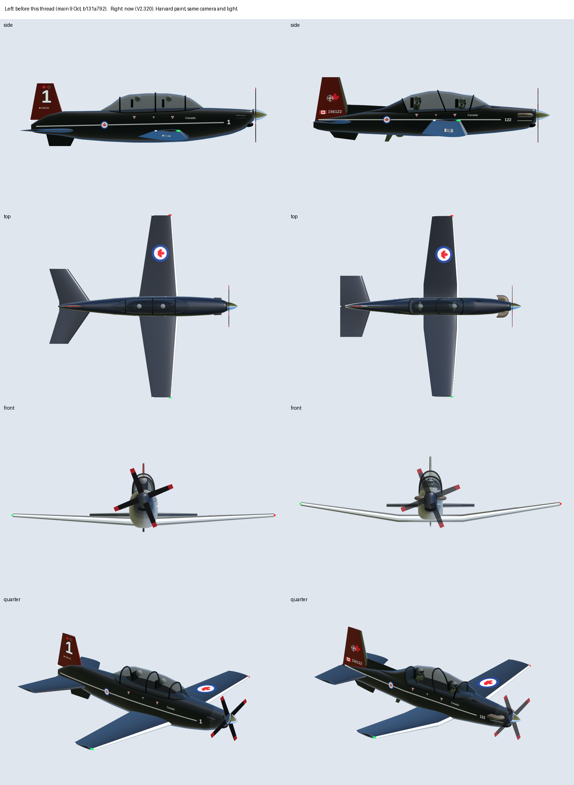
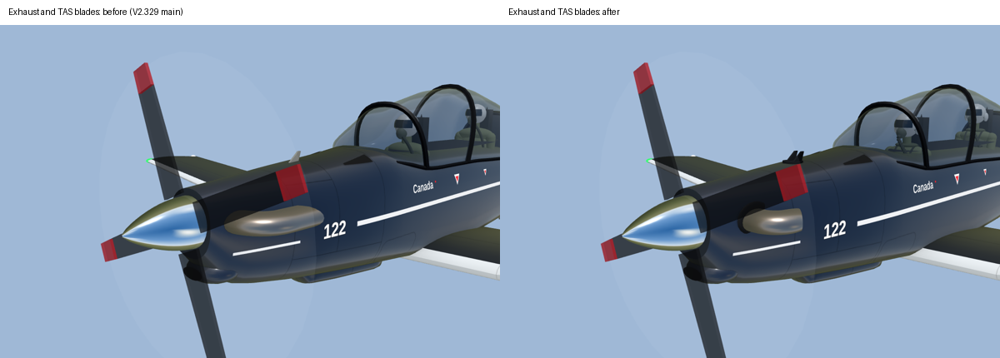
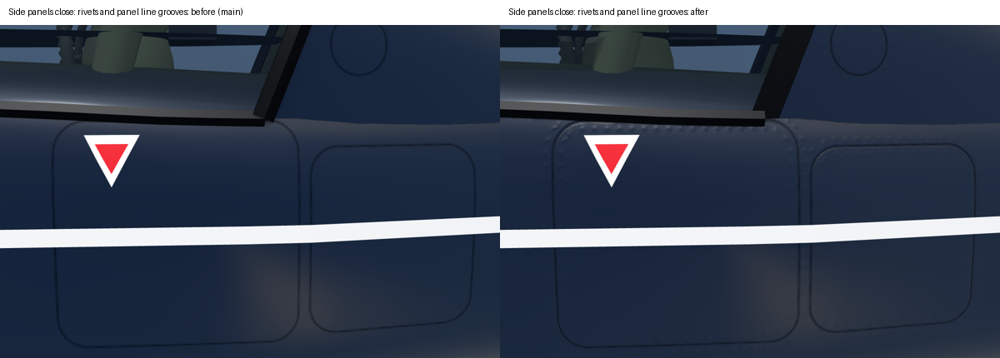
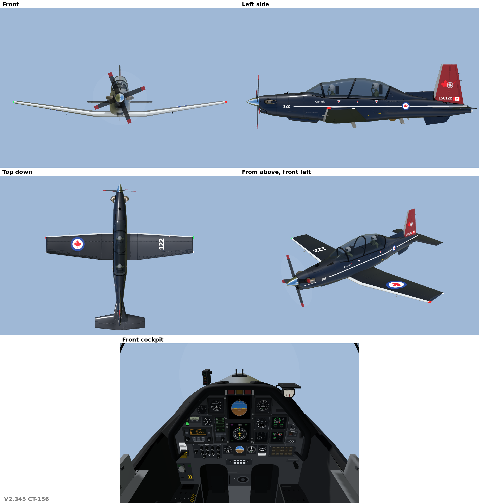
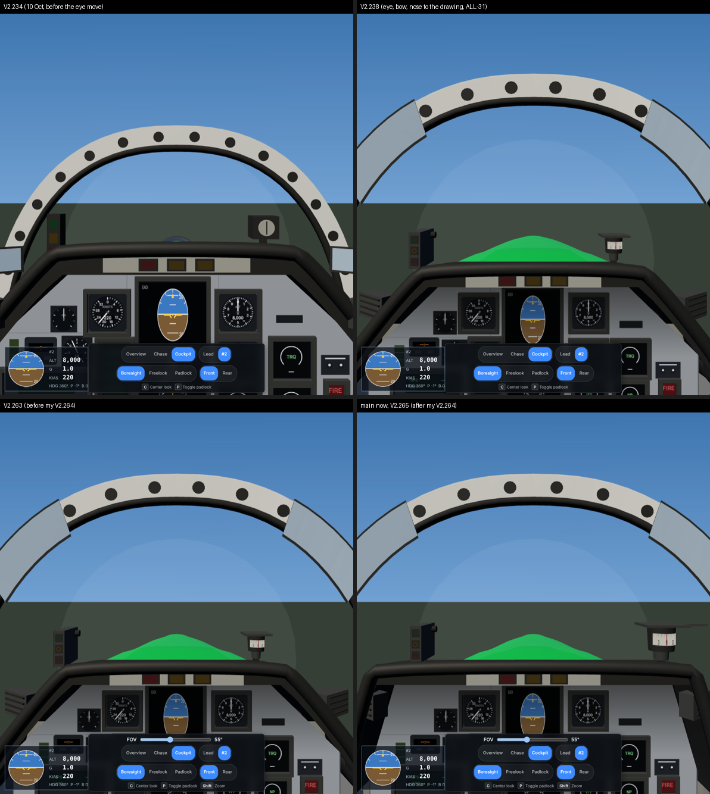
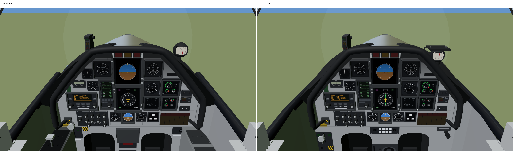
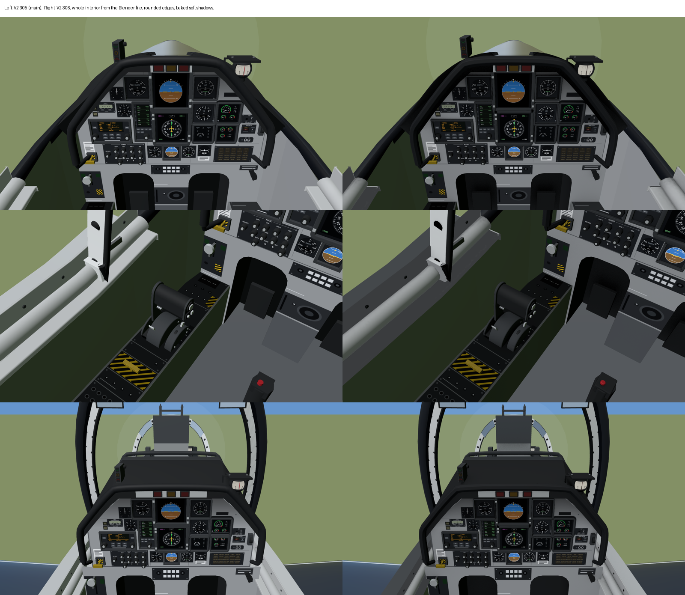
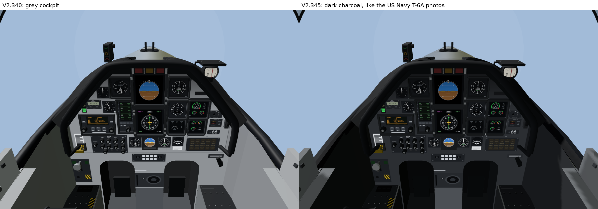

# How we built the CT-156 model

For Dad, from Patrick · 11 Oct 2026

## The short answer

The CT-156 went from a hand-coded sketch to a Blender-built model with a T-6A-style cockpit in about 40 merged versions (V2.235 to V2.345). Nearly all of it happened on 11 Oct 2026, between 01:00Z and 22:15Z. Patrick never wrote any code. He flew the model in his head, looked at every render, and told Claude what was wrong in pilot's words.

Three things made it work:

1. **Real references, measured, never copied.** Scaled side, top and panel views and SMM figures were measured for numbers and never copied. Patrick's own photos and his practice in the jet settled anything the views left open.
2. **Look at it every time.** Every change was rendered next to the version before it, and Patrick judged the picture, not the numbers.
3. **A fixed way of working.** One rule book, one thread per job, one writer per file, a second AI (Fable) to check the hard calls, and every change merged with its own version number.

## How the work was organised

The work ran in a Claude project: a group chat where each job gets its own thread, and each thread has its own Claude working in a copy of the repo.

- **Project chat and coordinator.** Patrick posts an ask in the project chat. A coordinator Claude opens a thread for it, keeps the project's memory and hands out version numbers.
- **The model thread.** One thread, "CT-156 model in Blender", owned the model. Before the handover it owned the outside; after it, the whole cockpit too. Nobody else edited those files.
- **Fable as reviewer.** A second model (Fable) ran in its own thread. It set the cockpit eye point from a scaled side view, did the first canopy and cockpit fixes, then handed the cockpit over (11 Oct 07:31Z). Patrick also used it to check the hard calls, like whether to tilt the model 2.5° nose down (it said no).
- **The rule book.** `AGENTS.md` sets the rules every thread follows: only the manuals in the project files are used; Patrick's words beat everything; one writer per file; confirm exact wording before writing a decision.
- **Decisions written down.** Choices that change the tool go into the decision rows (TS-157 for cockpit colours, ALL-31 for the eye point, ALL-33 for the Blender outside), word for word as Patrick approved them.

Each change went round the same loop:

1. Patrick says what looks wrong, often with a photo or a marked-up render.
2. Claude finds the cause, measures it against the scaled views, and says what it will change.
3. Claude builds it and renders the same views before and after.
4. Patrick looks. If it's right, it merges with the next version number and a git tag. If not, back to step 1.
5. Anything Patrick rules on goes into the decision rows and the project memory, so the next session starts from it.

## How the pictures were used

Every shape and size came from a picture with a known scale. Only the numbers measured off them were kept.

| Picture | What it gave us | How it was measured |
| --- | --- | --- |
| Scaled side, top and panel views | Fuselage outline and widths, canopy, wing, fin, tail, exhausts, the front pilot's eye, panel, consoles and power lever | Scaled from each view's own scale, one axis at a time. The KLN 900 GPS (5.75 × 3.75 in, from the maker's listing) checked the panel scale. |
| SMM Fig 3.5, 220 KIAS picture | Eye heights: horizon, glareshield and AOA indexer in the right place | Render from the eye at 220 KIAS laid over the figure. This raised the front eye 2 in and the rear eye 5.5 in. |
| SMM Figs 12.12 and 12.13, rear-seat views | Tie-down ring and belly antenna positions, used as formation references | Fitted a camera to known points, then traced each item's ray back to the wing or belly (about 5 px error) |
| Patrick's photos (156102, 156115, cockpit, his visor) | Paint, ship number 122, canopy bows, mirrors, glareshield depth, antenna colours | Compared by eye, side by side with the render |
| US Navy T-6A cockpit photos (public) | Dark charcoal cockpit colours | Compared by eye; Patrick approved the change (22:06Z) |

The working method was the same every time. Claude rendered the model from the same angle and scale as the picture, laid one over the other, and read off the difference in feet or inches. It changed one number in the model's tables and rendered again. Where a picture and Patrick disagreed, Patrick won: for example, the photos show canopy bows standing proud of the glass, and he ruled them flush.

**The Blender step.** The model's shape lives in code tables (stations, wing sections, fin, canopy). Since V2.306 (cockpit) and V2.328 (outside), a Blender script reads those tables, builds a proper mesh with rounded edges, and bakes soft shadows. Since V2.340 it also bakes rivets, panel lines and light grime. If the Blender file ever falls behind the tables, the tool shows the code model instead and logs "out of date", so a stale model can't slip through.

## Patrick's corrections and measurements

The scaled views got the model close; Patrick's flying knowledge made it right. These are the rulings that changed the model, newest first. Times are UTC on 11 Oct 2026.

| Time | Patrick's correction | What changed |
| --- | --- | --- |
| 22:06 | Use the US Navy T-6A cockpit colours | Panel, consoles, cushions and tub dark charcoal (V2.345) |
| 21:07 | Canopy bows flush with the glass, not bulging out | Bows rebuilt as a flat band in the glass (V2.340) |
| 20:32 | Rear-seat photos: "use angles to triangulate" | Tie-down ring and belly antennas placed by camera fit (V2.332) |
| 20:12 to 20:22 | Tie-downs and antennas must be right for formation references; two TAS blades; exhaust shape; white-tipped belly antenna; gear doors; speed brake opens with the boards and lights the SPEED BRAKE light | All built (V2.332) |
| 19:47 | The side view's overall length runs to the elevator trailing edge | Tail and wing re-measured; tail was about 1.5 ft too far aft (V2.328) |
| 10:05 to 10:15 | The power lever "exactly like the picture" | PCL rebuilt twice to match the picture (V2.300, V2.302) |
| 09:34 | Compass sits on a square top mount | Square flange added (V2.297) |
| 08:57 to 09:21 | EADI is round on a black square screen; glareshield top and diagonals off; compass a floating sphere; radio knobs; FIRE light on the wrong side | Panel redrawn to the panel layout (V2.287 to V2.293) |
| 08:34 | Front eye up "a hair" to match the 220 KIAS attitude | Rear eye raised 5.5 in; front checked within about 1° (V2.279) |
| 08:26 | Exhaust sticks out more: "look at the diagrams" | Stacks out to 25 in from the centreline (V2.278) |
| 07:39 | Whole cockpit 11 in forward, except the bow | Seat, eye, panel and glareshield moved (V2.271) |
| 07:00 | Front bow leans about 13° forward at the top | Bow lean set to 14.5°, Fable's reading of the side view (V2.270) |
| 06:29 to 06:43 | Middle bow tilts back; canopy convex, not concave; bow flush with the canopy | Canopy and arch reshaped (V2.257 onward) |
| 06:19 | Wings start fairly straight, then rise | Wing in three sections, dihedral 8.4° (V2.267) |
| 05:36 | Back of the canopy squared off; fuselage flows down into the tail, no bulky spine | Canopy end and spine rebuilt (V2.249, V2.257) |
| 03:06 | "The T-6 sits 2.5° nose up on the ramp" | Settled that the model's axis is the fuselage datum, so no tilt; front eye up 2 in instead |
| 02:39 | The GPS is a KLN 900 | Its real size checked the panel's scale |
| 02:33 to 02:37 | Mirrors on the front bow, covering the rail, not hanging down | Mirrors moved and reshaped (V2.238) |
| 02:26 | "The glare shield is more than an inch" | Glareshield lip 3 in deep (estimate) |
| 02:18 | Seat height rule: raise the seat until the surface under the three buttons just covers the top of the EADI | Used to set the eye height |
| 01:48 | The panel is drawn in the wrong spot; on the side view the bow and panel are apart | Panel moved back to the side view's position |
| 01:38 | At 220 KIAS the AOA indexer sits about its own height above the horizon | Became the check for eye height and panel position |

## How Patrick worded his prompts

Patrick wrote the way he'd brief a student: what looks wrong, what it should look like, and which reference proves it. He didn't need software words. The quotes below are his, with spelling tidied.

| What he did | His words | What it produced |
| --- | --- | --- |
| Gave a check a pilot would recognise | "At 220 knots it should be about the same distance from the horizon as it is tall (not exact?)" | A target the render could be measured against, which set the eye height and panel position |
| Pointed at the reference that settles it | "[This view is to scale], and you can see the edge of the instrument dash ahead of the bow. Can't you use that to estimate?" | The panel moved to where the side view puts it |
| Gave a known size to scale from | "The GPS is the KLN 900 so you can scale from that" (with the maker's link) | A cross-check on the whole panel's scale |
| Shared how it's done in the jet | "When we fly we raise the seat until the bottom of the surface just under the three buttons is just covering the top of the EADI" | The seat-height rule used to set the eye |
| Asked for the reasoning before deciding | "List our KNOWNS, our INDUCTIONS, our ASSUMPTIONS and what/where we would have to change to make this the 220 knot attitude accurately, then I will decide" | A clear choice between three fixes, with the trade-offs |
| Got a second opinion | "Send this to Fable and get its opinion" | Fable checked the tilt question independently before anything changed |
| Marked up the render | Comments pinned on a render: "too low? what's going on?", "also the exterior model is showing through?" | Exact spots to fix, with no guessing which part he meant |
| Asked to see before and after | "Show me what the exterior model looked like before we started, and now: top, front and side view. Then assess how to best improve it" | The side-by-side sheets in the annexes, and the plan to move to Blender |
| Gave the reason it matters | "Make sure the tie downs and antenna are in the right spot so that we can use the reference in formation flying" | Extra care on those parts: triangulated from rear-seat pictures, not eyeballed |
| Asked what's possible | "What else can we do to improve the outside? Textures? Shading? Details?" | A short list of options with a recommendation, then rivets, panel lines and shading |
| Gave broad scope when he trusted the direction | "Do one more pass on all of the instruments and paneling and details from all available sources" | A full panel pass in one piece of work |
| Answered in a word once he'd seen it | "Make it 122, all else the same" · "Yes, use that" | Fast decisions that kept the work moving |

Two habits mattered most. He always looked at the picture before saying yes, and he said when something was only a feeling ("not sure how to approach this"), so Claude came back with a way to measure it.

## Tips for your own sessions

These worked, and they fit the rule book your sessions already follow.

- **Start from the rule book.** Have each session read `AGENTS.md` and the module's folder first, so it knows the limits before it starts.
- **Send a scale with every picture.** A view with a scale bar, a part of known size (like the KLN 900), or a photo from a known seat works. Say which one is the reference.
- **Give a pilot's check, not a number.** "The AOA indexer sits about its own height above the horizon at 220" was more useful than any dimension.
- **Ask for before and after from the same camera.** Judge the picture, then say yes.
- **Mark up the render.** A comment pinned on the spot beats a description of where it is.
- **After two misses, stop and ask for the knowns and assumptions.** It's the rule book's two-failed-fixes rule, and it's what unstuck the 220 KIAS sight picture.
- **Pictures are for measuring only.** Only the numbers measured off a picture are committed.
- **Let Claude draft the wording, then approve it word for word.** Decisions go in only once you've said yes to the exact text.
- **Your pull requests come to Patrick.** Your sessions work on a branch and open a pull request; Patrick merges them.

## Annex A: the outside over time

The outside went from hand-written code shapes to a Blender mesh with rivets and grime in seven steps. All dates are 11 Oct 2026 unless marked.

| Version | What changed |
| --- | --- |
| V2.345 | Fin static wicks; yellow step stencils and access dots |
| V2.340 | Rivets, panel-line grooves, light soot and oil, flush canopy bows, real-time sun shadows |
| V2.332 | Tie-downs and belly antennas triangulated, two TAS blades, exhaust horn, gear doors, speed brake, better pilots |
| V2.328 | Outside built in Blender; tail and wing re-measured to the side view |
| V2.267 | 156102's paint with 122, wing in three sections with 8.4° dihedral, pilots and headboxes |
| V2.249 to V2.259 | Rounded spine, squared canopy end, fuselage width and fin to the top and side views, spinning prop |
| V2.238 | Outside to the scaled views: belly, fin height, tailplane span, dihedral |

**Before and after the first day of work: 9 Oct (left) and V2.320 (right).**

**V2.332: the exhaust horn and two TAS blades.**

**V2.340: rivets and panel-line grooves.**

**Now (V2.345): front, side, top and above front-left, plus the front cockpit.**

## Annex B: the cockpit over time

The cockpit started as your replica from your pictures (9 Oct). It was then moved to the side view's eye point, rebuilt to the panel and console layouts, and finally built in Blender.

| Version | What changed |
| --- | --- |
| V2.345 | Dark charcoal panel, consoles and tub, like the US Navy T-6A photos |
| V2.306 | Whole interior from Blender: rounded edges and baked soft shadows |
| V2.297 to V2.302 | Side consoles, power lever, park brake and compass mount to the console and power lever layouts |
| V2.298 | The eye leans up to 6 in to see Lead past the bow or glareshield |
| V2.283 to V2.293 | Panel redrawn to the panel layout: bezels, round EADI on a black screen, glareshield, compass, AOA indexer, real-looking displays |
| V2.279 | Rear eye 5.5 in higher, so the front headbox sits on the horizon at 220 KIAS |
| V2.275 | Forward bow and canopy rails from Blender |
| V2.271 | Whole cockpit 11 in forward to the side view's pilot |
| V2.264 to V2.270 | Fable's pass: canopy width, compass, bow 7 in forward with a 14.5° lean |
| V2.242 to V2.245 | Cockpit view 65° tall, Shift to zoom, a field-of-view slider starting at 55° |
| V2.235 and V2.238 | Eye, bow and nose to the side view; panel, indexer, compass, mirrors and seat height from Patrick's photos |
| V2.207 to V2.209 (9 Oct) | Your first replica of both cockpits, from your reference pictures |

**Front seat as the eye point moved: V2.234, V2.238, V2.263 and V2.265.**

**Panel and consoles to the layouts: V2.295 (left) and V2.297 (right).**

**Code interior (V2.305, left) against the Blender interior (V2.306, right).**

**Grey (V2.340) to dark charcoal (V2.345).**

