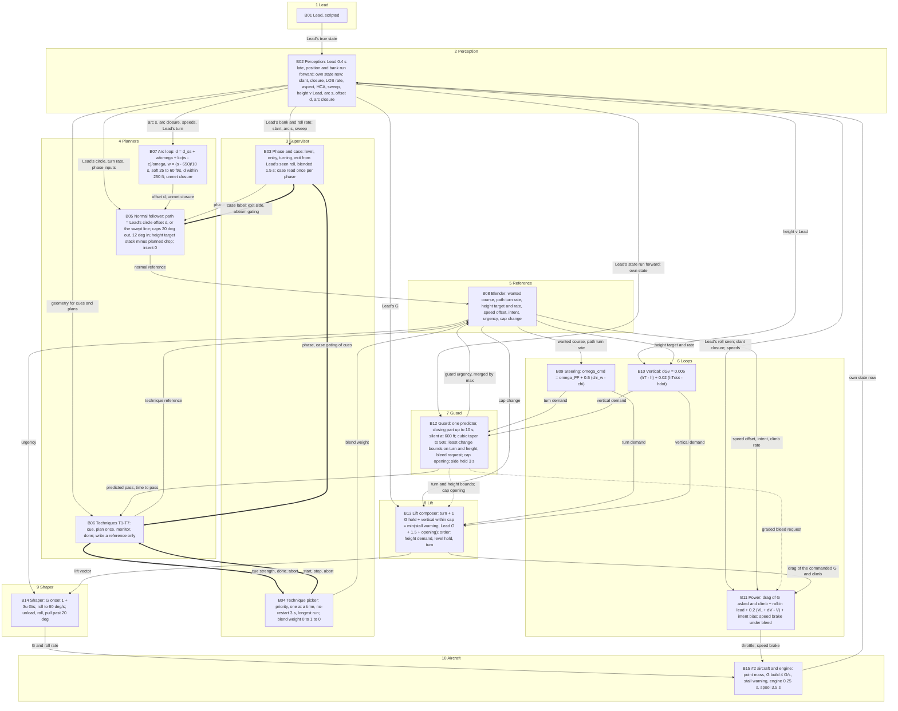
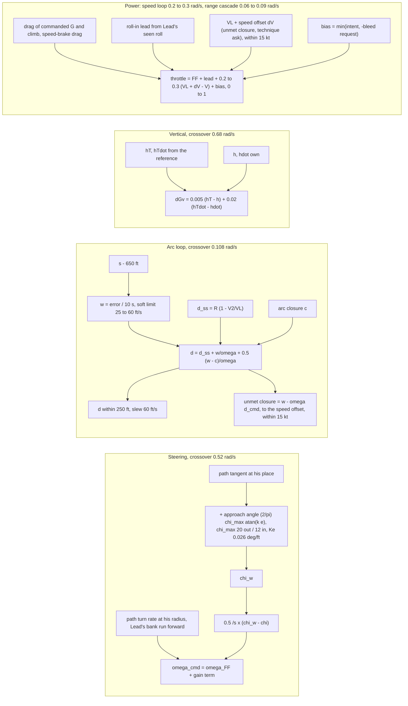

# Follow-up review: reconciliation with today's wiring, classification, gaps, diagram, pass clear, slices, rig steps, energy re-check

Givens folded in: pass clear's push by urgency (about 0.5 G ordinary, toward 0 G only when the pass is close); the trainer's acceleration in hand +1.85 kt/s at 1 G, +0.93 at 2 G, +0.24 at 2.5 G, −0.60 at 3 G, −2.75 at 4 G (sustained about 2.7 G); pass clear's energy intent from the picture; steering Kχ 0.5 /s, Ke 0.026°/ft; τ_s 10 s; speed brake only under a bleed intent (out > 60 ft/s for 1 s, in < 20 ft/s, held 3 s); the climb-out reset ends stacked low; D1, D3-D7, D9-D12, the cubic taper and the C10 definition approved. Finding numbers continue from D20.

## Headline

Reconciling against today's wiring found one real hole in brief 3 and one in my own tables:

- **D21 (fix before building).** Brief 3 has no range hold when Lead is level. Today the swept aim's power term does it (range ÷ 10 s → a wanted speed). The proposed design's arc loop sets d, which has no authority when ω → 0, and its "slow trim on speed against Lead" holds speed, not range. The fix is the approved D9 rule made general: the arc loop hands the closure its offset cannot give to the speed loop's set-point. In a 2 G turn with |d| < 250 ft that hand-off is zero (geometry owns closure); as Lead's radius grows the offset saturates and speed takes over, continuously. Sized below: range constant 15 s, speed loop proportional 0.2-0.3 /s.
- **D22 (fix before building).** My N² chart sent the turn and vertical demands to the guard to be bounded but never to the lift composer, and did not give the composer Lead's G for the cap. Corrected rows below.

All of today's seven harmful links are dropped or replaced by a limit or a request; all eight feeders are kept or completed. Four decision cells remain, all inside the supervisor-technique family.

## 1. Reconciliation of today's cells and feeders

| today's cell | in the proposed design | how / why |
|---|---|---|
| Lead → Perception | kept | B01 → B02, the one entry of Lead |
| Perception → Guard (slant, slant closure, Lead's turn) | changed | the guard reads dead-reckoned positions and velocities (S01, S02) and Lead's bank run forward by his seen roll rate (S03, D3); it predicts from geometry, not from the 1 s-smoothed slant closure (D11) |
| Perception → Jobs (slant, closure, Δh, Lead's bank, speed short) | changed | Jobs gone. Lead's bank and roll rate → phase (B03); slant, arc s, sweep → the case label (B03); "how far short of Lead's speed" → the arc loop's d_ss (S28) and the NF's planned drop low (D24), never a relay |
| Perception → Power (slant, slant closure) | changed | power reads slant closure only for the speed brake, and only under a bleed intent (S14 → B11); idle by closure threshold is dropped (idle only by intent) |
| Perception → Separation filter | dropped | the filter is removed; the guard is the one predictor |
| Perception → Height owner; climb-out (Δh, Lead's turn) | changed | Δh → the vertical loop (B10), the guard (B12) and the techniques that plan heights (B06); no height owner |
| Perception → Turn toward Lead first (Lead's bank) | dropped | the add-on is removed |
| Perception → Arc frame; arc loop; steering; Lead DR (bank, turn) | kept | Lead's turn (S05, S07) → B05, B07, B09 (the path's turn-rate feed-forward); the arc frame is folded into perception (S18-S20) |
| Perception → G cap (Lead's seen G) | kept | Lead's G (new S05b) → B13 for cap = Lead + 1.5 (D22) |
| Lead DR → arc frame, arc loop, swept aim, nose behind, steering, vertical PD, filter | kept / dropped | kept to the arc frame (in B02), the normal follower (B05), the guard (B12), height against Lead (S17); dropped to swept aim, nose behind, filter (all removed) |
| Aircraft → arc frame, steering, vertical PD, filter, lift, power, swept aim (own state) | kept | S08-S12 → B05-B13 |
| Arc frame → Arc loop (s, arc closure) | kept | S18, S20 → B07 |
| Arc frame → Climb-out (s, d, arc closure) | kept | S18-S20 → B06 T4, as its cue and plan inputs |
| Arc frame → Power (arc closure) | dropped | power's arc term goes; its one legitimate job (closure when the offset has no authority) is taken by D21's unmet-closure hand-off from the arc loop |
| Arc loop → Power (wanted closure; the closure the aim can't give) | changed | only the unmet part (S29b) passes, and only when d is at ±250 ft or ω is small; zero in a steady 2 G turn, so no second owner (D21) |
| Arc loop → Steering (offset command, aim point) | changed | the arc loop writes d (S30) to the normal follower's path; the aim point is gone; steering reads the wanted course and ω_FF from the blender |
| Swept aim → Arc loop; Power | dropped | the swept line is a path kind; its power term becomes the level form of D21 |
| Swept aim; turn toward Lead first; nose behind → Steering (aim point) | dropped | no aim point; three add-ons removed |
| Steering → Filter (aim line's turn; the turn asked) | dropped | the filter is gone; the turn asked (S31) goes to the guard to be bounded, and to the lift composer |
| Filter → Lift (the turn flown replaces steering's) | dropped | replaced by the guard's bound S37 (a limit, never a replacement) |
| Filter → G cap ("needs more G") | dropped | replaced by the guard's smooth cap opening S40 |
| Filter → Nose behind [decision] | dropped | both removed |
| Filter → Power [decision: hold → 20%] | dropped | replaced by the graded bleed request S39 |
| Filter → Height owner [decision] | dropped | no height owner; pass clear is a technique the supervisor picks |
| Guard → G cap (predicted pass; guard on) | changed | S40 cap opening, continuous 550 → 500 ft; "guard on" exists only as telemetry |
| Guard → Height owner; steering; power [decision: guard on] | dropped | replaced by S37/S38 bounds (limits) and S39 (request); pass clear's cue reads the predicted pass S35 (a signal), and the decision to start it sits in B04 |
| Jobs → Arc frame, arc loop, swept aim, nose behind, climb-out, filter [decision: Lead turning] | changed | the loops need no "turning" flag: Lead's seen turn rate is used continuously (ω → 0 gives the line); the phase weights S21 (continuous) go only to the normal follower and the techniques |
| Jobs → Power [decision: Lead turning, low inside] | dropped | energy travels as the intent (S27d) and the speed set-point offset (S29b); the drop low inside becomes a continuous height-target term (D24) |
| Jobs; height owner → Vertical PD (height target) | changed | one writer, the blender's S27c (target and rate, D1) |
| Climb-out → Height owner (its height) | changed | the technique's reference S26 → blender |
| Vertical PD → Filter (vertical G counted in the predicted slant) | kept | S32 → B12's predictor (physics) |
| Vertical PD → Lift | kept | S32 → B13, bounded by S38 (D22) |
| G cap → Lift | kept | composed inside B13 |
| Lift → Aircraft | kept | B13 → B14 (shaper) → B15 |
| Power → Speed hold (wanted speed) | changed | one power block; the speed loop's set-point is Lead's speed + the unmet closure (S29b), clipped ±15 kt |
| Power → Climb-out [decision: power back] | dropped | |
| Power; speed hold → Engine (throttle, idle, speed brake) | kept | S33, S34; idle continuous, the speed brake a switch under bleed intent only |

| feeder | today | proposed |
|---|---|---|
| turn G asked → power (drag of the G asked) | half there (drag of the G had) | completed: S44 from the lift composer carries the drag of the commanded G, before the shaper |
| bank → the lift's 1 G hold | there | kept in B13 |
| climb asked → power | missing | added: S27c's height-target rate and own ḣ → B11 (needs D1's height-rate field) |
| Lead's roll seen → power lead | missing | added: S03 (run forward by S04) → B11; the lead is the drag at Lead's expected end bank, ramped over his seen roll time, started when his seen roll rate passes about 10°/s (guess) |
| guard → energy | a 20% relay | the graded request S39 |
| vertical asked → the guard's prediction | there | kept (S32 → B12) |
| Lead's turn → steering | the aim line's turn (hidden feedback) | the path's turn rate at his radius, S27b, a true feed-forward; it also benefits from D3 because Lead's bank is run forward |
| speed → offset (d_ss) | there | kept (S28) |

Today's harmful links: power back → climb-out (dropped); filter line short → nose behind (dropped, both gone); filter hold → power cut and pass clear (dropped; request and technique pick instead); guard on → pass clear, aim blend, power integral (dropped; bounds, no aim, no integral: D23); low inside → full power and −300 ft past their owners (dropped; set-point offset and a continuous height term); aim-line turn fed forward (dropped; true feed-forward); arc error → power (dropped; replaced by the unmet-closure hand-off, which is zero whenever the offset has authority).

## 2. Classification of the proposed N² cells

P = physics or a reference signal, L = limit, Q = request, D = decision or switch state.

| cell | passes | class | verdict |
|---|---|---|---|
| B01 → B02 | Lead's true state | P | |
| B15 → B02 | own state | P | |
| B02 → B03 | bank, roll rate, slant, arc s, sweep | P | |
| B02 → B05, B06, B07, B10, B11, B12 | geometry and Lead's turn | P | |
| B02 → B13 | Lead's G (new) | P | D22 |
| B03 → B05 | phase weights | P (continuous) | |
| B03 → B05 | case label (exit side, placement) | D | acceptable: a plan choice made once at a phase start, held through the phase, with a ±50 ft dead band on the stretched/tight read; stretched and tight placement during the turn is already continuous through the arc loop, so the label decides only the exit line's side and the abeam gating |
| B03 → B06 | phase weights; case | P; D | acceptable (supervisor family) |
| B04 → B06 | start / stop / abort | D | acceptable: the intended channel |
| B04 → B08 | blend weight | P (continuous) | |
| B05 → B08, B06 → B08 | the two references | P | |
| B06 → B04 | cue strength, done, abort | D | acceptable, with D6's bands and dwells |
| B07 → B05 | d; unmet closure (new) | P | D21 |
| B08 → B09, B10, B11, B13, B14 | wanted course, ω_FF, h_T and ḣ_T, Δv_ref, intent, cap change, urgency | P | |
| B09 → B12, B10 → B12 | the demands, for prediction and bounding | P | |
| B09 → B13, B10 → B13 | the demands, to be composed (new) | P | D22 |
| B12 → B13 | turn and height bounds; cap opening | L | continuous |
| B12 → B11 | bleed request | Q | graded |
| B12 → B08 | guard urgency | P (merged by max) | |
| B12 → B06 | predicted pass, time to pass | P | pass clear's cue reads it; the decision is B04's |
| B13 → B11 | drag of the commanded G and climb | P | |
| B13 → B14, B14 → B15, B11 → B15 | lift, rates, throttle, speed brake | P | the speed brake is a switch inside B11; a physical step with a band and a hold: acceptable |
| inside B12 | side choice held 3 s | D (internal) | acceptable: does not cross a block boundary |

Four decision cells cross a boundary, all between the supervisor and the technique family or from the supervisor to the normal follower. None reaches a loop, the guard, the composer or the shaper.

## 3. Gaps

| gap | kind | fix |
|---|---|---|
| no range hold when Lead is level (brief 3) | needed link missing | D21: the arc loop's unmet closure → the speed loop's set-point; the range cascade sized below |
| the lift composer never receives the demands (my table) | needed link missing | D22: B09 → B13 ω_cmd, B10 → B13 ΔG_v; B02 → B13 Lead's G |
| the close-formation pattern has no integrator in power; brief 3's slow PI would wind against the intent bias and need a freeze (a switch) | pattern not followed | D23: proportional speed loop, the feed-forwards do the steady work |
| the close-formation "place's motion fed into the lift" | its trail-cone equivalent is ω_FF at his radius, present; D3 makes it lead like close formation's 0.3 s-ahead lift | none |
| the close-formation "pace cascade with braking taper" | equivalent: the arc loop's soft closure limit, present | none |
| speed brake drag → the power feed-forward | physics cross-feed inside B11 | add: while the brake is out its drag enters the throttle feed-forward so the speed loop is not surprised |
| the guard's predictor on the bounded or the raw demands | ambiguity | the predictor runs on the raw demands (S31, S32), finds the least change, and the bounds are the result; it reads the achieved state from B15 for the start point |
| B12 → B06 (predicted pass to pass clear) | new link, purpose stated | keep: one predictor for both the guard and pass clear's cue (brief 3's intent) |
| new links with no stated purpose | none found | |

## 4. Gate re-checks on the reconciled tables

**C1 one owner.** Turn: B09 writes, B12 bounds, B13 composes in the cap order, B14 rate-limits: pass. Height increment: B10 writes, B12 bounds (D16's rule: a bound below the demand makes the guard the effective writer of an escape, written down). Height target: B08 only. Throttle: B11 only, by a sum rule like close formation's: throttle = feed-forward (drag of commanded G, climb, speed-brake drag) + roll-in lead + Kv (V_L + Δv_ref − V) + bias, bias = min(intent, −bleed request) × full authority, clipped 0-1. Closure, the one shared outcome: geometry first (d within ±250 ft), speed gets the remainder; a stated rule, zero contest in a steady turn. Speed brake: B11, one switch. Cap: B13 computes, B12 opens. Urgency: max. Pass on paper; the runtime-contest line (none over 1 s) is for the gauge.

**C5 interaction.** Arc ↔ speed: in a 2 G turn with |d| < 250 ft the speed loop cannot change closure (d_ss hands it back) and the arc loop barely changes drag (the G at radius R − d differs from Lead's by d/R, under 10%), so the paired relative gains are about 1 and 1; when Lead is level the offset has no authority and speed is the only closure tool, one loop; in between it is a cascade with the remainder rule, not two loops on one error. Steering ↔ vertical: independent components of the lift vector below the cap; at the cap the allocation order makes the pairing triangular (the vertical gives, the turn does not), which is the stated cross-feed. Guard ↔ loops: nothing while silent. Pass on paper; the rig's 2×2 steps confirm (closing one loop moves another's crossover under 30%).

**C6 switches.** Remaining switch-like events and their bands: speed brake out > 60 ft/s for 1 s under bleed intent, in < 20, held 3 s (band 40 ft/s; today's ripple 25 was the 1 s-smoothed, 0.4 s-late closure; after D11 the ripple is unmeasured, so slice 0 measures it and the in-level drops to 10 ft/s if the ripple is over 20); phase from Lead's dead-reckoned bank 10°/5°, ripple near zero, two changes a turn; the case read once per phase with a ±50 ft dead band; the guard's side held 3 s; technique cues per D6 (pass clear on p < 600 closing for 0.1 s, done p > 650 opening for 2 s; climb-out on arc closure > 15 ft/s for 2 s, done < 5 for 5 s; S-turns on < 575 ft, done > 650 for 5 s; exit vertical on error > 150 ft or closure > 20, done < 50 ft and closure < 10 for 5 s; cut-across 1,000/900, 3 s dwell), each with the 3 s no-restart. Job switches ≤ 3 a turn: two phase changes plus at most one technique by construction. No switch that only changes a label: the case label drives the exit side and the abeam gating and nothing else. Pass with the bands written; two ripples (arc closure, dead-reckoned slant closure) to be measured in slice 0.

## 5. Changed rows

| table | row | change | reason |
|---|---|---|---|
| signals | S05b Lead's G (G, B02 → B13, L) | added | the cap needs it (D22) |
| signals | S29b unmet closure (ft/s, B07 → B05 → S27g; L; ±15 kt as a speed offset) | added | D21 |
| signals | S27g Δv_ref (kt, B08 → B11) | added: the speed loop's set-point offset, the blend of the NF's S29b and a technique's | D21; techniques may ask a speed (steer-behind, cut-across) |
| signals | S25 h_T from the NF | stack − k_e × max(0, speed deficit − 5 kt), k_e about 20 ft/kt (12 ft per ft/s), capped −300 ft, blended over 4.3 s; every foot below 100 ft under the stack counted | ruling 13 as a continuous term, not a relay (D24, a guess for the instructor) |
| signals | S34 speed brake | out > 60 ft/s for 1 s and effective intent ≤ −0.5; in < 20 ft/s or intent > −0.2; held ≥ 3 s; its drag into the feed-forward | the ruling |
| signals | S35 predicted pass | computed on the raw demands S31, S32 from the achieved state | ambiguity closed |
| N² | B09 → B13 ω_cmd; B10 → B13 ΔG_v | added | D22 |
| N² | B02 → B13 Lead's G | added | D22 |
| N² | B07 → B05 adds unmet closure | added | D21 |
| N² | B08 → B11 adds Δv_ref | added | D21 |
| resource | throttle | sum rule above; speed loop proportional, no integrator | D21, D23 |
| resource | closure (shared outcome) | geometry first, speed the remainder | D21 |
| blocks | B07 Arc loop | also writes the unmet closure; in level flight (ω under about 0.02 rad/s, R over about 20,000 ft) its offset saturates and the whole wanted closure is unmet | D21 |
| blocks | B06 T1 pass clear | plans a vertical profile with a push by urgency (section 7) | D1 and the ruling |
| blocks | B06 T4 climb-out reset | ends on Lead's circle behind him, stacked low | correction |
| sizing | power | speed loop proportional Kv 0.2 /s (crossover 0.2 rad/s, PM 92° / 88°, extra delay 8 s); Kv 0.3 (0.3 rad/s, 89° / 82°, 5 s). Full-power saturation at 1.85/0.2 = 9 kt of error at 1 G, 0.93/0.2 = 4.7 kt at 2 G | D23 replaces the PI rows |
| sizing | level range loop (new) | w = (s − 650)/τ_r → set-point → speed loop → closure → s. τ_r 15 s, Kv 0.2: crossover 0.059 rad/s, PM 75° / 73°, GM 36 / 28 dB, extra delay 22 s, speed ÷ range = 3.4 (C4 pass). τ_r 10 s, Kv 0.2: 0.086 rad/s, 68° / 66°, ratio 2.3 (C4 fail). τ_r 10 s, Kv 0.3: 0.091, 74° / 72°, ratio 3.3 (pass) | D21. Recommend τ_r = τ_s = 10 s only if Kv = 0.3; otherwise 15 s. One constant for both forms is cleaner: τ 10 s with Kv 0.3 is my starting choice (guess) |
| sizing | arc loop in a turn | unchanged: τ_s 10, kc 0.5, crossover 0.108, PM 90° / 88°, GM 24 / 12 dB; in a turn the speed loop does not sit inside it (d_ss), so no nesting claim between them | |
| gates | C10 | counted by the approved definition: normal follower, loops, guard, perception, phase ≈ 48 numbers; technique constants ≈ 36 (pass clear now 8); switches that write a control: 1 (speed brake) | |

## 6. The recommended structure

Boxes and arrows, as a list:

1. Lead → Perception: Lead's true state.
2. Perception → Phase and case: Lead's bank and roll rate; slant, arc s, sweep. → Normal follower, arc loop, techniques, vertical, power, guard, lift composer: the geometry each needs (above), all Lead-dead-reckoned or own-now.
3. Phase and case → Normal follower and techniques: phase weights (continuous); the case label [decision]. Picker → techniques: start, stop, abort [decision]; techniques → picker: cue, done, abort [decision]. Picker → blender: the weight.
4. Arc loop → Normal follower: d and the unmet closure. Normal follower and the active technique → Blender: two references.
5. Blender → Steering: wanted course and the path's turn rate; → Vertical: height target and rate; → Power: speed offset, intent, climb rate; → Lift composer: cap change; → Shaper: urgency.
6. Steering and Vertical → Guard and Lift composer: their demands.
7. Guard → Lift composer: bounds and cap opening [limit]; → Power: bleed request [request]; → Blender: urgency; → Pass clear: predicted pass.
8. Lift composer → Power: drag of the commanded G and climb; → Shaper: the lift vector.
9. Shaper → Aircraft: G and roll rates. Power → Aircraft: throttle and the speed brake.
10. Aircraft → Perception: own state now.

Level 2, the loops alone:

## 7. Pass clear, re-planned (every number a guess unless marked)

Cue: the guard's predicted pass p < 600 ft and closing, with 3 s ≤ t_pass ≤ 10 s, for two steps; the picker starts it unless a higher priority is running or the no-restart (3 s) holds.

Urgency at planning: u = clip((8 − t_pass) ÷ 5, 0, 1): 1 at 3 s or less, 0.4 at 6 s, 0 at 8 s or more (brief 3's two points).

Plan, sized once:
- Depth: h = √(D² − p²) with D 625 ft (ruling 12), below unless already more than 100 ft above Lead (ruling 4). From tight (p ≈ 355 ft) h ≈ 515 ft.
- Push: the vertical G factor n_p = 0.5 (1 − u): 0.5 G for an ordinary drop (u 0), 0.3 G at u 0.4, toward 0 G only at u near 1 (the instructor's answer). In a turn this is "relax some G": the same lift reduction eases the turn (he drifts out) and sinks him.
- Profile: ramp the vertical demand to n_p at the shaper's onset for u (1 + 3u G/s), hold until the planned height rate is reached, pull back at n_p' = 1 + (1 − n_p) to arrest at h, then the hand-back climb to the stack over 15 s. Reach, push and pull symmetric: at 0.5 G, 145 ft in 6 s, 258 ft in 8 s, 402 ft in 10 s; at 0.3 G, 203 ft in 6 s, 361 ft in 8 s; at 0 G, 290 ft in 6 s, 515 ft in 8 s (computed from ½ a t²).
- Least turn mix (D4 approved): when the vertical alone will not reach 625 ft of slant by t_pass, the guard adds the least turn away that makes it: Δω ≈ 2 Δq ÷ (V t_pass²), Δq the in-plane shortfall. From tight at 0.5 G: t_pass 8 s, h 258 ft, in-plane needed 569 ft, Δq 214 ft, Δω 0.018 rad/s (1.0°/s, about 3° of bank at 60°); t_pass 6 s, Δω 0.037 rad/s (2.1°/s, about 6° of bank); t_pass 4 s, 0.088 rad/s (5°/s, about 15° of bank). The mix is small because the turn's effect grows with t_pass². It is a plan quantity, re-planned if p drifts 50 ft below the plan.
- Energy intent from the picture at planning (the instructor's model): if closing over 20 ft/s or predicted inside 600 ft of arc at hand-back, bias −0.5 (bleed; the speed brake if closure exceeds 60 ft/s for 1 s); if predicted stretched beyond 750 ft at hand-back, +0.5 (gain); else 0. The descent itself trades about 12 ft of height per ft/s: a 300 ft drop gained and later spent is about 15 kt, so the bias is sized on the predicted range at hand-back, not on the dive.
- Heading roughly held (ruling 4): ω_FF held at its value at the cue, course gain working; the guard's turn bound may add the mix above.
- Monitor: re-plan if p falls 50 ft under plan or t_pass shortens by 2 s; nothing to abort to (pass clear is the bottom).
- Done: p > 650 ft and opening for 2 s, and the height profile at or past its bottom; longest run 15 s. Hand-back: the path slides to Lead's circle from outside over 6 s (D5), height to the stack over 15 s, Δv_ref from the arc loop.
- Numbers: D 625 (ruling), t_pass window 3-10, the u line (8, 5), n_p = 0.5 (1 − u), 50 ft re-plan, 650 ft done, 2 s dwell, 15 s longest, 6 s and 15 s hand-back: 8 of its own beyond the shared ones.

Gauge case: tight (560 ft, 45° sweep), Lead rolls toward him at 30°/s to 60°: least slant ≥ 500 ft, the pass at 625 ± 100 ft, the push starts at about 0.5 G and goes lower only if t_pass is under about 5 s, he ends outside Lead's circle and recaptures within 30 s, speed within 15 KIAS of Lead at the end.

## 8. The build plan, re-cut

Every slice is behind the switch (today's law is the default), keeps the close-formation and four-aircraft traces, runs model-first, and reports what it removed. Gates in brackets are the ones judgeable for that slice.

| slice | builds | removes | acceptance (academic set, plus the named case) |
|---|---|---|---|
| 0 | perception onto the one delay rule (Lead dead-reckoned, bank run forward by his seen roll rate; own state now); slant closure from velocities; the model rows for the whole design; the rig steps of section 9; ripple measurements of arc closure and slant closure | the 1 s closure smoother; the whole-picture delays | traces unchanged within the shared margins; the two lags measured; both ripples reported [C11] |
| 1 | the reference record and blender; the lift composer with the cap order and a 0.2 G soft knee; the shaper with onset by urgency (u = 0 for now); today's law rewritten to write the reference | today's lift rule (hold and vertical first); the pitch-owner priority as a mechanism (today's owners still write the target through the blender) | a pure refactor: traces unchanged within the shared margins; forced G-cap case (Lead scripted at 3.5 G, #2 inside and gaining): the height demand gives way before the turn [C1, C8, C11] |
| 2 | normal follower (path, caps, Kχ 0.5, Ke 0.026°/ft); arc loop at ±250 ft with the unmet-closure hand-off; the level range form; the speed loop proportional with the set-point offset | the aim point, turn toward Lead first, nose behind, the aim-turn cap, the always-on aim blend, power's arc term, the swept aim's power term, the idle-by-closure switch | cases with sweep ≥ 30° only: no wrong-way roll; at most 2 s a turn over Lead's G + 0.5; onset about 1 G/s; every turn ends 500-900 ft; settled on the swept line within 30 s of wings level with closure under 10 ft/s; the design sketch's captures inside ±250 ft; add 90° and 180° turns to the set [C2, C4, C5, C11, C3] |
| 3 | the guard as a constraint: one predictor on the raw demands, the cubic taper, least-change bounds, vertical escapes (below by default), side held 3 s, the cap opened smoothly, the bleed request (no reader yet) | the guard's on/off lines and holds, the second predictor (filter), the power cut, the guard owning height | guard active under 10% of each turn, none in steady turning; a pass predicted near 550 ft gets onset near 1.4 G/s; never inside 500 ft beyond a brief, shallow entry in the sweep ≥ 30° cases; no case breaks at +0.2 s [C7, C3, C6] |
| 3a | phases from Lead's seen roll, blended 1.5 s; the case read once per phase with a ±50 ft dead band; a reversal as exit then entry | the jobs, their hysteresis, the 1 s turn-start hold, the quick fix | settled in the cone within 30 s of wings level; a reversal flown as an entry; phase changes ≤ 2 a turn, no flicker [C6] |
| 3b | the picker (priority, no-restart, longest run); the vertical's height-and-rate reference with blended targets (pulled forward from 5); pass clear as in section 7; the checker rule that a technique writes only the reference | the stack-family relays for height | tight with Lead turning toward him: vertical first and below, push about 0.5 G, least slant ≥ 500, pass 625 ± 100, ends outside and recaptures within 30 s; pass clear runs only where its cue says [C6, C7, C1] |
| 4 | energy: drag of the commanded G and climb fed forward, speed-brake drag, the roll-in lead, intent bias, the bleed request read, the speed brake under bleed only, the continuous drop-low term (D24) | the low-inside relay, the filter and climb-out throttle relays, the speed hold's separate wanted-speed chain | within 15 KIAS of Lead at each turn's end; fewer than 5 torque swings a turn; full power and idle only by intent or the saturated speed loop; throttle rises with G in keep phases [C9, C1] |
| 5 | exit vertical; S-turns | the 300 ft-low owners | ends within 200 ft of Lead's height; no more than 100 ft below the stack outside a planned technique, every drop counted; settled within 30 s [C6] |
| 6 | abeam counts as the trail cone; steer-behind from abeam (geometric reversal cue first) | - | truly abeam (20° sweep): never banks with Lead toward him; never ahead of the wing line; never inside 500 beyond a brief entry; captured behind Lead within 30 s [C6, C7] |
| 7 | climb-out reset (ends stacked low), cut-across, back behind the wing line | - | each technique's own case; each rare in the academic set; structure review [C10] |
| 8a | climbs and descents (the line in Lead's flight-path plane) | - | the descent under Lead's G + 1.5; in the cone throughout |
| 8b | the hard-manoeuvring Lead (to 4 G, 90°/s, reversals) | - | the academic lines, stretching allowed while Lead manoeuvres; #2's speed loss accounted (section 10) |

Each slice adds one loop group (0 perception, 1 the composer and shaper, 2 steering, arc and speed, 3 the guard, 3a phases, 4 power's feed-forwards) or one technique family (3b, 5, 6, 7), and the wingman flies after each because today's law stays the default and each slice's own switch is tested from the default start. Structure reviews after 3b and 7.

## 9. Rig steps for slice 0

Turn-rate lag (what the steering margins depend on):
- Trims: T1 (Lead level, #2 at the swept place, 200 KIAS, 8,000 ft); T2 (Lead's 60° / 2 G turn, #2 650 ft of arc back on his circle); T4 (Lead at 4 G).
- Open the loop: hold the steering's course gain at zero and feed a step straight into the lift composer's turn demand.
- Steps: +0.02 rad/s (1.1°/s: about 13° of bank at T1, 3.4° at T2, 1° at T4) and +0.05 rad/s (2.9°/s: about 30° of bank at T1, where the roll-rate limit shows). Both signs at T2.
- Read: achieved course rate (own velocity direction, now) against time; fit a pure delay plus a first-order lag (time to 63% after the delay); record the roll-rate-limited portion for the larger step separately.
- Verdict lines (steering Kχ 0.5, Ke 0.026°/ft, whole picture 0.4 s): lag 0.3 s gives PM 51°, 0.4 s 48°, 0.5 s 46°, 0.6 s 43° (C2 fails past about 0.52 s under the whole-picture test; under Lead-only the limit is 1.0 s). If the measured lag is 0.5-0.8 s, fall back to Kχ 0.4, Ke·V 0.13 (PM 51-57° at 0.4-0.5 s lag).

G lag (what the vertical margins depend on):
- Trims: T1 and T2.
- Open the loop: hold the vertical PD at zero and feed +0.2 G and −0.2 G steps into the composer's vertical demand (the −0.2 G step at T1 also measures the push response pass clear relies on).
- Read: own normal acceleration and height rate against time; fit a pure delay plus a first-order lag.
- Verdict lines (0.005 / 0.02, whole picture 0.4 s): lag 0.1 s gives PM 50°, 0.2 s 46.5°, 0.25 s 44.6°, 0.3 s 42.8°; under Lead-only, 0.5 s 51°, 0.7 s 44.6°. C2 fails past about 0.22 s under whole picture and about 0.7 s under Lead-only. If the measured lag is over 0.2 s, use 0.004 / 0.02 (PM 54° at 0.1 s; about 48° at 0.25 s) or accept the Lead-only verdict, since after slice 0 the whole-picture delay no longer exists.

Also in slice 0: engine step (+10% throttle at T1, read acceleration; confirm 0.25 s and the +1.85 kt/s in hand); ripple of arc closure and of the dead-reckoned slant closure in a steady T2 and T1 (sets the speed brake's in-level and the climb-out cue band, C6); and a step on the speed loop (set-point +5 kt at T1) to confirm Kv's crossover.

## 10. Re-check with the corrected energy numbers

- D14 is withdrawn for Lead's 2 G: #2 has +0.93 kt/s in hand at 2 G, so the sustained academic turn is physical and the scripted constant-speed Lead is fair. D14 stands only above about 2.7 G (sustained): at 3 G #2 loses 0.6 kt/s, at 4 G 2.75 kt/s even at full power, so the hard set (8b) and any time the guard opens the cap bleed energy by physics. 8b's acceptance should count that loss rather than demand speed within 15 KIAS.
- Slice 4's "within 15 KIAS of Lead at each turn's end": reachable. At 2 G full power regains 10 kt in 11 s and 20 kt in 22 s; a 30 s academic turn allows a deficit of up to about 25 kt at entry to be back inside 15 KIAS. In the instructor's real 90-180° turns (11-21 s at 8.4°/s) only 10-20 kt can be regained, so for those the line should read "within 15 KIAS at the end of the exit settle (30 s)", not at roll-out.
- The drop low inside (ruling 13): still a planned trade, 300 ft ≈ 15 kt, but needed less often than I implied: only when the deficit exceeds what 0.93 kt/s recovers before roll-out, roughly 10 kt in a 90° turn, 20 kt in a 180° turn. D24's continuous term starts at a 5 kt deficit with 20 ft per kt (guess), which at 10 kt slow is 100 ft (the counted line) and at 20 kt 300 ft (the cap).
- The speed loop: proportional 0.2 /s saturates at full power beyond 4.7 kt of deficit at 2 G and 9 kt at 1 G, so "full power when slow" happens through the loop, no relay. The PI trim and its 15 KIAS figure are gone (D23); the 15 kt now clips the set-point offset.
- The ±250 ft authority (D9): unchanged at 2 G (d_ss 11.5 ft per knot slow). At 4 G d_ss is 5.2 ft per knot, so 27 kt lost over 10 s at 4 G costs only 143 ft of offset: the authority question is worst in gentle turns, where the unmet-closure hand-off (D21) carries the rest.
- Pass clear's energy: no fixed rule, set at planning (section 7).

## New findings

- **D21 (fix before building, slice 2).** No range hold when Lead is level in brief 3; the arc loop's unmet closure must feed the speed loop's set-point (the approved D9 rule made general). Evidence: with ω → 0 the offset has no authority; brief 3's slow trim holds speed, not range; today the swept aim's power term does this job and is on the removal list with no replacement. Cascade sized: τ 10 s with Kv 0.3 (ratio 3.3, PM 72-74°) or τ 15 s with Kv 0.2 (ratio 3.4, PM 73-75°). Gauge case: Lead level, #2 released 150 ft stretched and 100 ft off the swept line: back within 50 ft of 650 ft and closure under 10 ft/s in 30 s with fewer than 5 torque swings. Confidence high.
- **D22 (fix before building, slice 1).** My N² chart omitted the demands to the lift composer and Lead's G for the cap. Corrected rows in section 5. Confidence high.
- **D23 (can wait, slice 4).** Drop the speed loop's integrator: close formation has none, the feed-forwards do the steady work, and a PI would wind against the intent bias and need a freeze (a switch state inside power). Cost: −2 numbers (Ti, the freeze); margins 88-92°. Confidence medium-high (residual steady speed error is model error, a few knots).
- **D24 (note, a guess for the instructor).** The drop low inside as a continuous height-target term in the normal follower (stack − 20 ft per knot of deficit beyond 5 kt, capped −300 ft, counted against the 100 ft line) rather than a relay or a technique. Confidence medium.
- **D25 (note).** The speed brake's band (40 ft/s) against the new closure ripple is unmeasured; slice 0 measures it; drop the in-level to 10 ft/s if the ripple exceeds 20 ft/s.
- **D26 (note).** The academic set's 30 s turns are longer than the instructor flies; add 90° and 180° turns to the set from slice 2, and judge speed at the end of the exit settle, not at roll-out, for those.

## Questions for the instructor

1. D24's drop-low term: start at a 5 kt deficit, 20 ft per knot, cap 300 ft, or keep the drop a planned technique that fires only when power cannot recover the deficit before roll-out?
2. The one range constant: 10 s for both the turn (offset) and the level (speed) forms with a 0.3 /s speed loop, or 10 s in the turn and 15 s level with 0.2 /s? (My recommendation: one constant, 10 s, Kv 0.3.)
3. In a 90° turn (11 s) only about 10 kt can be regained at 2 G: is "within 15 KIAS at the end of the exit settle" the right line for those turns?

## Notes

- The arc loop's level form needs the radius clipped (about 20,000 ft, guess) so d_ss and d/ω stay finite as Lead rolls level; past the clip the offset is simply saturated and the hand-off carries everything.
- The lift composer's soft knee (0.2 G below the cap) is a new number; it replaces the step that today's priority cut made.
- No file was opened; the two scratch computations sit in the session scratchpad. Observations: none logged (read-only design review).
