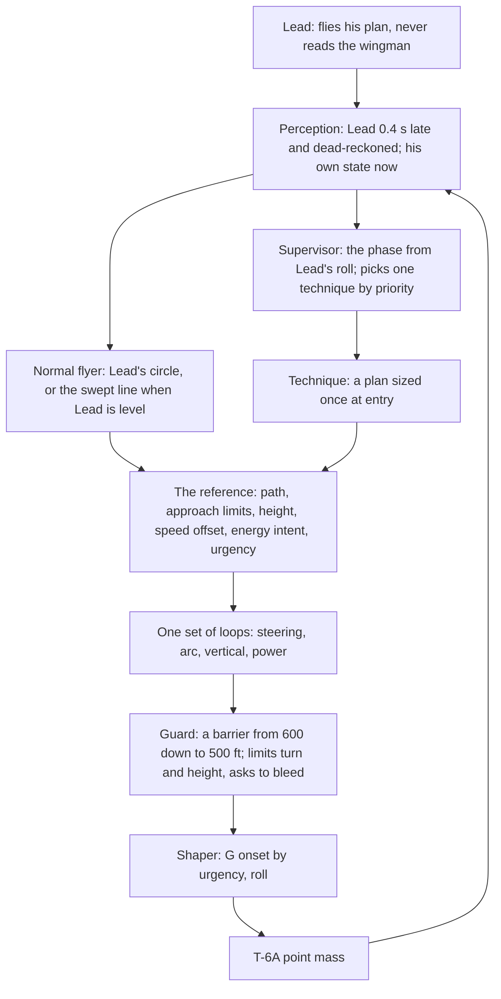
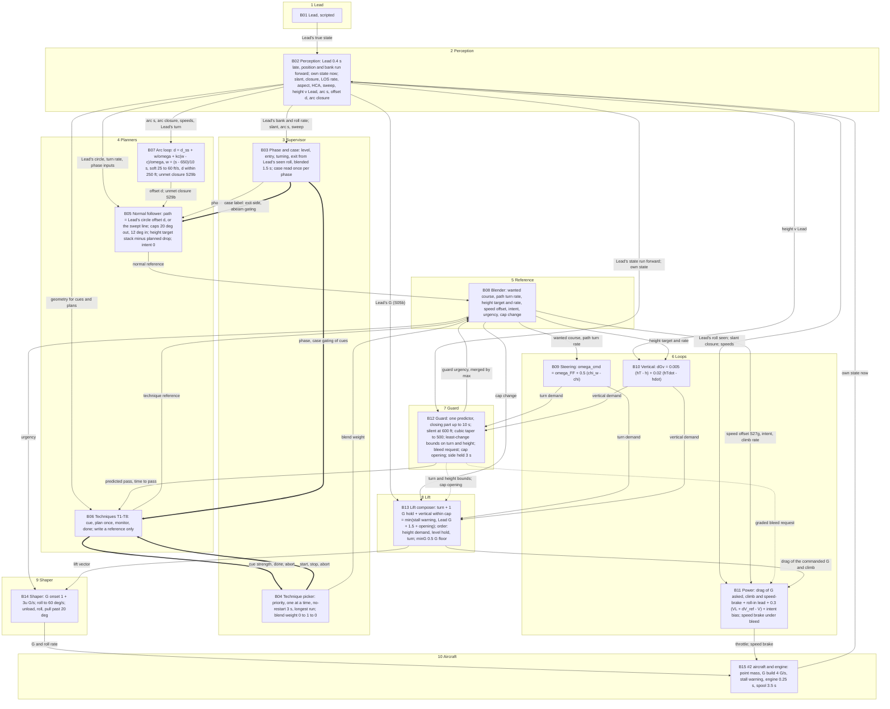
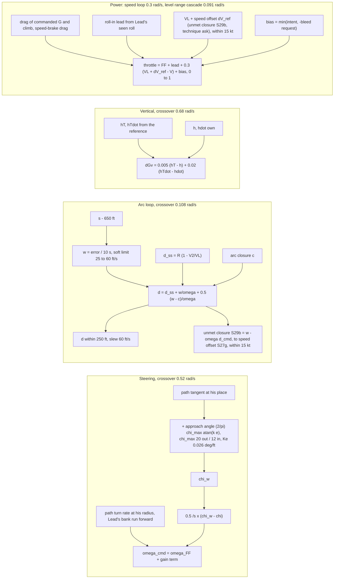

# Spec 7e draft 4: fighting wing on the live wingman, one design (plan T29s; approved 14 Oct 2026)

**What this is.** Draft 4 of spec 7e's design, written by the Formation thread for plan T29s. It replaces spec 7e from the first "7. Ruling" paragraph to the end of the section (the stacked rulings and sections 7-12). Sections 1-6 (purpose, goal, pursuit, the cues, the manual sweep, turn entry and exit, how Patrick flies it) stay as they are: they are the source material this design answers. Every ruling it folds in keeps its full text in TS-233 (`docs/modules/turn-sim/decisions.md`); here each is cited where it applies. The rules for all the sim's flying are TS-234 (spec 7a).

**Status.** Approved 14 Oct 2026 (TS-233, TS-234); Fable's model and audit (3a D1-D20 and follow-up 3b D21-D26) and Patrick's rulings folded in. Folded into `docs/modules/turn-sim/spec.md` section 7e in one piece; round 5's slices (section 11) are built from it.

**Numbers.** Every number is Patrick's, a manual page's, standard physics, or an estimate, and says which. The starting numbers here are sized by physics and the review's sketches, not on the rig: the rig (`tools/fw-rig.mjs`) flies today's technique only, and the phase-plane view is not built (T29m part 2, deliverable 7). Each slice sizes its numbers on the rig and the gauge, against C1-C11, and Patrick ratifies them when he flies it. Speeds: 200 KIAS at the 8,000 ft block is 381 ft/s true (the shared indicated-to-true helper, `iasToTasKt`); Lead's academic turn, 60° and 2 G (TS-65), turns 8.4°/s on a 2,600 ft radius.

---

## 7. The design: a normal flyer, a few techniques, one set of loops

### 7.1 The picture

In words: the **normal flyer** makes the reference nearly all the time. A **technique** takes over the reference only when the picture is well outside what the normal flyer can fix gently, and slides it back home when done. The **loops** never change: they fly whatever reference they are given, with feedback. The **guard** sits after them and only limits. The **shaper** is the pilot's hand (roll, G onset); the T-6A's own limits stay in the point mass.

**Level 1: Reconciled block diagram (`B01–B15`, Fable 3b §6):**

**Level 2: The loops alone (Fable 3b §6):**

### 7.2 The three rules here (TS-234)

1. **Phased hand-overs.** No on/off line in the flying. Phases, techniques and height owners blend in and out over a stated time or by how near a limit is (the "phased authority" of control model section 9). The guard is the constraint form: silent far from its limit, firmer as it nears, and only a limit on what the loops ask. The speed brake stays a switch (a real step in drag, Patrick), with a band at least twice the wobble of what triggers it and a hold time.
2. **One owner per control.** The loops own the turn, the height and the power. The normal flyer and the techniques write only the reference; the guard writes only limits and a request to bleed. Cross-feeds carry physics only: the drag of the G he asks for, the power for his climb, speed-brake drag, Lead's seen roll as a lead on power (control model section 10).
3. **Techniques plan; the same loops fly** (TS-233, "How a technique works"): section 7.9.

### 7.3 What changes from draft 3 and from today's code

| Draft 3 and today's code (rounds 1-4, tidied) | Draft 4 | Why |
|---|---|---|
| Supervisor jobs with hysteresis: swept, entry (Lead's bank past 10° for 1 s), in the turn, exit, quick fix, stretch | Phases read from Lead's seen roll with no hold, blended over about 1.5 s; the quick fix becomes the exit vertical technique; the stretch is Technique 8 built with T30 | TS-233 three phases; TS-234 rule 1; review F8 (switches under delay) |
| The guard engages under 600 ft predicted, releases over 700 ft held 3 s, owns pitch, cuts power, aims at where Lead was | A barrier from 600 down to 500 ft: the least change to his turn or height, a graded request to bleed; never power, never an aim | TS-233 "the guard tapers"; review F3 (the rail flew him at the ideal); part 2: the filter flew 8-48% of a turn |
| One pitch owner at a time by priority; commands never added | The height target blended between owners over at least 4.3 s; the guard's height is a constraint, not an owner | TS-234 rules 1 and 2; review F6 (300 ft-low finishes); Fable D1, D5 |
| An aim point between the route positions; the offset = wanted closure ÷ Lead's turn rate; a pursuit law steering at the point | A path follower on Lead's circle (or the swept line) with a bounded approach angle; the arc loop sets the circle's offset with its feed-forward and hands any unmet closure to the speed loop's set-point | Review 2.2 (vector-field path following); research §1 item 4 (the half-gain trap); Fable D21; part 2: up to 137 aim jumps a turn |
| Power: a slow PI on speed; the filter's power cut; MAX and −300 ft on "low inside" | Power = the drag of the G he asks plus his climb and speed-brake drag (fed forward) + Lead's roll-in lead + 0.3 /s proportional speed loop on (Lead's speed + unmet-closure offset) + the energy intent bias; no integrator, no cut; continuous drop-low height term in the normal follower | TS-233 "power with G"; Fable D21, D23, D24; review F5; part 2: the throttle's owner changed up to 37 times a turn |
| G onset: whatever the loops ask, through the roll limit | G onset by urgency, about 1 to 4 G/s, through the shaper | TS-233 "G onset by urgency"; part 2: 1.7-3.3 G/s in every turn |
| Lag first, the nose behind, the aim-turn cap, the always-on aim blend, the low-inside relay | All go | Review 2.9; control model R3, R9, R11 |
| The lift at the G cap: the 1 G hold and the vertical kept, the turn cut | The turn keeps its share; positive climb demand from the height loop gives way first, then the level-flight hold, the turn last, with a 0.2 G soft knee | TS-233 "at the G cap, in the lift" (Patrick 14 Oct 2026); Fable D20; control model R6 |
| The arc loop's offset within ±400 ft (`arcOffsetMaxFt`) | Within ±250 ft, with unmet closure passed to the speed offset | TS-233 "the arc loop's offset limit" (Patrick 14 Oct 2026); Fable D9, D21 |

What stays: perception and its 0.4 s rule, the predictor (one, the guard's), unload, roll, pull, idle and the boards, the stack 50 ft below, the yo-yo and the S-turns (as techniques), close formation untouched.

### 7.4 Perception (the 0.4 s rule)

As draft 3's perception, with TS-233's "where #2's 0.4 s sits": he sees Lead 0.4 s late (`FW_SEE.delaySec`, Patrick) and carries him forward (dead-reckoned round his seen turn), and runs Lead's seen bank forward by the roll rate he sees across the 0.4 s, capped at a plausible end bank (TS-233 "Lead's roll carried on", Fable D3: it cuts the guard's prediction error at a roll-in from 84-337 ft to about 20-30 ft); he knows his own position, speed, G and roll at once. From that, each quantity continuous and lightly smoothed as an eye judges it: slant range, and closure worked from the dead-reckoned Lead velocity and his own with no 1 s smoothing (Fable D11), line of sight (about 0.5 s), aspect and HCA, sweep, height against Lead, Lead's bank, roll and turn circle (from his seen bank and true airspeed). Round 5 brings today's whole-picture signals (slant range, closure, the guard and the jobs; control model R1) onto this rule, slice by slice, with the whole-picture case measured beside it (the method plan's two delay sweeps). Close formation keeps its 0.3 s (TS-211).

### 7.5 The phase

Four phases, one at a time, read from what he sees of Lead's roll. The path's geometry is continuous in Lead's seen bank (the circle becomes the line as his radius grows), so a phase change never moves the path by itself; only the case and side choice is blended, over at least 6 s (Fable's blend rule: at least 3 ÷ the slowest crossover it feeds, the steering's 0.52 rad/s):
- **Level:** Lead's wings level, flying straight, climbing or descending.
- **Entry:** from Lead's roll-in (his seen bank past about 10° *and* rolling toward the turn, no hold) until #2 is captured on the circle he wants (within about 100 ft, approach angle under about 5°; guesses) or about 8 s.
- **Turning:** on or around Lead's circle until Lead rolls out.
- **Exit:** from Lead's roll-out (seen bank under about 5° and rolling toward level) until settled in the cone (in the cone, closure under 10 ft/s for 5 s), then Level.
- **A reversal** is an exit followed at once by an entry the other way, the case read again.

The **case** is read once at the start of entry and exit, from what he sees: where he is against Lead's new circle (the arc behind and the offset), closure, sweep and aspect, with a ±50 ft dead band (Fable D17; estimate) so the read never flickers. Stretched is beyond about 700 ft, tight under about 560 ft (Patrick's "lead if more than 700, lag if near 500", spec 7e.6; the 560 ft edge is the review's estimate). Since stretched and tight placement during the turn is already continuous through the arc loop, the case label decides only the exit line's side (`SMM Fig 12.23`), turn-entry case placement, and abeam gating.

### 7.6 The normal flyer

One law in every phase: **follow a reference path with a bounded approach angle** (review 2.2; Nelson et al. 2007, research §2.1).
- **The path:** with Lead turning, a circle concentric with Lead's, offset d inside it (negative d outside); with Lead level, a straight line parallel to Lead's track at the swept place's offset. As Lead's radius grows (clipped near 20,000 ft, Fable 3b note; estimate) the circle becomes the line smoothly, so a roll-out never steps the path.
- **His wanted course:** the path's tangent at his place, plus an approach angle that grows smoothly with his distance e off the path: approach = (2/π) × χmax × atan(k × e), toward the path. χmax is 20° when he is inside and drifts out, 12° when outside and closing in (Patrick's caps, TS-233, Fable's second review); k about 1 per 420 ft under the 20° cap and 1 per 250 ft under the 12° cap, so the small-signal slope (0.026° per ft) is the same inside and out and only the cap differs (TS-233 "the gentler steering", Fable D2; estimates). 150 ft off he points about 5° at the path; the 20° cap is reached only beyond about 500 ft.
- **His turn:** the path's own turn rate at his radius (fed forward: on the circle he flies Lead's G, with Lead's bank run forward across 0.4 s per Fable D3) plus a course gain of 0.5 per second on (wanted course − his course): crossover about 0.52 rad/s, 48-65° of phase margin at every trim under both delay kinds (Fable 1b; estimates until the rig measures the turn-rate lag). As drafted (1 per 150 ft, 0.3 per second) it had 18-29° and would bounce at capture. If the rig's turn-rate lag is over 0.52 s, the softer option (0.4 per second, slope 0.13 /s) applies.

What falls out of it, in Patrick's words:

| Where he is | What the law does | Patrick |
|---|---|---|
| Inside Lead's circle at Lead's speed | Turns less than the circle and drifts out at up to V sin 20°, about 130 ft/s, then tightens to Lead's G as the angle closes | "relax some g/bank, and re-capture the pure turn circle" (TS-233; cone drift while relaxing confirmed) |
| On the circle | Approach zero: Lead's G and turn | pure |
| Outside | Inward up to 12°: a little more G than Lead | lead |
| Lead turning into him from in position, not tight | His heading starts inside the new circle's tangent, so he holds it while Lead's turn comes to him, then captures pure, or with a slight lead or lag | "fly straight ahead until I'm on the turn circle I want then capture pure" (TS-233, SMM 12.29 Fig 12.20) |
| Lead level | Converges on the swept line and holds it; fore and aft by the speed offset from unmet closure | swept, 625 ft at 45°, 50 ft below (Patrick) |

**Where the path sits, by phase and case.** Patrick's turn-entry reaction rule (14 Oct 2026, TS-233): *"when a turn starts the objective is to follow lead on either a lead lag or pure. so if you're stetched and he turns in toyou, you can just fly ahead, if you're tight and he turns away, you can fly ahead a bit (or probaly just pull some lag to not get too stretched). you have to react fastest when you're tight and he turns in to you, or stretched and he turns away."* Specifically: when stretched with Lead turning into him, #2 delays the turn (flies straight ahead) until he is on the circle he wants, then captures a lead or pure circle; when tight with Lead turning away, #2 can fly ahead a bit or ease onto a gentle lag circle (`d` slightly outside) so he falls back into band without getting too stretched; the two urgent entry cases requiring the fastest reaction are **tight with Lead turning in** (the miss: vertical first below, or immediate guard/turn-away bound) and **stretched with Lead turning away** (roll in promptly onto an inside lead circle with gain intent, or cut across if beyond 1,000 ft). The manual's tables (sections 4 and 5) and the rulings, as paths for the normal flyer, except where the right answer is a different kind of move, which is a technique (7.9):

| Phase and case | Lead turns away | Lead turns into him |
|---|---|---|
| Entry, in position | Lead's circle, he is outside: inward up to 12° (Fig 12.20: aim inside the circle) | Straight ahead to the circle he wants, then capture (above); the turn toward Lead only for the bubble (the miss) or when high on energy |
| Entry, stretched | **Fast reaction:** roll in promptly onto Lead's circle with d well inside, intent gain (Fig 12.21); beyond about 1,000 ft: **the very-stretched cut-across** (technique 5) | Delay the turn (fly straight ahead until on the circle wanted), d inside, intent gain, capture (Fig 12.21; Patrick 14 Oct 2026) |
| Entry, tight | Fly ahead a bit or pull gentle lag on Lead's circle, d slightly outside, so he falls back without getting too stretched (Fig 12.22: aim at Lead's tail; Patrick 14 Oct 2026) | **Fast reaction — The miss** (technique 1): vertical first, below (TS-233) |
| Entry, abeam (behind the 3/9 line, ahead of the cone) | As in position | **Lag pursuit from abeam** (technique 3; confirmed, TS-233) |
| Turning | Lead's circle, d from the arc loop (7.7); the route positions' ±120 ft are the comfortable range, not limits | Same; inside and gaining with no room to drift: **the high yo-yo** (technique 4); ahead of the 3/9 line: **back behind the 3/9 line** (technique 2) |
| Exit | The swept line on the side Fig 12.23 gives: tight or closing fast, the outside; stretched, the inside; in position, his own side. A spacing error to fix: **the exit vertical** (technique 6) or **S-turns** (technique 7) | Same |
| Level | The swept line, his side; range held by the unmet-closure speed offset (7.7); too close: **S-turns** (technique 7) | — |

### 7.7 The arc loop and level range hold (one 10 s range constant)

In Turning and Level alike, one `10 s` range time constant ($\tau_s = \tau_r = 10\text{ s}$, TS-233, Fable D21) governs spacing:
- In a turn, the arc loop (`B07`) sets the circle's offset $d$ from the arc behind Lead $s$ and its closure (review 2.2, research §1 item 4, control model's arc loop):
  $d = d_{\text{ss}} + \text{wanted} \div \omega + k_c \times (\text{wanted} - \text{closure}) \div \omega$, where $\omega$ is Lead's turn rate (radius clipped near `20,000 ft` as $\omega \to 0$ so quantities stay finite, Fable 3b note), $\text{wanted} = (s - 650\text{ ft}) \div 10\text{ s}$ (`650 ft` the top of his happy `600-650 ft`, Patrick; `10 s` an estimate), and $d_{\text{ss}} = R(1 - V_2/V_L)$, his speed handed to the offset;
- the wanted closure is limited smoothly from `25 ft/s` near the ideal to `60 ft/s` far from it (a soft limit over about `200-400 ft` of error, `softMin`; estimates), not by a step;
- $d$ is slewed at `60 ft/s`, and kept within `±250 ft` (Patrick 14 Oct 2026, card "±250 ft, tighter": a deliberate change from today's `±400 ft`), its comfortable range the route positions' `±120 ft`. In Lead's `60°` turn that caps how hard he leads or lags at about `40 ft/s` of closure at equal speed ($V \times d \div (R - d)$). Being slow uses part of it just to hold position ($d_{\text{ss}}$: about `115 ft` at `10 kt` slow, `230 ft` at `20 kt`), so the speed loop and energy intent keep him near Lead's speed; the review's sketches assumed `±400 ft`, so slice 2 checks they still capture inside `±250 ft`.

The feed-forward term ($\text{wanted} \div \omega$) is what makes the steady closure all of what is asked rather than half (the research's half-gain trap). The range time constant stays `10 s` for both turns and level flight (TS-233, Fable D21) and $k_c = 0.5$ or less (Fable D10: `88-90°` of phase margin, `24/12 dB` gain margin; $k_c$ only trims model error).

**Unmet closure hand-off (`S29b` → `S27g`, Fable D9 & D21).** Any wanted closure that the offset $d_{\text{cmd}}$ cannot supply — $\text{unmet closure} = w - \omega \cdot d_{\text{cmd}}$ (`S29b`, clipped to `±15 kt`) — passes through the reference blender (`S27g`, $\Delta v_{\text{ref}}$) to the speed loop's set-point (`B11`). In a 2 G turn while $|d| < 250\text{ ft}$, that hand-off is zero (geometry owns closure, so there is no contest between arc and speed); when $d$ saturates at `±250 ft` (Fable D9) or as Lead rolls wings level ($\omega \to 0$, radius clipped near `20,000 ft`, Fable D21), the unmet closure smoothly becomes the speed set-point offset $\Delta v_{\text{ref}}$, holding `650 ft` in level flight with the same `10 s` time constant (crossover `0.091 rad/s`, phase margin `74° / 72°`, speed-to-range bandwidth ratio `3.3`, passing gate C4).

### 7.8 Energy, power, the vertical and G

**The energy intent.** Patrick's model (TS-233, 14 Oct 2026): "the PCL ADDS energy or SUBTRACTS enemrgy to the system, the stick TRANSFORMS energy, G EATS energy, altitude/speed trade energy". Each phase, case and technique sets one intent from the picture: keep, gain or bleed, carried as a number from `−1` (bleed) to `+1` (gain) so it blends. Fighting wing turns are usually `90-180°` of heading, not sustained, and the T-6 model holds Lead's `2 G` at `200 KIAS` and `8,000 ft` with `+0.93 kt/s` spare acceleration (`+1.85 kt/s` at `1 G`, `+0.24 kt/s` at `2.5 G`, sustained about `2.7 G`; Fable D14 is withdrawn at `2 G` and stands only above `2.7 G`, losing `-0.60 kt/s` at `3 G` and `-2.75 kt/s` at `4 G`), so energy runs short only when #2 pulls well past Lead's G. In `90-180°` turns (`11-21 s` at `8.4°/s`) only `10-20 kt` can be regained during the turn itself, so the `±15 KIAS` speed check is judged at the end of the `30 s` wings-level exit settle for `90-180°` turns, and at roll-out for `30 s` turns (Fable D26, TS-233). Energy is spent in Patrick's order: geometry first (the path), then the vertical, then power (TS-96; TS-233 "power with G": "when I pull G I need power to maintain energy (unless I WANT to lose energy right now)").

**Power, one owner (`B11`, proportional speed loop, Fable D21 & D23).** Throttle = the drag of the commanded G (`S44` from `B13`, before the shaper), the power for his planned climb rate (`S27c`), and speed-brake drag while the boards are out, all fed forward (`dragPerWeight`, `power.js` `powerFor`, as close formation's `holdingTorque`), plus a roll-in lead from Lead's seen roll (`S03` run forward by `S04`, started when Lead's seen roll rate passes about `10°/s`, estimate), plus a `0.3 /s` proportional speed loop on $(V_L + \Delta v_{\text{ref}} - V)$ (`S27g` clipped within `±15 kt`, Patrick 4 Oct 19:12Z), plus the intent bias $\min(\text{intent `S27d`}, -\text{bleed request `S39`})$, clipped `0-1`. Following close formation's pattern, there is **no integrator** in the speed loop (Fable D23, superseding D12's 45 s PI): the physics feed-forwards do the steady work, a proportional `0.3 /s` gain gives `89° / 82°` of phase margin and `5 s` of extra-delay margin while saturating at full power past `~3.1 kt` of deficit at `2 G` (`~6.2 kt` at `1 G`), and dropping the integrator eliminates wind-up against the intent bias and any integrator-freeze switch. Idle is reached by a phased reduction, not a step. The speed brake (`S34`) is used only when bleeding on purpose (TS-233, card; Fable D8, D25): out when closing over about `60 ft/s` for `1 s` with effective bleed intent $\le -0.5$, in under about `20 ft/s` (or `10 ft/s` if Slice 0's un-smoothed dead-reckoned slant closure ripple exceeds `20 ft/s`, Fable D25) or when intent $> -0.2$, held at least `3 s` (estimates), with its drag fed forward into the throttle law while out. The guard never sets the throttle: it sends a graded request to bleed (`S39`).

**Continuous drop low inside (`D24`, TS-233 card "Drop low inside, MAX" & "Energy intent, counted").** On the inside of Lead's turn, when #2 is slow despite full power, dropping low on the inside is a continuous height-target term in the normal follower (`B05`, `S25`), not a relay or a separate technique:
$h_T = \text{stack} - 20\text{ ft/kt} \times \max(0, \text{speed deficit} - 5\text{ kt})$, capped at `-300 ft` (`100 ft` low at `10 kt` slow, `-300 ft` cap at `20 kt` slow; estimates), blended over `4.3 s`, and climbing back to the `-50 ft` stack as speed recovers or on roll-out. Every foot past `100 ft` below the `50 ft` stack counts in the gauge as a fault to justify (TS-233, Patrick 14 Oct 2026).

**The vertical, one loop, blended owners (`B10`).** One height loop: `0.005 G` per foot on the height error $(h_T - h)$ and `0.02 G` per ft/s on the height-rate error $(\dot{h}_T - \dot{h})$ (`S32`, crossover `0.68 rad/s`, the rig confirmed the gains, C11). The reference (`S27c`) carries both a height target $h_T$ and a height-rate target $\dot{h}_T$, so a planned climb or descent profile is not fought by the damping term (Fable D1: today's D acted on own $\dot{h}$ alone, so a `100 ft/s` planned descent met `2 G` of opposing demand). Its target is the stack (`50 ft` below, Patrick) minus any continuous low-inside drop (`D24`) unless a technique plans another profile; blends of the height target take at least `4.3 s` (Fable's blend rule, $3 \div 0.68\text{ rad/s}$); a technique's return to the stack takes about `15 s` (estimate). **Near the stack, low only when needed** (TS-233 "smooth, planned corrections": he sat too low too often; part 2: `8-25 s` a turn more than `100 ft` below the stack). The guard's height bound (`S38`) is a constraint on this loop's command, not a target. Inverted only if required (Patrick): the lift's composition points the lift where the geometry needs it.

**G onset by urgency (`B14`, TS-233).** Every G change goes through the shaper at an onset set by an urgency $u$ from `0` to `1`, smoothly: $\text{onset} \approx 1 + 3u\text{ G/s}$, so about `1 G/s` for ordinary flying ($u = 0$), about `2.2-2.5 G/s` for assertive corrections and reversals to capture a line ($u$ about `0.4-0.5`), and up to about `4 G/s`, the T-6A's onset, when about to hit something ($u = 1$). The urgency (`S27e`) is the larger of the guard's (`S36`) and the technique's (7.9). The guard's urgency is cubic: $u = x^3$ with $x = \text{clip}((600 - \text{predicted pass}) \div 100\text{ ft}, 0, 1)$ (Fable; TS-233 "Fable's other fixes"): `575 ft` asks about `1.05 G/s`, `550 ft` about `1.4 G/s` (Patrick's gentle: "if its gonna be 550 feet i dont want/need a violent cvorrection"), `525 ft` about `2.3 G/s`, `510 ft` `3.2 G/s`, `500 ft` `4 G/s`. It rises at once and decays over about `2 s` (no switch). The $1 + 3u$ shape is an estimate; the ends are Patrick's.

**The G cap and `minG = 0.5 G` floor (`B13`).** Cap = `Lead G + 1.5 G` (estimate, using Lead's seen G `S05b`, Fable D22; the wingman's `+5 G` of SMM Table 16.1 is the reference, flagged, not a wall). The guard opens it smoothly (`S40`) as the predicted pass goes from about `550` to `500 ft` (estimate), up to what the aircraft gives, flagged on screen; it stops at the stick shaker (a physical limit). At the cap (TS-233): airspeed gives way first (he holds a smooth, steady G and lets the speed bleed), then the vertical, then the turn; reaching the cap should be rare (gate C8). In the lift composer (`B13`) that means the turn keeps its share; positive climb demand ($\Delta G_v > 0$) from the height loop gives way first, then the `1 G` level-flight hold (he lets the nose drop a little), and the turn last; during the miss the guard opens the cap anyway, flagged (TS-233, card "Your order, checked"). Built as a continuous allocation with a soft knee about `0.2 G` below the cap, it is smooth, not a switch; a descent demand ($\Delta G_v < 0$) never binds at the cap, so the order only ever cuts climb demands (Fable D20). Seat load factor never pushes below `minG = 0.5 G` (Patrick 14 Oct 2026: *"In the vast majority of cases you would roll and pull instad of pushing to 0 or neg g"*; when downward acceleration beyond a `0.5 G` unload is needed, `B13` and `B14` unload, roll — overbanking past `90°` if required — and pull positive G).

### 7.8b The guard (a barrier)

The guard (`B12`) is a backstop for the `500 ft` bubble only; keeping position is the normal flyer's job (TS-233, "the guard tapers"; Patrick: "2 just needs to stay in position and try not to bust the bubble and if he does he corrects").
- **One predictor (`S35`):** the least slant range over the closing part of the relative motion up to `10 s` from the achieved state (`B15`), evaluated on the loops' raw demands (`S31` turn and `S32` vertical, Fable 3b §3), with Lead dead-reckoned across the `0.4 s` and his bank run forward by his seen roll rate (`S03`, Fable D3). The miss's cue (7.9.1) reads the same predictor.
- **The barrier:** silent while the predicted pass is at or over `600 ft`; between `600` and `500 ft`, the closing speed it allows toward the pass is $c_{\max} \times (1 - x^3)$, $x = \text{clip}((600 - \text{pass}) \div 100\text{ ft}, 0, 1)$: `87%` at `550 ft`, `58%` at `525 ft`, none at `500 ft` (Fable's cubic; TS-233). So a pass coming out near `550 ft` gets a gentle correction, never a violent one (Patrick 14 Oct 2026: "if its gonna be 550 feet i dont want/need a violent cvorrection"). Its correction is the least change to his turn (`S37`) or height (`S38`) that keeps within it, solved as a bound each step, never iterated through the aircraft (Fable: that loop's gain would be about `6`). The guard's vertical bound (`S38`), when it sits below the height loop's demand, is in effect the writer of a vertical escape; that is the stated rule (Fable D16, C1).
- **Its choices:** turn changes and vertical escapes, below by default, above only if he is already more than `100 ft` above Lead (Patrick). Separation is hard; staying behind the wing line is soft, with a wing-line overshoot costed far above crossing behind Lead (research §3.4, §8). When the two want opposite turns, one manoeuvre serves both, usually the vertical. A change of side (`S41`) is charged its roll time and, once taken, held at least about `3 s` (estimate), so the choice doesn't flip under the delay.
- **Its outputs:** bounds on his turn (`S37`) and height (`S38`) commands, a smooth cap opening (`S40`), guard urgency (`S36`), and a graded request to bleed (`S39`). Never a throttle setting, never an aim, never a pitch owner.
- **Inside 500 ft** he corrects out firmly (the miss below, G past the estimate, flagged); a brief, shallow kiss while already correcting firmly is acceptable (TS-233, "the bubble"). No Terminate; Lead never waits for #2 (Patrick).
- **Gate C7:** in the academic set the guard acts under about `10%` of a turn and not at all in steady turning.

### 7.9 Techniques

**Why techniques, and when one is needed.** The normal flyer fixes small errors gently, the way a pilot makes small continuous corrections, and flies nearly all of the time. A technique is used only when the picture is well outside what gentle feedback can fix in the time Lead allows: either the error is too big (the feedback would run into a limit, such as the G cap, the `20°` and `12°` approach caps, MAX or idle, and be slow or overshoot), or the right answer is a different kind of move (go vertical, reverse, cut across the circle) that feedback, which only nudges toward the target, will never find on its own. It is a pilot's named manoeuvre for that picture, planned once and then flown by the same loops.

**How a technique works** (TS-233, Patrick 14 Oct 2026, card "Plans; same loops fly it"):
- It starts from a **predicted cue**: left alone, the normal flyer would pass inside `600 ft`, need more than the cap, or still be stretched at roll-out.
- It **plans once**, from the error and his energy: the path, the speed offset, the energy intent, the height profile and the urgency.
- **The same loops fly it** with feedback. It writes only the reference (`S26`) and cue/done/abort (`S24`), never the stick or throttle.
- **Monitor:** small errors are the loops' to correct; a plan that drifts past its bound is re-planned from where he is; an unsafe one goes to the miss.
- **Hand back:** by sliding the reference home over a blend time (`S23`), only once well inside the normal flyer's envelope; no restart for about `3 s` (estimate) unless a fresher, more urgent cue fires. Blends work on the scalar loop inputs (`wanted course`, `path turn rate fed forward`, `height target and rate`, `speed offset`, `intent`, `urgency`, `cap`), never on the path shapes, and take at least `6 s` for the path fields and `4.3 s` for the height fields; the normal flyer re-starts from where he is at hand-back, its arc loop running on the measured arc and offset throughout (Fable D5).
- **Bands and holds on every cue** (Fable D6; TS-233): the miss on under `600 ft` and closing for `2 steps` (`0.1 s`) with `3 s ≤ t_pass ≤ 10 s`, done over `650 ft` and opening for `2 s` and past bottom; the high yo-yo on over `15 ft/s` for `2 s`, off under `5 ft/s` for `5 s`; the cut-across a `100 ft` band (`1,000 / 900 ft`) and a `3 s` hold; the exit vertical on at `150 ft` of error or `20 ft/s` closure, off at `50 ft` and `10 ft/s` for `5 s`; S-turns on under `575 ft` or `15 ft/s` closure, off over `650 ft` and `5 ft/s` for `5 s`; back behind the 3/9 line on ahead or within `3 s`, off `15°` behind for `2 s` (all estimates).
- **One at a time, by priority;** a new move by Lead means re-assess. Each has a longest run, after which the supervisor re-assesses.
- **Rare:** in ordinary flying techniques should seldom run; one that fires often means the normal flyer is wrong. The gauge counts how often each runs (gate beside C7).
- **The guard is not a technique.**

**Approved technique list (Patrick 14 Oct 2026, TS-233 — all 8 approved in priority order):**

| Priority | ID | Technique | From | Slice | Status |
|---|---|---|---|---|---|
| 1 | `T1` | The miss (vertical first, below) | SMM 12.29 Fig 12.22; Patrick "Vertical first, below", "roll and pull instead of pushing to 0 or neg g" | `S3b` | Approved |
| 2 | `T2` | Back behind the 3/9 line | Patrick: "rolls over Lead or flies it hot turning rejoin style" | `S7` | Approved |
| 3 | `T3` | Lag pursuit from abeam | Patrick's abeam ruling (confirmed); SMM 12.29 Fig 12.20 | `S6` | Approved |
| 4 | `T4` | The high yo-yo (ending stacked low) | Patrick, card "High yo-yo, then back down" | `S7` | Approved |
| 5 | `T5` | The very-stretched cut-across | Patrick: beyond about 1,000 ft, cut across the turn | `S7` | Approved |
| 6 | `T6` | The exit vertical (dive or climb) | Patrick: "Assertive use of the vertical on turn exit" | `S5` | Approved |
| 7 | `T7` | S-turns | Patrick (5 Oct 23:02Z; 14 Oct) | `S5` | Approved |
| 8 | `T8` | Moving out from close formation | Draft 3's stretch job; SMM 16.32 para 92, 16.38 para 105 | `T30` | Approved |

Not techniques, because the normal flyer's paths already do them: the turns away, into from in position (straight ahead, then capture), into stretched, relaxing to recapture the circle from inside (with cone drift allowed while relaxing, confirmed), the swept place, the exit sides, and dropping low inside (`D24` continuous height term in the normal follower).

**The cards.** All numbers are estimates unless a source is named; "e" is the error, "V" his true airspeed (`381 ft/s` here), "g" `32.2 ft/s²`. "About `12 ft` of height per ft/s" is standard energy at `381 ft/s` ($h \approx V \times \Delta v \div g$).

#### 1. The miss (`T1`, `techniques/miss.js`)

| | |
|---|---|
| Source | SMM 12.29 para 70 and Fig 12.22 (from tight, "first make the miss", a climbing turn above or descending turn below, then recapture with geometry); Patrick 14 Oct 2026 card "Vertical first, below" and ruling *"In the vast majority of cases you would roll and pull instad of pushing to 0 or neg g, approve otherwise"* (TS-233, Fable 3b §7); below by default, above only if already more than `100 ft` above Lead (Patrick) |
| Assess | The guard's predictor (`S35`): predicted pass $p < 600\text{ ft}$ slant and closing for `2 steps` (`0.1 s`), with $3\text{ s} \le t_{\text{pass}} \le 10\text{ s}$ (Fable D4, 3b §7) |
| Plan | **Urgency:** $u = \text{clip}((8 - t_{\text{pass}}) \div 5, 0, 1)$ (`1` at `≤ 3 s`, `0.4` at `6 s`, `0` at `≥ 8 s`). **Depth:** $h = \sqrt{D^2 - p^2}$ below Lead's plane (above if already `> 100 ft` above Lead), where $p$ is the predicted in-plane pass and $D = 625\text{ ft}$, the middle of his happy `600-650 ft`, so the guard (silent at `600 ft` and over) stays quiet despite the `0.4 s` prediction error (Patrick 14 Oct 2026). From tight (`560 ft`, $p \approx 355\text{ ft}$), $h \approx 515\text{ ft}$. **Vertical profile — roll and pull positive G, never push to 0 or negative G:** planned vertical load factor $n_p = 0.5(1 - u)$ (`0.5 G` ordinary drop at $u = 0$, more downward acceleration when $u > 0$), arrested symmetrically at $n_p' = 1 + (1 - n_p)$ to bottom at $h$. **In the seat, `#2` never pushes to `0 G` or negative G (`minG = 0.5 G` floor stands):** for an ordinary drop he unloads to about `0.5 G` (or relaxes G in the turn so he drifts out and sinks), and when an urgent drop requires more downward acceleration along the profile ($n_p < 0.5\text{ G}$), he **rolls (overbanking past `90°` if required, via unload-roll-pull) and pulls positive G** (`B13`/`B14`). **Least turn mix (`D4`):** hold roughly his heading ($\omega_{\text{FF}}$ held at its cue value); only when the vertical alone will not reach `625 ft` of slant by $t_{\text{pass}}$, add the least turn away $\Delta\omega \approx 2\Delta q \div (V t_{\text{pass}}^2)$, where $\Delta q$ is the in-plane shortfall (`~1°/s` at `8 s`, `~2.1°/s` at `6 s`, `~5°/s` at `4 s`). **Energy intent from the picture at planning:** `-0.5` (bleed; speed brake if closure `> 60 ft/s` for `1 s`) if closing `> 20 ft/s` or predicted `< 600 ft` of arc at hand-back; `+0.5` (gain) if predicted stretched `> 750 ft` at hand-back; `0` otherwise (Fable 3b §7, Patrick's energy model) |
| Execute | `B10` flies the $(h_T, \dot{h}_T)$ profile at the urgency's G onset (`1 + 3u G/s`) with `minG = 0.5 G` unload-roll-pull; `B09` holds the heading line plus any least turn mix |
| Monitor | Re-plan if $p$ falls `50 ft` under plan or $t_{\text{pass}}$ shortens by `2 s`; inside `500 ft` the guard's firm correction (G past the estimate, flagged) |
| Hand back | Predicted pass $p > 650\text{ ft}$ and opening for `2 s`, and height profile at or past its bottom: path slides to Lead's circle from outside (inward up to `12°`) over `6 s` (`D5`); height climbs back to the `-50 ft` stack over `15 s` |
| Writes | Reference (`S26`: heading path + least turn mix, $(h_T, \dot{h}_T)$ profile, intent, urgency) and cue/done (`S24`) |
| Interrupted by | Nothing; a reversal by Lead re-plans it |
| Longest run | About `15 s` |
| Numbers | `D = 625 ft`, `minG = 0.5 G`, `100 ft` "already high" (Patrick); $t_{\text{pass}}$ window `3-10 s`, $u = (8 - t_{\text{pass}})/5$, $n_p = 0.5(1 - u)$, `50 ft` / `2 s` re-plan, `650 ft` / `2 s` done, `15 s` max run, `6 s` path / `15 s` height hand-back, intent thresholds `20 ft/s, 600 ft, 750 ft` (estimates in `FW_MISS`) |
| Gauge case | `b5-into-tight` (`560 ft`, `45°` sweep, Lead rolls in at `30°/s` to `60°`): vertical first and below, seat G stays `≥ 0.5 G` (unloads to ~`0.5 G` or rolls and pulls positive G if urgent), least slant `≥ 500 ft`, pass at `625 ± 100 ft`, ends outside Lead's circle and recaptures within `30 s` |

#### 2. Back behind the 3/9 line (`T2`, `techniques/behind-39.js`)

| | |
|---|---|
| Source | Patrick 14 Oct 2026 (TS-233, "never ahead of Lead's 3/9 line", approved): "to get back behind he either rolls over Lead or flies it hot turning rejoin style, nose pointed behind Lead, banking steeply in and down" |
| Assess | Ahead of Lead's 3/9 line ($\text{sweep} < 0^\circ$), or predicted to be within about `3 s` |
| Plan | Hot turning rejoin style: a path with his nose pointed behind Lead, steep bank in and down (the lift below the horizon), intent bleed (`-0.5`); the vertical sized as the miss's so the pass behind stays over `D = 625 ft`. Rolling over Lead is not planned in this rung |
| Execute | The loops; urgency about `0.5` |
| Monitor | The miss pre-empts if the pass threatens |
| Hand back | Behind the 3/9 line by at least about `15°` of sweep for `2 s` (`D6`) and in the cone's range: slides to the normal flyer's circle over `6 s` (`D5`) |
| Writes | Reference (`S26`: path, height target, intent, urgency) and cue/done (`S24`) |
| Interrupted by | The miss |
| Longest run | About `15 s` |
| Numbers | `3 s` look, `15°` behind, `2 s` dwell, `6 s` hand-back (estimates in `FW_BEHIND39`); `D = 625 ft` shared with the miss |
| Gauge case | `T29d`'s reversals; the abeam case if he ends ahead (part 2: today he ends `49°` ahead) |

#### 3. Lag pursuit from abeam (`T3`, `techniques/lag-abeam.js`)

| | |
|---|---|
| Source | Patrick 14 Oct 2026, flying V2.433 Live (confirmed, TS-233): "if h's abeam 1 and lead turns towards him h just matches his bank? instead of going out to a lag prusuit... which is wrong as well" — lag pursuit toward Lead's tail, the miss, then reverse and capture; SMM 12.29 Fig 12.20; reversal cue SMM 16.20 para 65b(2) |
| Assess | Lead turning into him (seen bank and roll toward him) with #2 near abeam: behind the 3/9 line with `0° ≤ sweep < 20°`, within the cone's `500-1,000 ft` range (TS-233 "Lead may manoeuvre with #2 abeam") |
| Plan | A path toward a point on Lead's predicted track about `650 ft` behind him (lag pursuit: his nose behind Lead), so the crossing is behind Lead; the pass height sized as the miss's (`D = 625 ft`, below); then the reversal onto Lead's circle from outside on crossing Lead's track behind him (primary geometric cue, Fable D18), with a definite rise in line-of-sight rate (`S15`) banded at `≥ 2×` its ripple as the backup cue. Intent keep (`0`); urgency about `0.5` |
| Execute | The loops |
| Monitor | The miss pre-empts if the pass threatens; ahead of the 3/9 line, technique 2 |
| Hand back | On Lead's circle within about `100 ft`, approach under about `5°`, behind the 3/9 line: slides to the normal flyer over `6 s` (`D5`) |
| Writes | Reference (`S26`: path, height target, intent, urgency) and cue/done (`S24`) |
| Interrupted by | The miss; back behind the 3/9 line |
| Longest run | About `20 s` |
| Numbers | `0-20°` abeam band, `650 ft` tail aim point, capture `100 ft` and `5°`, `6 s` hand-back (estimates in `FW_ABEAM`); `D = 625 ft` shared |
| Gauge case | `b5-into-abeam`, moved to truly abeam (`5-10°` sweep) once the band counts abeam as fighting wing (slice 6): `0 s` banking with Lead into him; never ahead of the 3/9 line; never inside `500 ft` beyond a kiss; captured behind Lead within about `30 s` |

#### 4. The high yo-yo (`T4`, `techniques/yo-yo.js`)

| | |
|---|---|
| Source | Patrick 14 Oct 2026, card "High yo-yo, then back down" (TS-233): inside Lead's circle after the miss and gaining, he pulls up out of Lead's plane in a climbing turn to kill the horizontal closure and bleed speed, then comes back down onto Lead's circle behind him, **ending stacked low**; it overrides "below by default" for this case only. Its size: no cap, "as long as wg stays in the cone anything is permissable". Not in the manuals (spec 7e.3c) |
| Assess | Turning, inside Lead's circle and gaining (arc closure `> 15 ft/s` for `2 s`, `D6`) where the normal flyer's drift-out is predicted not to stop it before `600 ft` or the 3/9 line |
| Plan | A climb sized from the closure to kill, as energy: about `12 ft per ft/s` (`30 ft/s` → about `355 ft`), bounded by the cone (`500-1,000 ft` slant, behind the wing line); the turn kept with Lead's, a little less; intent bleed going up, keep coming down; then down onto Lead's circle behind him, **ending stacked low** (`-50 ft`). Urgency about `0.4` |
| Execute | `B10` flies the climb-then-descend $(h_T, \dot{h}_T)$ profile; `B09` keeps the circle's offset |
| Monitor | Closure under about `5 ft/s` for `5 s` (`D6`) at the top: start down; the slant reaching `1,000 ft` caps the climb; the miss pre-empts |
| Hand back | On Lead's circle behind him, closure under `10 ft/s`, near the low stack: path slides over `6 s`, height to the `-50 ft` stack over `15 s` |
| Writes | Reference (`S26`: $(h_T, \dot{h}_T)$ profile, intent, urgency) and cue/done (`S24`) |
| Interrupted by | The miss; back behind the 3/9 line; Lead's roll-out (the exit re-assesses) |
| Longest run | About `20 s` |
| Numbers | `15 ft/s` (`2 s` dwell) cue, `5 ft/s` (`5 s` dwell) top, `15 s` descent to stack (estimates in `FW_YOYO`); `12 ft per ft/s` (physics); `500-1,000 ft` (Patrick) |
| Gauge case | `b5-into-in-position` and the turns where he gains inside: never ahead of the 3/9 line; ends behind on the circle, stacked low; within `15 KIAS` of Lead |

#### 5. The very-stretched cut-across (`T5`, `techniques/cut-across.js`)

| | |
|---|---|
| Source | Patrick 14 Oct 2026 (TS-233, Fable's second review): "Very stretched (outside about 1,000 ft) he may cut across the turn, then reset onto a lead, lag or pure turn circle" |
| Assess | In a turn (`Entry` or `Turning`), slant range `> 1,000 ft` and not closing for `3 s` (`D6`) |
| Plan | The inward approach cap opened from `12°` to about `45°` toward a point inside Lead's circle (across the chord), intent gain (`MAX`, a dive allowed); aiming to arrive about `800 ft` behind on a lead circle. Urgency about `0.2` |
| Execute | The path follower with the opened cap |
| Monitor | Never ahead of the 3/9 line (predicted); the miss pre-empts |
| Hand back | Inside about `900 ft` and closure under `30 ft/s` (`100 ft` band, `D6`): the cap slides back to `12°` and the normal flyer over `6 s` (`D5`) |
| Writes | Reference (`S26`: approach limit, path offset, speed offset, intent, urgency) and cue/done (`S24`) |
| Interrupted by | The miss; back behind the 3/9 line |
| Longest run | About `40 s` |
| Numbers | `1,000 ft` (Patrick); `45°`, `800 ft`, `900 ft`, `30 ft/s`, `3 s` dwell, `6 s` hand-back (estimates in `FW_CUT`) |
| Gauge case | `b5-away-very-stretched` (`> 1,000 ft`, Lead turning away): back inside `1,000 ft` and in the cone within about `40 s`; never ahead of the 3/9 line |

#### 6. The exit vertical (dive or climb) (`T6`, `techniques/exit-vertical.js`)

| | |
|---|---|
| Source | Patrick 14 Oct 2026 (TS-233): "Assertive use of the vertical on turn exit to fix spacing, staying within the cone. if stretched, dive. if tight, climb/s turns"; card "Any height inside the cone's range" (any height while the slant stays `500-1,000 ft` behind the wing line; TS-80's `200 ft` band is where he settles). The sides from SMM 12.30 Fig 12.23 |
| Assess | `Exit` (Lead rolling out) with spacing error $|s - 650| > 150\text{ ft}$ or closure `> 20 ft/s` (`D6`) |
| Plan | The closure needed $\Delta v = \Delta s \div T$ ($T = 10\text{ s}$, the range constant); the height $h \approx 12\text{ ft per ft/s}$: `300 ft` stretched → `30 ft/s` → about `355 ft` of dive (about $0.85 h\text{ ft}$ of range made up in `10 s`, TS-233). Tight: the same as a climb, or S-turns (technique 7) when a climb would leave the cone. The path: the exit line on Fig 12.23's side. Intent gain for a dive, bleed for a climb. Urgency about `0.4` |
| Execute | `B10` flies the $(h_T, \dot{h}_T)$ profile; `B11` sets power by the intent and climb feed-forward |
| Monitor | Re-plan if the spacing error changes sign; capped by the `500-1,000 ft` cone |
| Hand back | Spacing within `50 ft` of `650 ft` and closure under `10 ft/s` for `5 s` (`D6`): slides to the normal flyer; height returns into the `200 ft` band (TS-80) and to the `-50 ft` stack over `15 s` |
| Writes | Reference (`S26`: $(h_T, \dot{h}_T)$ profile, exit line side, intent, urgency) and cue/done (`S24`) |
| Interrupted by | The miss; a new turn by Lead (`Entry` re-assesses) |
| Longest run | About `25 s` |
| Numbers | `150 ft` and `20 ft/s` cue, `10 s`, `50 ft` and `10 ft/s` (`5 s` dwell) hand-back, `15 s` return (estimates in `FW_EXIT_VERT`); `12 ft per ft/s` (physics); `500-1,000 ft` and `200 ft` (Patrick) |
| Gauge case | The wings-level settles: settled in the cone within about `30 s` of wings level; within `200 ft` of Lead's height at the end; fewer than `5` torque swings |

#### 7. S-turns (`T7`, `techniques/s-turns.js`)

| | |
|---|---|
| Source | Patrick 5 Oct 23:02Z "in fighting wing a common way to bleed energy is to S turn left and right if required"; 14 Oct 2026 "IF we're getting too tight we also make S turns back and forth from sides of the cone as well". Not in the manuals (spec 7e.3c) |
| Assess | `Level` or `Exit`, too tight or closing (slant `< 575 ft` or closure `> 15 ft/s`, `D6`), where a climb would leave the cone or the `200 ft` band |
| Plan | A heading swing $\psi$ off the line sized from the range to give up over $T$: $1 - \cos\psi = \Delta s \div (V \times T)$ (`150 ft` over `10 s` → about `16°`); legs across the cone between its sides (`30-60°` of sweep, Fig 12.19), the swept line swapping sides each leg; intent bleed. Urgency `0` (gentle) |
| Execute | The path follower on the alternating line |
| Monitor | Stop when range `> 650 ft` and closure `< 5 ft/s` for `5 s` (`D6`) |
| Hand back | On the swept line on the side he ends: slides to the normal flyer over `6 s` |
| Writes | Reference (`S26`: line side and offset, intent) and cue/done (`S24`) |
| Interrupted by | The miss; a turn by Lead (`Entry`) |
| Longest run | About `30 s` |
| Numbers | `575 ft` and `15 ft/s` cue, `650 ft` and `5 ft/s` (`5 s` dwell) stop, `6 s` hand-back (estimates in `FW_STURN`; `625 ft` Patrick's swept range); the cone's sides (manual) |
| Gauge case | `b5-level-tight`: back to the swept range without leaving the cone; no climb out of the band |

#### 8. Moving out from close formation (`T8`, `techniques/moving-out.js`, built with `T30`)

Approved (Patrick 14 Oct 2026, TS-233): Draft 3's stretch job as Technique 8 (`T8`), built in task `T30`. Straight back to about `500 ft` at about `10 ft/s` by power (close formation's guard still on), then out sideways to the swept place (`625 ft at 45°`, `50 ft` below) on the side he held (SMM 16.32 para 92, 16.38 para 105; EFIG p.390). The hand-over between close formation and fighting wing is phased by range: close formation full under about `100 ft`, fighting wing full past about `250 ft` (control model section 9; estimates), both initialized bumplessly from his bank, G and throttle.

### 7.10 How it is programmed (approved with this draft, TS-234)

The files, in `src/modules/turn-sim/live/wingman/` (the folder exists; `techniques/` is new):

| File | Job |
|---|---|
| `perception.js` | As now, brought onto the 0.4 s rule with Lead's bank run forward by his seen roll rate (7.4) |
| `supervisor.js` | The phase (7.5) and the technique picker (`B03`, `B04`): priority, one at a time, the 3 s no-restart time, each technique's longest run |
| `fw-reference.js` (new) | The reference and the scalar loop-input blender (`B08`): mixes the normal flyer's reference and the technique's by a weight that slides `0 → 1 → 0` |
| `fighting-wing.js` | The normal flyer (`B05`, 7.6), the arc loop (`B07`, 7.7), the one set of loops (`B09`, `B10`, `B11`), and the lift composer (`B13`, 7.8), reading only the reference |
| `separation.js` | The guard (`B12`, 7.8b): the one predictor, the cubic barrier, its turn/height bounds, cap opening, urgency, and bleed request |
| `techniques/<name>.js` (new) | One file per technique (`T1–T8`), its card as code |
| `shaper.js` | G onset by urgency (`1 + 3u G/s`) and the roll (`≤ 60°/s`), with unload-roll-pull (`B14`) |

**The reference (`B08`)** blends scalar loop inputs (`wanted course`, `path turn rate fed forward`, `height target and rate`, `speed offset`, `energy intent` `−1` to `+1`, `urgency` `0` to `1`, and `cap change`), so a hand-over is a slide, not a step; a circle of growing radius (clipped near `20,000 ft`) becomes the line smoothly (review 2.6, Fable D5, D21).

**A technique file** holds its card in its header (source, numbers, gauge case) and exports the same four functions:
- `cue(view)`: whether it is wanted now, and how urgently, from a prediction;
- `plan(view)`: the reference and limits, sized once;
- `monitor(view, plan)`: keep, re-plan or abort to the miss;
- `done(view, plan)`: true once well inside the normal flyer's envelope.

Its numbers live in one table in `wing-moves.js` (for example `FW_MISS`, `FW_YOYO`), so `tools/turn-sim-numbers.mjs` lists them in `numbers.md` with their sources and the control map's ledger finds them.

**The control map enforces the rules.** Each technique is a block in `tools/control-map/signals.mjs` (`B06`) that writes only `S24` (cue/done/abort to `B04`) and `S26` (candidate reference to `B08`); `check.mjs` fails automatically if `B06` writes any loop demand or control (`S31–S45`). So "one owner per control" (`C1`, `TS-234`) is enforced by the tool on every slice.

**Measured, and shown.** The gauge traces carry the active technique, its weight, its plan, and why it started and ended; the gauge counts how often each runs (the "rare" check). `T29r`'s HUD readout shows the phase and the technique.

**Adding or changing a technique** is one file, one table and one gauge case; no other technique changes.

---

## 8. Numbers

Patrick's: `0.4 s`; happy `600-650 ft`; lead beyond about `700`, lag near `500`; swept `625 ft` at `45°`, `50 ft` below; `500 ft` slant; the guard silent at `600 ft` and over, gentle near `550 ft`; the planned pass `625 ft`; `minG = 0.5 G` floor in the seat (roll and pull positive G rather than pushing to `0` or negative G); the arc loop's offset within `±250 ft`; at the cap positive climb vertical gives way before level hold, turn last; dropping low inside counted against the `100 ft` line; below by default, above if more than `100 ft` above Lead; the caps `20°` out and `12°` in; very stretched beyond about `1,000 ft`; the exit vertical anywhere inside `500-1,000 ft`; the `200 ft` band (`TS-80`); G onset about `1`, the middle and about `4 G/s`; at the cap airspeed, then the vertical, then the turn; within `15 KIAS` of Lead (at end of `30 s` exit settle for `90-180°` turns, at roll-out for `30 s` turns); no Terminate.

Manual: the cone `500-1,000 ft` and `30-60°` (SMM 12.29 Fig 12.19); the entry and exit cases (Figs 12.20-12.23); the reversal cue (SMM 16.20 para 65b(2)); the wingman's `+5 G` as a reference (SMM Table 16.1); moving out from close formation (SMM 16.32 para 92, 16.38 para 105; EFIG p.390).

Physics: `381 ft/s` true at `200 KIAS` and `8,000 ft`; `8.4°/s` and `2,600 ft` in Lead's `60°` turn; about `12 ft` of height per ft/s of speed; $V \sin 20^\circ$ about `130 ft/s`; trainer excess acceleration `+1.85 kt/s` at `1 G`, `+0.93 kt/s` at `2 G`, `+0.24 kt/s` at `2.5 G`, `-0.60 kt/s` at `3 G`, `-2.75 kt/s` at `4 G` (sustained `~2.7 G`); the S-turn, least-turn-mix, and pass-height formulas.

Estimates (every other number in this spec): the blend times (`6 s` path, `4.3 s` height, `1.5 s` phase weights) and the entry's `10°` and `5°`; the capture `100 ft` and `5°`; the `560 ft` tight edge and `±50 ft` case dead band (`D17`); $k$ (`1 per 420 ft` under `20°`, `1 per 250 ft` under `12°`, slope `0.026°/ft`) and the course gain `0.5 /s` (Fable `D2`, Patrick's card); the bank carry-on's end-bank cap `~70°` and roll-rate filter `~0.2 s`; the cue bands and holds (`D6`); the miss's vertical profile $n_p = 0.5(1 - u)$ and its `3-10 s` cue window (`D4`); the proportional speed loop gain `Kv = 0.3 /s` (no integrator, `D21`, `D23`) and `±15 kt` speed offset clip; the one range time constant $\tau_s = \tau_r = 10\text{ s}$, `kc = 0.5`, `25 → 60 ft/s` soft closure limit, `60 ft/s` offset slew, and `20,000 ft` radius clip; the onset shape `1 + 3u` and the guard's cubic urgency curve $x^3$; `Lead + 1.5 G`, the `0.2 G` soft knee (`D20`), and the cap's opening from `550 → 500 ft`; the side-change hold `3 s`; the return-to-stack `15 s`; the continuous drop-low-inside term (`20 ft/kt` past `5 kt` slow, cap `-300 ft`, `D24`); speed brake `60 / 20 (or 10) ft/s`, `1 s` on-dwell, `3 s` hold (`D8`, `D25`); every technique's cue, plan, hand-back and longest run numbers; the no-restart `3 s`.

## 9. Boundaries

The 4-ship's fighting wing stays on today's law until the 4-ship rung, which comes onto `TS-234` with its own control model first. Fluid manoeuvring and the lag roll are unchanged. The rejoins from fighting wing (`TRJ`, `SARJ`) are `B4`: spec 7d is rewritten as techniques under `TS-234` after `B5`, and `TRJ` moves only if the live one flies at least as well. Close formation (`7b`, `7c`) unchanged, checked on the gauge against the run before each slice (its `0.3 s` and gains untouched). Lead's speed changes are not in this rung's gauge set (future list, `F12`). Lead's own inverted moves in fighting wing are in `future.md`.

## 10. Done

As draft 3 (Patrick 14 Oct 2026: "Lead can maneuver as required in fighting wing and once straight and level 2 settles in the cone. Lead does not wait for 2 at all"). A fighting wing move is over when Lead's is; once Lead is wings level, #2 settles in the cone and the card judges him there (`500-1,000 ft`, `30-60°`, within `200 ft` of Lead's height, `TS-80`). What counts as a failure (`TS-233`): not getting stretched or nipping inside `500 ft` while avoiding, as long as he corrects back toward the ideal.

## 11. Round 5, re-cut into slices (`S0` – `T31`)

**Re-ordered by Fable's `D7` and `3b` §8 (approved, `TS-233`, 14 Oct 2026).** Every slice sits behind `"#2 in fighting wing: Live"` with `Old` the default; keeps the default gauge traces (close formations, fluid, rejoins, Old) byte-identical and the four-ship probe's hashes (`2d5b5a8020839796`) the same; updates `tools/control-map/signals.mjs` model-first (`TARGET_BLOCKS` `B01-B15`, `TARGET_SIGNALS` `S01-S45`); and reports what it removed as well as added (observation `0080`).

**Intermediate slice policy ("close enough for tuning"):** Intermediate build slices (`S2–S7`) verify clean compilation (`npm run build`), control-map integrity (`check.mjs`, `draw.mjs --check`), rig step checks (`fw-rig.mjs`), and default/close-formation/4-ship non-regression so each piece lands "close enough for tuning", while full-sim fighting-wing trace tuning and gate sign-off run once the full loop and technique system is assembled (`S8a–S8b`).

| Slice | Builds | Removes | Acceptance & Gate Focus |
|---|---|---|---|
| **S0** Perception on one delay rule & rig lags | Lead `0.4 s` late and dead-reckoned with seen bank run forward by seen roll rate (`D3`, `S03`); own state now; slant closure (`S14`) from velocities; rig steps (`fw-rig.mjs`) measuring turn-rate lag, G lag (`D13`), engine step, and arc/slant closure ripples (`D25`) | `1 s` slant closure smoother (`D11`); unused `historySec`/`wasAt`; whole-picture delays in fighting wing (`R1`) | Default traces unchanged; Live `b5-` within shared margins; lags and ripples recorded (`C11`) |
| **S1** Reference plumbing, lift cap & shaper | `fw-reference.js` scalar blender (`B08`, `D1`, `D5`); `B13` lift composer reading `S05b` Lead G (`D22`), `minG = 0.5 G` unload-roll-pull, `0.2 G` soft knee (`D20`), trimming positive climb $\Delta G_v$ first, `1 G` hold second, turn last (`TS-233`); `B14` shaper G onset `1 + 3u G/s` (`u = 0` for now); today's law wired to `S25` | Today's `liftWithin` rule that keeps vertical and cuts turn (`R6`); pitch-owner priority as a direct loop switch | Pure refactor on academic/close traces; forced `3.5 G` Lead rig case proves climb vertical gives way before turn (`C1, C8, C11`) |
| **S2** Normal follower, arc loop & level range hold | `B05` circle/line follower (`20°` out / `12°` in, `Ke = 0.026°/ft`, radius clip `20,000 ft`); `B09` steering (`Kχ = 0.5 /s`, `D2`); `B07` arc loop ($\tau_s = 10\text{ s}, k_c = 0.5$, `±250 ft`, unmet closure `S29b` → `S27g` $\Delta v_{\text{ref}}$, `D9/D21`); `0.3 /s` proportional speed loop (`D21/D23`); add `90°` and `180°` turns (`D26`) | Moving aim point & look-ahead; `lagFirst`; `noseBehind`; `aimTurnSec/Cap` (`R3`); `1.5 s` world aim blend (`R11`); `powerArcSec` (`R5`); swept power term; idle-by-closure switch | Close enough for tuning on `b5-` (`sweep ≥ 30°`) + level stretched release; rig/sketch capture within `±250 ft` with `≤ 1` overshoot (`C2, C3, C4, C5, C11`) |
| **S3** The guard as a barrier | `B12` single predictor on raw demands (`S31, S32`) up to `10 s`; cubic barrier `600 → 500 ft` ($x^3$); least-change turn/height bounds (`S37, S38`, below by default, `D16`); side hold `3 s` (`S41`); smooth cap opening (`S40`); graded bleed request (`S39`) | `600/700 ft` engage/release lines & `3 s` hold; second predictor (`missSlantFt`, `R8`); `20%` throttle power cut (`R9`); guard owning pitch | Guard active `< 10%` of academic turns, `0%` in steady turn; `550 ft` pass gets `~1.4 G/s` onset (`C1, C3, C6, C7`) |
| **S3a** Phases & case from Lead's seen roll | `B03` phases (`Level, Entry, Turning, Exit`) from Lead's seen roll with no `1 s` hold, blended `1.5 s`; reversal = `Exit → Entry`; case label (`S22`, `±50 ft` dead band, `D17`) setting exit side, Patrick's turn-entry case placement, and abeam gating, blended `≥ 6 s` (`D5`) | Legacy `fwJob` state machine & `1 s` `turnHoldSec` (`R7`); level `quickFix` height switch | Phase transitions clean across turns and reversals, zero phase flicker (`C3, C6`) |
| **S3b** Technique picker, vertical profile & the miss | `B04` picker (priority, `3 s` no-restart, max run, blend `S23`); `B10` height-rate target term ($\dot{h}_T - \dot{h}$, `D1`); `techniques/miss.js` (`T1`: $p < 600\text{ ft}$ in `3-10 s`, depth $h = \sqrt{625^2 - p^2}$, profile $n_p = 0.5(1 - u)$ flown via `minG = 0.5 G` unload-roll-pull — roll and pull positive G, never 0/neg G — least turn mix `D4`, picture intent); `check.mjs` `B06` rule | Legacy `pass-clear` / `in-and-down` pitch-owner relays (`guard.missFt`, `ownerHold`) | `b5-into-tight`: vertical first below, seat G `≥ 0.5 G`, pass `~625 ft`, recaptures from outside; `check.mjs` enforces `B06` writes only `S24/S26` (`C1, C3, C6, C7`) |
| **A1** Structure audit 1 | Read-only audit after `S3b`: single-writer `C1`, line-by-line removal check (`0080`), `B08` reversal continuity | — | Audit report filed before `S4` |
| **S4** Energy intent, power feed-forwards & drop-low | Complete `B11` power law (drag of commanded G `S44`, climb `S27c`, speed-brake drag, roll-in lead, `0.3 /s` speed loop on $V_L + \Delta v_{\text{ref}} - V$, intent/bleed bias, `D21/D23`); speed brake `S34` only under bleed (`D8/D25`); continuous drop-low-inside height term in `B05` (`20 ft/kt` past `5 kt` slow, cap `-300 ft`, counted past `100 ft`, `D24`) | Low-inside MAX/`-300 ft` relay; `downPower` 20% relay; `ac.speedHold` separate wanted-speed chain in FW (`R4`) | All `15/15` blocks & `53/53` signals built; within `15 KIAS` at roll-out (`30 s` turns) or end of `30 s` settle (`90-180°` turns, `D26`) (`C1, C3, C6, C9, C11`) |
| **S5** Exit vertical & S-turns | `techniques/exit-vertical.js` (`T6`: dive/climb inside `500-1,000 ft` cone, `12 ft per ft/s`) and `techniques/s-turns.js` (`T7`: alternating cone weave); `b5-level-tight` case | Legacy `sTurn` switch in `fighting-wing.js` and remaining `300 ft`-low exit holds | Settles within `200 ft` height band (`TS-80`) and cone within `30 s` (`C1, C3, C6`) |
| **S6** Abeam band & lag pursuit from abeam | Widen FW manoeuvre gate to `sweep ≥ 0°` within `500-1,000 ft` (`TS-233`, `R14`); `techniques/lag-abeam.js` (`T3`: lag pursuit to `650 ft` behind Lead, pass height $D = 625\text{ ft}$, geometric track-crossing reversal cue first + LOS-rate backup `D18`); move `b5-into-abeam` to truly abeam (`5-10°`) | Refusal of Lead's turn presses at `0-15°` sweep (`R14`) | `b5-into-abeam`: `0 s` banking with Lead into him, never ahead of 3/9 line, captured behind Lead (`C1, C3, C6, C7`) |
| **S7** High yo-yo, cut-across & back behind 3/9 line | `techniques/yo-yo.js` (`T4`: climb in turn, ends on circle behind Lead **stacked low**), `techniques/cut-across.js` (`T5`: `> 1,000 ft` opens inward cap to `45°`), `techniques/behind-39.js` (`T2`: hot-rejoin-style steep bank in and down behind Lead); `b5-away-very-stretched` case | Legacy `fwYoYo` block in `fighting-wing.js` | All 7 in-flight techniques (`T1–T7`) built and rare in academic set (`C1, C3, C6, C7, C10`) |
| **A2** Structure audit 2 | Read-only audit after `S7`: `C10` number/switch count (`D15`), technique rarity, removal ledger, `numbers.md` sources | — | Audit report filed before `S8a` |
| **S8a** `T29b`: Climbs and descents | Tilt reference path and `-50 ft` stack with Lead's seen flight-path plane (`B02, B05, B10`) | Level-plane-only height assumptions during Lead climbs/descents | Full-sim `b5-climb` and `b5-descent` pass under `Lead G + 1.5 G`, in cone throughout (`C1–C9`) |
| **S8b** `T29d`: Aggressive Lead (to 4 G, 90°/s, reversals) | `b5-hard-*` gauge set (`3-4 G`, `90°/s` roll-ins, back-to-back reversals) and full-system tuning across academic and aggressive sets (`D14, D26`) | — | Full academic `b5-` and aggressive `b5-hard-*` sets pass all gates (`C1–C11`), accounting for physical `3-4 G` bleed |
| **T29r** Controller HUD readout | Closed-by-default HUD drop-down (phase, active technique, loop shares) + `tools/flight-plot/` turn-centre phase-plane (`D3b`) | — | Seen in 2D/3D (closed by default); traces byte-identical |
| **T30** Blended hand-over close ↔ FW & `T8` | Range-phased authority blend (`100 → 250 ft`, bumpless) + `techniques/moving-out.js` (`T8`); fix hand-over pitch-rate/roll flicks | Hard step switches at close-to-FW hand-overs | Zero pitch-rate or roll jumps on echelon/route ↔ FW; red pitch-rate test passes (`C1, C6`) |
| **CR** Whole-B5 code review | Read-only review of complete B5 diff against `AGENTS.md`, `spec.md`, `TS-233`, `TS-234`, `control-model.md`, `numbers.md` | — | All findings resolved before `T31` |
| **T31** B5's one test, docs & Checkpoint G | One end-picture unit test (`tests/unit/turn-sim/`), 2 Jun 2026 4-ship Lead replay comparison, final docs & **Checkpoint G** with Patrick | — | Patrick flies Fighting Wing Live at Checkpoint G and signs off B5 |

## 12. Questions for Patrick, all answered and resolved (14 Oct 2026)

1. ~~**The technique list:**~~ **Answered and resolved (14 Oct 2026, TS-233):** All eight techniques (`T1` the miss, `T2` back behind the 3/9 line, `T3` lag pursuit from abeam, `T4` the high yo-yo ending stacked low, `T5` the very-stretched cut-across, `T6` the exit vertical, `T7` S-turns, and `T8` moving out from close formation at `T30`) and their priority order are approved.
2. ~~**Two readings from 14 Oct, plus Fable 3b's three questions:**~~ **Answered and resolved (14 Oct 2026, TS-233):**
   - Cone drift is allowed while relaxing to recapture Lead's circle.
   - From abeam with Lead turning in, `#2` flies lag pursuit toward Lead's tail, makes the miss, then reverses onto Lead's circle as he crosses behind Lead's track (`D18`).
   - Turn-entry reaction by case: stretched with Lead turning in flies straight ahead until on the circle wanted; tight with Lead turning away flies ahead a bit or pulls gentle lag (`d` slightly outside); fastest reaction when tight with Lead turning in (the miss) or stretched with Lead turning away (inside lead circle with gain intent, or cut across past `1,000 ft`).
   - The miss never pushes to `0 G` or negative G (`minG = 0.5 G` floor stands): ordinary drop unloads to `~0.5 G` (or relaxes G in the turn), urgent drop **rolls (overbanking if required) and pulls positive G** along the vertical profile (`D4`, `3b` §7).
   - One `10 s` range constant ($\tau_s = \tau_r = 10\text{ s}$) with unmet closure feeding a `0.3 /s` proportional speed loop (no integrator, `D21`, `D23`); continuous drop-low-inside height term (`20 ft/kt` past `5 kt` slow, cap `-300 ft`, counted past `100 ft`, `D24`); `90°` and `180°` turns added from Slice 2 with `±15 KIAS` judged at the end of the `30 s` exit settle (`D26`).

## Untested, unseen and unsure (entering Slice 0)

- The linear loop margins hang on two lags `Slice 0` measures on the rig (`tools/fw-rig.mjs`, Fable `3b` §9): the turn-rate lag (if `> 0.52 s`, steering falls back from `0.5 /s, 0.026°/ft` to `0.4 /s, 0.13 /s`) and the vertical G lag (`D13`), plus the un-smoothed dead-reckoned slant closure ripple (`D25`, which sets the speed brake's in-level to `10 ft/s` if ripple `> 20 ft/s`, else `20 ft/s`).
- Nothing in Round 5 (`S0–S8b`) is built or flown yet; intermediate slices (`S2–S7`) target "close enough for tuning" and full-sim trace tuning runs once the full system is assembled.
- The blender's behaviour across a mid-turn reversal (`circle → line → opposite circle`) is verified in `S3a` and Structure Audit `A1`.

