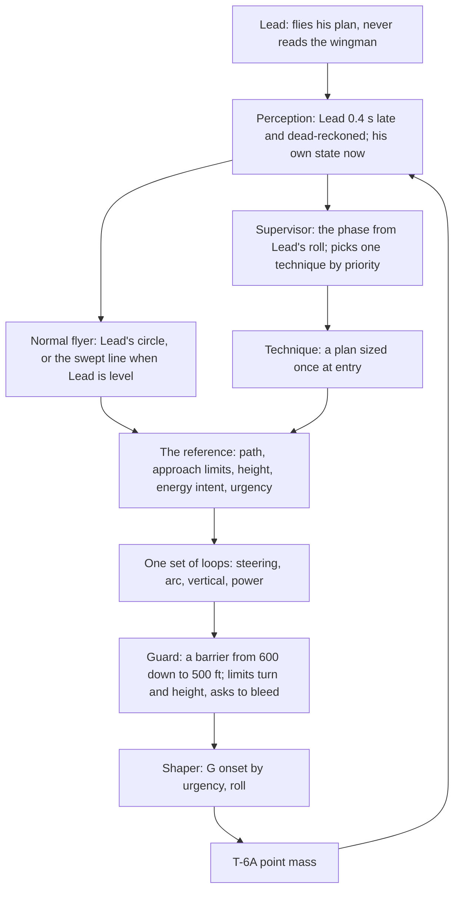

# Spec 7e draft 4: fighting wing on the live wingman, one design (plan T29s; 14 Oct 2026; not approved)

**What this is.** Draft 4 of spec 7e's design, written by the Formation thread for plan T29s. It replaces spec 7e from the first "7. Ruling" paragraph to the end of the section (the stacked rulings and sections 7-12). Sections 1-6 (purpose, goal, pursuit, the cues, the manual sweep, turn entry and exit, how Patrick flies it) stay as they are: they are the source material this design answers. Every ruling it folds in keeps its full text in TS-233 (`docs/modules/turn-sim/decisions.md`); here each is cited where it applies. The rules for all the sim's flying are TS-234 (spec 7a).

**Status.** Not approved. A first review's four findings were ruled by Patrick on 14 Oct 2026 and are folded in (TS-233: the lift at the G cap, the planned pass and a gentle guard, dropping low inside counted, the offset within ±250 ft). Fable's model and audit (report `fable-draft-4-model-report-14oct.md`, findings D1-D20) and Patrick's ten rulings on it (TS-233, 14 Oct 2026) are folded in too; its follow-up (the wiring reconciled, its recommended diagram, the miss re-planned, the slices re-cut, the rig steps) is running. Next: an Opus agent audits it read-only against the control model (`docs/modules/turn-sim/control-model.md`), the method plan (`control-systems-analysis-plan.md`, gates C1-C11), the architecture review and the rig; the thread folds in its findings; then Patrick approves it and it goes into `spec.md` in one piece, and round 5's slices (section 11) are built from it.

**Numbers.** Every number is Patrick's, a manual page's, standard physics, or an estimate, and says which. The starting numbers here are sized by physics and the review's sketches, not on the rig: the rig (`tools/fw-rig.mjs`) flies today's technique only, and the phase-plane view is not built (T29m part 2, deliverable 7). Each slice sizes its numbers on the rig and the gauge, against C1-C11, and Patrick ratifies them when he flies it. Speeds: 200 KIAS at the 8,000 ft block is 381 ft/s true (the shared indicated-to-true helper, `iasToTasKt`); Lead's academic turn, 60° and 2 G (TS-65), turns 8.4°/s on a 2,600 ft radius.

---

## 7. The design: a normal flyer, a few techniques, one set of loops

### 7.1 The picture

In words: the **normal flyer** makes the reference nearly all the time. A **technique** takes over the reference only when the picture is well outside what the normal flyer can fix gently, and slides it back home when done. The **loops** never change: they fly whatever reference they are given, with feedback. The **guard** sits after them and only limits. The **shaper** is the pilot's hand (roll, G onset); the T-6A's own limits stay in the point mass.

### 7.2 The three rules here (TS-234)

1. **Phased hand-overs.** No on/off line in the flying. Phases, techniques and height owners blend in and out over a stated time or by how near a limit is (the "phased authority" of control model section 9). The guard is the constraint form: silent far from its limit, firmer as it nears, and only a limit on what the loops ask. The speed brake stays a switch (a real step in drag, Patrick), with a band at least twice the wobble of what triggers it and a hold time.
2. **One owner per control.** The loops own the turn, the height and the power. The normal flyer and the techniques write only the reference; the guard writes only limits and a request to bleed. Cross-feeds carry physics only: the drag of the G he asks for, the power for his climb, Lead's seen roll as a lead on power (control model section 10).
3. **Techniques plan; the same loops fly** (TS-233, "How a technique works"): section 7.9.

### 7.3 What changes from draft 3 and from today's code

| Draft 3 and today's code (rounds 1-4, tidied) | Draft 4 | Why |
|---|---|---|
| Supervisor jobs with hysteresis: swept, entry (Lead's bank past 10° for 1 s), in the turn, exit, quick fix, stretch | Phases read from Lead's seen roll with no hold, blended over about 1.5 s; the quick fix becomes the exit vertical technique; the stretch is a candidate technique built with T30 | TS-233 three phases; TS-234 rule 1; review F8 (switches under delay) |
| The guard engages under 600 ft predicted, releases over 700 ft held 3 s, owns pitch, cuts power, aims at where Lead was | A barrier from 600 down to 500 ft: the least change to his turn or height, a graded request to bleed; never power, never an aim | TS-233 "the guard tapers"; review F3 (the rail flew him at the ideal); part 2: the filter flew 8-48% of a turn |
| One pitch owner at a time by priority; commands never added | The height target blended between owners over about 2 s; the guard's height is a constraint, not an owner | TS-234 rules 1 and 2; review F6 (300 ft-low finishes) |
| An aim point between the route positions; the offset = wanted closure ÷ Lead's turn rate; a pursuit law steering at the point | A path follower on Lead's circle (or the swept line) with a bounded approach angle; the arc loop sets the circle's offset with its feed-forward | Review 2.2 (vector-field path following); research §1 item 4 (the half-gain trap); part 2: up to 137 aim jumps a turn |
| Power: a slow PI on speed; the filter's power cut; MAX and −300 ft on "low inside" | Power = the drag of the G he asks plus his climb (fed forward) + the energy intent + a slow trim; no cut | TS-233 "power with G"; review F5; part 2: the throttle's owner changed up to 37 times a turn |
| G onset: whatever the loops ask, through the roll limit | G onset by urgency, about 1 to 4 G/s, through the shaper | TS-233 "G onset by urgency"; part 2: 1.7-3.3 G/s in every turn |
| Lag first, the nose behind, the aim-turn cap, the always-on aim blend, the low-inside relay | All go | Review 2.9; control model R3, R9, R11 |
| The lift at the G cap: the 1 G hold and the vertical kept, the turn cut | The turn keeps its share; the height loop's demand gives way first, then the level-flight hold, the turn last | TS-233 "at the G cap, in the lift" (Patrick 14 Oct 2026); control model R6 |
| The arc loop's offset within ±400 ft (`arcOffsetMaxFt`) | Within ±250 ft | TS-233 "the arc loop's offset limit" (Patrick 14 Oct 2026) |

What stays: perception and its 0.4 s rule, the predictor (one, the guard's), unload, roll, pull, idle and the boards, the stack 50 ft below, the yo-yo and the S-turns (as techniques), close formation untouched.

### 7.4 Perception (the 0.4 s rule)

As draft 3's perception, with TS-233's "where #2's 0.4 s sits": he sees Lead 0.4 s late (`FW_SEE.delaySec`, Patrick) and carries him forward (dead-reckoned round his seen turn), and runs Lead's seen bank forward by the roll rate he sees across the 0.4 s, capped at a plausible end bank (TS-233 "Lead's roll carried on", Fable D3: it cuts the guard's prediction error at a roll-in from 84-337 ft to about 20-30 ft); he knows his own position, speed, G and roll at once. From that, each quantity continuous and lightly smoothed as an eye judges it: slant range, and closure worked from the dead-reckoned Lead velocity and his own with no 1 s smoothing (Fable D11), line of sight (about 0.5 s), aspect and HCA, sweep, height against Lead, Lead's bank, roll and turn circle (from his seen bank and true airspeed). Round 5 brings today's whole-picture signals (slant range, closure, the guard and the jobs; control model R1) onto this rule, slice by slice, with the whole-picture case measured beside it (the method plan's two delay sweeps). Close formation keeps its 0.3 s (TS-211).

### 7.5 The phase

Four phases, one at a time, read from what he sees of Lead's roll. The path's geometry is continuous in Lead's seen bank (the circle becomes the line as his radius grows), so a phase change never moves the path by itself; only the case and side choice is blended, over at least 6 s (Fable's blend rule: at least 3 ÷ the slowest crossover it feeds, the steering's 0.52 rad/s):
- **Level:** Lead's wings level, flying straight, climbing or descending.
- **Entry:** from Lead's roll-in (his seen bank past about 10° *and* rolling toward the turn, no hold) until #2 is captured on the circle he wants (within about 100 ft, approach angle under about 5°; guesses) or about 8 s.
- **Turning:** on or around Lead's circle until Lead rolls out.
- **Exit:** from Lead's roll-out (seen bank under about 5° and rolling toward level) until settled in the cone (in the cone, closure under 10 ft/s for 5 s), then Level.
- **A reversal** is an exit followed at once by an entry the other way, the case read again.

The **case** is read at the start of entry and exit, from what he sees: where he is against Lead's new circle (the arc behind and the offset), closure, sweep and aspect. Stretched is beyond about 700 ft, tight under about 560 ft (Patrick's "lead if more than 700, lag if near 500", spec 7e.6; the 560 ft edge is the review's estimate).

### 7.6 The normal flyer

One law in every phase: **follow a reference path with a bounded approach angle** (review 2.2; Nelson et al. 2007, research §2.1).
- **The path:** with Lead turning, a circle concentric with Lead's, offset d inside it (negative d outside); with Lead level, a straight line parallel to Lead's track at the swept place's offset. As Lead's radius grows the circle becomes the line smoothly, so a roll-out never steps the path.
- **His wanted course:** the path's tangent at his place, plus an approach angle that grows smoothly with his distance e off the path: approach = (2/π) × χmax × atan(k × e), toward the path. χmax is 20° when he is inside and drifts out, 12° when outside and closing in (Patrick's caps, TS-233, Fable's second review); k about 1 per 420 ft under the 20° cap and 1 per 250 ft under the 12° cap, so the small-signal slope (0.026° per ft) is the same inside and out and only the cap differs (TS-233 "the gentler steering", Fable D2; estimates). 150 ft off he points about 5° at the path; the 20° cap is reached only beyond about 500 ft.
- **His turn:** the path's own turn rate at his radius (fed forward: on the circle he flies Lead's G) plus a course gain of 0.5 per second on (wanted course − his course): crossover about 0.52 rad/s, 48-65° of phase margin at every trim under both delay kinds (Fable 1b; estimates until the rig measures the turn-rate lag). As drafted (1 per 150 ft, 0.3 per second) it had 18-29° and would bounce at capture. If the rig's turn-rate lag is over 0.5 s, the softer option (0.4 per second, slope 0.13 /s) applies.

What falls out of it, in Patrick's words:

| Where he is | What the law does | Patrick |
|---|---|---|
| Inside Lead's circle at Lead's speed | Turns less than the circle and drifts out at up to V sin 20°, about 130 ft/s, then tightens to Lead's G as the angle closes | "relax some g/bank, and re-capture the pure turn circle" (TS-233) |
| On the circle | Approach zero: Lead's G and turn | pure |
| Outside | Inward up to 12°: a little more G than Lead | lead |
| Lead turning into him from in position, not tight | His heading starts inside the new circle's tangent, so he holds it while Lead's turn comes to him, then captures pure, or with a slight lead or lag | "fly straight ahead until I'm on the turn circle I want then capture pure" (TS-233, SMM 12.29 Fig 12.20) |
| Lead level | Converges on the swept line and holds it; fore and aft by power | swept, 625 ft at 45°, 50 ft below (Patrick) |

**Where the path sits, by phase and case.** The manual's tables (sections 4 and 5) and the rulings, as paths for the normal flyer, except where the right answer is a different kind of move, which is a technique (7.9):

| Phase and case | Lead turns away | Lead turns into him |
|---|---|---|
| Entry, in position | Lead's circle, he is outside: inward up to 12° (Fig 12.20: aim inside the circle) | Straight ahead to the circle he wants, then capture (above); the turn toward Lead only for the bubble (the miss) or when high on energy |
| Entry, stretched | Lead's circle, d well inside, intent gain (Fig 12.21); beyond about 1,000 ft: the cut-across technique | Delay the turn, d inside, intent gain, capture (Fig 12.21) |
| Entry, tight | Lead's circle, d slightly outside: he falls back (Fig 12.22: aim at Lead's tail) | **The miss** (technique 1): vertical first, below (TS-233) |
| Entry, abeam (behind the 3/9 line, ahead of the cone) | As in position | **Lag pursuit from abeam** (technique 2; the reading to confirm) |
| Turning | Lead's circle, d from the arc loop (7.7); the route positions' ±120 ft are the comfortable range, not limits | Same; inside and gaining with no room to drift: **the high yo-yo** (technique 3) |
| Exit | The swept line on the side Fig 12.23 gives: tight or closing fast, the outside; stretched, the inside; in position, his own side. A spacing error to fix: **the exit vertical** (technique 4) or **S-turns** (technique 5) | Same |
| Level | The swept line, his side; too close: **S-turns** | — |

### 7.7 The arc loop (range in the turn)

In Turning, the arc loop sets the circle's offset d from the arc behind Lead s and its closure (review 2.2, research §1 item 4, control model's arc loop):
- d = d_ss + wanted ÷ ω + kc × (wanted − closure) ÷ ω, where ω is Lead's turn rate, wanted = (s − 650 ft) ÷ 10 s (650 ft the top of his happy 600-650 ft, Patrick; 10 s an estimate), and d_ss = R(1 − V2/V_L), his speed handed to the offset;
- the wanted closure is limited smoothly from 25 ft/s near the ideal to 60 ft/s far from it (a soft limit over about 200-400 ft of error, `softMin`; estimates), not by a step;
- d is slewed, and kept within ±250 ft (Patrick 14 Oct 2026, card "±250 ft, tighter": a deliberate change from today's ±400 ft), its comfortable range the route positions' ±120 ft. In Lead's 60° turn that caps how hard he leads or lags at about 40 ft/s of closure at equal speed (V × d ÷ (R − d)). Being slow uses part of it just to hold position (d_ss: about 115 ft at 10 kt slow, 230 ft at 20 kt), so the energy intent has to keep him near Lead's speed; the review's sketches assumed ±400 ft, so slice 2 checks they still capture inside ±250.

The feed-forward term (wanted ÷ ω) is what makes the steady closure all of what is asked rather than half (the research's half-gain trap). The time stays 10 s (TS-233, card) and kc 0.5 or less (Fable D10: 80-90° of margin; kc only trims model error). When the ±250 ft limit is reached, the closure still owed feeds the energy intent smoothly: gain when he is stretched and slow, bleed when tight and fast (Fable D9; TS-233 "Fable's other fixes"). In Level and Exit there is no arc loop: the swept line's offset is fixed and fore and aft is power's.

### 7.8 Energy, power, the vertical and G

**The energy intent.** Patrick's model (TS-233, 14 Oct 2026): "the PCL ADDS energy or SUBTRACTS enemrgy to the system, the stick TRANSFORMS energy, G EATS energy, altitude/speed trade energy". Each phase, case and technique sets one intent from the picture: keep, gain or bleed, carried as a number from −1 (bleed) to +1 (gain) so it blends. Fighting wing turns are usually 90-180° of heading, not sustained, and the T-6 model holds Lead's 2 G at 200 KIAS and 8,000 ft with about 0.9 kt/s spare (about 2.7 G sustained), so energy runs short only when #2 pulls well past Lead's G. It is spent in Patrick's order: geometry first (the path), then the vertical, then power (TS-96; TS-233 "power with G": "when I pull G I need power to maintain energy (unless I WANT to lose energy right now)").

**Power, one owner.** Throttle = the drag of the G he asks for and of his climb, fed forward (`dragPerWeight`, power.js `powerFor`, as close formation's `holdingTorque`), plus a lead from Lead's seen roll (as close formation's `powerLeadPct`), plus the intent (gain toward MAX; bleed toward idle), plus a slow trim on his speed against Lead's (PI: about 15 s response, integral time 45 s, Fable D12; within 15 KIAS of Lead, Patrick 4 Oct 19:12Z; never faster than 15 s, or it sits on the arc loop's crossover). Idle is reached by a phased reduction with closure, not a step. The boards only when bleeding on purpose (TS-233, card): out when closing over about 60 ft/s for 1 s with a bleed intent, in under about 20 ft/s, held at least 3 s (estimates). Effective intent = the lower of the intent and the guard's bleed request; MAX only by an intent of about +0.8 or the trim at its 15 KIAS limit, idle only by about −0.8 (Fable's resource matrix). The guard never sets the throttle: it sends a graded request to bleed.

**Energy in Lead's turn** (TS-233, card "Drop low inside, MAX"): on the inside of Lead's 60°/2 G turn, where he can't hold Lead's speed at his higher G, the intent is gain: MAX first, then a drop low on the inside (a few hundred feet, estimate), climbing back to the stack on the roll-out. Phased by how short of Lead's speed he is, not a relay. It stays part of the energy intent, not a technique, and every drop counts against the "no more than about 100 ft below the stack" line, so each shows in the gauge as a fault to justify (TS-233, Patrick 14 Oct 2026, card "Energy intent, counted").

**The vertical, one loop, blended owners.** One height loop: 0.005 G per foot on the height error and 0.02 G per ft/s on the height-rate error (the rig confirmed the gains, C11). The reference carries a height and a height rate, so a planned climb or descent is not fought by the rate term (Fable D1: today's D acts on his own height rate, so a 100 ft/s planned descent met 2 G of opposing demand). Its target is the stack (50 ft below, Patrick) unless a technique or the energy intent plans another, as a profile; blends of the height target take at least 4.3 s (Fable's blend rule, the vertical's 0.68 rad/s); a technique's return to the stack takes about 15 s (estimate). **Near the stack, low only when needed** (TS-233 "smooth, planned corrections": he sat too low too often; part 2: 8-25 s a turn more than 100 ft below the stack). The guard's height is a constraint on this loop's command, not a target. Inverted only if required (Patrick): the lift's composition points the lift where the geometry needs it.

**G onset by urgency** (TS-233). Every G change goes through the shaper at an onset set by an urgency u from 0 to 1, smoothly: onset ≈ 1 + 3u G/s, so about 1 G/s for ordinary flying (u = 0), about 2.2-2.5 G/s for assertive corrections and reversals to capture a line (u about 0.4-0.5), and up to about 4 G/s, the T-6A's onset, when about to hit something (u = 1). The urgency is the larger of the guard's and the technique's (7.9). The guard's urgency is cubic: u = x³ with x = (600 − predicted pass) ÷ 100 ft, clipped 0-1 (Fable; TS-233 "Fable's other fixes"): 575 ft asks about 1.05 G/s, 550 ft about 1.4 G/s (Patrick's gentle: "if its gonna be 550 feet i dont want/need a violent cvorrection"), 525 ft about 2.3 G/s, 510 ft 3.2 G/s, 500 ft 4 G/s. It rises at once and decays over about 2 s (no switch). The 1 + 3u shape is an estimate; the ends are Patrick's.

**The G cap.** Lead + 1.5 G (estimate; the wingman's +5 G of SMM Table 16.1 the reference, flagged, not a wall). The guard opens it smoothly as the predicted pass goes from about 550 to 500 ft (estimate), up to what the aircraft gives, flagged on screen; it stops at the stick shaker (a physical limit). At the cap (TS-233): airspeed gives way first (he holds a smooth, steady G and lets the speed bleed), then the vertical, then the turn; reaching the cap should be rare (gate C8). In the lift that means the turn keeps its share; the height loop's demand gives way first, then the level-flight hold (he lets the nose drop a little), the turn last; during the miss the guard opens the cap anyway, flagged (TS-233, card "Your order, checked"). Today's `liftWithin` does the reverse (control model R6) and changes in the plumbing slice. Built as a continuous allocation, with a soft knee about 0.2 G below the cap, it is smooth, not a switch; a descent demand never binds at the cap, so the order only ever cuts climb demands (Fable D20).

### 7.8b The guard (a barrier)

The guard is a backstop for the 500 ft bubble only; keeping position is the normal flyer's job (TS-233, "the guard tapers"; Patrick: "2 just needs to stay in position and try not to bust the bubble and if he does he corrects").
- **One predictor:** the least slant range over the closing part of the relative motion, Lead dead-reckoned across the 0.4 s and his own commanded vertical counted in the slant (separation.js `leastPass`, looking until the range starts opening, capped at about 10 s; the research's closed form for two steady turns, §3.1, is the faster equivalent). The miss's cue (7.9) reads the same predictor.
- **The barrier:** silent while the predicted pass is at or over 600 ft; between 600 and 500 ft, the closing speed it allows toward the pass is c_max × (1 − x³), x = (600 − pass) ÷ 100 ft: 87% at 550 ft, 58% at 525 ft, none at 500 ft (Fable's cubic; TS-233). So a pass coming out near 550 ft gets a gentle correction, never a violent one (Patrick 14 Oct 2026: "if its gonna be 550 feet i dont want/need a violent cvorrection"). Its correction is the least change to his turn or height that keeps within it, solved as a bound each step, never iterated through the aircraft (Fable: that loop's gain would be about 6). The guard's vertical bound, when it sits below the height loop's demand, is in effect the writer of a vertical escape; that is the stated rule (Fable D16, C1).
- **Its choices:** turn changes and vertical escapes, below by default, above only if he is already more than 100 ft above Lead (Patrick). Separation is hard; staying behind the wing line is soft, with a wing-line overshoot costed far above crossing behind Lead (research §3.4, §8). When the two want opposite turns, one manoeuvre serves both, usually the vertical. A change of side is charged its roll time and, once taken, held at least about 3 s (estimate), so the choice doesn't flip under the delay.
- **Its outputs:** a limit on his turn and height commands, and a graded request to bleed. Never a throttle setting, never an aim, never a pitch owner.
- **Inside 500 ft** he corrects out firmly (the miss below, G past the estimate, flagged); a brief, shallow kiss while already correcting firmly is acceptable (TS-233, "the bubble"). No Terminate; Lead never waits for #2 (Patrick).
- **Gate C7:** in the academic set the guard acts under about 10% of a turn and not at all in steady turning.

### 7.9 Techniques

**Why techniques, and when one is needed.** The normal flyer fixes small errors gently, the way a pilot makes small continuous corrections, and flies nearly all of the time. A technique is used only when the picture is well outside what gentle feedback can fix in the time Lead allows: either the error is too big (the feedback would run into a limit, such as the G cap, the 20° and 12° approach caps, MAX or idle, and be slow or overshoot), or the right answer is a different kind of move (go vertical, reverse, cut across the circle) that feedback, which only nudges toward the target, will never find on its own. It is a pilot's named manoeuvre for that picture, planned once and then flown by the same loops.

**How a technique works** (TS-233, Patrick 14 Oct 2026, card "Plans; same loops fly it"):
- It starts from a **predicted cue**: left alone, the normal flyer would pass inside 600 ft, need more than the cap, or still be stretched at roll-out.
- It **plans once**, from the error and his energy: the path, the energy intent, the height and the urgency.
- **The same loops fly it** with feedback. It writes only the reference and its limits, never the stick or throttle.
- **Monitor:** small errors are the loops' to correct; a plan that drifts past its bound is re-planned from where he is; an unsafe one goes to the miss.
- **Hand back:** by sliding the reference home over a blend time, only once well inside the normal flyer's envelope; no restart for about 3 s (estimate) unless a fresher, more urgent cue fires. Blends work on the loop inputs (wanted course, the path's turn fed forward, height and height rate, intent, urgency), never on the path shapes, and take at least 6 s for the path fields and 4.3 s for the height fields; the normal flyer re-starts from where he is at hand-back, its arc loop running on the measured arc and offset throughout (Fable D5).
- **Bands and holds on every cue** (Fable D6; TS-233): the miss on under 600 ft and closing for 2 steps, done over 650 ft and opening for 2 s; the high yo-yo on over 15 ft/s for 2 s, off under 5 ft/s for 5 s; the cut-across a 100 ft band and a 3 s hold; the exit vertical on at 150 ft of error, off at 50 ft, a 5 s hold on done; S-turns on under 575 ft, off over 650 ft, a 5 s hold; back behind the 3/9 line a 2 s hold on done (all estimates).
- **One at a time, by priority;** a new move by Lead means re-assess. Each has a longest run, after which the supervisor re-assesses.
- **Rare:** in ordinary flying techniques should seldom run; one that fires often means the normal flyer is wrong. The gauge counts how often each runs (a gate beside C7, proposed for round 5).
- **The guard is not a technique.**

**The list for Patrick to approve.** Six from the plan, two candidates from his rulings, in priority order:

| Priority | Technique | From | Status |
|---|---|---|---|
| 1 | The miss (vertical first, below) | SMM 12.29 Fig 12.22; Patrick "Vertical first, below" | In the plan |
| 2 | Back behind the 3/9 line | Patrick: "rolls over Lead or flies it hot turning rejoin style" | Candidate |
| 3 | Lag pursuit from abeam | Patrick's abeam note (the thread's reading, to confirm); SMM 12.29 Fig 12.20 | In the plan |
| 4 | The high yo-yo | Patrick, card "High yo-yo, then back down" | In the plan |
| 5 | The very-stretched cut-across | Patrick: beyond about 1,000 ft, cut across the turn | In the plan |
| 6 | The exit vertical (dive or climb) | Patrick: "Assertive use of the vertical on turn exit" | In the plan |
| 7 | S-turns | Patrick (5 Oct 23:02Z; 14 Oct) | In the plan |
| — | Moving out from close formation | Draft 3's stretch job; SMM 16.32 para 92, 16.38 para 105 | Candidate, built with T30 |

Not techniques, because the normal flyer's paths already do them: the turns away, into from in position (straight ahead, then capture), into stretched, relaxing to recapture the circle from inside, the swept place, the exit sides, and dropping low inside at MAX (the energy intent).

**The cards.** All numbers are estimates unless a source is named; "e" is the error, "V" his true airspeed (381 ft/s here), "g" 32.2 ft/s². "About 12 ft of height per ft/s" is standard energy at 381 ft/s (h ≈ V × Δv ÷ g).

#### 1. The miss

| | |
|---|---|
| Source | SMM 12.29 para 70 and Fig 12.22 (from tight, "first make the miss", a climbing turn above or descending turn below, then recapture with geometry); Patrick 14 Oct 2026 card "Vertical first, below" (pass clear in the vertical, keeping roughly his heading, let Lead's turn go over him, end outside the circle, recapture); below by default, above only if already more than 100 ft above Lead (Patrick) |
| Assess | The guard's predictor: the normal flyer's path passes inside 600 ft slant, closing |
| Plan | A pass height h = √(D² − p²) below Lead's plane (above if already high), where p is the predicted pass without height and D = 625 ft, the middle of his happy 600-650 ft, so the guard (silent at 600 ft and over) stays quiet despite the 0.4 s prediction error (Patrick 14 Oct 2026: "it can aim the miss ther"). Example from tight, 520 ft, Lead turning in: p about 355 ft (review 2.8's sketch) gives h about 515 ft. If the pass comes out nearer 550 ft, the guard's correction is gentle (7.8b). Path: hold roughly his heading; only when the vertical alone can't make the pass in time, the least turn away that makes it, the guard choosing (TS-233, Fable D4). Planned as a height profile: push by urgency, about 0.5 G for an ordinary drop easing toward about 0 G only when the pass is close; hold; pull back to the stack (TS-233; in a turn, relaxing some G is usually enough, and 0 G is rare). In 6 s, 0 G drops about 580 ft and 0.5 G about 290 ft, so the cue must fire with at least about 6 s to the pass. Intent: set from the picture when planned, power back when closure is the problem, power in when he would be stretched after (TS-233, Patrick's energy model). Urgency from the time to the pass: 1 at 3 s or less, falling to about 0.4 at 6 s. Fable's detailed re-plan is in its follow-up |
| Execute | The height loop flies h at the urgency's onset; steering holds the heading line |
| Monitor | Re-plan if the predicted pass falls under D − 50 ft; inside 500 ft the guard's firm correction (G past the estimate, flagged) |
| Hand back | The predicted pass over 650 ft and opening for 2 s: the path slides to Lead's circle from outside (inward up to 12°) over about 6 s; the height back to the stack over about 15 s |
| Writes | The path (heading line), height target, intent, urgency |
| Interrupted by | Nothing; a reversal by Lead re-plans it |
| Longest run | About 15 s |
| Numbers | D 625 ft (Patrick 14 Oct 2026, the middle of his happy band); 100 ft "already high" (Patrick); hand-back 600 ft (Patrick's taper top); urgency times 3 and 6 s (estimates) |
| Gauge case | `b5-into-tight`: never inside 500 ft slant beyond a kiss while correcting; passes below; ends outside Lead's circle and recaptures it; in the cone at the end |

#### 2. Back behind the 3/9 line (candidate)

| | |
|---|---|
| Source | Patrick 14 Oct 2026 (TS-233, "never ahead of Lead's 3/9 line"): "to get back behind he either rolls over Lead or flies it hot turning rejoin style, nose pointed behind Lead, banking steeply in and down" |
| Assess | Ahead of Lead's 3/9 line, or predicted to be within about 3 s |
| Plan | Hot turning rejoin style: a path with his nose pointed behind Lead, steep bank in and down (the lift below the horizon), intent bleed; the vertical sized as the miss's so the pass behind stays over D. Rolling over Lead is not planned in this draft |
| Execute | The loops; urgency about 0.5 |
| Monitor | The miss pre-empts if the pass threatens |
| Hand back | Behind the 3/9 line by at least about 15° of sweep and in the cone's range: the normal flyer's circle over about 2 s |
| Writes | The path, height target, intent, urgency |
| Interrupted by | The miss |
| Longest run | About 15 s |
| Numbers | 3 s look (estimate); 15° behind (estimate); D shared with the miss |
| Gauge case | T29d's reversals; the abeam case if he ends ahead (part 2: today he ends 49° ahead) |

#### 3. Lag pursuit from abeam

| | |
|---|---|
| Source | Patrick 14 Oct 2026, flying V2.433 Live: "if h's abeam 1 and lead turns towards him h just matches his bank? instead of going out to a lag prusuit... which is wrong as well"; the thread's reading, **to confirm**: lag pursuit toward Lead's tail, the miss, then reverse and capture; SMM 12.29 Fig 12.20 (Lead turning into him: turn slightly toward Lead, make the miss, reverse and capture); the reversal cue, a definite increase in line of sight (SMM 16.20 para 65b(2)) |
| Assess | Lead turning into him (seen bank and roll toward him) with #2 near abeam: behind the 3/9 line with under about 20° of sweep, within the cone's range (TS-233 "Lead may manoeuvre with #2 abeam") |
| Plan | A path toward a point on Lead's predicted track about 650 ft behind him (lag pursuit: his nose behind Lead), so the crossing is behind Lead; the pass height sized as the miss's (D 625 ft, below); then the reversal on crossing Lead's track behind him, with a definite rise in line of sight as the backup cue, banded at twice its ripple (Fable D18): the path becomes Lead's circle from outside, captured pure. Intent keep; urgency about 0.5 |
| Execute | The loops |
| Monitor | The miss pre-empts if the pass threatens; ahead of the 3/9 line, technique 2 |
| Hand back | On Lead's circle within about 100 ft, approach under about 5°, behind the 3/9 line: the normal flyer over about 2 s |
| Writes | The path, height target, intent, urgency |
| Interrupted by | The miss; back behind the 3/9 line |
| Longest run | About 20 s |
| Numbers | 20° abeam band, 650 ft aim point, capture 100 ft and 5° (all estimates); D shared |
| Gauge case | `b5-into-abeam`, moved to truly abeam once the band counts abeam as fighting wing (slice 6): never banks with Lead into him; never ahead of the 3/9 line; never inside 500 ft beyond a kiss; captured behind Lead within about 30 s |

#### 4. The high yo-yo

| | |
|---|---|
| Source | Patrick 14 Oct 2026, card "High yo-yo, then back down" (TS-233): inside Lead's circle after the miss and gaining, he pulls up out of Lead's plane in a climbing turn to kill the horizontal closure and bleed speed, then comes back down onto Lead's circle behind him, ending stacked low; it overrides "below by default" for this case only. Its size: no cap, "as long as wg stays in the cone anything is permissable". Not in the manuals (spec 7e.3c) |
| Assess | Turning, inside Lead's circle and gaining (arc closure over about 15 ft/s) where the normal flyer's drift-out is predicted not to stop it before 600 ft or the 3/9 line |
| Plan | A climb sized from the closure to kill, as energy: about 12 ft per ft/s (30 ft/s → about 355 ft), bounded by the cone (500-1,000 ft slant, behind the wing line); the turn kept with Lead's, a little less; intent bleed going up, keep coming down; then down onto Lead's circle behind him, ending stacked low. Urgency about 0.4 |
| Execute | The height loop flies the climb-then-descend target; steering keeps the circle's offset |
| Monitor | Closure under about 5 ft/s at the top: start down; the slant reaching 1,000 ft caps the climb; the miss pre-empts |
| Hand back | On Lead's circle behind him, closure under 10 ft/s, near the stack: the normal flyer over about 2 s, the height to the stack over about 15 s |
| Writes | The height target, intent, urgency |
| Interrupted by | The miss; back behind the 3/9 line; Lead's roll-out (the exit re-assesses) |
| Longest run | About 20 s |
| Numbers | 15 ft/s cue, 5 ft/s top (estimates); 12 ft per ft/s (physics); 500-1,000 ft (Patrick) |
| Gauge case | `b5-into-in-position` and the turns where he gains inside: never ahead of the 3/9 line; ends behind on the circle, stacked low; within 15 KIAS of Lead at the turn's end |

#### 5. The very-stretched cut-across

| | |
|---|---|
| Source | Patrick 14 Oct 2026 (TS-233, Fable's second review): "Very stretched (outside about 1,000 ft) he may cut across the turn, then reset onto a lead, lag or pure turn circle". Round 4 tried opening the path law's caps beyond 1,000 ft (r4f7) and dropped it as worse on balance; the review expects that was the old rail at the ideal, not the cut: a risk for its slice to check |
| Assess | In a turn, beyond about 1,000 ft and not closing |
| Plan | The inward approach cap opened from 12° to about 45° toward a point inside Lead's circle (across the chord), intent gain (MAX, a dive allowed); aiming to arrive about 800 ft behind on a lead circle. Urgency about 0.2 |
| Execute | The path follower with the opened cap |
| Monitor | Never ahead of the 3/9 line (predicted); the miss pre-empts |
| Hand back | Inside about 900 ft and closure under 30 ft/s: the cap back to 12° and the normal flyer over about 3 s |
| Writes | The approach limit, the path's offset, intent, urgency |
| Interrupted by | The miss; back behind the 3/9 line |
| Longest run | About 40 s |
| Numbers | 1,000 ft (Patrick); 45°, 800 ft, 900 ft, 30 ft/s (guesses) |
| Gauge case | A stretched start beyond 1,000 ft, Lead turning away: back inside 1,000 ft and in the cone within about 40 s; never ahead of the 3/9 line |

#### 6. The exit vertical (dive or climb)

| | |
|---|---|
| Source | Patrick 14 Oct 2026 (TS-233): "Assertive use of the vertical on turn exit to fix spacing, staying within the cone. if stretched, dive. if tight, climb/s turns"; card "Any height inside the cone's range" (any height while the slant stays 500-1,000 ft behind the wing line; TS-80's 200 ft band is where he settles). The sides from SMM 12.30 Fig 12.23 |
| Assess | Exit (Lead rolling out) with the spacing more than about 100 ft from 650 ft, or closure over about 20 ft/s |
| Plan | The closure needed Δv = Δs ÷ T (T about 10 s, the arc loop's time); the height h ≈ 12 ft per ft/s: 300 ft stretched → 30 ft/s → about 355 ft of dive (about 0.85 h ft of range made up in 10 s, TS-233). Tight: the same as a climb, or S-turns (technique 7) when a climb would leave the cone. The path: the exit line on Fig 12.23's side. Intent gain for a dive, bleed for a climb. Urgency about 0.4 |
| Execute | The height loop flies h; power by the intent |
| Monitor | Re-plan if the spacing error changes sign; capped by the cone |
| Hand back | Spacing within about 50 ft of 650 ft and closure under 10 ft/s: the normal flyer; the height back into the 200 ft band (TS-80) and to the stack over about 15 s |
| Writes | The height target, the exit line's side, intent, urgency |
| Interrupted by | The miss; a new turn by Lead (entry re-assesses) |
| Longest run | About 25 s |
| Numbers | 100 ft and 20 ft/s cue, 10 s, 50 ft and 10 ft/s hand-back (estimates); 12 ft per ft/s (physics); 500-1,000 ft and 200 ft (Patrick) |
| Gauge case | The wings-level settles: settled in the cone within about 30 s of wings level; within 200 ft of Lead's height at the end; fewer than 5 torque swings |

#### 7. S-turns

| | |
|---|---|
| Source | Patrick 5 Oct 23:02Z "in fighting wing a common way to bleed energy is to S turn left and right if required"; 14 Oct 2026 "IF we're getting too tight we also make S turns back and forth from sides of the cone as well". Not in the manuals (spec 7e.3c) |
| Assess | Lead level or rolling out, too tight or closing (under about 600 ft, or closure over about 15 ft/s), where a climb would leave the cone or the 200 ft band |
| Plan | A heading swing ψ off the line sized from the range to give up over T: 1 − cos ψ = Δs ÷ (V × T) (150 ft over 10 s → about 16°); legs across the cone between its sides (30-60° of sweep, Fig 12.19), the swept line swapping sides each leg; intent bleed. Urgency 0 (gentle) |
| Execute | The path follower on the alternating line |
| Monitor | Stop when the range is back to about 625 ft and closure under about 5 ft/s |
| Hand back | On the swept line on the side he ends: the normal flyer |
| Writes | The line's side and offset, intent |
| Interrupted by | The miss; a turn by Lead (entry) |
| Longest run | About 30 s |
| Numbers | 600 ft and 15 ft/s cue, 625 ft and 5 ft/s stop (estimates; 625 ft Patrick's swept range); the cone's sides (manual) |
| Gauge case | A new level, too-close start: back to the swept range without leaving the cone; no climb out of the band |

#### Candidate: moving out from close formation (with T30)

Draft 3's stretch job as a technique: straight back to about 500 ft at about 10 ft/s by power (close formation's guard still on), then out sideways to the swept place on the side he held (SMM 16.32 para 92, 16.38 para 105; EFIG p.390). The hand-over between close formation and fighting wing is phased by range: close formation full under about 100 ft, fighting wing full past about 250 ft (control model section 9; estimates), both started from his bank, G and throttle. Its card is written with T30.

### 7.10 How it is programmed (proposed; approved with this draft)

The files, in `src/modules/turn-sim/live/wingman/` (the folder exists; `techniques/` is new):

| File | Job |
|---|---|
| `perception.js` | As now, brought onto the 0.4 s rule (7.4) |
| `supervisor.js` | The phase (7.5) and the technique picker: priority, one at a time, the no-restart time, each technique's longest run |
| `fw-reference.js` (new) | The reference and the blender: the normal flyer's reference and the technique's, mixed by a weight that slides in and out |
| `fighting-wing.js` | The normal flyer (7.6, 7.7) and the one set of loops (steering, arc, vertical, power), reading only the reference |
| `separation.js` | The guard (7.8b): the one predictor, the barrier, its limits and bleed request |
| `techniques/<name>.js` (new) | One file per technique, its card as code |
| `shaper.js` | G onset by urgency and the roll, as the pilot's hand |

**The reference** is plain data: the path (circle or line, its offset and side), the approach limits, the height target, the energy intent (−1 to +1), the urgency (0 to 1) and any cap change. Every field blends, so a hand-over is a slide, not a step; a circle of growing radius becomes the line (review 2.6).

**A technique file** holds its card in its header (source, numbers, gauge case) and exports the same four functions:
- `cue(view)`: whether it is wanted now, and how urgently, from a prediction;
- `plan(view)`: the reference and limits, sized once;
- `monitor(view, plan)`: keep, re-plan or abort to the miss;
- `done(view, plan)`: true once well inside the normal flyer's envelope.

Its numbers live in one table in `wing-moves.js` (for example `FW_MISS`, `FW_YOYO`), so `tools/turn-sim-numbers.mjs` lists them in `numbers.md` with their sources and the control map's ledger finds them.

**The control map enforces the rules.** Each technique is a block in `tools/control-map/signals.mjs` that writes only reference signals; `check.mjs` gains one rule: a technique block that writes a control (turn, height command or throttle) fails the check. So "one owner per control" (C1) is kept by the tool, not by memory, and a new technique can't quietly become an eleventh add-on.

**Measured, and shown.** The gauge traces carry the active technique, its weight, its plan, and why it started and ended; the gauge counts how often each runs (the "rare" check). T29r's HUD readout shows the phase and the technique.

**Adding or changing a technique** is one file, one table and one gauge case; no other technique changes.

---

## 8. Numbers

Patrick's: 0.4 s; happy 600-650 ft; lead beyond about 700, lag near 500; swept 625 ft at 45°, 50 ft below; 500 ft slant; the guard silent at 600 ft and over, gentle near 550 ft; the planned pass 625 ft; the arc loop's offset within ±250 ft; at the cap the vertical gives way before the turn; dropping low inside counted against the 100 ft line; below by default, above if more than 100 ft above Lead; the caps 20° out and 12° in; very stretched beyond about 1,000 ft; the exit vertical anywhere inside 500-1,000 ft; the 200 ft band (TS-80); G onset about 1, the middle and about 4 G/s; at the cap airspeed, then the vertical, then the turn; within 15 KIAS of Lead; no Terminate.

Manual: the cone 500-1,000 ft and 30-60° (SMM 12.29 Fig 12.19); the entry and exit cases (Figs 12.20-12.23); the reversal cue (SMM 16.20 para 65b(2)); the wingman's +5 G as a reference (SMM Table 16.1).

Physics: 381 ft/s true at 200 KIAS and 8,000 ft; 8.4°/s and 2,600 ft in Lead's 60° turn; about 12 ft of height per ft/s of speed; V sin 20° about 130 ft/s; the S-turn and the pass-height formulas.

Estimates (every other number in this draft): the blend times (6 s path, 4.3 s height) and the entry's 10° and 5°; the capture 100 ft and 5°; the 560 ft tight edge; k (1 per 420 ft under 20°, 1 per 250 ft under 12°) and the course gain 0.5 per second (Fable D2, Patrick's card); the bank carry-on's end-bank cap; the cue bands and holds; the miss's push profile and its 6 s cue time; the power trim's 45 s; the arc loop's 10 s, 25 and 60 ft/s and their soft limit; the onset shape 1 + 3u and the guard's urgency curve; Lead + 1.5 G and the cap's opening from 550 ft; the barrier's shape; the side-change hold 3 s; the height blends 2 s and 15 s; the drop low inside; every technique's cue, plan, hand-back and longest run numbers; the no-restart 3 s.

## 9. Boundaries

The 4-ship's fighting wing stays on today's law until the 4-ship rung, which comes onto TS-234 with its own control model first. Fluid manoeuvring and the lag roll are unchanged. The rejoins from fighting wing (TRJ, SARJ) are B4: spec 7d is rewritten as techniques under TS-234 after this draft is approved, and TRJ moves only if the live one flies at least as well. Close formation (7b, 7c) unchanged, checked on the gauge against the run before each slice (its 0.3 s and gains untouched). Lead's speed changes are not in this rung's gauge set (future list, F12). Lead's own inverted moves in fighting wing are in `future.md`.

## 10. Done

As draft 3 (Patrick 14 Oct 2026: "Lead can maneuver as required in fighting wing and once straight and level 2 settles in the cone. Lead does not wait for 2 at all"). A fighting wing move is over when Lead's is; once Lead is wings level, #2 settles in the cone and the card judges him there (500-1,000 ft, 30-60°, within 200 ft of Lead's height, TS-80). What counts as a failure (TS-233): not getting stretched or nipping inside 500 ft while avoiding, as long as he corrects back toward the ideal.

## 11. Round 5, re-cut into slices

**Re-ordered by Fable's D7 (approved, TS-233, 14 Oct 2026); its detailed re-cut is in its follow-up, and this section is rewritten from it.** The order: **0** perception onto the one delay rule (with Lead's roll carried on), the model rows for the whole design, and the rig steps that measure the turn-rate lag and the G lag (acceptance: traces unchanged; C11 on the lags); **1** the reference, its blender, the lift composer (the G cap in Patrick's order) and the shaper with G onset by urgency, built as a refactor of today's law writing the reference (acceptance: the close-formation and academic traces unchanged within the shared margins); **2** the normal flyer and the arc loop (acceptance only for starts with at least 30° of sweep until slice 6; a forced case, a scripted Lead at 3.5 G, checks the cap order); **3** the guard as a barrier; **3a** the phases; **3b** the technique picker and the miss, with the height profile; **4** energy; **5** the exit vertical and S-turns; **6, 7, 8a, 8b** as below. "Never inside 500 ft from tight with Lead turning in" is slice 3b's acceptance, not slice 3's. The table below is the first cut, kept until the follow-up lands.

Every slice sits behind "#2 in fighting wing: Live", with Old the default; keeps the default gauge traces (close formations, fluid, rejoins, Old) unchanged and the four-ship probe's hashes the same; runs the method plan's measurements on the new code (both delay sweeps, the loop margins against the rig, the switching map, the guard's share, the control map re-checked, what it removed as well as added); meets gates C1-C11 before Patrick flies it; adds at most the plan's one test. One loop group or one technique family per slice (observation 0075's lesson: five interacting loops at once failed twice).

| Slice | What | Acceptance (the academic set, beside Patrick's flying) |
|---|---|---|
| 1. The guard as a barrier | One predictor; the taper; the bleed request in place of the power cut; vertical escapes; the side-change hold; the cap opened smoothly | Acts under about 10% of each academic turn (C7); never inside 500 ft beyond a kiss; a pass predicted near 550 ft gets a gentle correction (G onset near 1 G/s); no job flips after wings level; no case breaks at +0.2 s of delay (C3) |
| 2. The normal flyer and the reference | The path follower and the arc loop with its feed-forward, the offset within ±250 ft; the reference and its blender; G onset by urgency in the shaper; the lift at the cap in Patrick's order (`liftWithin`); the aim point, lag first, the nose behind, the aim-turn cap and the always-on aim blend go | No wrong-way roll; at most about 2 s a turn over Lead + 0.5 G; G onset about 1 G/s in ordinary turns; at the cap the vertical gives way before the turn (C8); never ahead of the 3/9 line; every turn ends 500-900 ft; the review's sketch cases still capture inside ±250 ft |
| 3. The phases and the technique framework, with the miss | Level, entry, turning, exit (a reversal is exit then entry); the picker, the trace columns; the first technique, the miss; the 0.4 s rule on the whole-picture signals | Into tight: vertical first and below, never inside 500 ft beyond a kiss, recaptures from outside; settled in the cone within 30 s of wings level; the miss runs only where its cue says |
| 4. The energy intent | Power: the drag of the G asked and of his climb fed forward, the lead from Lead's roll, the intent, the slow trim; low inside folds into "gain" | Within 15 KIAS of Lead at each turn's end; fewer than 5 torque swings a turn; MAX and idle only by intent (C9) |
| 5. The vertical and the exit techniques | The stack near 50 ft below, height owners blended; the exit vertical; S-turns | Ends within 200 ft of Lead's height (TS-80); no more than about 100 ft below the stack outside a planned technique, with every drop low inside counted (Patrick 14 Oct 2026); the settles in the cone within 30 s |
| 6. Abeam | Abeam counts as fighting wing for Lead's moves (the band change, TS-233); lag pursuit from abeam (once Patrick confirms the reading) | Truly abeam: never banks with Lead into him; never ahead of the 3/9 line; captured behind Lead |
| 7. The rest of the techniques | The high yo-yo; the very-stretched cut-across; back behind the 3/9 line (if approved) | Their gauge cases (7.9); each technique rare in the academic set |
| 8. T29b and T29d | Climbs and descents on the line in Lead's flight-path plane; the aggressive Lead (to 4 G, 90°/s, reversals) | T29b: the descent under Lead + 1.5 G; T29d: the academic set's lines, stretching allowed while Lead manoeuvres |

Then T29r's HUD readout, T30 (the blended hand-over from close formation, with the moving-out card), and T31 with Checkpoint G (Patrick flies fighting wing).

## 12. Questions for Patrick (open)

1. **The technique list:** approve the seven and their priority, and say yes or no to the two candidates (back behind the 3/9 line; moving out from close formation, with T30).
2. **Two readings from 14 Oct, still to confirm** (on the waiting list): his place in the cone may drift while he relaxes to recapture Lead's circle ("we don't HAVE to fly at route the whole time"); abeam with Lead turning in: lag pursuit toward Lead's tail, the miss, then reverse and capture (technique 3 is written on that reading).

## Untested, unseen and unsure

- The margins hang on two lags the rig hasn't measured: the turn-rate lag (Fable assumed 0.25-0.5 s) and the G lag (0.1 s reproduces today's vertical margins; at 0.25 s the vertical's whole-picture margin falls to 45°). Slice 0 measures both.
- The gauge's academic turns run 30 s (about 250°); Patrick's fighting wing turns are usually 90-180° (TS-233). The gauge cases may want shorter turns beside the long ones.
- Nothing here is built or flown. The cards' numbers are physics and the review's sketches, not rig results; each slice sizes them.
- The review's sketch numbers for the normal flyer (G 1.0-2.7, ending 773-785 ft) come from a simple model, level and at equal speeds, without the energy intent.
- The blender's behaviour across a reversal (a circle to a line and back the other way) is designed but not checked; slice 3 checks it.
- The urgency shape (1 + 3u) and the barrier's shape are estimates; slice 1 and 2 choose them on the rig.
- Unsure: whether lag pursuit from abeam should plan its own pass height or hand to the miss; written here as its own, with the miss pre-empting.
- Unsure: whether "back behind the 3/9 line" is needed once the normal flyer and the miss work; the aggressive set (T29d) will show.
- The `check.mjs` rule for techniques is a design; it is built with slice 3.
