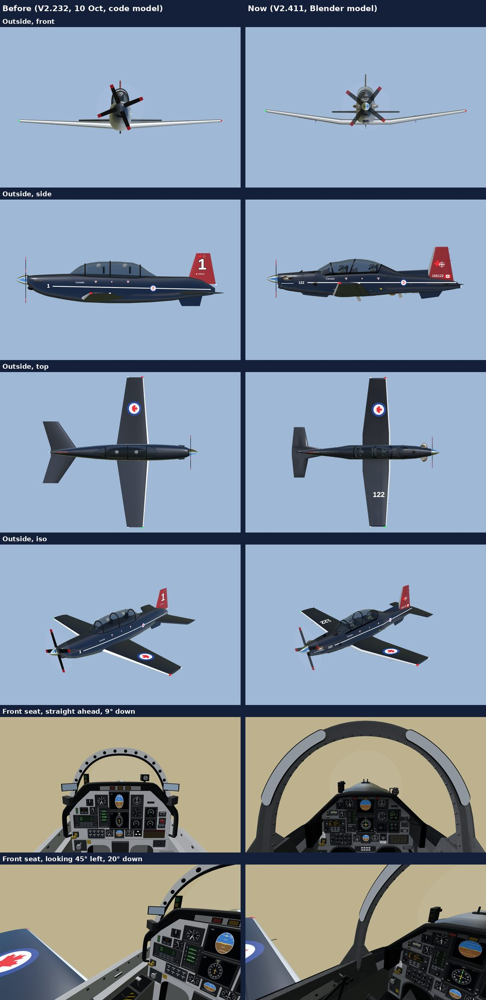
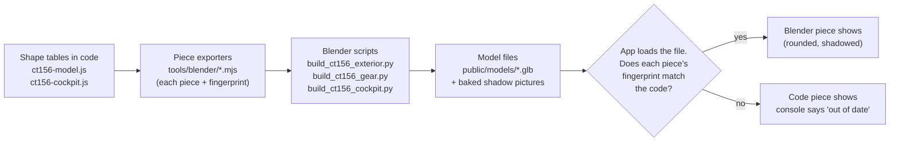
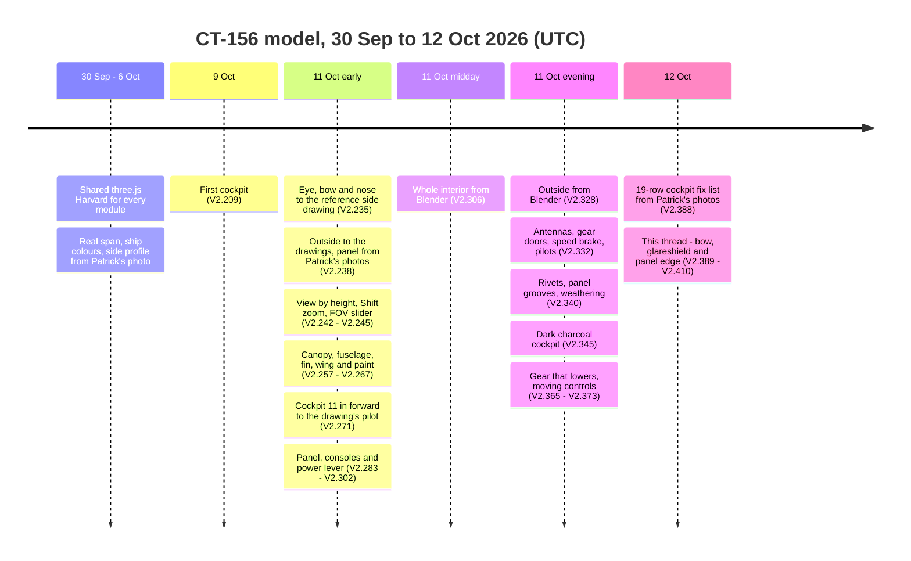
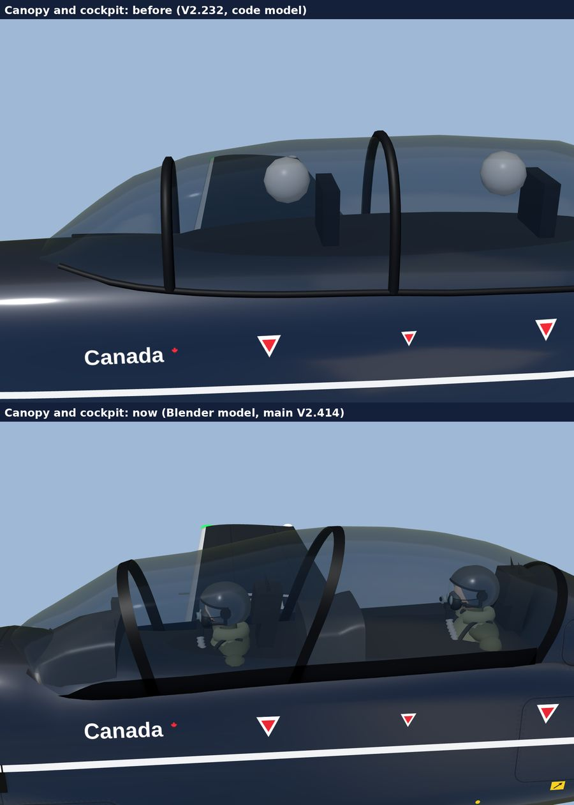

# Graphics handover: the CT-156 model (12 Oct 2026, main at V2.417)

This note is for whoever picks up the 3D aircraft next. It explains what was built, why it was built that way, and what is still open. The CT-156 model has not changed since V2.410; the versions after it are other modules.

Read this first, then `tools/blender/README.md` (how to rebuild the model files) and the "Cockpit (shared 3D)" part of [future.md](../future.md) (open items).

*Left: V2.232 (10 Oct), the code-drawn model. Right: today's model, built in Blender from the same code tables. Outside front, side, top and iso, then the front seat straight ahead and looking 45° left.*

## 0. What the CT-156 code does, and where each part goes (ALL-38, 12 Oct 2026)

The rule book asks for a list of what code did before it is rewritten or retired. Six modules use the CT-156 code:
Debrief, EP Tabletop, SOF, Traffic, Turn Fight and Formation.

| What the code does | Where it goes under ALL-38 |
|---|---|
| The shape: fuselage, wing, tail, canopy, gear, cockpit structure, panel shell, seats (about 4,000 of the 6,000 lines in `ct156-model.js` and `ct156-cockpit.js`) | Blender: the master file `ct156/ct156.blend` in `3d-work` |
| Every size's source (comments beside the numbers) | `ct156/sources.md` in `3d-work`, one row per size, moved over as parts are edited |
| Eye points (ALL-31), bow and nose positions | Named points in the master file; ALL-31's numbers, with the later 11 in move forward, become size checks |
| Reference points: wingtip lights, exhausts, stab and fin tips, bow crests (Debrief uses them) | Named points in the master file, also delivered as a small data file so the code can read them before the model loads |
| Live instruments: EADI, gauges, annunciators, master lamps (EP Tabletop drives them) | Stays code, drawn onto the instrument faces the master file names |
| Head lean to see Lead past the bow; camera, field of view, zoom | Stays code; it uses the bow's blocking shapes (the occluders) from the file |
| Gear sequence (6 s), aileron, elevator, rudder, flap and speed-brake travel (ALL-34, ALL-35), prop spin | Stays code; the hinges come from the file |
| Paint schemes, ship numbers and serials | Stays code (two more paints, `usaf` and `usn`, added in code on 17 Oct 2026: ALL-45, proposed, built ahead of Patrick's yes; the shape is untouched) |
| Lights, canopy glass | Stays code |
| Pilots | Blender (in the master since 12 Oct 2026, collection Pilots) |
| Fingerprints | Replaced by the delivery check (plan 3.4, 13 Oct 2026): the app loads a model file only when every part carries the name of the delivery in `public/models/ct156/delivery.json`, written by `npm run models:import` (`tools/blender/README.md`) |
| The light Harvard for distant aircraft | Unchanged |

In the master file (plan Step 3b item 3.3, done 12 Oct 2026): the outside's 17 parts and the mirrored right aileron and
flaps, the gear (down), the cockpit, 14 named points, 19 hinges and the 10 instrument faces; and the parts the code drew
itself: the speed brake and its well, the gear and flap wells, the prop blades, the exhaust stacks, the cockpit floor
and coamings seen from outside, the tub seen from the seats, and the two pilots. Still drawn by the code, as the table
says: the canopy glass, lights, cheat line, decals and ship numbers, and the prop's blur disc.

## 1. How the model is made

**Since plan 3.4 (13 Oct 2026)** the files are made from the `3d-work` master by its delivery command and taken in by
`npm run models:import`; the code-table pipeline below is the record of how they were made before ALL-38, and the
fingerprint check it describes is gone (section 0).

**Changed by ALL-38 (12 Oct 2026):** Blender now owns the shape, in master files in the private repo `3d-work`, and
the app takes finished, checked files. This section describes the model as built up to V2.418, from the code tables;
the move is plan Step 3b in `docs/modules/shared/plan.md`, and the next handover is
`Pat's claude work/graphics-handover-12oct-night.md`.

The code is the one source of the aircraft's shape. Blender never invents a shape: it takes the code's own pieces, rounds them, bakes their soft shadows and panel lines, and writes model files the app swaps in.

Why it works this way:

- **One source of truth.** Every size lives in a code table with its source beside it. Changing a number in code and rebuilding is the only way to change the shape.
- **Fingerprints catch a forgotten rebuild.** Each piece carries a hash of its code shape. If the code changes and nobody rebuilds, that piece falls back to the code's version: it loses its rounding and shadows, but it never shows a stale shape. The outside is all-or-nothing; the cockpit and gear go piece by piece.
- **Rebuild after every shape change.** Rebuild times: the outside about 5 minutes, the gear under 1, the cockpit a few minutes. Blender 4.2 LTS runs without its window in the cloud container; it isn't kept between containers, so each session downloads it again.

Coordinates, for anyone reading the tables: model units, nose +X, left +Y, up +Z, 1 unit = 23.148 ft (33 ft 4 in over 1.44 units). The cockpit tables are in feet.

## 2. What was built, in order

### Before this thread (the Blender thread and Fable, 9 to 12 Oct)

- **Seat view (V2.235 to V2.245):** the front eye was fitted to the reference side drawing and raised 2 in at Patrick's call; the rear eye was later set so the front headbox sits on the horizon at 220 KIAS. Seat views are framed by height, so a wide screen no longer crops the panel. Hold Shift to zoom; the FOV slider starts at 55°.
- **Outside to the drawings (V2.238 to V2.267):** fuselage stations, canopy, fin, tail, wing (3 sections, 8.4° dihedral) and belly were measured off the reference side and top views. One finding mattered: the drawing's 33 ft 4 in runs from the spinner tip to the elevator trailing edge, not to the tail cone, so the earlier tail numbers sat about 1.5 ft aft. Paint is 156102's, numbered 122.
- **Cockpit moved forward (V2.270, V2.271):** the windscreen and bow came 7 in forward, and the whole front cockpit (seat, eye, panel, glareshield) came 11 in forward to where the drawing puts the pilot. Patrick's rule for the eye: the bow's legs and the Lead picture have to look right from the seat.
- **Panel and consoles (V2.283 to V2.302):** displays, bezels, EADI, consoles and power lever were laid out from the panel figures and Patrick's photos.
- **Blender (V2.306 to V2.373):** first the interior, then the outside (V2.328), then the gear and moving controls. The bake adds panel-line grooves and rivets (bump map) and light soot, oil and grime.
- **V2.388:** a 19-row fix list from Patrick's photos covered colours, mirrors, lamps, compass, pilots (helmet, visor, mask, vest), eyes and seats.
- **Lesson that thread left:** it ran long, and Patrick's notes arrived late or out of order. Some claims came from out-of-date renders, and an agent stalled unnoticed. Patrick asked for a fresh thread, and this one started from its handover.

### This thread (12 Oct, V2.389 to V2.410)

The root cause of "fixes never showing" came first. The cockpit model file drew its own bow and rails from a few numbers, with no fingerprint, so the app always showed Blender's old bow whatever the code said. From V2.389 the bow and rails are built from the code's pieces with fingerprints, like everything else.

| Version | What changed | Why (Patrick's words or ruling) |
|---|---|---|
| V2.389 | Solid canopy bow and rails, panel 1 in lower, whole EADI in view | The bow went paper-thin when he moved his head; the lamp strip hid the EADI at the 220 KIAS eye |
| V2.391 | Bow built to his sketch: flanges, bolts, feet into a plate, bow in our cockpit grey | His reference picture is the target for construction only; "should match our interior" |
| V2.396 | Bow feet rounded, glareshield sides a flat grey panel, bolts as hex nuts, clipping cleaned up | His cards "Both, our grey" and "At the feet" |
| V2.398 | Head-lean look-around clears the new bow and the nose; exhaust spikes gone | Leaning to see Lead must not put the eye inside a part |
| V2.401 | Paint grain and scuffs inside, sooty stack insides, compass lowered | "too high now, look at the other cockpit" |
| V2.403 | Canopy section a U (straight sides, round top) | "why does our bow look like an arch?" He said not to change the bow shape yet, and asked for a middle ground that doesn't break everything |
| V2.404 | Bow feet flare into a riveted gusset plate | His in-flight photos looking left |
| V2.405 | Bow a T again: 1.9 in flange, thin web, small lip, one row of nuts | "we lost the t shape?", "Ya the flange stays too but render it nicely" |
| V2.409 | Glareshield sides smooth black, ending in a short drop flush with the sill | "smooth black and no sharp edges sticking"; "ends in a short vertical section ... flush with the inside of the sill" |
| V2.410 | Panel face kept under the glareshield hood | "Isn't this sticking over? This grey?" |

How each fix was checked: a fresh Blender rebuild, then renders from the same seat views, with no "out of date" warning in the console, on one sheet beside Patrick's photo.

More close-ups, old above new: [nose](closeup-nose.jpg), [tail](closeup-tail.jpg), [underside](closeup-under.jpg).

### After this thread (12 Oct, V2.418)

- **The light Harvard** (SH-59): `createLightHarvard` in `ui-kit/three-aircraft.js`, the plain T-6 shape in navy, for every aircraft that isn't being looked at closely. Traffic draws the full CT-156 only for the aircraft followed or flown in (TR-152).
- **The blurred prop disc** (`blurProp`) moved to `ui-kit/three-aircraft.js`; Traffic and the Formation sim both use it, faint (20%) from the own seat.
- **Real-time shadows are off in every module** for now (ALL-37), one switch in `ui-kit/aircraft-shadows.js`.

## 3. The logic we kept to

- **Patrick's photos and words beat a figure.** His reference picture set the construction (how parts are built) but not the colours, which stay our cockpit grey and black.
- **Change the least that fixes it.** When the bow looked like an arch, raising the sill would have meant refitting the whole cockpit. Changing only the canopy's cross-section to a U fixed the look and moved nothing else.
- **Build from code, then rebuild Blender, then render.** A render taken before the rebuild shows the code's parts, not Blender's, and has fooled us before.
- **Every size carries its source.** That's Patrick's ruling, his photo (as an estimate scaled off a known size, such as the bolt pitch), or a reference drawing cited by page in private notes only. Estimates are marked as estimates in the code.
- **One writer.** `src/ui-kit/ct156-cockpit.js` and `public/models/ct156-cockpit.glb` have one owner thread at a time. Changes to `ct156-model.js` (the outside) or the shared 3D files are agreed with the coordinator first.

## 4. How to render and check

- Turn Sim from the default start, cockpit view, front seat: look ahead and to both sides, then the rear seat. Give the model a few seconds to load.
- The render scripts are in `tools/blender/render/` (see its README): seat and outside views, part picking, and past versions in a separate git worktree. That's how the pictures above were made. The one trap: draw once, wait for the model files to attach, then draw again before taking the picture.

## 5. Open items

- **Sill height.** Our bow is about 32.8 in wide and 26 in tall, standing on a 7 in sill. Readings of the real one say about 10 in (side view) to 15 in (front view). This waits on Patrick's tape measurements from the seat: the bow's width at the sill, its height, and its width at half height. Nothing is built for it yet.
- **Not yet seen:** the rear seat after V2.403, phones, and the head-lean look-around flown live.
- **Paint grain:** Patrick hasn't said whether the interior grain should be heavier.
- **Pilots** are drawn in code, so they have no rounded edges or baked shadows.
- **Dark left wall:** the sky light in the 3D scenes shines along +Y instead of up. A one-line fix per scene points it up, but it changes every module's look, so it waits for Patrick's yes (see [future.md](../future.md)).
- **Live sun shadows** in the cockpit are a future idea (future.md).
- **Tags:** `v2.385` to `v2.410` still need Patrick to push them (`Pat's claude work/tags-to-push.md`).
