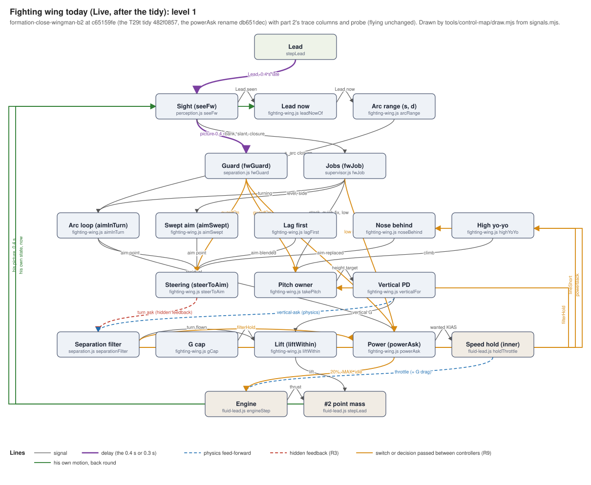
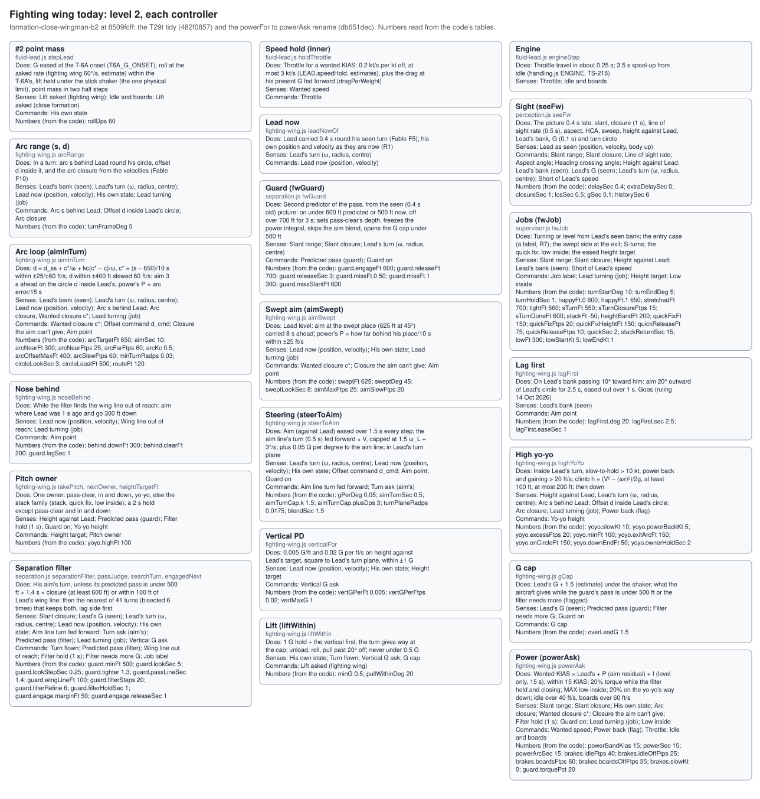
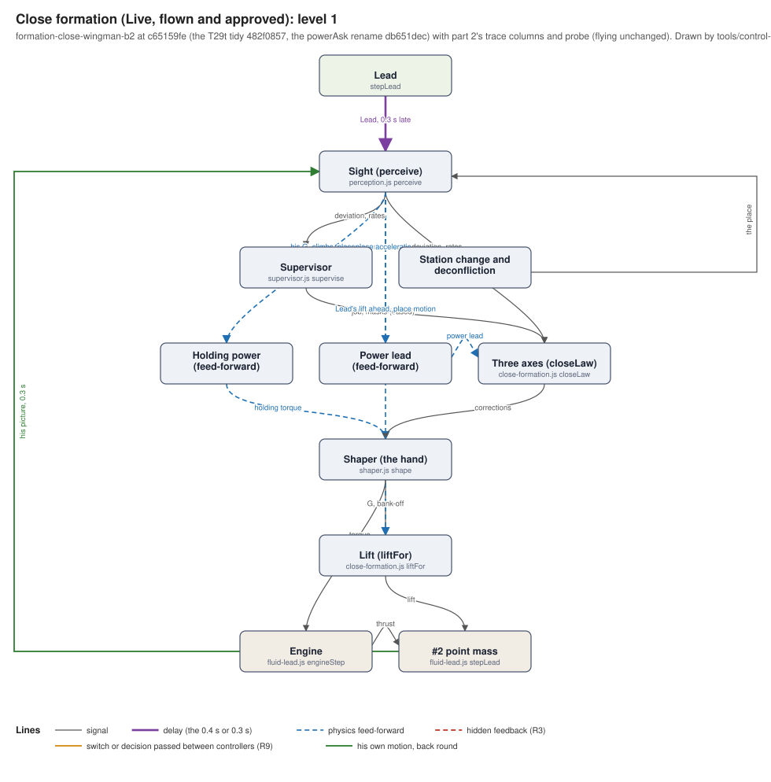
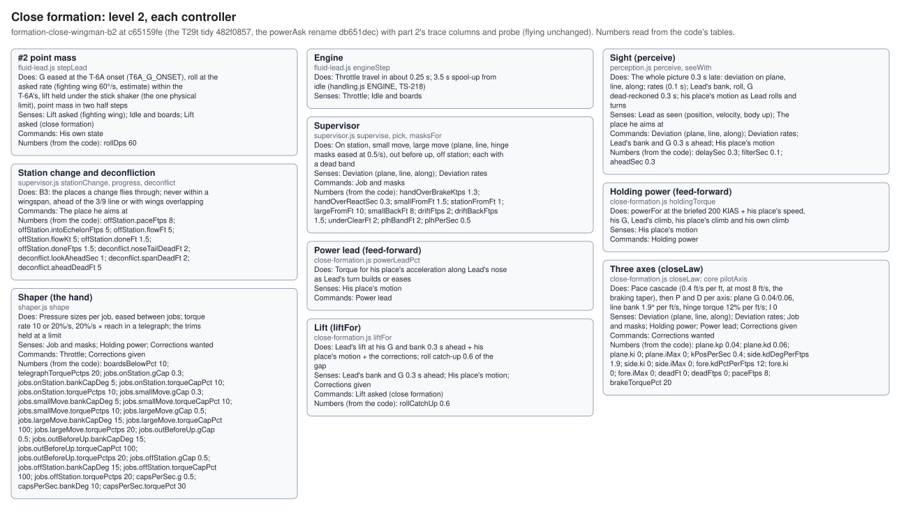
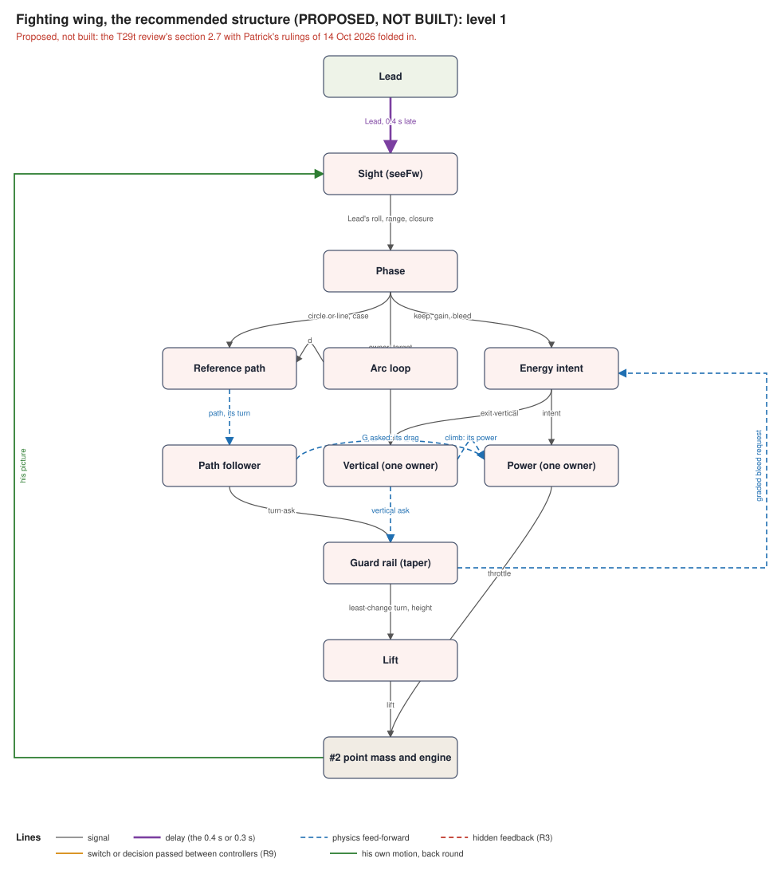
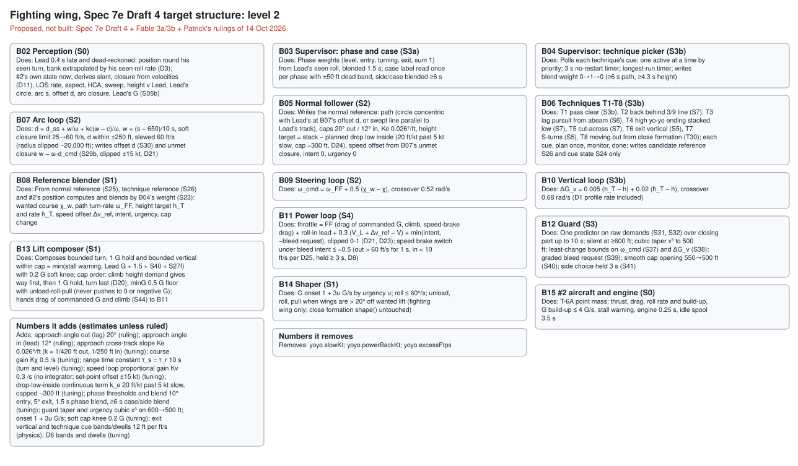
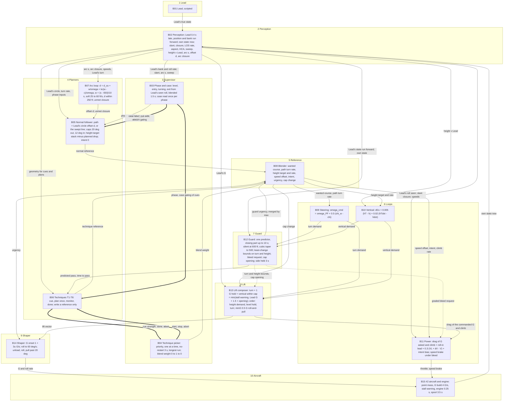
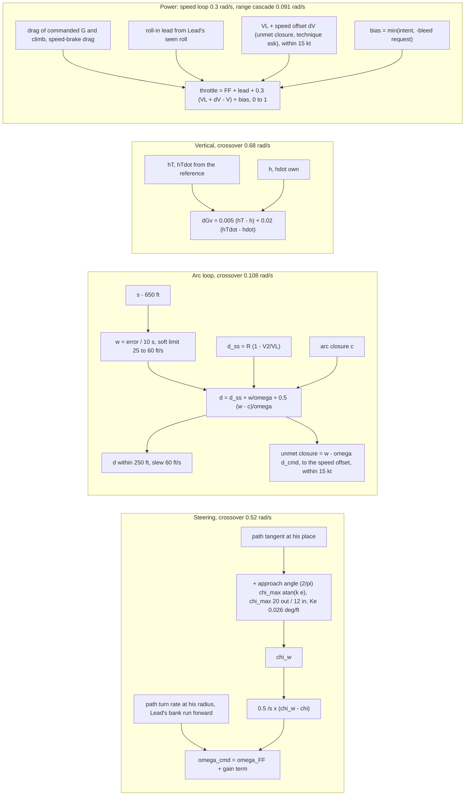
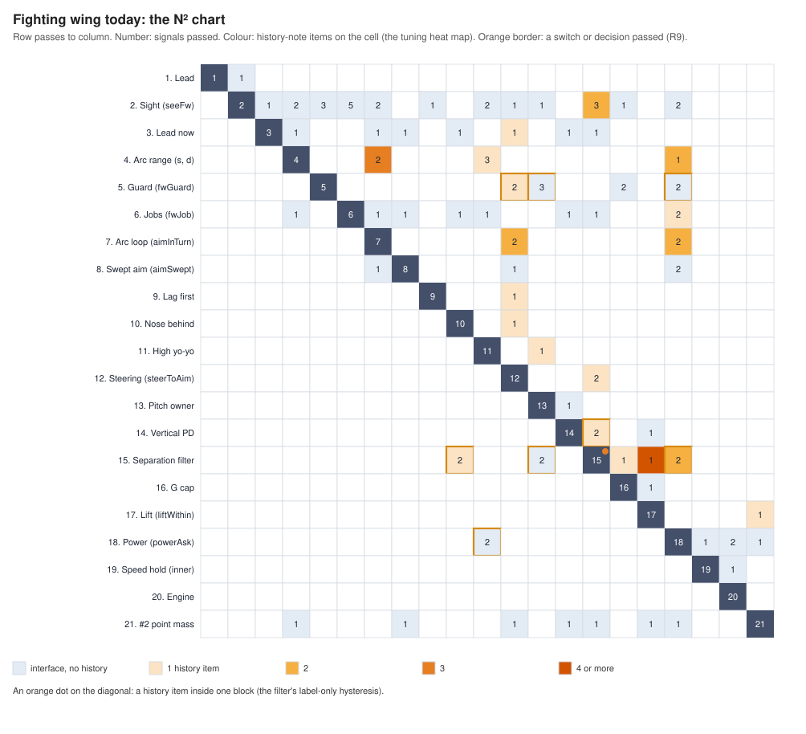

# The live wingman's control model

<!-- Made by `node tools/control-map/draw.mjs` from tools/control-map/model.template.md and signals.mjs. Do not edit by hand. -->

**What this is.** The control-systems model of #2, the live wingman, in fighting wing and close formation: every controller, what it senses and commands, how the controllers share the controls, how they are tuned, and a first cut of each loop's speed and margins. Plan T29m part 1 (Patrick 14 Oct 2026: "build the system we asked originally, including its reccomendations"); the method is `Pat's claude work/formation-review-12oct/control-systems-analysis-plan.md`. It describes the code as built and changes nothing in flight. Every number here comes from the code, a ruling, a manual page or standard physics, or is an estimate; the loop margins are all estimates until part 2's rig checks them against the sim. The thread, the rule book (`AGENTS.md`), spec 7b and 7e and TS-233 win over anything here.

**Status.** formation-close-wingman-b2 at c65159fe (the T29t tidy 482f0857, the powerAsk rename db651dec) with part 2's trace columns and probe (flying unchanged). 14 Oct 2026, plan T29m parts 1 and 2 (Opus, high). An estimate of the code as built, read by hand; the trace columns and the ledger are checked by check.mjs. Nothing here changes how anything flies.

**How it stays true to the code.** One master list (`tools/control-map/signals.mjs`) holds every block, signal, rule, switch and number role. This page and its pictures are drawn from it (`draw.mjs`), and a check (`check.mjs`) compares it with a gauge run's trace columns and with the code's tuning tables, failing on a missing row, an unknown column or an unlisted number. When a wingman file changes, run the check; if it fails, the master list changes in the same piece of work. The steps are in `tools/control-map/README.md`.

**Words used here.**
- **Loop:** a controller that measures something, compares it with what it wants, and moves a control to close the gap (feedback).
- **Feed-forward:** a control set from what is known to be coming (Lead's bank, the drag of his own G), not from an error.
- **Hidden feedback:** something labelled feed-forward that also carries #2's own motion back into his command, so it is really part of a loop.
- **Crossover:** how fast a loop works (rad/s); 1 ÷ crossover is roughly the time it corrects over.
- **Phase margin, gain margin:** how far a loop is from oscillating, in extra lag (degrees) or extra gain (dB).
- **Extra-delay margin:** how much more reaction delay it could take before it chases.
- **Switch, hysteresis, hold:** an on/off rule; different on and off lines so it doesn't flicker; a minimum time in one state.
- **Phased blend:** a controller's say that grows smoothly with a measure (how near a limit, how long since a hand-over), never on/off. Section 9.
- **N² chart:** a grid with the controllers on the diagonal; the cell in row A, column B says what A passes to B.

---

## 1. Findings: R1-R10 checked against the tidied code, and two new

- **R1 (confirmed).** Fighting wing delays Lead only (dead-reckoned 0.4 s; leadNowOf); close formation the whole picture 0.3 s. Corrected in detail: three more delay kinds sit inside fighting wing. The slant, slant closure, aspect, HCA, height and the guard read the whole picture 0.4 s late (seeFw buffers both aircraft); the wanted speed and the swept place's closure read Lead 0.4 s late without the dead-reckoning (seen.lead.v). So one technique mixes three delays (DELAYS: leadDr, leadLate, picture04).
- **R2 (confirmed).** Two closures. Arc closure (velocities, now; level, the closure on the swept place) feeds the arc loop, the yo-yo, the power cut and the brakes in a turn; slant closure (1 s, 0.4 s late) feeds the pass line, S-turns, the quick fix, the exit side, the entry case, the brakes level and their "where". The power cut trips on the arc closure while the filter's line moves with the slant closure.
- **R3 (confirmed).** The aim line's turn fed forward is hidden feedback: the line turns with his own motion. Linearised (fw_loops.py), it adds a rate term V/L ≈ 0.33 /s on his heading: it acts like damping, not like feed-forward.
- **R4 (confirmed).** Power is three in series: powerAsk's wanted KIAS, holdThrottle (0.2 kt/s per kt, ≤ 3 kt/s, G drag fed forward), the engine. The inner hold's numbers are LEAD.speedHold, shared with Lead.
- **R5 (corrected).** Two owners of the arc error, but they don't add. The arc loop's d_ss = R(1 − V2/V_L) moves the offset outward by ΔV/ω for every ft/s power adds, so in a steady turn the closure is the arc loop's alone: power's arc term only chooses how much of it is speed and how much is offset (faster sits further outside). The plan's 0.15 rad/s "together" was wrong; fw_loops.py gives power almost no loop gain on closure.
- **R6 (confirmed).** liftWithin keeps the 1 G hold and the vertical, and cuts the turn at the cap. The filter replaces the steering's turn while failing, so the steering loop is open then. In the cm gauge run the job label reads "guard-filter" for 14-97% of the steady part of each academic turn (a scratch count; engaged is a label, so the share of steps it actually changes the turn is part 2's T29r column).
- **R7 (confirmed).** fwJob's entry case flies nothing; the jobs label it only.
- **R8 (confirmed).** fwGuard predicts from the 0.4 s old picture holding his own present turn, no vertical; the filter from now with the capture and the vertical. The guard decides pass-clear, the power integral, the aim blend and the cap; the filter the turn and the power cut.
- **R9 (confirmed).** Switch-to-switch links: power back → yo-yo; filter lineShort → nose behind; filter hold → power cut and pass-clear; guard on → pass-clear, aim blend, power I. One good link: the vertical ask → the filter's prediction (physics).
- **R10 (confirmed).** Close formation: holdingTorque and powerLeadPct fed forward into torque, Lead's lift and his place's motion into the one lift vector, three pilotAxis loops on what is left; job changes eased (masks, caps). The cross-feed pattern working.
- **R11 (new).** The aim is eased every step, not only at a change of aim. steerToAim eases his aim's offset against Lead (world axes) over 1.5 s every step, so in a steady turn the aim point lags Lead's rotation by atan(ω × 1.5 s): about 12° at 60°/2 G, 26° at 4 G. In the cm run the commanded and flown offset differ by a median 90-400 ft in the steady part of the turns away, outside the filter. A likely contributor; part 2's rig confirms or clears it.
- **R12 (new).** Three signals the spec meant for the supervisor are read by nothing: line of sight (the guard's reversal cue went with the tidy), aspect and HCA. Trace only.
- **R13 (new (part 2)).** The rig confirms the linear models where the filter is quiet: the vertical, steering on the swept line and the speed hold (straight and level) each match their model within 30% in time and 10 points of overshoot. One model fix: the vertical's D acts on his height rate, not on the error, so a change of target goes through P only (no 19% overshoot; 1% in both). In Lead's 60° turn the arc loop and the offset can't be checked linearly at all: at the trim the code settles to (604 ft of arc, 102 ft inside, 228 ft low) the filter flies him half the time.
- **R14 (new (part 2)).** Truly abeam (0-15° of sweep at 625 ft) the formation reads "other", not fighting wing, and refuses Lead's fighting wing presses; the gauge's abeam case sits at 20°, the nearest it accepts. From there, Lead turning into him: #2 banks the same way as Lead 92% of the first 10 s (to 52-90° against Lead's 60°), the filter flies 98% of the turn, and he ends 49° ahead of Lead's 3/9 line, 302 ft low and 23.5 kt slow, the throttle changing owner 37 times.
- **R15 (new (part 2)).** Patrick's "overcontrolling ... aimpoint and roll and G" measured: G onset up to 1.7-3.3 G/s in every academic turn (1-5 s a turn over 1 G/s), 2-137 aim jumps a turn (into tight 137), 3-24.5 s a turn over Lead's G + 0.5. "Too low": 8-25 s a turn more than 100 ft below the stack, lowest 240-315 ft in the turns. Energy: into tight loses 27 kt against Lead for 40 G·s of G over Lead's. Torque: up to 36 swings of 30 points a turn.

## 2. Block diagrams

### 2.1 Fighting wing today, level 1

1. **Lead**: Flies his programme; never reads #2 (TS-211)
2. **Sight (seeFw)**: The picture 0.4 s late: slant, closure (1 s), line of sight rate (0.5 s), aspect, HCA, sweep, height against Lead, Lead's bank, G (0.1 s) and turn circle · **Lead now**: Lead carried 0.4 s round his seen turn (Fable F5); his own position and velocity as they are now (R1) · **Arc range (s, d)**: In a turn: arc s behind Lead round his circle, offset d inside it, and the arc closure from the velocities (Fable F10)
3. **Guard (fwGuard)**: Second predictor of the pass, from the seen (0.4 s old) picture: on under 600 ft predicted or 500 ft now, off over 700 ft for 3 s; sets pass-clear's depth, freezes the power integral, skips the aim blend, opens the G cap under 500 ft · **Jobs (fwJob)**: Turning or level from Lead's seen bank; the entry case (a label, R7); the swept side at the exit; S-turns; the quick fix; low inside; the eased height target
4. **Arc loop (aimInTurn)**: d = d_ss + c*/ω + kc(c* − c)/ω, c* = (s − 650)/10 s within ±25/±60 ft/s, d within ±400 ft slewed 60 ft/s; aim 3 s ahead on the circle d inside Lead's; power's P = arc error/15 s · **Swept aim (aimSwept)**: Lead level: aim at the swept place (625 ft at 45°) carried 8 s ahead; power's P = how far behind his place/10 s within ±25 ft/s · **Lag first**: On Lead's bank passing 10° toward him: aim 20° outward of Lead's circle for 2.5 s, eased out over 1 s. Goes (ruling 14 Oct 2026) · **Nose behind**: While the filter finds the wing line out of reach: aim where Lead was 1 s ago and go 300 ft down · **High yo-yo**: Inside Lead's turn, slow-to-hold > 10 kt, power back and gaining > 20 ft/s: climb h = (V² − (ωr)²)/2g, at least 100 ft, at most 200 ft; then down
5. **Steering (steerToAim)**: Aim (against Lead) eased over 1.5 s every step; the aim line's turn (0.5 s) fed forward × V, capped at 1.5 ω_L + 3°/s; plus 0.05 G per degree to the aim line; in Lead's turn plane · **Pitch owner**: One owner: pass-clear, in and down, yo-yo, else the stack family (stack, quick fix, low inside); a 2 s hold except pass-clear and in and down · **Vertical PD**: 0.005 G/ft and 0.02 G per ft/s on height against Lead's target, square to Lead's turn plane, within ±1 G
6. **Separation filter**: His aim's turn, unless its predicted pass is under 500 ft + 1.4 s × closure (at least 600 ft) or within 100 ft of Lead's wing line: then the nearest of 41 turns (bisected 6 times) that keeps both, lag side first · **G cap**: Lead's G + 1.5 (estimate) under the shaker; what the aircraft gives while the guard's pass is under 500 ft or the filter needs more (flagged) · **Lift (liftWithin)**: 1 G hold + the vertical first, the turn gives way at the cap; unload, roll, pull past 20° off; never under 0.5 G · **Power (powerAsk)**: Wanted KIAS = Lead's + P (aim residual) + I (level only, 15 s), within 15 KIAS; 20% torque while the filter held and closing; MAX low inside; 20% on the yo-yo's way down; idle over 40 ft/s, boards over 60 ft/s · **Speed hold (inner)**: Throttle for a wanted KIAS: 0.2 kt/s per kt off, at most 3 kt/s (LEAD.speedHold, estimates), plus the drag at his present G fed forward (dragPerWeight)
7. **Engine**: Throttle travel in about 0.25 s; 3.5 s spool-up from idle (handling.js ENGINE, TS-218) · **#2 point mass**: G eased at the T-6A onset (T6A_G_ONSET), roll at the asked rate (fighting wing 60°/s, estimate) within the T-6A's, lift held under the stick shaker (the one physical limit), point mass in two half steps

**Level 2** (each controller: what it does, senses, commands, and its numbers read from the code): [fw-today-level2.svg](control-model/fw-today-level2.svg).

### 2.2 Close formation, level 1 (the reference design)

1. **Lead**: Flies his programme; never reads #2 (TS-211)
2. **Sight (perceive)**: The whole picture 0.3 s late: deviation on plane, line, along; rates (0.1 s); Lead's bank, roll, G dead-reckoned 0.3 s; his place's motion as Lead rolls and turns
3. **Supervisor**: On station, small move, large move (plane, line, hinge masks eased at 0.5/s), out before up, off station; each with a dead band · **Station change and deconfliction**: B3: the places a change flies through; never within a wingspan, ahead of the 3/9 line or with wings overlapping
4. **Holding power (feed-forward)**: powerFor at the briefed 200 KIAS + his place's speed, his G, Lead's climb, his place's climb and his own climb · **Power lead (feed-forward)**: Torque for his place's acceleration along Lead's nose as Lead's turn builds or eases · **Three axes (closeLaw)**: Pace cascade (0.4 ft/s per ft, at most 8 ft/s, the braking taper), then P and D per axis: plane G 0.04/0.06, line bank 1.9° per ft/s, hinge torque 12% per ft/s; I 0
5. **Shaper (the hand)**: Pressure sizes per job, eased between jobs; torque rate 10 or 20%/s, 20%/s × reach in a telegraph; the trims held at a limit
6. **Lift (liftFor)**: Lead's lift at his G and bank 0.3 s ahead + his place's motion + the corrections; roll catch-up 0.6 of the gap
7. **Engine**: Throttle travel in about 0.25 s; 3.5 s spool-up from idle (handling.js ENGINE, TS-218) · **#2 point mass**: G eased at the T-6A onset (T6A_G_ONSET), roll at the asked rate (fighting wing 60°/s, estimate) within the T-6A's, lift held under the stick shaker (the one physical limit), point mass in two half steps

**Level 2:**

### 2.3 Fighting wing, the recommended target structure (Spec 7e Draft 4 + Fable 3a/3b, `B01–B15`, `S01–S45`)

Spec 7e Draft 4 reconciled with Fable's control-systems model and audit (`fable-draft-4-model-report-14oct-mapped.md` `D1–D20` and follow-up `fable-draft-4-model-report-3b-14oct-mapped.md` `D21–D26`) and Patrick's rulings of 14 Oct 2026 (`TS-233`, `TS-234`):
- **One delay rule (`B02`):** Lead seen 0.4 s late and dead-reckoned (position around his seen turn, bank run forward by his seen roll rate, `D3`); #2's own state known now; slant closure computed directly from velocities with no 1 s smoother (`D11`).
- **One normal follower (`B05`) and arc loop (`B07`):** follows Lead's circle at offset $d \in [-250, +250]\text{ ft}$ or the swept line ($K_\chi = 0.5\text{ /s}$, $K_e = 0.026^\circ/\text{ft}$, caps $20^\circ$ out / $12^\circ$ in, `D2`); one $10\text{ s}$ range constant ($\tau_s = \tau_r = 10\text{ s}$, $k_c = 0.5$, `D10`) with unmet closure $w - \omega \cdot d_{\text{cmd}}$ (`S29b`, clipped $\pm 15\text{ kt}$) feeding the speed set-point offset $\Delta v_{\text{ref}}$ (`S27g`, `D21`) and a continuous drop-low-inside height term ($20\text{ ft/kt}$ past $5\text{ kt}$ slow, capped $-300\text{ ft}$, `D24`).
- **Techniques (`B06`, `T1–T8`) plan once and write only the reference (`S26`):** blended by `B08` (`S27a–g`) over $\ge 6\text{ s}$ path and $\ge 4.3\text{ s}$ height (`D5`); in the miss (`T1`), #2 rolls and pulls positive G (`minG = 0.5 G` floor via unload-roll-pull, never pushing to 0 or negative G).
- **One set of loops (`B09` steering, `B10` vertical with profile rate `D1`, `B11` proportional $0.3\text{ /s}$ speed loop with physics feed-forwards `D23`), one barrier guard (`B12`, cubic $x^3$ taper $600 \to 500\text{ ft}$), lift composer (`B13`, cap order: climb height demand first, 1 G hold second, turn last, `0.2 G` knee `D20`, `D22`), and urgency shaper (`B14`, $1 + 3u\text{ G/s}$).**

1. **B01 Lead (scripted)**: Flies the test script; never reads #2; the only source of Lead's truth
2. **B02 Perception**: Lead 0.4 s late and dead-reckoned: position round his seen turn, bank extrapolated by his seen roll rate (D3); #2's own state now; derives slant, closure from velocities (D11), LOS rate, aspect, HCA, sweep, height v Lead, Lead's circle, arc s, offset d, arc closure, Lead's G (S05b)
3. **B03 Supervisor: phase and case**: Phase weights (level, entry, turning, exit, sum 1) from Lead's seen roll, blended 1.5 s; case label read once per phase with ±50 ft dead band, side/case blended ≥6 s · **B04 Supervisor: technique picker**: Polls each technique's cue; one active at a time by priority; 3 s no-restart timer; longest-run timer; writes blend weight 0→1→0 (≥6 s path, ≥4.3 s height)
4. **B07 Arc loop**: d = d_ss + w/ω + kc(w − c)/ω, w = (s − 650)/10 s, soft closure limit 25→60 ft/s, d within ±250 ft, slewed 60 ft/s (radius clipped ~20,000 ft); writes offset d (S30) and unmet closure w − ω·d_cmd (S29b, clipped ±15 kt, D21) · **B05 Normal follower**: Writes the normal reference: path (circle concentric with Lead's at B07's offset d, or swept line parallel to Lead's track), caps 20° out / 12° in, Ke 0.026°/ft, height target = stack − planned drop low inside (20 ft/kt past 5 kt slow, cap −300 ft, D24), speed offset from B07's unmet closure, intent 0, urgency 0 · **B06 Techniques T1-T8**: T1 pass clear (S3b), T2 back behind 3/9 line (S7), T3 lag pursuit from abeam (S6), T4 high yo-yo ending stacked low (S7), T5 cut-across (S7), T6 exit vertical (S5), T7 S-turns (S5), T8 moving out from close formation (T30); each cue, plan once, monitor, done; writes candidate reference S26 and cue state S24 only
5. **B08 Reference blender**: From normal reference (S25), technique reference (S26) and #2's position computes and blends by B04's weight (S23): wanted course χ_w, path turn-rate ω_FF, height target h_T and rate ḣ_T, speed offset Δv_ref, intent, urgency, cap change
6. **B09 Steering loop**: ω_cmd = ω_FF + 0.5 (χ_w − χ), crossover 0.52 rad/s · **B10 Vertical loop**: ΔG_v = 0.005 (h_T − h) + 0.02 (ḣ_T − ḣ), crossover 0.68 rad/s (D1 profile rate included) · **B11 Power loop**: throttle = FF (drag of commanded G, climb, speed-brake drag) + roll-in lead + 0.3 (V_L + Δv_ref − V) + min(intent, −bleed request), clipped 0-1 (D21, D23); speed brake switch under bleed intent ≤ −0.5 (out > 60 ft/s for 1 s, in < 20 ft/s, held ≥ 3 s, D8, D25)
7. **B12 Guard**: One predictor on raw demands (S31, S32) over closing part up to 10 s; silent at ≥600 ft; cubic taper x³ to 500 ft; least-change bounds on ω_cmd (S37) and ΔG_v (S38); graded bleed request (S39); smooth cap opening 550→500 ft (S40); side choice held 3 s (S41)
8. **B13 Lift composer**: Composes bounded turn, 1 G hold and bounded vertical within cap = min(stall warning, Lead G + 1.5 + S40 + S27f) with 0.2 G soft knee; cap order: climb height demand gives way first, then 1 G hold, turn last (D20); minG 0.5 G floor with unload-roll-pull (never pushes to 0 or negative G); hands drag of commanded G and climb (S44) to B11
9. **B14 Shaper**: G onset 1 + 3u G/s by urgency u; roll ≤ 60°/s; unload, roll, pull when wings are > 20° off wanted lift (fighting wing only; close formation shape() untouched)
10. **B15 #2 aircraft and engine**: T-6A point mass: thrust, drag, roll rate and build-up, G build-up ≤ 4 G/s, stall warning, engine 0.25 s, idle spool 3.5 s

#### Level 1 architecture diagram (Mermaid, reconciled `B01–B15`)

#### Level 2 loop architecture diagram (Mermaid, `B07`, `B09`, `B10`, `B11`)

#### Target blocks (`B01–B15`)

| ID | Block | Kind | File | Slice | Status | What it does |
|---|---|---|---|---|---|---|
| B01 | B01 Lead (scripted) | aircraft | `live/manoeuvres.js` | S0 | built | Flies the test script; never reads #2; the only source of Lead's truth |
| B02 | B02 Perception | perception | `live/wingman/perception.js` | S0 | built | Lead 0.4 s late and dead-reckoned: position round his seen turn, bank extrapolated by his seen roll rate (D3); #2's own state now; derives slant, closure from velocities (D11), LOS rate, aspect, HCA, sweep, height v Lead, Lead's circle, arc s, offset d, arc closure, Lead's G (S05b) |
| B03 | B03 Supervisor: phase and case | supervisor | `live/wingman/supervisor.js` | S3a | built | Phase weights (level, entry, turning, exit, sum 1) from Lead's seen roll, blended 1.5 s; case label read once per phase with ±50 ft dead band, side/case blended ≥6 s |
| B04 | B04 Supervisor: technique picker | supervisor | `live/wingman/supervisor.js` | S3b | built | Polls each technique's cue; one active at a time by priority; 3 s no-restart timer; longest-run timer; writes blend weight 0→1→0 (≥6 s path, ≥4.3 s height) |
| B05 | B05 Normal follower | planner | `live/wingman/fighting-wing.js` | S2 | built | Writes the normal reference: path (circle concentric with Lead's at B07's offset d, or swept line parallel to Lead's track), caps 20° out / 12° in, Ke 0.026°/ft, height target = stack − planned drop low inside (20 ft/kt past 5 kt slow, cap −300 ft, D24), speed offset from B07's unmet closure, intent 0, urgency 0 |
| B06 | B06 Techniques T1-T8 | technique | `live/wingman/techniques/` | S3b | built | T1 pass clear (S3b), T2 back behind 3/9 line (S7), T3 lag pursuit from abeam (S6), T4 high yo-yo ending stacked low (S7), T5 cut-across (S7), T6 exit vertical (S5), T7 S-turns (S5), T8 moving out from close formation (T30); each cue, plan once, monitor, done; writes candidate reference S26 and cue state S24 only |
| B07 | B07 Arc loop | loop | `live/wingman/fighting-wing.js` | S2 | built | d = d_ss + w/ω + kc(w − c)/ω, w = (s − 650)/10 s, soft closure limit 25→60 ft/s, d within ±250 ft, slewed 60 ft/s (radius clipped ~20,000 ft); writes offset d (S30) and unmet closure w − ω·d_cmd (S29b, clipped ±15 kt, D21) |
| B08 | B08 Reference blender | reference | `live/wingman/fw-reference.js` | S1 | built | From normal reference (S25), technique reference (S26) and #2's position computes and blends by B04's weight (S23): wanted course χ_w, path turn-rate ω_FF, height target h_T and rate ḣ_T, speed offset Δv_ref, intent, urgency, cap change |
| B09 | B09 Steering loop | loop | `live/wingman/fighting-wing.js` | S2 | built | ω_cmd = ω_FF + 0.5 (χ_w − χ), crossover 0.52 rad/s |
| B10 | B10 Vertical loop | loop | `live/wingman/fighting-wing.js` | S3b | built | ΔG_v = 0.005 (h_T − h) + 0.02 (ḣ_T − ḣ), crossover 0.68 rad/s (D1 profile rate included) |
| B11 | B11 Power loop | loop | `live/wingman/fighting-wing.js` | S4 | target | throttle = FF (drag of commanded G, climb, speed-brake drag) + roll-in lead + 0.3 (V_L + Δv_ref − V) + min(intent, −bleed request), clipped 0-1 (D21, D23); speed brake switch under bleed intent ≤ −0.5 (out > 60 ft/s for 1 s, in < 20 ft/s, held ≥ 3 s, D8, D25) |
| B12 | B12 Guard | guard | `live/wingman/separation.js` | S3 | built | One predictor on raw demands (S31, S32) over closing part up to 10 s; silent at ≥600 ft; cubic taper x³ to 500 ft; least-change bounds on ω_cmd (S37) and ΔG_v (S38); graded bleed request (S39); smooth cap opening 550→500 ft (S40); side choice held 3 s (S41) |
| B13 | B13 Lift composer | shaper | `live/wingman/fighting-wing.js` | S1 | built | Composes bounded turn, 1 G hold and bounded vertical within cap = min(stall warning, Lead G + 1.5 + S40 + S27f) with 0.2 G soft knee; cap order: climb height demand gives way first, then 1 G hold, turn last (D20); minG 0.5 G floor with unload-roll-pull (never pushes to 0 or negative G); hands drag of commanded G and climb (S44) to B11 |
| B14 | B14 Shaper | shaper | `live/wingman/shaper.js` | S1 | built | G onset 1 + 3u G/s by urgency u; roll ≤ 60°/s; unload, roll, pull when wings are > 20° off wanted lift (fighting wing only; close formation shape() untouched) |
| B15 | B15 #2 aircraft and engine | aircraft | `live/flight.js` | S0 | built | T-6A point mass: thrust, drag, roll rate and build-up, G build-up ≤ 4 G/s, stall warning, engine 0.25 s, idle spool 3.5 s |

#### Target signals (`S01–S45`, including `S05b`, `S27a–g`, `S29b`)

| ID | Signal | Unit | Writer | Readers | Delay | Smoothing | Limits / notes | Slice | Status |
|---|---|---|---|---|---|---|---|---|---|
| S01 | Lead position, dead-reckoned | ft ×3 | B02 | B05, B06, B07, B12 | L | none | - | S0 | built |
| S02 | Lead velocity, dead-reckoned | ft/s ×3 | B02 | B05, B06, B07, B12 | L | none | - | S0 | built |
| S03 | Lead bank, run forward by seen roll rate | deg | B02 | B03, B05, B11, B12 | L | extrapolated by S04 (D3) | capped at plausible end bank | S0 | built |
| S04 | Lead roll rate, seen | deg/s | B02 | B03, B11, B12 | L | ~0.2 s | - | S0 | built |
| S05 | Lead turn rate ω | rad/s | B02 | B05, B07, B09, B12 | L | from S03, S06 | - | S0 | built |
| S05b | Lead G, seen | G | B02 | B13 | L | ~0.15 s | for cap = Lead G + 1.5 (D22) | S1 | built |
| S06 | Lead true airspeed | ft/s | B02 | B07, B11 | L | none | - | S0 | built |
| S07 | Lead circle: centre, radius | ft | B02 | B05, B07, B12 | L | none | radius clipped ~20,000 ft → line | S0 | built |
| S08 | own position, velocity, course | ft, ft/s, deg | B15 | B02, B05, B06, B07, B08, B09, B10, B11, B12 | N | none | - | S0 | built |
| S09 | own bank, roll rate | deg, deg/s | B15 | B02, B13, B14 | N | none | - | S0 | built |
| S10 | own G | G | B15 | B02, B11, B13, B14 | N | none | - | S0 | built |
| S11 | own height rate | ft/s | B15 | B02, B10, B11 | N | none | - | S0 | built |
| S12 | own KIAS / TAS | kt, ft/s | B15 | B02, B07, B11 | N | none | - | S0 | built |
| S13 | slant range | ft | B02 | B03, B06, gauge | L | none (D11) | - | S0 | built |
| S14 | slant closure | ft/s | B02 | B06, B11 | L | from S02 and S08, no 1 s smoother (D11) | - | S0 | built |
| S15 | line-of-sight rate | deg/s | B02 | B06 | L | 0.5 s | - | S0 | built |
| S16 | aspect, HCA, sweep | deg | B02 | B03, B05, B06, B12 | L | none | - | S0 | built |
| S17 | height against Lead (+ above) | ft | B02 | B06, B10, B12 | L | none | - | S0 | built |
| S18 | arc behind s | ft | B02 | B03, B06, B07 | L | none | - | S0 | built |
| S19 | offset d, measured | ft | B02 | B03, B06, B07 | L | none | - | S0 | built |
| S20 | arc closure | ft/s | B02 | B06, B07 | L | ≤ 0.5 s | - | S0 | built |
| S21 | phase weights (level, entry, turning, exit) | 4 × 0-1 | B03 | B05, B06 | L | blend 1.5 s | sum 1 | S3a | built |
| S22 | case label (exit side, abeam gating) | label | B03 | B05, B06 | L | read once per phase, ±50 ft dead band, side blended ≥6 s | decision [D] | S3a | built |
| S23 | active technique, blend weight | id; 0-1 | B04 | B06, B08 | N | slides ≥6 s path, ≥4.3 s height (D5) | one at a time | S3b | built |
| S24 | cue strength, done, abort (per technique) | 0-1; bool; bool | B06 | B04 | L | band and dwell per cue (D6) | decision [D] | S3b | built |
| S25 | normal reference (path, d, side, caps, Ke, h_T, ḣ_T, Δv, intent, u, cap) | record | B05 | B08 | L | h_T drop-low term blended 4.3 s (D24) | d from S30, Δv from S29b | S1 | built |
| S26 | technique reference (same fields) | record | B06 | B08 | L | none | writes reference only (C1) | S1 | built |
| S27a | wanted course χ_w (blended) | deg | B08 | B09 | L | blend by S23 (≥6 s) | approach angle capped before blend | S1 | built |
| S27b | path turn-rate feed-forward ω_FF | rad/s | B08 | B09 | L | blend by S23 (≥6 s) | - | S1 | built |
| S27c | height target h_T and rate ḣ_T | ft, ft/s | B08 | B10, B11 | L | blend by S23 (≥4.3 s; 15 s return to stack) | D1 profile rate | S1 | built |
| S27d | energy intent | −1..+1 | B08 | B11 | L | blend by S23 | −1 bleed to +1 gain | S1 | built |
| S27e | urgency u | 0-1 | B08 | B14 | L | max(technique, guard S36) | 0-1 | S1 | built |
| S27f | cap change | G | B08 | B13 | L | blend by S23 | - | S1 | built |
| S27g | speed set-point offset Δv_ref | kt | B08 | B11 | L | blend of NF S29b and technique speed ask | ±15 kt (D21) | S2 | built |
| S28 | steady-state offset d_ss = R(1 − V2/V_L) | ft | B07 | B07, gauge | L | none | - | S2 | built |
| S29 | wanted closure w = (s − 650)/10 s | ft/s | B07 | B07 | L | soft limit 25→60 ft/s over 200-400 ft | ±60 ft/s | S2 | built |
| S29b | unmet closure w − ω·d_cmd | ft/s (→ kt) | B07 | B05 | L | continuous remainder | clipped ±15 kt as speed offset (D21) | S2 | built |
| S30 | offset command d_cmd | ft | B07 | B05 | L | slew 60 ft/s | ±250 ft (TS-233) | S2 | built |
| S31 | turn-rate command ω_cmd | rad/s | B09 | B12, B13 | N | none | to B12 for bounding and B13 for composing (D22) | S2 | built |
| S32 | vertical G command ΔG_v | G | B10 | B12, B13 | N | none | to B12 for bounding and B13 for composing (D22) | S3b | built |
| S33 | throttle command | 0-1 | B11 | B15 | N | engine lag in B15 | 0-1 | S2 | built |
| S34 | speed brake command | bool | B11 | B15 | L | hold ≥ 3 s; drag fed forward in B11 | out > 60 ft/s for 1 s & intent ≤ −0.5; in < 20 ft/s (D8, D25) | S4 | target |
| S35 | predicted pass p, time to pass t_pass | ft, s | B12 | B06, B14, gauge | L | none (D3; on raw S31, S32 from achieved state) | horizon ≤ 10 s | S3 | built |
| S36 | guard urgency | 0-1 | B12 | B08 | L | rises at once, decays ~2 s | cubic ((600 − p)/100)³ | S3 | built |
| S37 | turn bounds (lo, hi) on ω_cmd | rad/s | B12 | B13 | L | none | least change | S3 | built |
| S38 | vertical bounds (lo, hi) on ΔG_v | G | B12 | B13 | L | none | least change (effective writer on escape, D16) | S3 | built |
| S39 | graded bleed request | 0-1 | B12 | B11 | L | as S36 | request, never sets throttle | S3 | built |
| S40 | cap opening | G | B12 | B13 | L | smooth 550→500 ft | ≤ stall-warning G | S3 | built |
| S41 | guard side choice | ±1 | B12 | B12 | L | held ≥ 3 s | internal to B12 | S3 | built |
| S42 | commanded lift vector (G and direction) | G, deg | B13 | B14 | N | 0.2 G soft knee at cap | cap = min(stall warning, Lead G + 1.5 + S40 + S27f); minG 0.5 G | S1 | built |
| S43 | what gave way at the cap | label | B13 | gauge | N | none | telemetry only | S1 | built |
| S44 | drag of commanded G and climb | thrust fraction | B13 | B11 | N | none | physics cross-feed before shaper | S4 | target |
| S45 | achieved G, bank rate | G, deg/s | B14 | B15 | N | onset 1 + 3u G/s; roll ≤ 60°/s | unload-roll-pull past 20° | S1 | built |

## 3. Where the delay sits

Fighting wing mixes three kinds of delay inside one technique (R1), while close formation has one. The loops' margins depend on which kind sits inside each loop: under D-Lead (as built) almost no delay is inside the fighting wing loops; under D-Picture the whole 0.4 s is (section 7).

| Delay kind | What it means | Signals |
|---|---|---|
| none | Now: his own state, or worked out this step from things known now | Lead as seen (position, velocity, body up), His own state, Wanted closure c*, Offset command d_cmd, Closure the aim can't give, Aim point, Aim line turn fed forward, Turn ask (aim's), Turn flown, Filter needs more G, Height target, Yo-yo height, Vertical G ask, G cap, Lift asked (fighting wing), Throttle, Idle and boards, Corrections wanted, Corrections given, The place he aims at, Lift asked (close formation) |
| leadDr | Lead 0.4 s late (FW_SEE.delaySec, Patrick 14 Oct 2026), then dead-reckoned 0.4 s round his seen turn (leadNowOf); his own state now | Lead now (position, velocity), Arc s behind Lead, Offset d inside Lead's circle, Arc closure, Predicted pass (filter) |
| leadLate | Lead 0.4 s late, not dead-reckoned (seen.lead used as it was) | Lead's bank (seen), Lead's G (seen), Lead's turn (ω, radius, centre), Short of Lead's speed, Wanted speed |
| picture04 | The whole relative picture 0.4 s late: Lead and himself as they were (seeFw buffers both) | Slant range, Slant closure, Line of sight rate, Aspect angle, Heading crossing angle, Height against Lead, Predicted pass (guard) |
| picture03 | The whole relative picture 0.3 s late (CLOSE_SEE.delaySec, TS-211): close formation | Deviation (plane, line, along), Deviation rates, Lead's bank and G 0.3 s ahead, His place's motion, Holding power, Power lead |
| state | Internal memory or a switch state, carried from the last step | Wing line out of reach, Filter hold (1 s), Guard on, Job label, Lead turning (job), Pitch owner, Low inside, Power back (flag), Job and masks |

## 4. Every signal

| Signal | Unit | Written by | Read by | Delay | Smoothing | Limits | Gauge column | Source |
|---|---|---|---|---|---|---|---|---|
| Lead as seen (position, velocity, body up) | ft, ft/s | Lead | Sight (seeFw), Sight (perceive) | none | none |  | none yet (part 2) | TS-211 |
| Slant range | ft | Sight (seeFw) | Guard (fwGuard), Jobs (fwJob), Power (powerAsk) | picture04 | none |  | `slantFt` | SMM 12.2 para 7; 500 ft is slant (Patrick 14 Oct 2026) |
| Slant closure | ft/s, + closing | Sight (seeFw) | Guard (fwGuard), Jobs (fwJob), Separation filter, Power (powerAsk) | picture04 | 1 s (FW_SEE.closureSec) |  | `closureFtps` | SMM 12.2 para 5 ("subtle"); R2 |
| Line of sight rate | °/s | Sight (seeFw) | (nothing) | picture04 | 0.5 s (FW_SEE.losSec) |  | `losDps` | SMM 12.2 para 8; read by nothing since the tidy (the guard's reversal cue went) |
| Aspect angle | ° | Sight (seeFw) | (nothing) | picture04 | none |  | `aspectDeg` | SMM 12.2 para 6, 16.16 para 40b; trace only |
| Heading crossing angle | ° | Sight (seeFw) | (nothing) | picture04 | none |  | `hcaDeg` | SMM 12.2 para 9; trace only |
| Height against Lead | ft, + above | Sight (seeFw) | Jobs (fwJob), Pitch owner, High yo-yo | picture04 | none |  | `heightFt` | TS-80 band; stack 50 ft below (Patrick 14 Oct 2026) |
| Lead's bank (seen) | ° | Sight (seeFw) | Jobs (fwJob), Lag first, Arc range (s, d), Arc loop (aimInTurn) | leadLate | none |  | none yet (part 2) | TS-211; spec 7e.7 |
| Lead's G (seen) | G | Sight (seeFw) | G cap, Separation filter | leadLate | 0.1 s (FW_SEE.gSec) |  | none yet (part 2) | spec 7e.7 |
| Lead's turn (ω, radius, centre) | rad/s, ft | Sight (seeFw) | Lead now, Arc range (s, d), Arc loop (aimInTurn), Steering (steerToAim), High yo-yo, Separation filter, Guard (fwGuard) | leadLate | from G (0.1 s) and true speed | ω ≥ 0.03 rad/s in d = c/ω | none yet (part 2) | Fable F4, F9 |
| Lead now (position, velocity) | ft, ft/s | Lead now | Arc range (s, d), Arc loop (aimInTurn), Swept aim (aimSwept), Nose behind, Steering (steerToAim), Vertical PD, Separation filter | leadDr | none |  | none yet (part 2) | Fable F5 (second review); R1 |
| His own state | ft, ft/s | #2 point mass | Arc range (s, d), Steering (steerToAim), Vertical PD, Separation filter, Lift (liftWithin), Power (powerAsk), Swept aim (aimSwept) | none | none |  | none yet (part 2) | leadNowOf: "his own state he knows" (R1) |
| Arc s behind Lead | ft, + behind | Arc range (s, d) | Arc loop (aimInTurn), High yo-yo | leadDr | none |  | `sFt` | Fable F10 (second review) |
| Offset d inside Lead's circle | ft, + inside | Arc range (s, d) | High yo-yo | leadDr | none |  | `dFt` | Fable F10 (second review) |
| Arc closure | ft/s, + closing | Arc range (s, d) | Arc loop (aimInTurn), High yo-yo, Power (powerAsk) | leadDr | none |  | `cActualFtps` | R2: in a turn; level, cActual is the closure on his swept place |
| Short of Lead's speed | KIAS | Sight (seeFw) | Jobs (fwJob) | leadLate | none |  | none yet (part 2) | TS-233 "Drop low inside, MAX" |
| Wanted closure c* | ft/s | Arc loop (aimInTurn), Swept aim (aimSwept) | Arc loop (aimInTurn), Power (powerAsk) | none | none | ±25 ft/s within 300 ft, ±60 beyond (turn); ±25 (level) | `cWantFtps` | Fable F1, F3 |
| Offset command d_cmd | ft, + inside | Arc loop (aimInTurn) | Steering (steerToAim) | none | slew 60 ft/s | ±400 ft | `offFt` | Fable F1 |
| Closure the aim can't give | ft/s of speed | Arc loop (aimInTurn), Swept aim (aimSwept) | Power (powerAsk) | none | none | ±15 KIAS | none yet (part 2) | spec 7e.7 power row |
| Aim point | ft | Arc loop (aimInTurn), Swept aim (aimSwept), Lag first, Nose behind | Steering (steerToAim) | none | eased 1.5 s against Lead, every step |  | `aim` (the aim's kind (lead, pure, lag, lagFirst, behind, swept, sTurn), not the point) | Patrick 14 Oct 2026 route positions; R11 |
| Aim line turn fed forward (hidden feedback) | G | Steering (steerToAim) | Separation filter | none | 0.5 s | 1.5 ω_L + 3°/s | none yet (part 2) | Fable F10; R3 |
| Turn ask (aim's) | ft/s², rad/s | Steering (steerToAim) | Separation filter | none |  |  | `omNomDps` | spec 7e.7 steering row |
| Turn flown | ft/s², rad/s | Separation filter | Lift (liftWithin) | none |  | stick shaker (filter); the cap (lift) | `omPickDps` (the filter's turn while it acts, else null) | TS-233 filter |
| Predicted pass (filter) | ft slant | Separation filter | Separation filter | leadDr |  |  | `passFt` | Squires et al. as mapped in formation-control-research-14oct.md §3.1 |
| Predicted pass (guard) | ft slant | Guard (fwGuard) | G cap, Pitch owner | picture04 |  |  | `predFt` | R8: a second predictor |
| Wing line out of reach | flag | Separation filter | Nose behind | state |  |  | `lineShort` | Fable F6; R9 |
| Filter hold (1 s) | s | Separation filter | Power (powerAsk), Pitch owner | state |  |  | none yet (part 2) | R9 |
| Filter needs more G | flag | Separation filter | G cap | none |  |  | none yet (part 2) | Patrick 14 Oct 2026: references, not walls |
| Guard on | flag | Guard (fwGuard) | Steering (steerToAim), Pitch owner, G cap, Power (powerAsk) | state |  |  | none yet (part 2) | R8 |
| Job label | words | Jobs (fwJob), Separation filter | (nothing) | state |  |  | `job` | History note: the filter's engagement changed only this label |
| Lead turning (job) | flag | Jobs (fwJob) | Arc range (s, d), Arc loop (aimInTurn), Swept aim (aimSwept), Nose behind, High yo-yo, Power (powerAsk), Separation filter | state | 10° / 5° held 1 s |  | none yet (part 2) | Fable F4 |
| Height target | ft against Lead | Jobs (fwJob), Pitch owner | Vertical PD | none | jobs: eased 2 s or 15 s | ±200 ft band for the stack family | `heightTargetFt` | Fable F7, F9; TS-233 |
| Pitch owner | name | Pitch owner | (nothing) | state | 2 s hold |  | `pitchOwner` | Fable F9 |
| Yo-yo height | ft | High yo-yo | Pitch owner | none |  | 100-200 ft | `yoyoFt` | TS-233 (no 400 ft cap) |
| Low inside | flag | Jobs (fwJob) | Power (powerAsk) | state |  |  | `fwLow` | TS-233 |
| Vertical G ask | G | Vertical PD | Separation filter, Lift (liftWithin) | none |  | ±1 G | none yet (part 2) | spec 7e.7 |
| G cap | G | G cap | Lift (liftWithin) | none |  | Lead + 1.5 under the shaker, or the aircraft's | none yet (part 2) | spec 7e.7 (estimate); shaker physical |
| Lift asked (fighting wing) | G vector | Lift (liftWithin) | #2 point mass | none |  | 0.5 G to the cap | none yet (part 2) |  |
| Wanted speed | KIAS | Power (powerAsk) | Speed hold (inner) | leadLate |  | Lead ± 15 KIAS | none yet (part 2) | Patrick 4 Oct 19:12Z band |
| Power back (flag) | flag | Power (powerAsk) | High yo-yo | state |  |  | none yet (part 2) | R9: power to yo-yo |
| Throttle | share of full thrust | Power (powerAsk), Speed hold (inner), Shaper (the hand) | Engine | none |  | 0 to MAX | `fwTorquePct` (torque %, fighting wing; close formation: torquePct) |  |
| Idle and boards | flags | Power (powerAsk) | Engine, #2 point mass | none |  |  | `fwBrakes` | TS-233 |
| Deviation (plane, line, along) | ft | Sight (perceive) | Supervisor, Three axes (closeLaw) | picture03 | none |  | `planeFt` (planeFt, lineFt, alongFt (the gauge's own)) | spec 7b.3 (plane, line, hinge) |
| Deviation rates | ft/s | Sight (perceive) | Supervisor, Three axes (closeLaw) | picture03 | 0.1 s (CLOSE_SEE.filterSec) |  | none yet (part 2) | spec 7b.6d item 7 |
| Lead's bank and G 0.3 s ahead (physics feed-forward) | °, G | Sight (perceive) | Lift (liftFor) | picture03 | 0.1 s, then dead-reckoned 0.3 s |  | none yet (part 2) | spec 7b.6d item 5; TS-227 |
| His place's motion (physics feed-forward) | G, ft/s | Sight (perceive) | Lift (liftFor), Holding power (feed-forward), Power lead (feed-forward) | picture03 | 0.1 s |  | none yet (part 2) | spec 7b.6d item 4 (rigid body) |
| Job and masks | name, 0-1 | Supervisor | Three axes (closeLaw), Shaper (the hand) | state | masks eased 0.5/s |  | `job` | spec 7b.6d item 12 |
| Holding power (physics feed-forward) | torque % | Holding power (feed-forward) | Three axes (closeLaw), Shaper (the hand) | picture03 |  |  | none yet (part 2) | Patrick 13 Oct 2026; powerFor |
| Power lead (physics feed-forward) | torque % | Power lead (feed-forward) | Three axes (closeLaw) | picture03 |  |  | none yet (part 2) | spec 7b.5 |
| Corrections wanted | G, G, torque % | Three axes (closeLaw) | Shaper (the hand) | none |  |  | none yet (part 2) | spec 7b.6c |
| Corrections given | G, G, torque % | Shaper (the hand) | Lift (liftFor), Three axes (closeLaw) | none | torque rate | per job | `torquePct` (torque only) | spec 7b.6d item 6 |
| The place he aims at | ft | Station change and deconfliction | Sight (perceive) | none |  | deconfliction | none yet (part 2) | spec 7c.3 |
| Lift asked (close formation) | G vector | Lift (liftFor) | #2 point mass | none |  |  | none yet (part 2) | spec 7b.6d item 8 |

## 5. The N² chart and the resource matrix

### 5.1 The cells

| From (row) | To (column) | What passes | History items on the cell |
|---|---|---|---|
| Lead | Sight (seeFw) | Lead as seen (position, velocity, body up) | - |
| Sight (seeFw) | Guard (fwGuard) | Slant range, Slant closure, Lead's turn (ω, radius, centre) | - |
| Sight (seeFw) | Jobs (fwJob) | Slant range, Slant closure, Height against Lead, Lead's bank (seen), Short of Lead's speed | - |
| Sight (seeFw) | Power (powerAsk) | Slant range, Slant closure | - |
| Sight (seeFw) | Separation filter | Slant closure, Lead's G (seen), Lead's turn (ω, radius, centre) | guard.passLine (F4) (folded); guard.tighterAtMin, built off then on (folded) |
| Sight (seeFw) | Pitch owner | Height against Lead | - |
| Sight (seeFw) | High yo-yo | Height against Lead, Lead's turn (ω, radius, centre) | - |
| Sight (seeFw) | Lag first | Lead's bank (seen) | - |
| Sight (seeFw) | Arc range (s, d) | Lead's bank (seen), Lead's turn (ω, radius, centre) | - |
| Sight (seeFw) | Arc loop (aimInTurn) | Lead's bank (seen), Lead's turn (ω, radius, centre) | - |
| Sight (seeFw) | G cap | Lead's G (seen) | - |
| Sight (seeFw) | Lead now | Lead's turn (ω, radius, centre) | - |
| Sight (seeFw) | Steering (steerToAim) | Lead's turn (ω, radius, centre) | - |
| Lead now | Arc range (s, d) | Lead now (position, velocity) | - |
| Lead now | Arc loop (aimInTurn) | Lead now (position, velocity) | - |
| Lead now | Swept aim (aimSwept) | Lead now (position, velocity) | - |
| Lead now | Nose behind | Lead now (position, velocity) | - |
| Lead now | Steering (steerToAim) | Lead now (position, velocity) | deadReckon (F5) (folded) |
| Lead now | Vertical PD | Lead now (position, velocity) | - |
| Lead now | Separation filter | Lead now (position, velocity) | - |
| #2 point mass | Arc range (s, d) | His own state | - |
| #2 point mass | Steering (steerToAim) | His own state | - |
| #2 point mass | Vertical PD | His own state | - |
| #2 point mass | Separation filter | His own state | - |
| #2 point mass | Lift (liftWithin) | His own state | - |
| #2 point mass | Power (powerAsk) | His own state | - |
| #2 point mass | Swept aim (aimSwept) | His own state | - |
| Arc range (s, d) | Arc loop (aimInTurn) | Arc s behind Lead, Arc closure | arcFrame (F10) (folded); arcLoop (F1) (folded); arcFeedForward: the half-gain fix (folded) |
| Arc range (s, d) | High yo-yo | Arc s behind Lead, Offset d inside Lead's circle, Arc closure | yoyo.excessFtps and yoyo.maxFt (folded) |
| Arc range (s, d) | Power (powerAsk) | Arc closure | speedFf: V_L(1 − d/R) to power, removed (removed); brakes: idle and boards, thresholds raised (folded) |
| Arc loop (aimInTurn) | Power (powerAsk) | Wanted closure c*, Closure the aim can't give | T29 aim loop, quick fix, power PI (three closures to 47 ft/s) (kept); T29a one owner for closure in a turn (no power I) (kept) |
| Swept aim (aimSwept) | Arc loop (aimInTurn) | Wanted closure c* | - |
| Swept aim (aimSwept) | Power (powerAsk) | Wanted closure c*, Closure the aim can't give | - |
| Arc loop (aimInTurn) | Steering (steerToAim) | Offset command d_cmd, Aim point | followCircle: follow Lead's circle 3 s ahead (folded); pathCaps (F7), built off, retried, removed (removed) |
| Swept aim (aimSwept) | Steering (steerToAim) | Aim point | - |
| Lag first | Steering (steerToAim) | Aim point | lagFirst.on and guard.lineShortAll (folded) |
| Nose behind | Steering (steerToAim) | Aim point | behind.onCircle: aim on Lead's circle, removed (removed) |
| Steering (steerToAim) | Separation filter | Aim line turn fed forward, Turn ask (aim's) | aimTurnCap (folded) |
| Separation filter | Lift (liftWithin) | Turn flown | guard.filter: the miss becomes the filter (folded); guard.wingLine (F6) (folded); guard.capture: candidates held 3 s then Lead's turn (folded); guard.lagSide: lag side first and rescue (folded) |
| Guard (fwGuard) | G cap | Predicted pass (guard), Guard on | - |
| Guard (fwGuard) | Pitch owner | **switch or decision:** Predicted pass (guard), Guard on, Guard on | - |
| Separation filter | Nose behind | **switch or decision:** Wing line out of reach, Wing line out of reach | behind.on: nose behind, in and down (folded) |
| Separation filter | Power (powerAsk) | **switch or decision:** Filter hold (1 s), Filter hold (1 s) | guard.offClosingOnly: power off only while closing (folded); guard.engage.holdsPower, removed (removed) |
| Separation filter | Pitch owner | **switch or decision:** Filter hold (1 s), Filter hold (1 s) | - |
| Separation filter | G cap | Filter needs more G | guard.shakerBound (F2) (folded) |
| Guard (fwGuard) | Steering (steerToAim) | **switch or decision:** Guard on, Guard on | T28 guard (miss, reversal phases) (folded) |
| Guard (fwGuard) | Power (powerAsk) | **switch or decision:** Guard on, Guard on | - |
| Jobs (fwJob) | Arc range (s, d) | Lead turning (job) | - |
| Jobs (fwJob) | Arc loop (aimInTurn) | Lead turning (job) | - |
| Jobs (fwJob) | Swept aim (aimSwept) | Lead turning (job) | - |
| Jobs (fwJob) | Nose behind | Lead turning (job) | - |
| Jobs (fwJob) | High yo-yo | Lead turning (job) | - |
| Jobs (fwJob) | Power (powerAsk) | Lead turning (job), Low inside | T29a low inside at MAX (kept) |
| Jobs (fwJob) | Separation filter | Lead turning (job) | - |
| Jobs (fwJob) | Vertical PD | Height target | - |
| Pitch owner | Vertical PD | Height target | - |
| High yo-yo | Pitch owner | Yo-yo height | yoyo.on and the pitch owners (F8, F9) (folded) |
| Vertical PD | Separation filter | **switch or decision:** Vertical G ask, Vertical G ask | guard.sharedLift (F3) (folded) |
| Vertical PD | Lift (liftWithin) | Vertical G ask | - |
| G cap | Lift (liftWithin) | G cap | - |
| Lift (liftWithin) | #2 point mass | Lift asked (fighting wing) | T29a unload, roll, pull (kept) |
| Power (powerAsk) | Speed hold (inner) | Wanted speed | - |
| Power (powerAsk) | High yo-yo | **switch or decision:** Power back (flag), Power back (flag) | - |
| Power (powerAsk) | Engine | Throttle, Idle and boards | - |
| Speed hold (inner) | Engine | Throttle | - |
| Power (powerAsk) | #2 point mass | Idle and boards | - |
| Separation filter | Separation filter |  | guard.engage: filter hysteresis (label only) (label) |

### 5.2 The resource matrix: who writes each control and who reads each shared signal

Each shared thing has one rule: **sum**, **priority** (an order), **switch** (on/off with thresholds, hysteresis, hold), **phased** (authority growing smoothly) or **single** (one writer). Two writers with no rule would be a fight (plan criterion C1).

| Resource | Kind | Writers (how) | Readers | Rule | Rule in words | History items |
|---|---|---|---|---|---|---|
| Turn G (in Lead's turn plane) | control, fighting wing | Steering (steerToAim): aim line turn fed forward + 0.05 G/deg; Separation filter: replaces it when the predicted pass fails; Lift (liftWithin): cuts it at the cap; unload-roll-pull; G cap: sets the cap | - | priority | Filter replaces steering (a switch, no hysteresis on failing); then the cap cuts the turn, never the hold and the vertical (R6) | 10 |
| Up-down G (square to the turn plane) | control, fighting wing | Vertical PD: PD on the height target; Lift (liftWithin): the 1 G hold, kept first at the cap | - | sum | The 1 G hold square to his path + the PD's ask; both kept first at the cap. The PD's target is the pitch owner's | 0 |
| Pitch owner (height target) | control, fighting wing | Pitch owner: pass-clear (guard on and filter held); Nose behind: in and down 300 ft; High yo-yo: climb 100-200 ft; Jobs (fwJob): stack −50, quick fix ±150, low inside −300 (eased) | - | priority | pass-clear > in and down > yo-yo > stack family; a 2 s hold except pass-clear and in and down (Fable F7, F9) | 1 |
| Bank and roll | control, fighting wing | Lift (liftWithin): from the lift vector (gAndBankForLift); the point mass rolls there at 60°/s within the T-6A | - | single | Bank follows the lift vector; no controller asks bank directly | 0 |
| Throttle | control, fighting wing | Power (powerAsk): wanted KIAS through the speed hold; Power (powerAsk): 20% while the filter held and closing; Power (powerAsk): MAX low inside; Power (powerAsk): 20% on the yo-yo's way down; Speed hold (inner): 0.2 kt/s per kt + G drag | - | switch | An if-chain of relays over the speed hold: filter cut / yo-yo down, then low inside MAX, else the hold (F5 of the review: four owners) | 4 |
| Idle | control, fighting wing | Power (powerAsk): arc or slant closure > 40 ft/s, off < 25 | - | switch | Hysteresis 40/25 ft/s; overrides the throttle | 1 |
| Boards | control, fighting wing | Power (powerAsk): closure > 60 ft/s, off < 35 | - | switch | Hysteresis 60/35 ft/s | 0 |
| Aim point | control, fighting wing | Arc loop (aimInTurn): turning; Swept aim (aimSwept): level; Lag first: blended in 3.5 s; Nose behind: replaces; Steering (steerToAim): eases it 1.5 s; at once with the guard or nose behind | - | priority | Call order: turn or swept, then lag first (blend), then nose behind (replace); eased 1.5 s every step | 7 |
| Arc closure (read) | signal, fighting wing | Arc range (s, d): from velocities, now | Arc loop (aimInTurn), High yo-yo, Power (powerAsk) | single | One signal, three readers: the arc loop's D, the yo-yo's gaining test, the filter cut's "closing" and the brakes in a turn | 1 |
| Slant closure (read) | signal, fighting wing | Sight (seeFw): 1 s smoothed, 0.4 s late | Separation filter, Guard (fwGuard), Jobs (fwJob), Power (powerAsk) | single | Pass line, S-turns, quick fix, exit side, entry case, brakes level and their "where" (R2) | 1 |
| Range (slant) | signal, fighting wing | Sight (seeFw): 0.4 s late | Guard (fwGuard), Jobs (fwJob), Power (powerAsk) | single | Jobs' thresholds and the brakes' "where"; in a turn the loops use s instead | 0 |
| Aspect | signal, fighting wing | Sight (seeFw): 0.4 s late | - | single | Read by nothing (spec 7e.7 meant it for the supervisor) | 0 |
| Arc s | signal, fighting wing | Arc range (s, d) | Arc loop (aimInTurn), High yo-yo, Power (powerAsk) | single | Arc loop (10 s) and power (15 s) both act on its error (R5) | 5 |
| Offset d | signal, fighting wing | Arc range (s, d) | High yo-yo | single | Only the yo-yo reads the measured d; the arc loop works on closure, not d | 0 |
| Torque (close) | control, close | Holding power (feed-forward): feed-forward; Power lead (feed-forward): feed-forward; Three axes (closeLaw): P and D on the hinge pace; Shaper (the hand): sizes and rate | - | sum | holding + lead + correction, the correction sized around holding + lead (the working cross-feed pattern, R10) | 0 |
| Lift (close) | control, close | Lift (liftFor): Lead's lift 0.3 s ahead + place motion; Three axes (closeLaw): plane and line corrections; Shaper (the hand): pressure sizes | - | sum | One lift vector: feed-forward + corrections (spec 7b.6d item 8) | 0 |
| Plane, line, hinge shares | control, close | Supervisor: masks eased 0.5 per second | - | phased | A large move shows the line's error once on the plane, the along error once on the line, each eased in: authority grows smoothly | 0 |
| Pressure sizes | control, close | Shaper (the hand): eased at capsPerSec between jobs | - | phased | A change of job never steps the sizes (bumpless) | 0 |

### 5.3 The history note on its cells (where tuning went round in circles)

Every item of `Pat's claude work/formation-review-12oct/fighting-wing-code-history.md`, placed on the cell and resource it acted on. "Folded" means always on, its off branch removed by the tidy; "removed" flew worse; "label" changed a label only.

| Resource | History items |
|---|---|
| Turn G (in Lead's turn plane) | 10 |
| Aim point | 7 |
| Arc s | 5 |
| Throttle | 4 |
| Pitch owner (height target) | 1 |
| Idle | 1 |
| Arc closure (read) | 1 |
| Slant closure (read) | 1 |

| Item | Commit | Cell (from → to) | Resource | Now |
|---|---|---|---|---|
| T28 guard (miss, reversal phases) | 9ab5a0e4 | Guard (fwGuard) → Steering (steerToAim) | Aim point | folded |
| T29 aim loop, quick fix, power PI (three closures to 47 ft/s) | 06196de8 | Arc loop (aimInTurn) → Power (powerAsk) | Arc s | kept |
| T29a unload, roll, pull | d4ae55f9 | Lift (liftWithin) → #2 point mass | Turn G (in Lead's turn plane) | kept |
| T29a one owner for closure in a turn (no power I) | d4ae55f9 | Arc loop (aimInTurn) → Power (powerAsk) | Arc s | kept |
| T29a low inside at MAX | d4ae55f9 | Jobs (fwJob) → Power (powerAsk) | Throttle | kept |
| guard.filter: the miss becomes the filter | b60a4a2b | Separation filter → Lift (liftWithin) | Turn G (in Lead's turn plane) | folded |
| followCircle: follow Lead's circle 3 s ahead | b60a4a2b | Arc loop (aimInTurn) → Steering (steerToAim) | Aim point | folded |
| deadReckon (F5) | 04ce6768 | Lead now → Steering (steerToAim) | Aim point | folded |
| guard.shakerBound (F2) | 31d304e6 | Separation filter → G cap | Turn G (in Lead's turn plane) | folded |
| guard.sharedLift (F3) | d5bef644 | Vertical PD → Separation filter | Turn G (in Lead's turn plane) | folded |
| guard.passLine (F4) | 26461ad3 | Sight (seeFw) → Separation filter | Slant closure (read) | folded |
| arcFrame (F10) | 0a48470d | Arc range (s, d) → Arc loop (aimInTurn) | Arc s | folded |
| arcLoop (F1) | 17f32caa | Arc range (s, d) → Arc loop (aimInTurn) | Arc s | folded |
| pathCaps (F7), built off, retried, removed | 2380ce07, 75f3163f, 1b395b73 | Arc loop (aimInTurn) → Steering (steerToAim) | Aim point | removed |
| guard.wingLine (F6) | 4251723f | Separation filter → Lift (liftWithin) | Turn G (in Lead's turn plane) | folded |
| yoyo.on and the pitch owners (F8, F9) | f0cfac10 | High yo-yo → Pitch owner | Pitch owner (height target) | folded |
| guard.offClosingOnly: power off only while closing | 1268e5f9 | Separation filter → Power (powerAsk) | Throttle | folded |
| guard.tighterAtMin, built off then on | 050968a8, fed616aa | Sight (seeFw) → Separation filter | Turn G (in Lead's turn plane) | folded |
| guard.capture: candidates held 3 s then Lead's turn | c67dc04e | Separation filter → Lift (liftWithin) | Turn G (in Lead's turn plane) | folded |
| behind.on: nose behind, in and down | 4db3ca78 | Separation filter → Nose behind | Aim point | folded |
| behind.onCircle: aim on Lead's circle, removed | 4db3ca78, 1b395b73 | Nose behind → Steering (steerToAim) | Aim point | removed |
| arcFeedForward: the half-gain fix | f379224d | Arc range (s, d) → Arc loop (aimInTurn) | Arc s | folded |
| lagFirst.on and guard.lineShortAll | 32359104 | Lag first → Steering (steerToAim) | Aim point | folded |
| aimTurnCap | b1261ec6 | Steering (steerToAim) → Separation filter | Turn G (in Lead's turn plane) | folded |
| guard.engage: filter hysteresis (label only) | fe258241 | Separation filter → Separation filter | Turn G (in Lead's turn plane) | label |
| guard.engage.holdsPower, removed | fe258241, 1b395b73 | Separation filter → Power (powerAsk) | Throttle | removed |
| yoyo.excessFtps and yoyo.maxFt | 794e5a7e | Arc range (s, d) → High yo-yo | Arc closure (read) | folded |
| speedFf: V_L(1 − d/R) to power, removed | 2f96613f, 1b395b73 | Arc range (s, d) → Power (powerAsk) | Throttle | removed |
| brakes: idle and boards, thresholds raised | 2423fc47 | Arc range (s, d) → Power (powerAsk) | Idle | folded |
| guard.lagSide: lag side first and rescue | 9e5c860f | Separation filter → Lift (liftWithin) | Turn G (in Lead's turn plane) | folded |

**Reading the heat map.** Two places carry most of the history: the in-plane turn (the filter's replacement of the steering's turn: shaker bound, shared lift, wing line, capture, lag side, the hysteresis) and the aim point (follow the circle, dead-reckoning, lag first, nose behind, path caps, the nose behind on the circle). Both are the one root problem the review names, #2 inside Lead's circle gaining, answered at the aim point and at the filter instead of in the steering law. The third is the throttle (power cut, closing only, hold power, speed feed-forward, low inside, brakes): four owners and no energy intent.

## 6. The switching map (today's code)

"Crossings" counts how often #2's trigger signal crossed the switch's on line in the fighting wing set (the cm gauge run, 12 traces with the abeam case); "wobble" is its spread about its own 2 s trend at a crossing; a band under about twice the wobble will chatter (an estimate, plan C6). Made by `tools/control-map/ripple.mjs`; switches whose trigger the gauge doesn't trace wait for part 2.

| Switch | Block | Trigger | On | Off | Hold | Changes | Flies or label | Crossings, wobble, band ÷ wobble (cm run) | Note |
|---|---|---|---|---|---|---|---|---|---|
| turning | Jobs (fwJob) | Lead's seen bank | \|bank\| > 10° held 1 s | \|bank\| < 5° held 1 s | 1 s each way | circle or swept aim; arc frame; power's I; quick fix and low inside allowed | yes | part 2 | Starts 1 s after the 10°: 1.4 s after Lead's roll is seen |
| entryCase | Jobs (fwJob) | slant, slant closure | tight < 560 ft or closure > 20 ft/s; stretched > 700 ft | at each turn start or reversal | the turn | the job label only | label | part 2 | R7; the gauge's "in position" 780 ft start reads stretched |
| exitSide | Jobs (fwJob) | slant, slant closure at the turn end | tight: slant < 600 or closure > 15 → outside; stretched: > 700 or opening > 10 → inside | - | until the next turn | the swept side | yes | part 2 | SMM Fig 12.23 |
| sTurn | Jobs (fwJob) | slant, slant closure | slant < 550 or (closure > 15 and slant < 650) | slant ≥ 600 and closure < 10 | side swapped at half the swept lateral | the swept side, back and forth | yes | 2 crossings of 550 (`slantFt`); wobble 43.3; band 50 = 1.16 × wobble | Patrick 14 Oct 2026 |
| quickFix | Jobs (fwJob) | slant error from 625, slant closure | error > 150 ft and closure < 10 (down); closure > 20 and error < 75 (up) | \|error\| < 75 and \|closure\| < 10 | target eased 2 s, back over 15 s | height target ±150 ft (level only) | yes | 39 crossings of 20 (`closureFtps`); wobble 6.8; band 10 = 1.47 × wobble | Fable F7 |
| lowInside | Jobs (fwJob) | short of Lead's KIAS | > 5 kt | < 1 kt | - | height −300 ft, power MAX (stack family has pitch) | yes | part 2 | TS-233 "Drop low inside, MAX" |
| lagFirst | Lag first | Lead's seen bank toward his side | crossing 10° | timer 2.5 s + 1 s ease | the timer | aim 20° outward of Lead's circle | yes | part 2 | Goes: ruling 14 Oct 2026 ("fly straight ahead until I'm on the turn circle I want") |
| noseBehind | Nose behind | the filter's lineShort (last step) | lineShort | lineShort false and 200 ft behind the wing line | - | aim where Lead was 1 s ago; pitch in and down 300 ft | yes | part 2 | A switch driven by a switch (R9) |
| yoyo | High yo-yo | slow-to-hold, powerBack, arc closure excess | > 10 kt and power back and > 20 ft/s over the arc loop's want | on circle (arc error and d < 150 ft), well behind, opening, or Lead's turn over; down ends within 50 ft of the stack | - | height target +100 to +200 ft, then down with power back | yes | part 2 | Three inputs from three blocks |
| ownerHold | Pitch owner | the owner wanted | a new owner | - | 2 s, except pass-clear and in and down at once | which height target the PD flies | yes | part 2 | Fable F9 |
| guard | Guard (fwGuard) | the guard's own predicted pass (0.4 s old picture), slant | < 600 ft predicted or < 500 ft now | > 700 ft for 3 s | 3 s | pass-clear wanted (with the filter's hold); power I frozen; aim not blended; G cap opened under 500 ft | yes | 41 crossings of 600 (`predFt`); wobble 28.1; band 100 = 3.55 × wobble | Replaced by the taper ruling (14 Oct 2026) |
| filterFailing | Separation filter | his aim's predicted pass and wing-line distance | pass < 500 + 1.4 s × closure (≥ 600 ft) or < 100 ft behind the wing line | the same line, no hysteresis | none | replaces his turn with the nearest clearing one | yes | 132 crossings of 600 (`passFt`); wobble 49.5; band 0 = 0 × wobble | The working switch: no band at all (F3 of the review) |
| filterEngaged | Separation filter | the same | failing | clear by 50 ft for 1 s | 1 s | the job label "guard-filter" only | label | part 2 | History: fe258241 moved job counts, not the flying |
| filterSide | Separation filter | the cost of each candidate | the other side clears and costs less by more than one full turn range | - | cost penalty, no time dwell | which way the filter turns him | yes | part 2 | The either-or that breaks at +0.2 s (review F8) |
| filterHold | Separation filter | the filter acted | it changed his turn | 1 s after | 1 s | power to 20% while closing; pass-clear wanted with the guard on | yes | part 2 | R9 |
| powerCut | Power (powerAsk) | filter hold and arc closure sign | held and closing > 0 | closure ≤ 0 or hold over | none on the closure sign | throttle to 20% torque | yes | 42 crossings of 0 (`cActualFtps`); wobble 3.3; band 0 = 0 × wobble | Toggled 30 times in the turn away from in position (review F3) |
| downPower | Power (powerAsk) | yo-yo down and faster than Lead | both | either | - | throttle to 20% | yes | part 2 |  |
| lowMax | Power (powerAsk) | low inside with the stack family on pitch | both | either | - | MAX | yes | part 2 |  |
| idle | Power (powerAsk) | closure (arc in a turn, else slant), where, not slow | > 40 ft/s and (slant < 650 or closing on the pass line) | < 25 ft/s | band 15 ft/s | throttle 0 (3.5 s spool-up) | yes | 13 crossings of 40 (`cActualFtps`); wobble 22.1; band 15 = 0.68 × wobble | brakes.slowKt 0 acts as a relay on speed (review F12) |
| boards | Power (powerAsk) | as idle | > 60 ft/s | < 35 ft/s | band 25 ft/s | boards out | yes | 13 crossings of 60 (`cActualFtps`); wobble 24.7; band 25 = 1.01 × wobble |  |
| capOpen | G cap | guard pass < 500 ft, or the filter needs more | either | neither | none | G cap from Lead + 1.5 to the aircraft's | yes | part 2 | A step in the cap |
| unloadRollPull | Lift (liftWithin) | wings off the wanted lift | > 20° | ≤ 20° | none | pulls only the share along the wings | yes | part 2 | A kink, continuous in value |
| turnPlane | Steering (steerToAim) | Lead's seen turn rate | > 1°/s | ≤ 1°/s | none | steering and the vertical in Lead's turn plane or the level plane | yes | part 2 |  |
| arcLimit | Arc loop (aimInTurn) | arc error | \|error\| ≥ 300 ft: ±60 ft/s | < 300 ft: ±25 ft/s | none | the wanted closure's limit jumps 25 ↔ 60 ft/s | yes | part 2 | A step in a saturation; a phased blend fits |
| aimKind | Arc loop (aimInTurn) | offset against a quarter route position (30 ft) | - | - | - | the trace's lead/pure/lag | label | part 2 | routeFt is read only here |
| cfJobs | Supervisor | distance off and rate | small > 1.5 ft; large > 10 ft or > 2 ft/s | station < 1 ft; small < 8 ft and < 1.5 ft/s | dead bands | pressure sizes (eased) and the plane, line, hinge masks (eased) | yes | part 2 | Each change phased in by the shaper and masks: the working pattern |
| cfUnder | Supervisor | under Lead | below his plane inside his wingtip | 2 ft clear | band 2 ft | no upward correction | yes | part 2 | Patrick 13 Oct 2026 |
| cfTelegraph | Shaper (the hand) | Lead's seen roll rate | > 1°/s | ≤ 1°/s | none | torque rate 20%/s × reach | yes | part 2 | A step in a rate limit |
| cfDeconflict | Station change and deconfliction | his place against Lead | wings overlap, within a span + 2 ft, ahead of 5 ft behind the 3/9 line | dead bands 1-5 ft | dead bands | the place he aims at | yes | part 2 | spec 7c.3 |

**What it shows.** The filter's working line has no band at all and was crossed 132 times with a 50 ft wobble. Idle's band is smaller than its trigger's wobble (0.7 times) and the boards' only equal to it (1.0). The power cut trips on the sign of the closure, which crossed zero 42 times. These are exactly the places the round 4 gauge counted flicker and torque reversals, and the review's delay sweep broke on (its F8: the filter's choice of side). Two switches change only a label (the filter's engagement, the entry case) and one the trace only (the aim's kind).

## 7. Bandwidth and delay: a first cut

Each loop linearised by hand at the trim points, every gain read from the code (`tools/flight-design/fw_loops.py`, results in `tools/flight-design/results/`). **Every row is an estimate** until part 2's rig checks the loop's step response against the sim. D-Lead: the delay model as built in fighting wing (only the 0.05 s step inside the loop). D-Picture: the whole picture late (0.4 s fighting wing, 0.3 s close formation as built).

<!-- made by tools/flight-design/fw_loops.py on 2026-10-13; inputs: FW_WING, FW_SEE, CLOSE_WING, CLOSE_SEE (wing-moves.js), LEAD.speedHold, ENGINE, STEP_SEC, power.js, through tools/control-map/tables.mjs; G onset lag 0.05 s, roll lag 0.05 s, Padé order 6; every row an estimate until part 2's rig checks it -->

| Technique | Loop | Trim | Delay model | Crossover (rad/s) | Phase margin (°) | Gain margin (dB) | Extra-delay margin (s) | Steady share | Note |
|---|---|---|---|---|---|---|---|---|---|
| fighting wing | steering | T2 | D-Lead | 0.593 | 62.4 | 34.7 | 1.84 | - | look 3 s (1142 ft); P 0.242/s; aim-line turn 0.5 s (hidden feedback, R3); lag 0.1 s (estimate) |
| fighting wing | steering | T2 | D-Picture | 0.593 | 48.9 | 13.0 | 1.44 | - | look 3 s (1142 ft); P 0.242/s; aim-line turn 0.5 s (hidden feedback, R3); lag 0.1 s (estimate) |
| fighting wing | steering without the aim-line term | T2 | D-Lead | 0.339 | 42.6 | 38.6 | 2.19 | - | what the aim-line "feed-forward" adds: compare with the row above |
| fighting wing | steering | T1 | D-Lead | 0.377 | 70.9 | 37.7 | 3.28 | - | look 8 s (3046 ft); P 0.242/s; aim-line turn 0.5 s (hidden feedback, R3); lag 0.1 s (estimate) |
| fighting wing | steering | T1 | D-Picture | 0.377 | 62.3 | 18.3 | 2.88 | - | look 8 s (3046 ft); P 0.242/s; aim-line turn 0.5 s (hidden feedback, R3); lag 0.1 s (estimate) |
| fighting wing | steering without the aim-line term | T1 | D-Lead | 0.267 | 62.6 | 38.8 | 4.09 | - | what the aim-line "feed-forward" adds: compare with the row above |
| fighting wing | arc loop (power closed) | T2 | D-Lead | 0.086 | 80.4 | 16.4 | 16.36 | 1.00 | kc 0.5, aimSec 10 s, blend 1.5 s, limits and slew left out; same at T2 and T4: no gain here depends on Lead's turn rate |
| fighting wing | power on the arc error (arc closed) | T2 | D-Lead | - | - | - | - | - | R5 corrected: d_ss hands the speed back as offset, so power has little loop gain on closure |
| fighting wing | arc loop inner shortfall term (kc) | T2 | D-Lead | - | - | - | - | - | kc on the closure it has |
| fighting wing | arc loop (power closed) | T2 | D-Picture | 0.085 | 79.9 | 12.7 | 16.34 | 1.00 | kc 0.5, aimSec 10 s, blend 1.5 s, limits and slew left out; same at T2 and T4: no gain here depends on Lead's turn rate |
| fighting wing | power on the arc error (arc closed) | T2 | D-Picture | - | - | - | - | - | R5 corrected: d_ss hands the speed back as offset, so power has little loop gain on closure |
| fighting wing | arc loop inner shortfall term (kc) | T2 | D-Picture | - | - | - | - | - | kc on the closure it has |
| fighting wing | arc loop without the feed-forward (half-gain trap) | T2 | D-Lead | - | - | - | - | 0.50 | steady closure delivered against the wanted: about half |
| fighting wing | arc loop (power closed) | T4 | D-Lead | 0.086 | 80.4 | 16.4 | 16.36 | 1.00 | kc 0.5, aimSec 10 s, blend 1.5 s, limits and slew left out; same at T2 and T4: no gain here depends on Lead's turn rate |
| fighting wing | power on the arc error (arc closed) | T4 | D-Lead | - | - | - | - | - | R5 corrected: d_ss hands the speed back as offset, so power has little loop gain on closure |
| fighting wing | arc loop inner shortfall term (kc) | T4 | D-Lead | - | - | - | - | - | kc on the closure it has |
| fighting wing | arc loop (power closed) | T4 | D-Picture | 0.085 | 79.9 | 12.7 | 16.34 | 1.00 | kc 0.5, aimSec 10 s, blend 1.5 s, limits and slew left out; same at T2 and T4: no gain here depends on Lead's turn rate |
| fighting wing | power on the arc error (arc closed) | T4 | D-Picture | - | - | - | - | - | R5 corrected: d_ss hands the speed back as offset, so power has little loop gain on closure |
| fighting wing | arc loop inner shortfall term (kc) | T4 | D-Picture | - | - | - | - | - | kc on the closure it has |
| fighting wing | arc loop without the feed-forward (half-gain trap) | T4 | D-Lead | - | - | - | - | 0.50 | steady closure delivered against the wanted: about half |
| fighting wing | vertical PD | T1 | D-Lead | 0.685 | 66.0 | 30.8 | 1.68 | - | 0.005 G/ft, 0.02 G per ft/s; G onset 0.05 s (estimate) |
| fighting wing | vertical PD | T1 | D-Picture | 0.685 | 50.3 | 13.4 | 1.28 | - | 0.005 G/ft, 0.02 G per ft/s; G onset 0.05 s (estimate) |
| fighting wing | vertical PD | T2 | D-Lead | 0.685 | 66.0 | 30.8 | 1.68 | - | 0.005 G/ft, 0.02 G per ft/s; G onset 0.05 s (estimate) |
| fighting wing | vertical PD | T2 | D-Picture | 0.685 | 50.3 | 13.4 | 1.28 | - | 0.005 G/ft, 0.02 G per ft/s; G onset 0.05 s (estimate) |
| fighting wing | power on the swept place (PI) | T1 | D-Lead | 0.141 | 36.5 | 24.3 | 4.51 | - | P behind/10 s, I 15 s, speed hold 0.2/s, engine 0.25 s |
| fighting wing | power on the swept place (PI) | T1 | D-Picture | 0.141 | 33.3 | 16.9 | 4.11 | - | P behind/10 s, I 15 s, speed hold 0.2/s, engine 0.25 s |
| close formation | plane axis, as spec 7b.6c (no filter, no onset) | T1 | built 0.3 s | 2.032 | 36.9 | 7.8 | 0.32 | - | the check of the method: spec 7b.6c gives about 2 rad/s and 37° |
| close formation | plane axis with the 0.1 s rate filter, G onset and the step | T1 | built 0.3 s | 2.092 | 13.6 | 2.5 | 0.11 | - | Fable 13 Oct: 25.9° with the filter, about 17° with the onset (its estimate); onset lag 0.05 s here |
| close formation | plane axis, as above with a 0.15 s onset lag (sensitivity) | T1 | built 0.3 s | 2.022 | 4.0 | 0.8 | 0.03 | - | how much the onset lag guess matters; the flown axis settles in about 2 s without hunting (spec 7b status), so the true lag is small |
| close formation | line axis (bank on the pace) | T1 | built 0.3 s | 1.159 | 38.5 | 8.7 | 0.58 | - | 1.9° per ft/s at Lead's G 1; pace 0.4/s per ft |
| close formation | line axis (bank on the pace) | T2 | built 0.3 s | 2.188 | 17.6 | 2.7 | 0.14 | - | 1.9° per ft/s at Lead's G 2; pace 0.4/s per ft |
| close formation | hinge axis (torque on the pace) | T1 | built 0.3 s | 0.908 | 30.9 | 8.5 | 0.59 | - | 12% per ft/s, 0.036 kt/s per % (power.js); torque rate limit left out |

**Reading it.**
- **The method checks out.** Close formation's plane axis gives 2.0 rad/s and 37° at 0.3 s, spec 7b.6c's numbers.
- **Fighting wing's loops are slow and far from the delay.** Steering 0.4-0.6 rad/s, the arc loop 0.09, the vertical 0.7, all with 45-80° of phase margin and 1-16 s of extra-delay margin, even with the whole picture 0.4 s late. Yet the gauge measures about 0.1 s in the full sim (plan T29, round 4; the review's sweep breaks at +0.2 s). So the fragility is in the switching layer (section 6), as the review's F8 says, not in the loops' gains.
- **The aim line's "feed-forward" is a loop term (R3).** Without it the steering crosses at 0.34 rad/s with 43° at T2; with it, 0.59 rad/s and 62°. It helps here, but it is a gain to analyse, and it jumps when the aim jumps (hence round 4's cap).
- **Power has almost no loop gain on the arc error (R5 corrected).** The d_ss term hands any speed change back as offset, so in a turn the closure is the arc loop's alone. Power's arc term only chooses how much of the closure is speed and how much is offset.
- **The half-gain trap is confirmed:** without the feed-forward the arc loop delivers half the closure it asks for.
- **Close formation's linear margins are thin, and it flies well anyway.** The plane axis with its 0.1 s rate filter and the step reads about 14°, the line axis in a 60°/2 G turn about 18° (its bank-to-lift gain doubles with Lead's G). Yet it holds 60° turns within 1.75 ft (spec 7b, B2 probe). The feed-forward (Lead's lift ahead, his place's motion, the holding power, the power lead) does most of the work, so the loops correct only small errors. That is the cross-feed pattern earning its place. Worth a rig check in part 2 before close formation is flown hard (section 11).
- **Swept power reads 33-37°:** adequate, and worth a step in the rig.

## 8. The tuning ledger

Every number of CLOSE_SEE, CLOSE_WING, FW_SEE and FW_WING, its value read from the code, its role, and its source from `docs/modules/turn-sim/numbers.md` (the code's own comment). **Role:** ruling (Patrick or a manual), geometry (physics or the aircraft), search (search effort), tuning (a gain, time, threshold or limit to tune), sweep (an analysis knob), label (names a trace only), unused. **Recommended structure:** what the recommended structure (2.3) does with it.

| Table | Leaf numbers | ruling | geometry | search | tuning | sweep | label | unused | Recommended removes | Changes |
|---|---|---|---|---|---|---|---|---|---|---|
| CLOSE_SEE | 3 | 1 | 0 | 0 | 2 | 0 | 0 | 0 | 0 | 0 |
| CLOSE_WING | 62 | 8 | 1 | 0 | 53 | 0 | 0 | 0 | 0 | 0 |
| FW_SEE | 6 | 1 | 0 | 0 | 4 | 1 | 0 | 0 | 0 | 0 |
| FW_WING | 104 | 18 | 0 | 3 | 83 | 0 | 0 | 0 | 6 | 5 |

| Added by the recommended structure | Value | Role | Source |
|---|---|---|---|
| approach angle out (lag) | 20° | ruling | TS-233 (steer-behind 20°) |
| approach angle in (lead) | 12° | ruling | TS-233 (steer-ahead 12°) |
| approach cross-track slope Ke | 0.026°/ft (k ≈ 1/420 ft out, 1/250 ft in) | tuning | TS-233; Fable D2 (estimate) |
| course gain Kχ | 0.5 /s | tuning | TS-233; Fable D2 (estimate) |
| range time constant τ_s = τ_r | 10 s (turn and level) | tuning | TS-233; Fable D10, D21 (Patrick 14 Oct 2026) |
| speed loop proportional gain Kv | 0.3 /s (no integrator; set-point offset ±15 kt) | tuning | Fable D21, D23 (Patrick 14 Oct 2026) |
| drop-low-inside continuous term k_e | 20 ft/kt past 5 kt slow, capped −300 ft | tuning | Fable D24 (Patrick 14 Oct 2026; estimate) |
| phase thresholds and blend | 10° entry, 5° exit, 1.5 s phase blend, ≥6 s case/side blend | tuning | Spec 7e §7.5; Fable D5, D17 (estimate) |
| guard taper and urgency | cubic x³ on 600→500 ft; onset 1 + 3u G/s; soft cap knee 0.2 G | tuning | TS-233; Fable §2, D20 (estimate) |
| exit vertical and technique cue bands/dwells | 12 ft per ft/s (physics); D6 bands and dwells | tuning | TS-233; Fable D6 (estimates) |

| Number | Value (code) | Role | Block | Recommended structure | Source (numbers.md) |
|---|---|---|---|---|---|
| `CLOSE_SEE.delaySec` | 0.3 | ruling | Sight (perceive) | keeps | everything he sees reaches his hands about 0.3 s late (TS-211, estimate; Tohidi and Yildiz (2020) measured 0.3 s as a pilot's total delay, decision plus neur... |
| `CLOSE_SEE.filterSec` | 0.1 | tuning | Sight (perceive) | keeps | the rates he reads (the picture moving, Lead's roll and its build-up, Lead's G) are smoothed over about 0.1 s, as an eye judges motion over a moment: at most... |
| `CLOSE_SEE.aheadSec` | 0.3 | tuning | Sight (perceive) | keeps | he dead-reckons Lead's bank across his own delay: seen bank + rate x 0.3 + half the build-up x 0.3² (spec 7b.6d item 5) |
| `CLOSE_WING.plane.kp` | 0.04 | tuning | Three axes (closeLaw) | keeps | Pitch, on the plane axis: G per foot and per ft/s (spec 7b.6c's starting gains; with the 0.3 s reaction about 2 rad/s and 37° of phase margin, the Fable audi... |
| `CLOSE_WING.plane.kd` | 0.06 | tuning | Three axes (closeLaw) | keeps | Pitch, on the plane axis: G per foot and per ft/s (spec 7b.6c's starting gains; with the 0.3 s reaction about 2 rad/s and 37° of phase margin, the Fable audi... |
| `CLOSE_WING.plane.ki` | 0 | tuning | Three axes (closeLaw) | keeps | Pitch, on the plane axis: G per foot and per ft/s (spec 7b.6c's starting gains; with the 0.3 s reaction about 2 rad/s and 37° of phase margin, the Fable audi... |
| `CLOSE_WING.plane.iMax` | 0 | tuning | Three axes (closeLaw) | keeps | Pitch, on the plane axis: G per foot and per ft/s (spec 7b.6c's starting gains; with the 0.3 s reaction about 2 rad/s and 37° of phase margin, the Fable audi... |
| `CLOSE_WING.kPosPerSec` | 0.4 | tuning | Three axes (closeLaw) | keeps | In Lead's wing plane both loops are a cascade (spec 7b.6c "Power is a cascade"): the distance to his place picks one pace straight at it, and roll and power ... |
| `CLOSE_WING.side.kdDegPerFtps` | 1.9 | tuning | Three axes (closeLaw) | keeps | Roll, in and out: degrees of bank off Lead's per ft/s of pace error (spec 7b.6d item 7: 1.7 to 2.1° per ft/s, crossover 1.0 to 1.2 rad/s; estimate), so 0.76°... |
| `CLOSE_WING.side.ki` | 0 | tuning | Three axes (closeLaw) | keeps | Roll, in and out: degrees of bank off Lead's per ft/s of pace error (spec 7b.6d item 7: 1.7 to 2.1° per ft/s, crossover 1.0 to 1.2 rad/s; estimate), so 0.76°... |
| `CLOSE_WING.side.iMax` | 0 | tuning | Three axes (closeLaw) | keeps | Roll, in and out: degrees of bank off Lead's per ft/s of pace error (spec 7b.6d item 7: 1.7 to 2.1° per ft/s, crossover 1.0 to 1.2 rad/s; estimate), so 0.76°... |
| `CLOSE_WING.fore.kdPctPerFtps` | 12 | tuning | Three axes (closeLaw) | keeps | Power, forward and back: about 12% torque per ft/s of pace error (spec 7b.6d item 7: 10 to 13%, estimate), so 4.8% per foot near the spot. Trim from zero as ... |
| `CLOSE_WING.fore.ki` | 0 | tuning | Three axes (closeLaw) | keeps | Power, forward and back: about 12% torque per ft/s of pace error (spec 7b.6d item 7: 10 to 13%, estimate), so 4.8% per foot near the spot. Trim from zero as ... |
| `CLOSE_WING.fore.iMax` | 0 | tuning | Three axes (closeLaw) | keeps | Power, forward and back: about 12% torque per ft/s of pace error (spec 7b.6d item 7: 10 to 13%, estimate), so 4.8% per foot near the spot. Trim from zero as ... |
| `CLOSE_WING.deadFt` | 0 | ruling | Three axes (closeLaw) | keeps | No threshold (Patrick 13 Oct 2026: "we notice ANY drift from the ideal references. if we're not exactly on plane or exactly on the line we will correct, unti... |
| `CLOSE_WING.deadFtps` | 0 | ruling | Three axes (closeLaw) | keeps | No threshold (Patrick 13 Oct 2026: "we notice ANY drift from the ideal references. if we're not exactly on plane or exactly on the line we will correct, unti... |
| `CLOSE_WING.paceFtps` | 8 | ruling | Three axes (closeLaw) | keeps | The pace: at most jogging, 8 ft/s, in B1 (Patrick 13 Oct 2026: "yes 8 ft/s and 13 ft/s works"; "start with slower rates until we figure out how to tune the P... |
| `CLOSE_WING.brakeTorquePct` | 20 | tuning | Three axes (closeLaw) | keeps | The pace: at most jogging, 8 ft/s, in B1 (Patrick 13 Oct 2026: "yes 8 ft/s and 13 ft/s works"; "start with slower rates until we figure out how to tune the P... |
| `CLOSE_WING.boardsBelowPct` | 10 | ruling | Shaper (the hand) | keeps | Below 10% torque he would use the boards before idle (Patrick 13 Oct 2026, "sure 10% tq for boards"; TS-61's order). The live step has no boards' drag, so B1... |
| `CLOSE_WING.rollCatchUp` | 0.6 | tuning | Lift (liftFor) | keeps | while his bank is behind the bank his lift asks for he rolls this share of the gap past it, so he rolls faster than Lead until caught up (Patrick 13 Oct 2026... |
| `CLOSE_WING.telegraphTorquePctps` | 20 | tuning | Shaper (the hand) | keeps | while he sees Lead rolling his hand moves the throttle at up to 20%/s (spec 7b.6d item 6: about 10%/s on station, 15-20%/s in a telegraph; estimate) |
| `CLOSE_WING.handOverBrakeKtps` | 1.3 | geometry | Supervisor | keeps | The hand-over from a change into echelon (events.js liveHandOver; spec 7b.6d items 2 and 3): he is handed over only closing slowly enough to stop on his plac... |
| `CLOSE_WING.handOverReactSec` | 0.3 | ruling | Supervisor | keeps | The hand-over from a change into echelon (events.js liveHandOver; spec 7b.6d items 2 and 3): he is handed over only closing slowly enough to stop on his plac... |
| `CLOSE_WING.jobs.onStation.gCap` | 0.3 | tuning | Shaper (the hand) | keeps | The pilot's hand (spec 7b.4 and 7b.6d item 6; estimates), by job: the most G off what Lead's motion needs, the most bank off Lead's, the most torque off the ... |
| `CLOSE_WING.jobs.onStation.bankCapDeg` | 5 | tuning | Shaper (the hand) | keeps | The pilot's hand (spec 7b.4 and 7b.6d item 6; estimates), by job: the most G off what Lead's motion needs, the most bank off Lead's, the most torque off the ... |
| `CLOSE_WING.jobs.onStation.torqueCapPct` | 10 | tuning | Shaper (the hand) | keeps | The pilot's hand (spec 7b.4 and 7b.6d item 6; estimates), by job: the most G off what Lead's motion needs, the most bank off Lead's, the most torque off the ... |
| `CLOSE_WING.jobs.onStation.torquePctps` | 10 | tuning | Shaper (the hand) | keeps | The pilot's hand (spec 7b.4 and 7b.6d item 6; estimates), by job: the most G off what Lead's motion needs, the most bank off Lead's, the most torque off the ... |
| `CLOSE_WING.jobs.smallMove.gCap` | 0.3 | tuning | Shaper (the hand) | keeps | The pilot's hand (spec 7b.4 and 7b.6d item 6; estimates), by job: the most G off what Lead's motion needs, the most bank off Lead's, the most torque off the ... |
| `CLOSE_WING.jobs.smallMove.bankCapDeg` | 5 | tuning | Shaper (the hand) | keeps | The pilot's hand (spec 7b.4 and 7b.6d item 6; estimates), by job: the most G off what Lead's motion needs, the most bank off Lead's, the most torque off the ... |
| `CLOSE_WING.jobs.smallMove.torqueCapPct` | 10 | tuning | Shaper (the hand) | keeps | The pilot's hand (spec 7b.4 and 7b.6d item 6; estimates), by job: the most G off what Lead's motion needs, the most bank off Lead's, the most torque off the ... |
| `CLOSE_WING.jobs.smallMove.torquePctps` | 10 | tuning | Shaper (the hand) | keeps | The pilot's hand (spec 7b.4 and 7b.6d item 6; estimates), by job: the most G off what Lead's motion needs, the most bank off Lead's, the most torque off the ... |
| `CLOSE_WING.jobs.largeMove.gCap` | 0.5 | tuning | Shaper (the hand) | keeps | The pilot's hand (spec 7b.4 and 7b.6d item 6; estimates), by job: the most G off what Lead's motion needs, the most bank off Lead's, the most torque off the ... |
| `CLOSE_WING.jobs.largeMove.bankCapDeg` | 15 | tuning | Shaper (the hand) | keeps | The pilot's hand (spec 7b.4 and 7b.6d item 6; estimates), by job: the most G off what Lead's motion needs, the most bank off Lead's, the most torque off the ... |
| `CLOSE_WING.jobs.largeMove.torqueCapPct` | 100 | tuning | Shaper (the hand) | keeps | The pilot's hand (spec 7b.4 and 7b.6d item 6; estimates), by job: the most G off what Lead's motion needs, the most bank off Lead's, the most torque off the ... |
| `CLOSE_WING.jobs.largeMove.torquePctps` | 20 | tuning | Shaper (the hand) | keeps | The pilot's hand (spec 7b.4 and 7b.6d item 6; estimates), by job: the most G off what Lead's motion needs, the most bank off Lead's, the most torque off the ... |
| `CLOSE_WING.jobs.outBeforeUp.gCap` | 0.5 | tuning | Shaper (the hand) | keeps | The pilot's hand (spec 7b.4 and 7b.6d item 6; estimates), by job: the most G off what Lead's motion needs, the most bank off Lead's, the most torque off the ... |
| `CLOSE_WING.jobs.outBeforeUp.bankCapDeg` | 15 | tuning | Shaper (the hand) | keeps | The pilot's hand (spec 7b.4 and 7b.6d item 6; estimates), by job: the most G off what Lead's motion needs, the most bank off Lead's, the most torque off the ... |
| `CLOSE_WING.jobs.outBeforeUp.torqueCapPct` | 100 | tuning | Shaper (the hand) | keeps | The pilot's hand (spec 7b.4 and 7b.6d item 6; estimates), by job: the most G off what Lead's motion needs, the most bank off Lead's, the most torque off the ... |
| `CLOSE_WING.jobs.outBeforeUp.torquePctps` | 20 | tuning | Shaper (the hand) | keeps | The pilot's hand (spec 7b.4 and 7b.6d item 6; estimates), by job: the most G off what Lead's motion needs, the most bank off Lead's, the most torque off the ... |
| `CLOSE_WING.jobs.offStation.gCap` | 0.5 | tuning | Shaper (the hand) | keeps | B3: a change between close places, a large move's sizes (estimate) |
| `CLOSE_WING.jobs.offStation.bankCapDeg` | 15 | tuning | Shaper (the hand) | keeps | B3: a change between close places, a large move's sizes (estimate) |
| `CLOSE_WING.jobs.offStation.torqueCapPct` | 100 | tuning | Shaper (the hand) | keeps | B3: a change between close places, a large move's sizes (estimate) |
| `CLOSE_WING.jobs.offStation.torquePctps` | 20 | tuning | Shaper (the hand) | keeps | B3: a change between close places, a large move's sizes (estimate) |
| `CLOSE_WING.offStation.paceFtps` | 8 | ruling | Station change and deconfliction | keeps | at most jogging, 8 ft/s, on every close move for now (Patrick 14 Oct 2026, "Jogging only for now"; spec 7c.4) |
| `CLOSE_WING.offStation.intoEchelonFtps` | 5 | tuning | Station change and deconfliction | keeps | from the corner forward and up into echelon at about 5 ft/s (spec 7c.3, approved 14 Oct 2026; an estimate beside SMM 12.20 paras 45, 47) |
| `CLOSE_WING.offStation.flowFt` | 5 | tuning | Station change and deconfliction | keeps | a place on the way is passed once within 5 ft of it ... (TS-117: corners passed within 5 ft, an estimate) |
| `CLOSE_WING.offStation.flowKt` | 5 | ruling | Station change and deconfliction | keeps | ... and no faster against it than 5 kt (TS-117, Patrick 6 Oct 05:29Z: "can be moving 5 knots thru corners") |
| `CLOSE_WING.offStation.doneFt` | 1.5 | tuning | Station change and deconfliction | keeps | on the last place the change's own list ends within the small move's 1.5 ft (smallFromFt) ... |
| `CLOSE_WING.offStation.doneFtps` | 1.5 | tuning | Station change and deconfliction | keeps | ... moving under a gentle drift (driftBackFtps); he holds it from there as always |
| `CLOSE_WING.deconflict.noseTailDeadFt` | 2 | tuning | Station change and deconfliction | keeps | no wings overlapping (SMM 12.20 para 44 CAUTION: "never overlap the wing of another aircraft"; para 45: nose at least 10 ft behind Lead's tail, below the pro... |
| `CLOSE_WING.deconflict.lookAheadSec` | 1 | tuning | Station change and deconfliction | keeps | about what stopping from 8 ft/s across takes with 15° of bank and his 0.3 s reaction (standard kinematics) |
| `CLOSE_WING.deconflict.spanDeadFt` | 2 | tuning | Station change and deconfliction | keeps | never within a wingspan (centre to centre): inside span + 2 ft he aims straight away from Lead to span + 4 ft |
| `CLOSE_WING.deconflict.aheadDeadFt` | 5 | tuning | Station change and deconfliction | keeps | never ahead of Lead's 3/9 line: further forward than 5 ft behind it he aims 10 ft behind it |
| `CLOSE_WING.capsPerSec.g` | 0.5 | tuning | Shaper (the hand) | keeps | a new job's pressure sizes are eased in, never stepped (bumpless; estimates) |
| `CLOSE_WING.capsPerSec.bankDeg` | 10 | tuning | Shaper (the hand) | keeps | a new job's pressure sizes are eased in, never stepped (bumpless; estimates) |
| `CLOSE_WING.capsPerSec.torquePct` | 30 | tuning | Shaper (the hand) | keeps | a new job's pressure sizes are eased in, never stepped (bumpless; estimates) |
| `CLOSE_WING.smallFromFt` | 1.5 | tuning | Supervisor | keeps | The supervisor's jobs, each with a dead band so it never flickers (spec 7b.6d item 12; estimates): a small move from 1.5 ft off (the 0.5 ft he can see and a ... |
| `CLOSE_WING.stationFromFt` | 1 | tuning | Supervisor | keeps | The supervisor's jobs, each with a dead band so it never flickers (spec 7b.6d item 12; estimates): a small move from 1.5 ft off (the 0.5 ft he can see and a ... |
| `CLOSE_WING.largeFromFt` | 10 | ruling | Supervisor | keeps | The supervisor's jobs, each with a dead band so it never flickers (spec 7b.6d item 12; estimates): a small move from 1.5 ft off (the 0.5 ft he can see and a ... |
| `CLOSE_WING.smallBackFt` | 8 | tuning | Supervisor | keeps | The supervisor's jobs, each with a dead band so it never flickers (spec 7b.6d item 12; estimates): a small move from 1.5 ft off (the 0.5 ft he can see and a ... |
| `CLOSE_WING.driftFtps` | 2 | tuning | Supervisor | keeps | ... and a large move too while he is moving faster than a gentle drift (spec 7b.6: "a gentle drift for a few feet, up to a jogging pace"), 2 ft/s, back under... |
| `CLOSE_WING.driftBackFtps` | 1.5 | tuning | Supervisor | keeps | ... and a large move too while he is moving faster than a gentle drift (spec 7b.6: "a gentle drift for a few feet, up to a jogging pace"), 2 ft/s, back under... |
| `CLOSE_WING.underClearFt` | 2 | tuning | Supervisor | keeps | ... and a large move too while he is moving faster than a gentle drift (spec 7b.6: "a gentle drift for a few feet, up to a jogging pace"), 2 ft/s, back under... |
| `CLOSE_WING.plhBandFt` | 2 | tuning | Supervisor | keeps | Plane, line, hinge (Patrick 13 Oct 2026): in a large move the line's error is shown to the loops once he is within 2 ft of the plane, and the error along the... |
| `CLOSE_WING.plhPerSec` | 0.5 | tuning | Supervisor | keeps | Plane, line, hinge (Patrick 13 Oct 2026): in a large move the line's error is shown to the loops once he is within 2 ft of the plane, and the error along the... |
| `FW_SEE.delaySec` | 0.4 | ruling | Sight (seeFw) | keeps | he acts 0.4 s after he sees Lead's bank and nose start (Patrick 14 Oct 2026; TS-211's 0.3-0.5 s) |
| `FW_SEE.extraDelaySec` | 0 | sweep | Sight (seeFw) | keeps: analysis knob; part 2 adds the whole-picture delay beside it | a further delay he does not know he has (his dead reckoning still carries Lead 0.4 s): the delay sweep's (Fable's loop margins), 0 in flying |
| `FW_SEE.losSec` | 0.5 | tuning | Sight (seeFw) | keeps | the line of sight's rate, Lead's drift across the windscreen, smoothed over about 0.5 s (spec 7e.7) |
| `FW_SEE.gSec` | 0.15 | tuning | Sight (seeFw) | keeps | Lead's seen G (his lift, so his turn circle and G cap, S05b) smoothed over about 0.15 s (spec 7e.4, Fable D22; estimate) |
| `FW_SEE.rollSec` | 0.2 | tuning | Sight (seeFw) | keeps: B02 seen roll-rate smoothing (S04, D3) | Lead's seen roll rate (S04) smoothed over about 0.2 s before carrying his bank across the 0.4 s delay (spec 7e.4, Fable D3; estimate) |
| `FW_SEE.bankCarryMaxDeg` | 70 | tuning | Sight (seeFw) | keeps: B02 bank carry-on clamp across 0.4 s (S03, D3) | plausible end-bank cap when extrapolating Lead's seen bank across the 0.4 s delay (S03, TS-233 "Lead's roll carried on", Fable D3; estimate) |
| `FW_WING.chiMaxOutDeg` | 20 | ruling | Steering (steerToAim) | keeps: B05 approach-angle cap from outside (20°, TS-233) | max outward approach angle toward lag side of Lead's circle or swept line: 20° (Patrick 14 Oct 2026, TS-233 "steer-behind 20°") |
| `FW_WING.chiMaxInDeg` | 12 | ruling | Steering (steerToAim) | keeps: B05 approach-angle cap from inside (12°, TS-233) | max inward approach angle toward lead side of Lead's circle or swept line: 12° (Patrick 14 Oct 2026, TS-233 "steer-ahead 12°") |
| `FW_WING.keDegPerFt` | 0.026 | tuning | Steering (steerToAim) | keeps: B05 cross-track approach-angle slope (0.026°/ft, D2) | cross-track approach slope Ke: 0.026°/ft (k ≈ 1/420 ft out, 1/250 ft in; TS-233, Fable D2; estimate) |
| `FW_WING.kChiPerSec` | 0.5 | tuning | Steering (steerToAim) | keeps: B09 course error gain (0.5 /s, D2) | steering loop proportional course gain Kχ: 0.5 /s, crossover ~0.52 rad/s, 48-65° PM (TS-233, Fable D2; estimate) |
| `FW_WING.maxCircleRadiusFt` | 20000 | tuning | Arc range (s, d) | keeps: B05/B07 radius clip where circle becomes line smoothly (20,000 ft, D21) | Lead's seen turn radius clipped near 20,000 ft so the circle becomes the swept line smoothly as ω -> 0 (spec 7e §7.6, Fable D21; estimate) |
| `FW_WING.overLeadG` | 1.5 | tuning | G cap | keeps: an estimate (spec 7e.7), not a ruling | his G no more than Lead's + 1.5 (spec 7e.7, estimate); the guard may open the cap smoothly inside 550 ft, flagged (Patrick 14 Oct 2026) |
| `FW_WING.capKneeG` | 0.2 | tuning | Lift (liftWithin) | keeps: B13 0.2 G soft knee at G cap (D17) | soft knee below the G cap where positive climb demand begins to give way smoothly before level hold and turn (spec 7e.8, Fable D20; estimate) |
| `FW_WING.minG` | 0.5 | tuning | Lift (liftWithin) | keeps | never under 0.5 G, so his lift always has a direction and he rolls and pulls instead of pushing to 0/neg G (Patrick 14 Oct 2026, TS-233; estimate) |
| `FW_WING.onsetMinGps` | 1 | tuning | Lift (liftWithin) | keeps: B14 urgency shaper minimum G onset rate at u = 0 (D18) | ordinary G onset at urgency 0: 1 G/s (Patrick 14 Oct 2026, TS-233 "G onset by urgency") |
| `FW_WING.onsetMaxGps` | 4 | tuning | Lift (liftWithin) | keeps: B14 urgency shaper maximum G onset rate at u = 1 (D18) | urgent G onset at urgency 1: 4 G/s, the T-6A's onset (Patrick 14 Oct 2026, TS-233 "G onset by urgency") |
| `FW_WING.rollDps` | 60 | tuning | #2 point mass | keeps: an estimate (spec 7e.7) | roll up to 60°/s (spec 7e.7, estimate); his bank is not capped: past 90° only when the lift he needs points there (Patrick 14 Oct 2026, "only if required") |
| `FW_WING.pullWithinDeg` | 20 | tuning | Lift (liftWithin) | keeps | unload, roll, pull: with his wings more than 20° off where the lift is wanted he pulls only its share along them (estimate; fw-live.js does the same) |
| `FW_WING.turnPlaneRadps` | 0.0175 | tuning | Steering (steerToAim) | keeps | steering in Lead's turn plane once Lead turns faster than about 1°/s, else the level plane (estimate) |
| `FW_WING.blendSec` | 1.5 | tuning | Steering (steerToAim) | changes: phase blends of the path, not an every-step lag on the aim point (R11) | phase weight blend time 1.5 s (spec 7e §7.5, R11; estimate) |
| `FW_WING.turnStartDeg` | 10 | tuning | Jobs (fwJob) | changes: the phase starts at the roll seen, no 1 s hold (review 2.1) | Entry phase starts immediately once Lead's seen extrapolated bank passes 10° with no 1 s hold (spec 7e §7.5, R7; estimate) |
| `FW_WING.turnEndDeg` | 5 | tuning | Jobs (fwJob) | keeps | Exit phase starts once Lead's seen bank drops under 5° (spec 7e §7.5; estimate) |
| `FW_WING.phaseBlendSec` | 1.5 | tuning | Jobs (fwJob) | keeps: B03 continuous phase weight blend time (1.5 s, S21) | continuous phase weights (level, entry, turning, exit) blended over 1.5 s (spec 7e §7.5, Fable D17; estimate) |
| `FW_WING.sideBlendSec` | 6 | tuning | Jobs (fwJob) | keeps: B03 swept-side blend time (6 s, D5) | case/side choice blended over >= 6 s (3 / ω_c for steering crossover 0.52 rad/s; spec 7e §7.5, Fable D5, D17; estimate) |
| `FW_WING.caseDeadBandFt` | 50 | tuning | Jobs (fwJob) | keeps: B03 range hysteresis dead band on case label (50 ft, S22) | ±50 ft hysteresis dead band around case range boundaries so case label never flickers (Fable D17; estimate) |
| `FW_WING.happyFt.0` | 600 | ruling | Jobs (fwJob) | keeps | the range he is happy at, slant (Patrick 14 Oct 2026) |
| `FW_WING.happyFt.1` | 650 | ruling | Jobs (fwJob) | keeps | the range he is happy at, slant (Patrick 14 Oct 2026) |
| `FW_WING.stretchedFt` | 700 | ruling | Jobs (fwJob) | keeps | stretched case past 700 ft (Patrick 14 Oct 2026: "lead if more than 700, lag if near 500 (? numbers are a guess)") |
| `FW_WING.veryStretchedFt` | 1000 | tuning | Jobs (fwJob) | keeps: B03 very-stretched boundary (1,000 ft, S22) | very-stretched case past 1,000 ft, outside the cone's far edge (Patrick 14 Oct 2026, TS-233) |
| `FW_WING.tightFt` | 560 | tuning | Jobs (fwJob) | keeps | tight case under 560 ft (spec 7e §7.5; estimate) |
| `FW_WING.entryCaptureFt` | 100 | tuning | Jobs (fwJob) | keeps: B03 entry-to-turning capture range tolerance (100 ft) | Entry phase transitions to Turning once within 100 ft of the target circle offset ... (spec 7e §7.5; estimate) |
| `FW_WING.entryCaptureDeg` | 5 | tuning | Jobs (fwJob) | keeps: B03 entry-to-turning capture course tolerance (5°) | ... and within 5° of the target course ... (spec 7e §7.5; estimate) |
| `FW_WING.entryMaxSec` | 8 | tuning | Jobs (fwJob) | keeps: B03 maximum entry phase duration (8 s) | ... or after at most 8 s in Entry (spec 7e §7.5; estimate) |
| `FW_WING.exitSettleFtps` | 10 | tuning | Jobs (fwJob) | keeps: B03 exit settle closure threshold (10 ft/s) | Exit phase transitions to Level once in the cone with closure under 10 ft/s ... (spec 7e §7.5; estimate) |
| `FW_WING.exitSettleSec` | 5 | tuning | Jobs (fwJob) | keeps: B03 exit settle dwell time (5 s) | ... held for 5 s (spec 7e §7.5; estimate) |
| `FW_WING.turnFrameDeg` | 5 | tuning | Arc range (s, d) | keeps | (s, d) in Lead's turn-centre frame; below 5° of his bank their straight-line limits (Fable F10, estimate) |
| `FW_WING.arcTargetFt` | 650 | ruling | Arc loop (aimInTurn) | keeps | s_target, the arc behind Lead he holds in a turn (Fable F1; Patrick's happy 600-650 ft) |
| `FW_WING.aimSec` | 10 | tuning | Arc loop (aimInTurn) | keeps | one 10 s range time constant τ_s = τ_r = 10 s for both turns and level flight (Patrick 14 Oct 2026, TS-233, Fable D10, D21) |
| `FW_WING.arcNearFt` | 300 | tuning | Arc loop (aimInTurn) | changes: a phased limit instead of a jump (switch arcLimit) | mid-point of the 200-400 ft soft closure transition band (spec 7e §7.7; estimate) |
| `FW_WING.arcNearBandFt.0` | 200 | tuning | Arc loop (aimInTurn) | keeps: B07 soft closure limit ramp band 200-400 ft (S28) | wanted closure soft-limited from 25 ft/s inside 200 ft to 60 ft/s beyond 400 ft (spec 7e §7.7, Fable D10; estimate) |
| `FW_WING.arcNearBandFt.1` | 400 | tuning | Arc loop (aimInTurn) | keeps: B07 soft closure limit ramp band 200-400 ft (S28) | wanted closure soft-limited from 25 ft/s inside 200 ft to 60 ft/s beyond 400 ft (spec 7e §7.7, Fable D10; estimate) |
| `FW_WING.arcNearFtps` | 25 | tuning | Arc loop (aimInTurn) | keeps | wanted closure cap near target arc: 25 ft/s (Fable F1, D10; estimate) |
| `FW_WING.arcFarFtps` | 60 | tuning | Arc loop (aimInTurn) | keeps | wanted closure cap far from target arc: 60 ft/s (Fable F1, D10; estimate) |
| `FW_WING.arcKc` | 0.5 | tuning | Arc loop (aimInTurn) | keeps | closure-shortfall gain kc = 0.5 in d = d_ss + w/ω + kc(w - c)/ω (Fable D10; estimate) |
| `FW_WING.arcOffsetMaxFt` | 250 | ruling | Arc loop (aimInTurn) | keeps: TS-233 ±250 ft circle offset authority | offset d_cmd bounded within ±250 ft of Lead's circle; unmet closure beyond ±250 ft hands off to speed S29b (Patrick 14 Oct 2026, TS-233, Fable D9, D21) |
| `FW_WING.arcSlewFtps` | 60 | tuning | Arc loop (aimInTurn) | keeps | d_cmd slewed at 60 ft/s (Fable F1, F11; estimate) |
| `FW_WING.minTurnRadps` | 0.03 | tuning | Arc loop (aimInTurn) | keeps | d divides by Lead's turn rate, never by less than about 1.7°/s (Fable F3; estimate) |
| `FW_WING.sweptFt` | 625 | ruling | Swept aim (aimSwept) | keeps | 625 ft at 45° (Patrick 14 Oct 2026) |
| `FW_WING.sweptDeg` | 45 | ruling | Swept aim (aimSwept) | keeps | 45° of sweep back from Lead's wing line (Patrick 14 Oct 2026) |
| `FW_WING.aimMaxFtps` | 25 | tuning | Swept aim (aimSwept) | keeps | level range closure cap ±25 ft/s (spec 7e §7.7) |
| `FW_WING.aimSlewFtps` | 20 | tuning | Swept aim (aimSwept) | keeps | turn offset slewed back to 0 at 20 ft/s when wings level (spec 7e §7.7) |
| `FW_WING.sTurnFt` | 550 | tuning | Jobs (fwJob) | keeps | S-turns trigger slant range in level flight (kept until S5 moves it to FW_STURN; estimate) |
| `FW_WING.sTurnClosureFtps` | 15 | tuning | Jobs (fwJob) | keeps | S-turns trigger closure in level flight (kept until S5; estimate) |
| `FW_WING.sTurnDoneFt` | 600 | tuning | Jobs (fwJob) | keeps | S-turns release range in level flight (kept until S5; estimate) |
| `FW_WING.stackFt` | -50 | ruling | Jobs (fwJob) | keeps | his stack: 50 ft below Lead (Patrick 14 Oct 2026, spec 7e.7 swept) |
| `FW_WING.heightBandFt` | 200 | ruling | Jobs (fwJob) | changes: where he settles, not a limit on the exit vertical (ruling 14 Oct 2026) | within 200 ft of Lead's height settle band (TS-80; a reference, not a wall) |
| `FW_WING.vertGPerFt` | 0.005 | tuning | Vertical PD | keeps | 0.005 G per foot of height error (spec 7e §7.8, crossover 0.68 rad/s; estimate) |
| `FW_WING.vertGPerFtps` | 0.02 | tuning | Vertical PD | keeps | 0.02 G per ft/s of (ḣ_T - ḣ) height-rate error including planned profile rate (spec 7e §7.8, Fable D1; estimate) |
| `FW_WING.vertMaxG` | 1 | tuning | Vertical PD | keeps | vertical loop demand bounded within ±1 G (estimate) |
| `FW_WING.stackReturnSec` | 15 | tuning | Jobs (fwJob) | keeps | height blend time returning to stack: 15 s (spec 7e §7.8, Fable D5; estimate) |
| `FW_WING.lowFt` | 300 | tuning | Jobs (fwJob) | removes: low inside folds into the energy intent (review 3) | drop-low-inside cap 300 ft below Lead (Patrick 14 Oct 2026, TS-233; estimate) |
| `FW_WING.lowStartKt` | 5 | tuning | Jobs (fwJob) | removes: into the intent | drop-low-inside starts past 5 kt slow (Patrick 14 Oct 2026, Fable D24; estimate) |
| `FW_WING.lowEndKt` | 1 | tuning | Jobs (fwJob) | removes: into the intent | drop-low-inside release threshold (kept until S4; estimate) |
| `FW_WING.yoyo.slowKt` | 10 | tuning | High yo-yo | removes: the yo-yo's speed trigger (review 3) | speed deficit trigger (kept until S7; estimate) |
| `FW_WING.yoyo.powerBackKt` | 5 | tuning | High yo-yo | removes: a power-to-yo-yo link (R9) | power-back trigger (kept until S7; estimate) |
| `FW_WING.yoyo.excessFtps` | 20 | tuning | High yo-yo | removes: the speed trigger | excess arc closure trigger (kept until S7; estimate) |
| `FW_WING.yoyo.minFt` | 100 | tuning | High yo-yo | keeps | 500 ft bubble boundary where cubic barrier reaches full authority x = 1 (Patrick, TS-208, TS-233) |
| `FW_WING.yoyo.exitArcFt` | 150 | tuning | High yo-yo | keeps | exit arc error threshold (estimate) |
| `FW_WING.yoyo.onCircleFt` | 150 | tuning | High yo-yo | keeps | on-circle offset threshold (estimate) |
| `FW_WING.yoyo.downEndFt` | 50 | tuning | High yo-yo | keeps | return-to-stack threshold (estimate) |
| `FW_WING.yoyo.highFt` | 100 | ruling | Pitch owner | keeps | "already high": more than 100 ft above Lead, guard/miss escapes above instead of below (Patrick 14 Oct 2026, TS-233) |
| `FW_WING.yoyo.ownerHoldSec` | 2 | tuning | High yo-yo | keeps | pitch owner hold time (kept until S7; estimate) |
| `FW_WING.powerBandKias` | 15 | ruling | Power (powerAsk) | keeps | speed offset Δv_ref bounded within ±15 KIAS of Lead (Patrick 4 Oct 19:12Z, Fable D21) |
| `FW_WING.speedKvPerSec` | 0.3 | tuning | Power (powerAsk) | keeps: B11 proportional speed loop gain (0.3 /s, D21, D23) | proportional speed loop gain Kv = 0.3 /s with no integrator (Patrick 14 Oct 2026, Fable D21, D23; estimate) |
| `FW_WING.brakes.idleFtps` | 40 | tuning | Power (powerAsk) | keeps | idle closure threshold (estimate) |
| `FW_WING.brakes.idleOffFtps` | 25 | tuning | Power (powerAsk) | keeps | idle release threshold (estimate) |
| `FW_WING.brakes.boardsFtps` | 60 | tuning | Power (powerAsk) | keeps | speed brake out threshold > 60 ft/s (Patrick 14 Oct 2026, Fable D8; estimate) |
| `FW_WING.brakes.boardsOffFtps` | 35 | tuning | Power (powerAsk) | keeps | speed brake retract threshold (updated to 10 ft/s in S4 per D25; estimate) |
| `FW_WING.guard.hardFloorFt` | 350 | ruling | Separation filter | keeps: B12 hard separation floor (350 ft, Spec 7e §7.6) | emergency separation floor where guard uses full available authority (spec 7e §7.8b; estimate) |
| `FW_WING.guard.minFt` | 500 | ruling | Separation filter | keeps | 500 ft bubble boundary where cubic barrier reaches full authority x = 1 (Patrick, TS-208, TS-233) |
| `FW_WING.guard.taperStartFt` | 600 | ruling | Guard (fwGuard) | keeps: B12 cubic barrier outer boundary (600 ft, TS-233) | guard is completely silent at >= 600 ft and tapers cubically x = ((600 - p)/100)^3 down to 500 ft (Patrick 14 Oct 2026, TS-233) |
| `FW_WING.guard.capOpenStartFt` | 550 | tuning | G cap | keeps: B12 smooth G-cap opening start (550 ft, S40) | G cap opens smoothly from Lead G + 1.5 at 550 ft to stall-warning/available G at 500 ft (spec 7e §7.8b; estimate) |
| `FW_WING.guard.lookSec` | 10 | tuning | Separation filter | keeps: B12 closing-pass predictor horizon (10 s, S35) | single forward predictor horizon up to 10 s over the closing part of the pass (spec 7e §7.8b, Fable D4; estimate) |
| `FW_WING.guard.lookStepSec` | 0.25 | search | Separation filter | keeps | predictor integration step 0.25 s (search effort) |
| `FW_WING.guard.tighter` | 1.3 | tuning | Separation filter | keeps | also checks Lead tightening his turn by 1.3x when inside 550 ft (Fable F1, F13; estimate) |
| `FW_WING.guard.passLineSec` | 1.4 | tuning | Separation filter | changes: the closure allowance becomes the taper's allowed closing speed | closure allowance time scale in the tapered barrier (spec 7e §7.8b; estimate) |
| `FW_WING.guard.wingLineFt` | 100 | ruling | Separation filter | keeps | minimum distance behind Lead's 3/9 line along Lead's path (TS-233, Fable F6; estimate) |
| `FW_WING.guard.filterSteps` | 20 | search | Separation filter | keeps | candidate turn steps searched each way (search effort) |
| `FW_WING.guard.filterRefine` | 6 | search | Separation filter | keeps | binary refinements on the least-change clearing turn (search effort) |
| `FW_WING.guard.urgencyDecaySec` | 2 | tuning | Guard (fwGuard) | keeps: B12 guard urgency decay time (2 s, S36) | guard urgency S36 rises at once and decays over ~2 s (spec 7e §7.8b; estimate) |
| `FW_WING.guard.sideHoldSec` | 3 | tuning | Separation filter | keeps: B12 guard side-choice dwell time (3 s, S41) | guard side choice S41 held for at least 3 s so it never flickers left/right (spec 7e §7.8b, Fable §2; estimate) |
| `FW_WING.picker.noRestartSec` | 3 | tuning | Jobs (fwJob) | keeps: B04 technique picker cooldown and blend times (S23, D5) | 3 s cooldown after a technique finishes before the same technique can re-fire (spec 7e §7.10, Fable D6; estimate) |
| `FW_WING.picker.pathBlendSec` | 6 | tuning | Jobs (fwJob) | keeps: B04 technique picker cooldown and blend times (S23, D5) | scalar path blend time >= 6 s (3 / ω_c for steering crossover 0.52 rad/s; Fable D5; estimate) |
| `FW_WING.picker.heightBlendSec` | 4.3 | tuning | Jobs (fwJob) | keeps: B04 technique picker cooldown and blend times (S23, D5) | scalar height blend time >= 4.3 s on entry (3 / ω_c for vertical crossover 0.68 rad/s; Fable D5; estimate) |
| `FW_WING.miss.clearSlantFt` | 625 | ruling | Pitch owner | keeps: B06 T1 pass-clear target slant clearance (625 ft) | target 3D pass clearance D = 625 ft so horizontal + vertical clears the 500 ft bubble with margin (spec 7e §7.9.1; estimate) |
| `FW_WING.miss.cuePassFt` | 600 | tuning | Pitch owner | keeps: B06 T1 pass-clear cue and profile constants (D1, D4, D6) | cue triggers when predicted pass p < 600 ft closing (Patrick 14 Oct 2026, TS-233; estimate) |
| `FW_WING.miss.cueClosureFtps` | 5 | tuning | Pitch owner | keeps: B06 T1 pass-clear cue and profile constants (D1, D4, D6) | minimum closing rate to trigger the miss cue (Fable D6; estimate) |
| `FW_WING.miss.tPassMinSec` | 3 | tuning | Pitch owner | keeps: B06 T1 pass-clear cue and profile constants (D1, D4, D6) | minimum time-to-pass for the planned vertical profile cue window (Fable D4: 3 s <= t_pass <= 10 s; estimate) |
| `FW_WING.miss.tPassMaxSec` | 10 | tuning | Pitch owner | keeps: B06 T1 pass-clear cue and profile constants (D1, D4, D6) | maximum time-to-pass for the planned vertical profile cue window (Fable D4; estimate) |
| `FW_WING.miss.dwellSteps` | 2 | tuning | Pitch owner | keeps: B06 T1 pass-clear cue and profile constants (D1, D4, D6) | cue must hold for 2 consecutive steps (0.1 s) before firing (Fable D6; estimate) |
| `FW_WING.miss.urgencyStartSec` | 8 | tuning | Pitch owner | keeps: B06 T1 pass-clear cue and profile constants (D1, D4, D6) | urgency u = clip((8 - t_pass) / 5, 0, 1) starts rising below 8 s to pass (Fable 3b §7; estimate) |
| `FW_WING.miss.urgencySpanSec` | 5 | tuning | Pitch owner | keeps: B06 T1 pass-clear cue and profile constants (D1, D4, D6) | urgency reaches 1.0 at t_pass <= 3 s (Fable 3b §7; estimate) |
| `FW_WING.miss.minDepthFt` | 75 | tuning | Pitch owner | keeps: B06 T1 pass-clear cue and profile constants (D1, D4, D6) | least vertical miss depth below Lead (spec 7e §7.9.1; estimate) |
| `FW_WING.miss.maxDepthFt` | 300 | tuning | Pitch owner | keeps: B06 T1 pass-clear cue and profile constants (D1, D4, D6) | deepest planned vertical miss below Lead (spec 7e §7.9.1; estimate) |
| `FW_WING.miss.maxRateFtps` | 60 | tuning | Pitch owner | keeps: B06 T1 pass-clear cue and profile constants (D1, D4, D6) | maximum planned vertical profile descent/climb rate \\|ḣ_T\\| (Fable D1; estimate) |
| `FW_WING.miss.maxTurnMixRadps` | 0.12 | tuning | Pitch owner | keeps: B06 T1 pass-clear cue and profile constants (D1, D4, D6) | cap on least horizontal turn mix Δω when vertical reach alone is short of 625 ft (Fable D4; estimate) |
| `FW_WING.miss.replanTighterFt` | 50 | tuning | Pitch owner | keeps: B06 T1 pass-clear cue and profile constants (D1, D4, D6) | re-plans depth once if predicted pass tightens by more than 50 ft (spec 7e §7.9.1; estimate) |
| `FW_WING.miss.donePassFt` | 650 | tuning | Pitch owner | keeps: B06 T1 pass-clear cue and profile constants (D1, D4, D6) | miss hands back once predicted pass > 650 ft and opening ... (Fable D6; estimate) |
| `FW_WING.miss.doneDwellSec` | 2 | tuning | Pitch owner | keeps: B06 T1 pass-clear cue and profile constants (D1, D4, D6) | ... held for 2 s after passing bottom (Fable D6; estimate) |
| `FW_WING.miss.maxRunSec` | 15 | tuning | Pitch owner | keeps: B06 T1 pass-clear cue and profile constants (D1, D4, D6) | longest-run timeout for the miss technique (spec 7e §7.9.1; estimate) |

## 9. The phased-in pattern (Patrick's "phased security guard")

**What it is, in control and systems-engineering words.** A protection or a hand-over whose authority grows smoothly with how much it is needed, instead of a switch that is either off or in charge. Patrick's guard ruling is the clearest case: it does nothing at or over 600 ft predicted, pushes harder as the pass nears 500 ft, and allows no closing speed at 500 ft. The same idea goes by several names:
- **Control barrier function (CBF)**, in safety-critical control: a barrier h (here: the predicted pass less 500 ft) and a rule that its rate may not fall faster than a function of how much room is left (ḣ ≥ −α(h)). Far from the limit it allows anything; at the limit it allows nothing; the correction is the least change to the pilot's command that keeps the rule. `docs/references/formation-control-research-14oct.md` §3.3-3.4 (Park, Kim and Panagou's square-root law; Xu et al.'s cruise-control barrier) is this.
- **Soft limits and envelope protection**, in flight control (general knowledge, not from a source here): a protection whose authority builds as a limit nears, so the aircraft rounds onto the limit rather than hitting a stop. The core already has the building block: `softMin` and `softMax` in `src/core/flight-math.js` ("rounds onto it over about knee instead of stopping dead, and its rate does not step").
- **Authority blending, or gain scheduling with smooth weights:** two controllers' commands mixed by a weight from 0 to 1 that moves with a measure.
- **Bumpless transfer:** a hand-over in which the incoming controller starts from the outgoing one's command and takes over gradually (spec 7b.6b; close formation's masks and pressure sizes already do it).
- In systems-engineering terms it is **graduated authority** (graceful degradation's counterpart): no single line where the system changes mode.

**Plain-words name for the tool:** *phased authority*. Two forms, and which one to use matters:
1. **The constraint form, for safety** (the guard): the protection limits the command (the least change that keeps the rule) and is silent otherwise. It never averages a safe command with an unsafe one.
2. **The blend form, for hand-overs and limits** (phase changes, the G cap, the arc loop's closure limit): a weight that moves smoothly with a measure or with time.

A blend is the wrong tool for safety: half of a safe command plus half of an unsafe one can be neither. A constraint is the wrong tool for a hand-over, where both controllers should keep flying.

**Why it helps.** No line to chatter on, so its hysteresis numbers go. Commands without steps, so fewer G and roll reversals. No either-or that flips under delay (the review's F8). Usually fewer numbers: a zone start, a zone end and a shape, in place of on, off and hold.

**What it costs.** A zone width to choose for each. Inside the zone both parts act, so their sum must be designed (the constraint form avoids that for safety). A smooth zone can feel softer than a pilot's firm correction, which is why the ruling keeps "inside 500 ft he corrects firmly".

**Where today's code uses an on/off switch where a phased blend would fit** (evidence from section 6):

| Today's switch | Evidence | Phased version | What it fixes | Tuning values |
|---|---|---|---|---|
| The filter's working line (500 ft + 1.4 s × closure, at least 600 ft; engaged until clear by 50 ft for 1 s) | 132 crossings, 50 ft wobble, no band | Patrick's taper, the constraint form: nothing at or over 600 ft, the allowed closing speed shrinking to none at 500 ft | The flicker, the rail flying him at the ideal, the label-only hysteresis | Removes 5 (engage and release lines, their holds); adds 1-2 (the taper's shape and time) |
| The power cut (20% torque while the filter held and closing) | 42 crossings of zero closure; 30 toggles in one turn (review F3) | The guard's graded bleed request into the energy intent, by the taper's weight | The power relay fighting the G | Removes 2; adds 0-1 |
| Idle and the boards (40/25 and 60/35 ft/s) | Bands 0.7 and 1.0 × the wobble | Idle: a phased throttle reduction by closure excess. The boards are a physical step (Patrick: "a very large step change in drag"), so keep the switch, with a band of at least twice the wobble and a minimum time out | Idle chatter; boards in and out | About the same |
| The G cap opening (Lead + 1.5 to the aircraft's, when the guard's pass is under 500 ft or the filter needs more) | A step in the cap | The cap rises with the taper's weight between about 550 and 500 ft | A G step at the bubble | Adds 0 (shares the taper) |
| The arc loop's closure limit (25 ft/s within 300 ft, 60 beyond) | A step in a saturation | A smooth limit from 25 to 60 over about 200-400 ft (softMin) | A jump in the wanted closure | Same count |
| Lead's turn start (10° held 1 s) | Starts 1.4 s after the roll is seen | The phase weight grows with Lead's seen bank and roll (review 2.1: no hold) | A late entry; lag first's reason to exist | Removes 1 |
| The pitch-owner hand-over (a 2 s hold; pass-clear and in and down at once) | Owners change in steps; 300 ft-low finishes (review F6) | The height target blended between owners over about 2 s, pass-clear at once but through the vertical's rate | Height steps | Same count |
| The quick fix (150/75 ft, 20/10 ft/s) | Band 1.6 × the closure's wobble | The exit vertical, sized continuously by the spacing error (ruled assertive) | Height target jumps | Removes 6, adds 2 |
| Low inside (5/1 kt short) | A relay on speed to MAX and −300 ft | The energy intent's "gain", weighted by the shortfall | MAX steps | Removes 3 |
| Unload, roll, pull (at 20° off) | A kink in the lift | A cosine-shaped share | A G kink as the wings come round | Same |
| Close formation's telegraph torque rate (on at 1°/s of Lead's roll) | A step in a rate limit | The rate weighted by Lead's seen roll rate | A small torque-rate step at the roll start | Same |

**Where else in the tool it could apply:**

| Where | What it would fix | Tuning values |
|---|---|---|
| The hand-overs between close formation and fighting wing (T30; Fable F8's stretch job) | Close formation's gains asking for tens of G at 100 ft: each technique's authority weighted by range (close formation full under about 100 ft, fighting wing full past about 250 ft), both started bumplessly | 2 (the zone's ends) |
| The G cap's on-screen flag | An amber zone as he nears the estimate and red past it, rather than one flag at the line (a screen step for the screen-layout skill) | 1 |
| The 15 KIAS power band | The wanted speed's corner at the band: a smooth saturation (arctan, as Wang et al.'s bounded speed command, research §2.2) | 0 |
| The cone's edges in the gauge and on the card (500-1,000 ft, 30-60°, the height band) | A graded "how far into the cone" in place of in or out, so the gauge reads how near the edge he ran, not only whether he crossed it | 0-1 |
| Job changes in fighting wing | The 1.5 s aim blend, applied only at a change, with a weight that ends (R11) | 0 |
| The 4-ship's deconfliction (close formation's dead bands) | The same taper as the bubble, for a wingspan | 1-2 |
| Lead's own limits (rolling and pulling 4.7 G; the 8 G/s gate) | Already rounded by softMin in Lead's loop (Step 12.3); the pattern is in use | 0 |
| The rejoins (B4): overtake closure near the join | Closure allowed shrinking with range, as the bubble's taper (a straight-ahead rejoin's 25 kt to the join) | 1-2 |

## 10. Controllers feeding each other: good idea or not?

**Verdict: yes, deliberate cross-feeds are a good idea, but only one kind of them.** A cross-feed is good when it passes **physics**: the cost of one control's action, worked out from the aircraft model and handed to the control that pays it, before any error appears. It is harmful when it passes a **decision or a switch state** from one controller to another, because that makes a loop through logic that bypasses the aircraft. Such loops have no dynamics to smooth them, and they flip under delay. Close formation is built on the first kind and flies well with thin loop margins (section 7). Fighting wing's trouble sits in the second kind (sections 5 and 6).

**The four options, judged on this model:**

| Option | What it does to the N² chart | Margins | Tuning values | Verdict |
|---|---|---|---|---|
| 1. Through the aircraft only | Leaves today's cells; each loop sees the others late | Linear margins large (section 7), but the switches carry the coupling | Today's | What fails now |
| 2. Cross-feeds (physics) | Adds feed-forward cells (G → power, climb → power, roll-in → power, vertical → guard); removes no fights by itself | None lost: a feed-forward sits outside the loop and adds no lag to it | 0 (the physics is already in the code) to about 1 | Yes |
| 3. One intent split in Patrick's order | Empties the shared-control cells: one owner each for turn, vertical, power; the guard and the jobs pass an intent and a constraint, not settings | Removes the switch-to-switch loops (R9), where the full-sim margin is lost | About 3-6 (the intent's thresholds, the exit vertical) | Yes, with 2 |
| 4. A short predictive planner | Replaces several cells with one block | A planner's margin depends on its model and horizon; nothing in this model calls for it | Many, and a solver | In reserve for T29d's back-to-back reversals |

**Which cells should carry a deliberate cross-feed, and what each passes:**

| From → to | Signal | Today | Rule |
|---|---|---|---|
| Turn G asked → power | The drag of the G he is asking for (`dragPerWeight` at the commanded G), so power leads the pull rather than lagging it. Patrick: "when I pull G I need power to maintain energy (unless I WANT to lose energy right now)" (TS-233) | Half there: `holdThrottle` adds the drag of the G he *has* | Paid when the intent is keep or gain; not paid when the intent is bleed |
| Bank → the lift that holds height | The 1 G share square to his path | There (`verticalFor`'s hold) | Kept first at the cap, as today |
| Climb or the vertical ask → power | The power for his climb rate (power.js `powerFor`'s climb term, as close formation's `holdingTorque` uses) | Missing in fighting wing | By intent: keep pays the climb, so a climb doesn't bleed speed and a dive doesn't gain it; gain lets a dive gain (the exit's "if stretched, dive") |
| Lead's roll seen → power (a lead) | The coming G's drag, from Lead's seen bank and roll, as close formation's `powerLeadPct` | Missing | Scaled by what he sees, never Lead's plan (TS-211) |
| The guard → the energy intent | A graded request to bleed, weighted by the taper | Today a 20% throttle relay | The intent owns power; the guard never sets the throttle |
| The vertical ask → the guard's prediction | The height he is asking for, counted in the predicted slant | There (Fable F3, `sharedLift`) | Keep |
| Lead's turn → steering | The path's own turn rate (on the circle, Lead's turn): true feed-forward | Today the aim line's turn, which is hidden feedback (R3) | The path follower's feed-forward replaces it |
| Speed → the offset | d_ss = R(1 − V2/V_L): his speed handed to the offset (R5) | There | Keep; it is what lets power serve energy and the arc loop own closure |

**Which existing links are the harmful kind:**
- **Power back → the yo-yo's trigger** (R9): a relay's state as a trigger; it ties the yo-yo to the power cut's 42 crossings.
- **The filter's lineShort → the nose behind** (R9): a search result switching an aim override.
- **The filter's hold → the power cut** (R9): pulling 3.5 G with power cut, the opposite of Patrick's rule (review F5), toggling 30 times in one turn.
- **The guard on → pass-clear's pitch, the aim blend, the power integral** (R8, R9): a second predictor's switch changing three loops' structure; with the filter's hold it is what takes him 300 ft low (review F6).
- **Low inside → MAX and −300 ft** (R5's cousin): a job setting the throttle and the height directly, past their owners.
- **The aim line's turn "feed-forward"** (R3): hidden feedback that jumped when the aim jumped, so it needed a cap.
- **The arc error → power's P** (R5): harmless, since the offset hands it back, but a second owner that costs a number and blurs who owns closure.

**What makes a cross-feed safe or unsafe:**
- *Safe:* worked from physics (the aircraft model, or kinematics) of a command or of what is seen of Lead. Continuous (no thresholds). Summed by the one owner of the control it feeds, inside that owner's limits. Consistent with the delay model (from what he sees, TS-211; from his own command now). Its model error caught by the receiving loop's feedback or trim (spec 7b: "his estimate need not be perfect").
- *Unsafe:* it carries a decision, a switch state or a threshold. Or it contains the receiver's own motion (hidden feedback), so it is really a loop gain. Or it writes a control that another block also writes, with no rule. Or it feeds one loop's measured error into another loop (two owners of one error: double counting, or one cancelling the other).

**What each costs:**
- *Tuning values:* physics cross-feeds cost none (they reuse `powerFor`, `dragPerWeight` and the kinematics already in the code). A roll-in lead may need one share, as close formation's telegraph rate. The intent split costs about 3-6 (review 3).
- *Delay margin:* a true feed-forward costs none, because it is outside the loop. In practice it raises the margin, because the loops have less to do and the switches trip less. Hidden feedback is a loop gain and must be in the margin table (it is, R3). The arc loop's own feed-forward shows both effects: the steady closure delivered went from half to all of what it asks for, and its margin stayed near 80°.

**Does the recommended structure hold up?** Yes: cross-feeds plus one intent (review 2.4), with the planner in reserve. Three changes from this model:
1. **The guard's only outputs are a constraint and a request.** The least change to turn or height, by the taper, plus a graded bleed request to the intent. Never a throttle setting, a pitch-owner switch or an aim point. That empties the guard → pitch owner, filter → power and filter → nose behind cells.
2. **Add the two missing physics cross-feeds to power: the climb, and the coming G (and the G asked, not the G had).** Both are gated by the intent. That is "pull G, add power" as a cross-feed, so power leads instead of chasing the speed a second later.
3. **Drop power's arc term (R5)** and make the cap's hand-down follow Patrick's order. When the cap binds, the turn and the vertical share it in his order (Q2), phased rather than a priority step.

The planner stays in reserve. The linear margins are large (section 7), so a planner would only be justified by sequencing (lining up the vertical and the turn in T29d's 4 G reversals), not by stability.

## 11. Notes and ideas (revelations and things that might work, each with its evidence)

- **R11, the aim blend is always on.** `steerToAim` eases the aim against Lead every step, so in a steady turn the aim lags Lead's rotation by about atan(ω × 1.5 s): about 12° at 60°/2 G, 26° at 4 G. Evidence: in the cm run, outside the filter, the commanded and flown offsets differ by a median 90-400 ft in the steady part of the turns away (a scratch count). It might be part of why the turns end far back. Idea: blend only across a change of aim, with a weight that ends; part 2's rig can show the difference before anyone changes the flying.
- **The fragility is in the switches, measured.** Linear margins of seconds (section 7) against 0.1 s in the full sim; the filter's line crossed 132 times. This supports the review's F8 and the taper ruling, and means round 5's guard-rail slice should move the delay margin most.
- **Power's arc term does nothing to closure (R5 corrected).** A whole N² cell and a tuning value that can go, with no loss.
- **Close formation's line axis is twice as stiff in a 60° turn.** Its bank-to-lift gain is multiplied by Lead's G, so the loop's crossover doubles in a 2 G turn and its linear margin drops to about 18°. It flies well today; if part 2 or Patrick's flying ever shows a lateral hunt in steep close turns, dividing by Lead's G (a fixed lift per foot) is the candidate. A flying change, for Patrick only.
- **Three seen cues feed nothing (R12).** Line of sight, aspect and HCA are traced but read by nobody since the tidy. The phase could use the manual's own reversal cue, a definite increase in line of sight (SMM 16.20 para 65b(2)), and HCA ≈ 2 × aspect as the "on the circle" test (SMM 16.16, Fable F10) for "captured".
- **The core already has the soft-limit building block** (`softMin`, `softMax`), so phased limits need no new maths (rule book: search for existing flight math first).
- **The check caught my own slips first.** It refused two of the master list's rules (up-down G is a sum; bank has one writer) before it passed. The method works on its own author.
- **The gauge's in-position start reads "stretched"** (780 ft against the 700 ft edge; R7 and the review's F10). Worth fixing in slice 0 so each case is what it says.

## 12. Questions for Patrick

**Answered since part 1 (TS-233):**

- Where the 0.4 s sits: "a", Lead only, dead-reckoned, his own state known at once; round 5 brings slant, closure, the guard and the jobs onto that rule; the whole picture measured beside it each slice (the gauge's --delay-mode picture).
- At the G cap: "airpeed then vertical then turn": he holds a smooth, steady G and lets the speed bleed; G onset smooth, constant and deliberate; reaching the cap rare.
- G onset by urgency: about 1 G/s for ordinary flying (u = 0), about 2.2-2.5 G/s for assertive corrections and reversals (u ≈ 0.4-0.5), up to 4 G/s (the aircraft's onset) when about to hit something (u = 1).
- Abeam counts as fighting wing: anywhere behind Lead's 3/9 line within 500-1,000 ft counts so Lead can always manoeuvre; from abeam with Lead turning in, #2 flies lag pursuit toward Lead's tail, makes the miss, then reverses onto the circle.
- Fable 3b rulings (14 Oct 2026): (1) one 10 s range constant for both turns and level flight, with a 0.3 /s proportional speed loop (no integrator) and unmet-closure hand-off S29b → S27g (D21, D23); (2) continuous drop-low-inside term in the normal follower: 20 ft/kt past 5 kt slow, capped −300 ft, every foot past 100 ft below stack counted (D24); (3) add 90° and 180° turns from Slice 2, judge ±15 KIAS at end of the 30 s exit settle for 90-180° turns and account for physical 3-4 G bleed in Slice 8b (D26); (4) in the miss profile #2 rolls and pulls positive G (minG 0.5 G floor, unload-roll-pull, overbanking past 90° if required) instead of pushing to 0 or negative G; (5) all 8 techniques approved in priority order (including Back behind the 3/9 line in S7 and Moving out from close formation at T30).

**Open** (the thread relays these one at a time; each has a working answer until he replies):

*(All questions answered in TS-233, 14 Oct 2026.)*

## 13. Part 2: the measuring kit, and what it shows of today's faults

Patrick, his first flight of V2.433 Live (14 Oct 2026): "hes overcontrolling his aimpoint and roll and G way too much. I think we need to have 'gentle handovers' between switches. hes also holding too much low stack in general ... the excess G and fast onset is bleeding his energy ... in FW we basically assess the error, make a plan, smoothly execute the plan/monitor perofmrance/adjust as requied". The kit below measures exactly those, on today's code, as the known-bad baseline for round 5.

**What was added (flying unchanged).** Every default gauge trace (32) and every live b5 trace (11) is unchanged apart from added columns (`Pat's claude work/formation-review-12oct/gauge-trace-compare.mjs`, shown first catching one changed G value). The 4-ship probe still gives 2d5b5a8020839796 with default options and with fwWing 'live'.
- **Controller columns** in the gauge's traces: each loop's terms, each control's ask against its grant, the winner, the limits (table below). Close formation's P and D per axis, its feed-forwards and its asks against what the hand gave.
- **Fault measures and counts per press,** printed by the gauge and kept in each trace's `faults` key: the G onset, aim jumps, wrong-way roll, time over Lead's G + 0.5, torque swings of 30 points, time more than 100 ft below the stack, speed lost against Lead for the G used over his, the filter's and the guard's share, each control's owner changes with their mean hold, and each loop's time at a limit. Every threshold is an estimate, named in `tools/formation-gauge.mjs`.
- **An analysis probe and delay flags** (`fighting-wing.js` `setFwAnalysis`, never set in flying). The gauge's `--extra-delay s` and `--delay-mode lead|picture` (the whole picture late: Patrick kept "lead" and asked for "picture" to be measured beside it each slice). The probe adds a step at `cWant`, `aimLateral`, `heightTarget` or `wantKias`.
- **The scripted-Lead rig** `tools/fw-rig.mjs`: the real technique on the real point mass against a Lead flying a script, with a probe step after he settles.
- **The abeam case** `b5-into-abeam` in the gauge's b5 set: today's known-bad baseline.

| Gauge column | Block | Unit | What it shows |
|---|---|---|---|
| `fwSteerAngleDeg` | Steering (steerToAim) | ° | angle from his path to the aim line |
| `fwSteerPG` | Steering (steerToAim) | G | steering P term (toward the aim line) |
| `fwSteerFfG` | Steering (steerToAim) | G | the aim line's turn fed forward, along P's direction (R3: hidden feedback) |
| `fwAimTurnDps` | Steering (steerToAim) | °/s | the aim line's turn as fed forward (after the cap) |
| `fwAimTurnRawDps` | Steering (steerToAim) | °/s | the aim line's turn before the cap |
| `fwAimJumpFt` | Steering (steerToAim) | ft per step | how far his aim moved against Lead this step (jumps) |
| `fwTurnAskG` | Steering (steerToAim) | G, + left | turn asked by steering |
| `fwTurnFlownG` | Separation filter | G, + left | turn after the filter |
| `fwTurnGrantedG` | Lift (liftWithin) | G, + left | turn granted after the cap and unload-roll-pull |
| `fwTurnWinner` | Separation filter | name | who won the turn: steer or filter |
| `fwCapG` | G cap | G | the G cap this step |
| `fwCapBind` | Lift (liftWithin) | 0/1 | the cap cut the turn |
| `fwUrp` | Lift (liftWithin) | 0/1 | unload, roll, pull acting |
| `fwArcDssFt` | Arc loop (aimInTurn) | ft | arc loop: the station-holding offset d_ss |
| `fwArcFfFt` | Arc loop (aimInTurn) | ft | arc loop: wanted closure over Lead's turn rate (its feed-forward) |
| `fwArcKcFt` | Arc loop (aimInTurn) | ft | arc loop: the shortfall term |
| `fwArcWantFt` | Arc loop (aimInTurn) | ft | arc loop: offset wanted, before the slew |
| `fwArcLimit` | Arc loop (aimInTurn) | name | arc loop limit binding: offset, slew or closure |
| `fwVertErrFt` | Vertical PD | ft | vertical: height error (target less his height) |
| `fwVertRateFtps` | Vertical PD | ft/s | vertical: his height rate against Lead's (D acts on this, not on the error) |
| `fwVertPG` | Vertical PD | G | vertical P term |
| `fwVertDG` | Vertical PD | G | vertical D term |
| `fwVertG` | Vertical PD | G | vertical ask after its ±1 G limit |
| `fwVertLimit` | Vertical PD | 0/1 | vertical at its limit |
| `fwPowerKind` | Power (powerAsk) | name | who won the throttle: hold, cut, max, yoyoDown, idle |
| `fwPowerPFtps` | Power (powerAsk) | ft/s | power P (the closure the aim can't give) |
| `fwPowerIFtps` | Power (powerAsk) | ft/s | power I |
| `fwPowerBandClip` | Power (powerAsk) | 0/1 | the 15 KIAS band clipping P + I |
| `fwGuardOn` | Guard (fwGuard) | 0/1 | the guard on |
| `fwFilterOn` | Separation filter | 0/1 | the filter changed his turn |
| `fwFilterEngaged` | Separation filter | 0/1 | the filter engaged (a label) |
| `fwLeadG` | Sight (seeFw) | G | Lead's G as he sees it |
| `fwLeadGFlown` | Lead | G | Lead's G as flown (the gauge's) |
| `cfPlaneP` | Three axes (closeLaw) | G | plane axis P |
| `cfPlaneD` | Three axes (closeLaw) | G | plane axis D |
| `cfPlaneI` | Three axes (closeLaw) | G | plane axis trim |
| `cfLineP` | Three axes (closeLaw) | G (out) | line axis P |
| `cfLineD` | Three axes (closeLaw) | G (out) | line axis D |
| `cfHingeP` | Three axes (closeLaw) | torque % | hinge axis P |
| `cfHingeD` | Three axes (closeLaw) | torque % | hinge axis D |
| `cfLeadPct` | Power lead (feed-forward) | torque % | the power lead (feed-forward) |
| `cfHoldPct` | Holding power (feed-forward) | torque % | the holding power (feed-forward) |
| `cfAskUpG` | Three axes (closeLaw) | G | up correction asked (granted: the shaper's, in gWant) |
| `cfAskLeftG` | Three axes (closeLaw) | G | left correction asked |
| `cfAskTorquePct` | Three axes (closeLaw) | torque % | torque asked (granted: torquePct) |
| `cfFfUpG` | Sight (perceive) | G | his place's motion fed forward, up |
| `cfFfLeftG` | Sight (perceive) | G | his place's motion fed forward, left |
| `cfGAheadG` | Sight (perceive) | G | Lead's G dead-reckoned 0.3 s ahead |
| `cfJob` | Supervisor | name | the supervisor's job |

### 13.1 Today's faults, case by case (the cm run; `tools/control-map/faults.mjs`)

| Case | Press | G onset max (G/s) | Time over 1 G/s (s) | Aim jumps | Wrong-way roll (s) | Over Lead's G + 0.5 (s) | Torque swings | Below −150 ft (s), lowest | Speed lost against Lead (kt), for G·s over his | Filter acting, guard on (share) | Throttle owner changes |
|---|---|---|---|---|---|---|---|---|---|---|---|
| away-in-position | Level turn away from #2, in position, 30 s | 1.8 | 3 | 38 | 0 | 6.2 | 33 | 11.3 (-290) | 3.9 (6.6) | 0.24, 0.59 | 44 |
| away-in-position | Wings level, 30 s | 2 | 1.4 | 3 | 0 | 2.4 | 9 | 29.4 (-306) | -0.9 (3.2) | 0.04, 1 | 8 |
| away-stretched | Level turn away from #2, stretched (950 ft), 30 s | 2.3 | 5.1 | 38 | 0.3 | 10 | 6 | 7.8 (-278) | 4.3 (11.7) | 0.13, 0.55 | 5 |
| away-stretched | Wings level, 30 s | 2.1 | 1 | 33 | 0 | 0.9 | 5 | 22.9 (-288) | -12.2 (1.8) | 0.02, 0.22 | 8 |
| away-tight | Level turn away from #2, tight (520 ft), 30 s | 2.7 | 3.5 | 2 | 0.8 | 5.2 | 33 | 19.9 (-304) | 5.4 (6.5) | 0.33, 0.7 | 45 |
| away-tight | Wings level, 30 s | 2.9 | 1 | 2 | 0 | 1.4 | 0 | 19.9 (-303) | -7.6 (3) | 0, 1 | 2 |
| climb | Straight climb, 40 s | 0.5 | 0 | 0 | 0 | 0 | 1 | 0 (-149) | -1.5 (0.9) | 0, 0 | 0 |
| climb | Descend, 40 s | 3 | 3 | 3 | 0 | 6 | 5 | 11.2 (-162) | -4.2 (11.8) | 0.45, 0.66 | 6 |
| echelon-to-fw | Echelon to fighting wing | 1.2 | 0.2 | - | 0 | 0.6 | 1 | 0 (-3) | 0.5 (0.7) | 0, 0 | 0 |
| into-abeam | Level turn into #2 from nearly abeam (625 ft, 20° swept), 30 s | 3.2 | 3.1 | 2 | 0 | 2.7 | 28 | 12.2 (-315) | 23.5 (5.7) | 0.98, 0.98 | 37 |
| into-abeam | Wings level, 30 s | 2.2 | 0.8 | 1 | 0 | 0.9 | 1 | 20.1 (-302) | -20.5 (2.1) | 0.1, 1 | 1 |
| into-in-position | Level turn into #2, in position, 30 s | 2.1 | 2.1 | 7 | 2.9 | 8.6 | 3 | 14.9 (-240) | -8.7 (12.1) | 0.08, 0.25 | 6 |
| into-in-position | Wings level, 30 s | 2 | 0.5 | 34 | 0 | 2.2 | 15 | 6.8 (-183) | 8.1 (3) | 0.02, 0.5 | 14 |
| into-stretched | Level turn into #2, stretched (950 ft), 30 s | 1.7 | 1.5 | 33 | 1.5 | 5.9 | 36 | 17.4 (-299) | 7.1 (8) | 0.28, 0.37 | 41 |
| into-stretched | Wings level, 30 s | 2.2 | 0.9 | 1 | 0 | 1 | 4 | 19.8 (-305) | -9.1 (1.9) | 0.02, 1 | 8 |
| into-tight | Level turn into #2, tight (520 ft), 30 s | 3.3 | 1.3 | 137 | 0 | 24.5 | 3 | 24.5 (-300) | 27 (40.1) | 0.48, 0.22 | 5 |
| into-tight | Wings level, 30 s | 1.2 | 0.3 | 46 | 0 | 7.8 | 0 | 18.8 (-326) | -37 (10.2) | 0, 0 | 2 |
| outside-cone | Level turn into #2 from outside the cone (1,300 ft), 30 s | 2 | 1.7 | 37 | 1.9 | 7.5 | 15 | 16.4 (-297) | 3.3 (9.4) | 0.22, 0.48 | 30 |
| outside-cone | Wings level, 30 s | 1.9 | 1 | 4 | 0 | 2 | 3 | 30 (-306) | -1.8 (2.9) | 0.04, 1 | 0 |
| reversal-mid-entry | Level turn away from #2, 3 s of it | 1.3 | 0.9 | 25 | 0 | 0.3 | 1 | 0 (-28) | -2.9 (0.3) | 0, 0 | 0 |
| reversal-mid-entry | Reversal mid-entry (now into #2), 30 s | 2.2 | 2 | 13 | 1.8 | 6.6 | 9 | 11.5 (-302) | 5.4 (9.2) | 0.33, 0.5 | 16 |
| reversal-mid-entry | Wings level, 30 s | 2.1 | 0.9 | 4 | 0 | 2.2 | 3 | 29.4 (-304) | 0.8 (2.9) | 0.04, 1 | 0 |
| turn-button | Turn button: 90° into #2 in fighting wing | 3 | 6.6 | - | 1.8 | 5.3 | 5 | 0 (-129) | 0 (12) | 0, 0 | 0 |

**Reading it, in Patrick's words:**
- **"Overcontrolling ... G" and "fast onset":** the smoothed G onset reaches 1.7-3.3 G/s in every academic turn and spends 1-5 s a turn over 1 G/s. Lead's own academic roll-in builds about 1 G over his roll. He is over Lead's G + 0.5 for 3-25 s of a 30 s turn (into tight 24.5 s).
- **"Overcontrolling his aimpoint":** 2-137 aim jumps a turn (more than 25 ft against Lead in one step), the aim line's turn reaching up to 109°/s before its cap. R11's every-step aim blend and the overrides (lag first, the nose behind, the filter) are where they come from.
- **"Gentle handovers between switches":** the throttle changes owner up to 37 times in a turn (into from nearly abeam); the turn's winner flips between steering and the filter up to 16 times in a wings-level settle.
- **"Too much low stack":** 7-30 s a press more than 100 ft below his 50 ft stack, lowest 183-326 ft, in every academic turn case. The pitch owners commanding 300 ft (review F6) hold him there.
- **"The excess G ... is bleeding his energy":** into tight loses 27 kt against Lead for 40 G·s over Lead's G. The turns away lose 4-5 kt for 7-12 G·s.
- **"Abeam, Lead turning into him, he just matches his bank":** confirmed (R14). From nearly abeam he banks the same way as Lead 92% of the first 10 s, the filter flies 98% of the turn, and he ends 49° ahead of Lead's 3/9 line, 302 ft low and 23.5 kt slow.

### 13.2 The rig against the linear models (plan C11)

<!-- made by tools/flight-design/fw_loops.py rig_check from results/fw-rig.json (tools/fw-rig.mjs); every model row an estimate -->

| Rig case | What steps | Rig: final, peak, overshoot %, 63% (s) | Linear model: final, peak, overshoot %, 63% (s) | Verdict |
|---|---|---|---|---|
| vertical-T1 | height against Lead (ft) for a 40 ft step in the height target | 1, 1.014, 1, 4.85 | 1.0, 1.013, 1, 4.62 | holds |
| steering-T1 | his lateral place (ft, out) for a 60 ft step in the swept aim | 0.979, 0.982, 0, 9.25 | 0.989, 0.992, 0, 7.45 | holds |
| power-T1 | his KIAS for a 3 KIAS step in the wanted speed | -0.136, 0.558, 310, 2.45 | -0.137, 0.577, -, 2.59 | holds |
| offset-T2 | his offset d inside Lead's circle (ft) for a 60 ft step in the aim's offset | 4.581, 4.721, 3, 19.55 | -, -, -, - | not checkable linearly: the filter flies him at this trim (filter acting 217 of 400 recorded steps after the step; trim s 604 ft, d 102 ft, height -228 ft) |
| arc-T2 | his arc closure (ft/s) for a 5 ft/s step in the wanted closure | -1.083, -3.394, 213, 0.25 | -, -, -, - | not checkable linearly: the filter flies him at this trim (filter acting 199 of 400 recorded steps after the step; trim s 604 ft, d 102 ft, height -228 ft) |

**Reading it.** Where the filter is quiet (straight and level), today's loops behave as their linear models say, so part 1's table holds for them (R13). The one fix was the vertical's model (D acts on his height rate, not the error), which changes its answer to a new target, not its margins. In Lead's 60° turn the arc loop and the offset can't be checked linearly: at the trim today's code settles to, the filter flies him half the time. That is the review's F3 measured on a single loop, and the reason round 5's guard-rail slice (the taper) comes first.

## 14. Untested, unseen and unsure

- **Nothing here was flown or seen in the app;** it reads the code and one gauge run.
- **Every loop margin is an estimate.** These are hand linearisations at fixed trim points, with the G onset and roll as small lags (0.05 s, from reading `easeValue`: rate limits, nearly transparent when small) and the limits and slews left out. Part 2's rig checks each against the sim (plan C11).
- **The ripple numbers** come from one gauge run of 11 fighting wing cases, measured on the traced signal nearest each trigger. The filter's line is taken at 600 ft, though it moves with closure.
- **The master list is read by hand.** The check proves its trace columns and its numbers, not its every writer and reader; part 2's per-term trace columns (T29r) let the check prove those too.
- **Unsure:** whether R11's offset gap is the blend or the 3 s chord to the look-ahead point; whether close formation's thin linear margins matter at the aggressive end; the T4 rows, since the arc loop's linear gains don't change with Lead's turn rate, so T4's real differences are nonlinear (the look-ahead angle's 90° cap, the blend's 26°).
