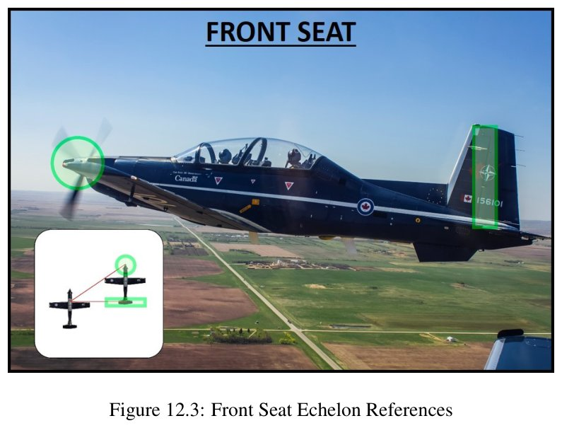

# Turn Sim spec

This file has two parts. **Part 1** is how Pat's Formation Simulator works now (main at V2.102), by topic. **Part 2** is the plan-mode spec from before the reset: history, not instructions (rule book, "What wins" item 4). Where they disagree, Part 1 wins. Decisions are in `decisions.md`; every statement below names its decision (TS-xx), a manual page, or Patrick's ruling with its time. The review notes behind it are in the project files at `turn-sim-review/`.

Patrick approved the first version's spec on 4 Oct 2026 at 10:03Z (decision card "Approve the Turn Sim first-version spec and screen as drafted?"). Everything since grew from his rulings. **Nothing since V2.91 has been flown by Patrick yet (true as of 6 Oct 2026), and the sign-off in `testing.md` is still open.** Where a later decision changed an earlier rule, Part 1 states the later one.

Reading notes. Numbers with no manual page or ruling beside them are **estimates**. Speeds are indicated (KIAS) unless they say otherwise. Manual text and figures are quoted with their page where they help; the CFAFM never goes in the repo (ALL-41). Every number and its source is also in the numbers register (section 15, `numbers.md`).

# Part 1. The Formation Simulator now

## 1. What it is

A 2-ship in line abreast that flies along on its own. You press a manoeuvre button and the pair flies it the way the SMM draws it. You press a Change formation button and the pair flies the manuals' transition from where it is to the new formation. In fighting wing, Lead flies normal moves and in fluid manoeuvring the fighting wing aerobatics, while #2 flies his part. The camera follows the formation and each aircraft's ground track stays drawn (TS-R1). On screen it is called Pat's Formation Simulator (from V2.14); the code name stays `turn-sim`. A Scenario setting turns the pair into a 4-ship (section 14); the default stays the 2-ship. Plan mode and V6's other features come later, one at a time, on the same flying core (`future.md`).

Built so more can bolt on (TS-35):
- Aircraft are a list with "who flies off whom" (`ref`), never numbers 1 to 4 in the logic, so the 4-ship and offset box add aircraft, not rewrites.
- Every step's state is recorded in a rolling record (the last 10 minutes), which the spacing graph and the spreadsheet export will read.
- Each line abreast manoeuvre is one small path-builder in `live/manoeuvres.js`; a new button is a new builder.

## 2. The screen

Pictures: `turn-sim-review/first-version/screen-mockup.png` in the project files (first version); V6's: `archive/2026-10-reset/1-requirements/agents/shots/turn-sim/v6-default.png` in the project files. The screen has changed a lot since the mockup; the list below is current.

**Top bar.** Play/Pause, Reset, playback speed (0.25× to 4×), time, Fit (comes back to the Auto zoom picture after a drag), 2D/3D, and the Camera, Layers and Data tag menus.

**Left column, three boxes** (Patrick, 5 Oct; V2.26, TS-89):
- **Controls** (open). A FORMATION bar and a MANOEUVRES bar (V2.44). Under FORMATION, the Change formation buttons in two groups, three to a row: Tactical (line abreast, fighting wing, Fluid; the four's Spread 4, Fluid 4, offset box) and Close formation (echelon, route, line astern; the four's finger, box), with the formation flown now lit (V2.41, V2.44). Then the Station switch (Keep, Left, Right, V2.45, V2.48) and, when the formation allows it, the Change position button (section 11). Under MANOEUVRES, one line per manoeuvre with small L and R (shackle and cross turn side by side), Lead's fighting wing moves, the Lag roll (#2) group, and the fluid buttons. The 4-ship's "Delayed 45 with the check turn" tick is here too.
- **Scenario** (closed). 2-ship or 4-ship, Spacing, "#2 on Lead's" Right or Left, and the training errors (section 10).
- **Settings** (closed). Fighting wing spacing and sweep, the fluid settings, Rejoin kind, Rates, Track length, and the fixed line.

**Only what can be used shows** (Patrick 5 Oct 22:36Z: "the only buttons visible in any formation position should be the ones that can be actually USED from that formation"; 22:49Z: "go through each formation setting"; TS-89). A button the formation can't use is hidden, not greyed; one that is busy for a moment (a change or Lead's move running, fluid until Terminate) is greyed. Lag roll is in fighting wing and echelon only; Lead's fighting wing moves show in fighting wing; the fluid moves only while Fluid runs; the Fluid button only in fighting wing; the Rejoin switch only in line abreast and fighting wing. Every formation button shows from every formation: no planner refuses one formation from another. While a change is flown the column says "Changing formation. Its manoeuvres show once the change is flown." (Patrick 5 Oct), except in fighting wing, where Lead's moves show once #2 is in the cone (section 8).

**Fixed line** under Controls: "220 KIAS · 8,000 ft · 3 G turns (71° bank) · still air · roll 90°/s" (the screen's own words; the roll words are the first version's, the aircraft's real roll limit is section 3).

**The picture.**
- Header buttons stand out as buttons (accent edge and tint, Patrick 5 Oct: "pop so they're obviously clickable", V2.27).
- Backdrop: medium slate #2a3038 with a faint grey grid, in 2D and 3D (Patrick 5 Oct; V2.37, V2.72). Lead's blue is #3d8bff; #2 green, #3 red, #4 white with a dark outline (TS-R21). The 3D aircraft are painted in the Harvard scheme (Patrick 11 Oct 2026, V2.320; ship colours from V2.38 until then) with one long canopy (V2.58, V2.59); the paint choice is under Layers.
- 3D at the start, looking straight down (5°, the closest the camera allows), the camera on the formation (Patrick 5 Oct; V2.34). Close formations are drawn at real size: the 3D camera zooms in to about 8 px a foot, echelon shows wings matched to Lead and #2 stepped down along the bearing line, and in a turn both bank in Lead's plane (SMM 12.4 Figs 12.3-12.4; 12.19 Fig 12.11; V2.16, TS-56). The 3D camera keeps a depth range of 60,000 ft each side of the formation (V2.58). The 3D view is a bonus: no more 3D polish while the module is being built. **Graphics** (TS-210), beside the 2D/3D switch: High (the start, as built) or Performance (no real-time shadows, normal resolution on high-resolution screens, no edge smoothing; switching reloads the page and starts the flight over); the prop is a blurred disc in both.
- The T-6 model's wingspan is 33 ft 5 in against a 33.4 ft length (Patrick 5 Oct; V2.35; published T-6A dimensions, an estimate until a manual page backs it; shared with Traffic, Fight Sim and the Debrief). Real aircraft size on the bar draws each aircraft at that length however far out the zoom; unticked (default) the usual easy-to-see size times a Scale slider, ×0.5 to ×4 (default ×1, an estimate) (V2.30).
- Ground tracks for the whole flight as a faint solid line (30%), or for the Track length set in Settings: whole flight (default), 30 s, 1, 2, 5 or 10 min, in 2D and 3D (V2.32, V2.70). A 1 NM ground grid.
- Planned paths are drawn dashed. A plan stands still once drawn: the aircraft flies along it and the flown track takes over behind it; it is redrawn only when the aircraft reaches its end or a new plan starts (Patrick 5 Oct: "it moving with the aircraft was confusing"; V2.74).
- The 3/9 line and the 7/5 lines are red (#ff4d4d) in 2D and 3D; the turn circles and the cone keep each aircraft's colour (V2.55). They have half the dashes with wider gaps (V2.70).

**Camera menu** (Patrick 5 Oct; V2.24, V2.25, V2.31, V2.32, V2.51, V2.73). Centre on Formation (every aircraft weighed the same, the centre of mass), Lead or #2 (#3 and #4 in the four), or Free (follows nothing, no automatic zoom; drag pans in 2D, shift-drag or right-drag in 3D). On an aircraft in 3D, Look: Chase (behind it along its nose), Follow (free look: centred on it, turned by hand) or Padlock (behind it, looking at the other aircraft: Lead watches #2, #4 watches #3, the others watch Lead; the pairing is a choice, not a ruling), tilting by the other's elevation on top of the person's tilt. In 2D the menu picks the centre only and the map stays north up. With the camera on the formation, Chase turns the 3D view with Lead's heading. **Cockpit interior** (V2.205, TS-154; on at the start, 3D only): Cockpit and Padlock sit in the CT-156's front seat with the canopy bows, the instrument panel under its glareshield (attitude, KIAS, altitude, heading and G live from the HUD's numbers), the seats and the own aircraft's wings and tail round the eye; every size is an estimate until Patrick rules; ticked off, the own aircraft is hidden from inside as before. **Seat** (V2.207, TS-155; under the Cockpit interior tick): Front (at the start) or Rear; each seat has its own panel, consoles, stick and seat (a closer T-6A-based replica), and the HUD and panel numbers are the same aircraft's in either seat. Under it the chosen seat's **Eye up / down** and **Eye forward / back** sliders (0.05 ft steps; 0 at the start is the estimated eye; front ±0.5 ft, rear up to +0.3 ft) and **Reset eye**, so Patrick or Dad can set where their own eye sits. The head turns down to 85° in those views. **Sight picture** (V2.208, TS-156): the front eye, the forward bow and the glareshield are placed so level flight at 200 KIAS shows half ground and half sky through the windscreen (AETCMAN 11-248 Fig 2.7, p.42, with the sim's own attitude); the forward bow is the wide light band with its ring of round holes, the glareshield has a thick dark rim, the AOA indexer stands on its left, three lamps on its centre and the standby compass on its right. Every ship shows, up close, its wingtip and tail lights, round exhaust stacks, canopy frames and fin serial (156101 for #1, and so on), in either paint. The final-approach picture does not match the manual with the sim's attitudes (open question for Patrick). **Cockpit replica** (V2.209, TS-157): both seats are drawn as a closer copy of the T-6A's (the moulded coaming with its grab rail down the panel's sides, vents, lamps under the rail, square-bezel panel, knee wells and pedestal, gear handle, drawn consoles, seat with harness, headbox and canopy breakers, oxygen hose, canopy side frames with fasteners, mirrors on the side frames, the inter-cockpit arch and shield, and the rear panel under a big moulded hump); the forward bow and the Fig 2.7 picture are unchanged, and from the rear seat the hump puts the level horizon about a third of the way up. **Auto zoom** (on at the start): the camera keeps every aircraft in the picture with about 15% spare on each side, never tighter than 150 ft across (estimates), counting height spread so loops stay in the picture, and eases its zoom as they move ("DYNAMICALLY CHANGE ZOOM"). A wheel zoom while it follows sets how close it sits; a pan or zoom in 2D hands the camera over until Fit or Reset.

**Layers menu** (closed). Ground tracks (on), planned path (on), turn circles (off), data tags (on), 3D paint (Harvard; ship colours are the other choice), and the guides, each with ticks for which aircraft draw it (Lead at first; #3 and #4 in the four): the 3/9 line, the 7 and 5 o'clock lines and The Cone (V2.28, V2.33). Lead's 3/9 line is Lead's wing line out both ways; the 7 and 5 o'clock lines run from Lead out past his tail, 30° either side of it, so 60° of sweep back from the 3/9 line, the back edge of the fighting wing cone (SMM 12.29 para 69, Fig 12.19). The Cone is the fighting wing cone, both sides, lightly shaded in the aircraft's colour: 30-60° of sweep back from its wing line, 500-1,000 ft (SMM 12.29 para 69, Fig 12.19). In 3D it draws as the 2D projection (the flat band at the aircraft's height, turned with its heading only; the default, V2.57) or as a true 3D cone, a hollow shell from 30° to 60° off the tail and 500-1,000 ft out, all the way round (Patrick 5 Oct, "true cone round the tail"; the SMM band gives only sweep and range, the shape above and below the wing plane is Patrick's choice; V2.29, V2.31). Defaults: Lead's 3/9 and 7/5 lines on, The Cone off, every per-aircraft list Lead only (V2.33). **The guides follow the formation:** at each press, not on arrival (Patrick 5 Oct: "as soon as I hit the button"; V2.50, V2.61), the 3/9 line goes on for line abreast (Spread 4 for the four) and off for the others, and The Cone goes on for fighting wing and off for the others; a tick changed by hand holds until the next change; the 7/5 lines are left as set. A layout saved before keeps every other choice.

**Data tag menu** (Patrick 5 Oct, approved list; V2.32): Data tags on or off; What it's doing, Position, Range and sweep, Airspeed, Power and Closure (rejoins; with Lead's clock) on at first; Height off Lead, Heading, and Bank and G off. What the tags say is section 13.

**Cockpit range** (Patrick 12 Oct 2026 04:01Z and 04:04Z): in Cockpit and Padlock, with the Arrow to Lead on, the range to Lead shows in yellow top right, with #2's LAG, PURE or LEAD under it in fluid manoeuvring.

**The Formation card** (right): what is flying, Now, the last roll-out judged (section 4), the flags and the training error. The how-it's-flown text folds under More; the spacing, sweep and height lines, each aircraft's numbers and the rejoin's range, closure and clock are on the tags (V2.32). During a rejoin the picture draws a dashed range ring round Lead and a closure arrow on #2.

**Start.** Lead flying 000 at 220 KIAS, #2 abeam on the right at **5,000 ft** (Patrick 5 Oct 22:46Z: "5000"; the middle of SMM 16.18 para 49's 4,000-6,000 ft band; any spacing can be set; TS-89), 3D top down, paused at t = 0. Press Play or any button to start. Keys: Space plays or pauses, Home resets (only while the module is open and not typing). The version label is on the home screen.

**Removed from the plan-mode screen** (91 controls became about 20): formation preset, start heading, turn menu, direction, speed and G boxes, timing and clock-cue menus, the 27-box Aircraft errors panel, the 26-box settings menu, Profiles placeholder, Step, breadcrumbs, NM labels, spacing lines, clock marks, error labels, the MOA box, Follow Lead.

## 3. How the aircraft fly

**Geometry first, power as needed, always** (TS-111; Patrick 6 Oct 01:24Z, 01:25Z; wording confirmed by card 03:26Z): "Geometry first, power as needed, always. Every formation move gets and holds its position with geometry first (angles, cut-off and lag, and height, because geometry includes the vertical), then with power as the position needs it, up or down. Bleeding energy is an option a pilot may choose, never a move's default."

**Every target is a window** (TS-110; Patrick 6 Oct 03:35Z-03:45Z; wording confirmed by card 03:45Z): "Every Formation target is a window, never one exact point: each move aims for the middle and accepts anywhere inside. A move always tries to reach the position; the overshoot is the last resort, never an error."

| # | Rule | Source |
|---|---|---|
| F1 | Every aircraft flies a planned, kinematically accurate path. The plan is worked out at the press and again at each event (a press, the hand-over, the decision point, the picture breaking), from where the aircraft are then. The line drawn ahead is the current plan. It is flown with realistic roll rate, bank, pitch and G, and the turn radius and rate follow from speed and G. Each manoeuvre uses the bank and G its source gives. | Patrick, 4 Oct 08:53Z (wording approved); TS-36; reworded 5 Oct 19:54Z, card "Yes, as written" (TS-76). Built: the press and the hand-over (TS-65); the decision point and the picture breaking (TS-81; the turning rejoin is flown through its decision point since V2.123, TS-112) |
| F2 | Roll: the bank eases in and out with the shared `easeRoll`. The pilot's roll is 180°/s building at 720°/s² for every move except Lead's close formation turns (6 to 12°/s, eased; section 7). Every roll is the lower of the pilot's and the aircraft's own at its speed (section 3.1). It was 90°/s building at 360°/s² (0 to 70.5° in about 1.0 s) until step 2. Every roll #2 flies in the Formation moves builds its roll acceleration over the aircraft's onset, 0.2 s, and lets it die away the same way (TS-196). | Patrick 5 Oct 06:07Z ("Roll rate can be 180 degrees per second"; replaces 4 Oct 08:54Z "90/s" and card 09:54Z "Quick ease", TS-37); TS-65 (8); TS-77, TS-78; TS-85, TS-93, TS-196 |
| F3 | Speed: 220 KIAS in line abreast and 200 KIAS outside it, held through every manoeuvre, flown as true airspeed at the block height (shared `iasToTasKt`). Speeds on screen say KIAS. Speed changes are smooth ramps and happen only inside a move (a change of formation, a fluid manoeuvre, the training errors' Speed/power fix tool: `flight.js` `{ kind: 'speed', toKias, rateKtps }`). | Patrick card 09:54Z; SMM 16.18 para 50 (220), SMM 12.23 para 53 (200); Patrick 4 Oct 11:08Z, 11:09Z; KIAS rule TS-R6; TS-38; TS-53; Speed/power fix Patrick 4 Oct 11:42Z |
| F4 | Block height 8,000 ft for the IAS-to-TAS conversion (220 KIAS is about 248 KTAS there). **Estimate** until Patrick gives the low block height. | estimate; TS-38 |
| F5 | Turns: 70.5° bank, 3.0 G level, unless the manoeuvre says otherwise (the cross turn's first half, F6b). Flown at full power, the speed bleeding as full power allows; once the last aircraft rolls out all set power back for 220 KIAS together, at 80% torque at most (TS-204, V2.397). The manoeuvre ends at the roll-out and the reset runs in the background, so the next turn can be called at once; called during the reset, it takes them back to 220 after it (V2.399). | SMM 16.18 para 50, Figs 16.15-16.21 "70/3"; TS-39 |
| F6 | Delayed turns use exact geometry: the second aircraft's turn start is calculated so it rolls out abeam at the starting spacing. Both aircraft fly the same turn, so the wait is spacing ÷ speed × cot(half the turn) for a pair abreast; the planner uses the heading the turn really rolls out on, and rounds the wait to the 0.05 s step, so the roll-out is abeam to within a few tens of feet. This replaces the old Delayed 45 rule (ends slanted, then the wingman fixes). | Patrick cards 09:53Z and 09:54Z; TS-40 |
| F6b | Cross turn: both turn toward each other for the first 90° at the same bank, set so they roll out abeam at the spacing they started at (about 53° and 1.7 G at 6,000 ft, near the SMM's 60° and 2 G, the figure the SMM gives as required), then 70/3 to 180°. | SMM 16.19 para 64, Fig 16.21; TS-41 |
| F7 | Shackle and cross turn: the wingman climbs to pass 300 ft above Lead (**working answer:** above, not below), then returns to Lead's height after the cross. Lead stays level. The height change starts and ends with no climb rate and no vertical acceleration (shared `pitchDegFromClimb`). | Patrick card 09:52Z; SMM 16.19 paras 61, 64; 16.13 para 31; TS-42 |
| F8 | No V6 lag, lead or G-fix nudges. | Patrick card 09:53Z (settles TS-Q17); TS-43 |
| F9 | Still air. The screen says so in one line. | TS-R10 (Patrick, TS-Q6) |
| F10 | Fixed 0.05 s step, so the same presses at the same times give the same picture at any playback speed. Each step uses the mean bank over the step for the turn and the middle heading for the move, so a turn's roll-in and roll-out are mirror images. | TS-R9 |
| F11 | A formation press while #2 is moving re-plans now, from where the aircraft are, bank and speed included. Nothing is queued for it (section 12). | Patrick 5 Oct 19:51Z ("I want to be able to 'change the plan' mid change and have the wingman react correctly"), card 19:54Z "Yes, as written"; TS-76 replaces TS-45; built TS-78, TS-79 |
| F12 | Every hand-over is smooth: where one part of a manoeuvre ends and the next begins (roll-in, roll-out, the cross turn's change of bank, the climb and descent, one manoeuvre to the next), position, track, bank and pitch and their rates carry straight on. A turn never snaps onto its new heading; it rolls out within a fraction of a degree of it (each turn aims at the whole degree). | Patrick 4 Oct 10:05Z (Traffic thread, carried here); TS-47 |

### 3.1 One envelope gate (TS-85, TS-93)

- **The limit** (core `t6-performance.js` `T6A_ROLL`, `rollWithinT6A`, `T6A_G_ONSET`; ESTIMATES from standard aerodynamics, no manual in the project files gives them): full-stick roll about 0.45°/s per knot of true airspeed, at most 120°/s, full rate in about 0.3 s (about 100°/s at 200 KIAS and 8,000 ft). G onset 4 G/s building at 16 G/s². Patrick 5 Oct 22:01Z ("okay, let's do that"), on section 3 of Fable's performance audit; ALL-28.
- **One gate** (`flight.js` `gateRoll`, `holdToEnvelope`; Patrick 22:13Z "execute"; Fable's plan approved 23:18Z): every bank any aircraft flies goes through it: a turn, the tracker, a recorded bank track, a replayed line's wings and Lead's turns. It holds the roll rate and onset to the aircraft's at the speed flown, the G onset to 8 G/s when rolling steeper (twice the normal 4 G/s; Patrick 23:27Z: "higher than 4 occasionally is fine thats life as a pilot", so 4 G/s is the normal pull, not a wall), and the bank to what the speed can hold without stalling (86 KIAS 1 G stall). Rolling out is not held. A rate handed in faster than the aircraft rolls is taken at the aircraft's; the pilot's own rate is used when lower. The G readout keeps its sign from the lift's axis.
- **A line's start** (Fable's review 22:10Z): a line's acceleration in Lead's frame builds over its first second and the start blend takes up only #2's own motion, so a line pressed mid-move no longer swings #2's bank through hundreds of degrees a second.
- **Left as they are:** fluid (its own 3D model, up to about 9.6 G/s on the entry) and the 4-ship's pose lines (section 14).

### 3.2 Speed, power and energy

- **Slowing down** (TS-61; Patrick 4 Oct 23:29Z-23:58Z and 5 Oct 00:11Z-00:48Z; `live/slow-down.js`): in Patrick's order of use (23:37Z-23:38Z; SMM 12.26 para 63, 12.27 paras 64-66): geometry (the planners), then power (core `excessFnFor`, its slowest the power floor at throttle 0), then the speed brake (drag ÷ weight about 0.095 at 200 KIAS, about +1.7 kt/s; its size is a guess), then idle (idle prop drag ÷ weight 0.16 at 200 KIAS, about 5 kt/s level at 200, Patrick 00:11Z), then idle and the brake. The fixed 1.5 kt/s slow-down is gone. Speeding up uses the T-6's full-power figure from the core. **The engine** (TS-218, V2.424, `live/power.js` engineStep): from 5% torque up the power follows the PCL quickly (full travel in 0.25 s); once it has sat below 5% (idle) for 1 s, the first 3.5 s after the PCL is advanced give no rise; every pilot steps it (the tracker, fluid Lead, both live laws), so formation pilots avoid idle. **Lead's power** (TS-216): 20% to 80% torque in formation except fluid manoeuvring (MAX) and line abreast; his slow-downs and descents never idle.
- **Held to full power** (TS-63; Patrick 5 Oct 02:48Z: "If they get stretched they just have to show it in their tag and fix it as best as they can once the maneuver ever finishes"; narrowed 03:46Z): a planned line never asks #2 to speed up faster than full power gives at his speed, height and G (core `excessThrustPerWeight`, a climb paid from it). He flies the same line at the speed he can reach, the range opens, his tag and the card say **STRETCHED** while he is more than 10 ft or 5% of the range behind (estimate), and he closes with power at up to 15 KIAS overtake (EFIG p.374), easing off at about 1 ft/s² (estimate). Over the stall line or just under 7 G he slows instead (Patrick 03:05Z). Code: `live/full-power.js`. Since refactor step 1 (V2.305) no planned line uses the hold; it lived on in the planned fluid wingman's energy governor (TS-74) until he was retired (TS-199, V2.384): the live wingman flies at MAX by geometry (section 10.11).
- **The G rule** (Patrick 5 Oct 03:04Z: "4 g is just leads limit for fluid maneuvering. 5 g The wirc wrt can pull what they need to to make it work up to stall , up to seven in extreme cases"; 03:05Z: "Yeah over 5 g is a last resort and must stay below 7 in all cases"; TS-63): 5 G is the normal aim (SMM 16.17 para 44a; Gen Book p.11), more only as a last resort and never 7. A wingman's G stops at the stall line or 6.95 G (estimate of "below 7"), whichever is less. Flagged on screen, never a wall. No bank cap in a rejoin or a move around a station (a kick-out, or a move in the fighting wing or line abreast band) (Patrick 6 Oct 04:07Z: "there is NO LIMIT on bank angle in formation"; 04:07:49Z: "no bank cap on rejoins or movements around a station"; TS-107): the bank goes as far as a level 7 G turn, about 82°, the aircraft's G limit (T6A_LIMITS.maxG). Close legs keep their 60°. Formation moves pull at most 4.5 G, the same as the rejoin, about 77° level: what moves plan to, not a wall; if no move works within it, #2 pulls more, up to the aircraft's own limits, flagged on screen (TS-205).
- **Height as energy** (TS-82; Patrick 5 Oct 17:44Z "we can use the vertical too", 19:51Z "if it scores high enough in our model"): a smooth height leg's vertical acceleration is charged as G in `flight.js` (wings-level share 1 + a/g, with the turn's tan(bank): standard mechanics), so it shows in G, power, drag and the nose attitude. A climb costs speed and a descent gives it (dV/dt = g(T - D)/W - g sin(climb)).
- **Power on the tags** (TS-62 (4); Patrick 5 Oct 01:44Z "I want tags on the aircraft to show their power setting, red letters for IDLE and IDLE+BOARDS or BOARDS as well", 02:05Z): MAX at full power; TQ nn% at part power; IDLE; IDLE+BOARDS; TQ nn% + BOARDS (power set and speed brake out); the last three in red. TQ% = thrust × TAS / (eta × 1,100 shp) × 100, capped at 100: thrust is the model's throttle × core `thrustPerWeight` × 6,000 lb (estimate); 1,100 shp is the PT6A-68's flat rating (reference); eta 0.81 (estimate). The throttle is the model's, not a torque gauge reading. Approximate checks against SMM Table 8.1: level 180 KIAS clean about 43% (SMM 40-45%); level 120 KIAS with gear and T/O flap about 36% (SMM 35%); 3° glidepath at 120 KIAS about 22% (SMM 25%). It shows where the flown step knows its power (holds, turns, speed changes, the turning and straight-ahead rejoins, fluid at MAX); the tracker's and the other planned lines set none, so no power line shows rather than a guess. The torque curve from the reference data is a later piece (`future.md`). Code: `live/power.js`.

### 3.3 Two rate sets (TS-84)

Every move flies one of two sets of rates, with one home (`rates.js` `RATE_SETS`; Patrick 5 Oct 21:06Z, 21:11Z: "near lead throttle is only when holding close formation. as soon as a tactical formation is selected, unrestricted attitude changes and power"; 20:50Z: "Fighting wing, rejoins, tactical formations, line abreast etc is unrestricted (realistic) roll rates & aircraft handling"):
- **Close:** holding close formation and moving near Lead. Lead's close turn roll (4.8 to 9.6°/s, built and eased over 2 s; TS-209 as slowed 14 Oct 2026), and the rates and accelerations of a line in Lead's frame. Slow and smooth so #2 can stay in place.
- **Tactical:** everything else, the aircraft's own handling: roll 180°/s building at 720°/s² (then gated by 3.1), the opening out's rates and accelerations (full power along, 1 g across, 0.3 g up or down; TS-78).

### 3.4 Rates setting, lines then tracker

- **Rates** (Settings, 2-ship and 4-ship; TS-65, TS-66; Patrick 5 Oct 05:46Z "three closure rates. Studnt pilot ... Insturctor ... AI"; 06:07Z: closure is range rate, "how fast lead is getting closer/how quickly they are getting bigger in the windscreen", and the rates change the closure only: "No on bank and g"): Student, Instructor (the default) or AI. They set a rejoin's closure, 15, 25 or 50 kt (06:09Z: "Student keeps 15 knots, instructor 25 knots, all the way up into \"route\" or \"corner\" or \"decision point\"", the AI's 50 an estimate), to about 500 ft from the slot, then the close-in rate: route to echelon in about 10, 5 or 2.5 s (06:11Z; "student should take 10 seconds to get from route to eschelon ... IP takes 5, AI takes 2-3"). For the turning and straight-ahead rejoins Rates now sets only the close-in rate after the decision point (TS-75, section 6.3). A close move's bank may go up to 60° as required, every Rates choice (Patrick 06:43Z "lets do up to 60 for all as requird for now"), so the AI's 2.5 s is within reach; a slower rate banks less.
- **Lines, then tracker** (TS-65; Patrick, card "Lines, then tracker" 05:41Z; 05:44Z: "within 500-1000 feet, dpending on whats going on. becuase we start to see the aspect change and the clusre visually and adjust to that"; 06:24Z: hand-over and rate change together at about 500 ft): every 2-ship wingman move the line rules cover (`live/line-moves.js`) flies a kinematic line for the big move into the ball park at the rejoin closure, arriving about 500 ft from the slot (`HAND_OVER_FT`, `live/hand-over.js`, the one place the rule lives) at the close-in rate. There the tracker takes over from exactly where the line left him (position, track, speed, bank and roll rate; its speed loop at the line's acceleration) at the close-in rate, into the slot, and holds it. It is planned again from where #2 and Lead really are as the line ends (Patrick 06:24Z, "Should the tracker re-calculate after the line hands over?": yes). A move that starts inside 500 ft is the tracker's alone. The tracker keeps its own speed loop (Patrick 06:24Z). **Retired:** no move flies a kinematic line any more; the planners fly the tracker from the press, and its phases set the closure (`live/closures.js`, `hand-over.js` until refactor step 1). The 500 ft figure lives on as `HAND_OVER_FT`, where a long move starts (`rates.js`).
- **The tracker** (`live/tracker.js`; Patrick 5 Oct 05:27Z: "Tracker for fallback, and refractor the tracker"): a small closed-loop pilot that flies a wingman toward a slot in the frame of the aircraft he flies off, commanding bank and speed through the same flight step as every aircraft, run once as a dry run at the press and replayed. It flies the last few hundred feet, holds the slot, and is the fallback for starts no line rule covers. Its gains are labelled in plain words in `moves.js` (all estimates: they shape how smoothly the wingman flies, not where the formations are).
- **The power technique** (TS-65 (3); Patrick 04:58Z: "setting a higher power setting until a rate is \"Set\" then reducing the powr to \"maintain that rate\", then as the aaircraft approaches the position it wants to be in, it does the opposite"; 06:13Z: "they dont HAVE to go full power to set a rate. they can massage it at a lower power ... I dont want them to only use full power or idle"): each change of rate is the smallest power step that makes it in about 2 s (the thread's default, an estimate), never past full power or idle, then the holding power; slowing uses power below the hold first, idle only if needed, the boards only when idle can't do it in time. The engine answers in 0.25 s (06:02Z: "The TQ can change very fast. 2 percent to 100 in .25 seconds."). Since V2.119 (TS-108; Patrick 6 Oct 03:17Z, 03:18Z): the torque goes 0 to 100% in about 0.2 s and the speed brakes are instant, so the acceleration may change at up to 25 kt/s² (`POWER.jerkKtps2`, an estimate from the 0.2 s; 1 kt/s² until then); a rejoin keeps at least 5% torque with the boards as needed, idle a last resort (`REJOIN.floorTorquePct`), and its decision point is where a stop with that floor and the boards just fits (idle until V2.119). The hot turning rejoin's hard pull (TS-106) still uses idle and the boards: it is the last resort before the overshoot. The bank drawn and read out is where the lift points (`liftBankDeg`; Patrick 6 Oct 04:17Z: "the bank should follow the lift vector"): the turn's sideways share and the vertical pull together, past 90° when #2 pulls down to a lower line.

## 4. In position means in the band (the judge)

One slot table (`live/slots.js`), one classifier and one judge (`live/judge.js`) for the 2-ship and the 4-ship; the card, the roll-out verdict, the change planners and the tags all read them (TS-64). Patrick 5 Oct 21:26Z: "Any tactical formation is in the position when they are 'In the band' (fighting wing cone, S+L max 200 foot stack above or below lead), LAB has a band etc. Close formation within 5 feet and 5 knots." (TS-80; 21:38Z "Just follow the SMM bands for line abreast", "FW can be above lead".)

| Formation | #2's position (in position when #2 is inside) | Source |
|---|---|---|
| Line abreast | anywhere in the SMM's band: 4,000-6,000 ft abeam, 0-10° sweep, up to 2,000 ft above or below Lead; the spacing setting is the aim, a setting outside the band is judged within 100 ft of itself | SMM 16.18 para 49; Patrick 5 Oct 21:38Z; TS-80 |
| Fighting wing | anywhere in the cone: 500-1,000 ft, 30-60° sweep measured back from Lead's wing line (0° abeam), up to 200 ft above or below Lead, judged only with Lead straight and level (within 5° of bank and 300 ft/min, estimate); default place 750 ft and 45° (estimate; a setting, section 8) | SMM 12.29 para 69, Fig 12.19; Patrick 5 Oct 21:26Z; TS-80 |
| Route | On the spinner-to-wingtip line, the slot 3 wingspans down it from echelon (about 121 ft out, 75 ft back, 3 ft low since TS-230 moved echelon up the line; it was 116 out, 96 back, 5 low; judged from 1 to 3 wingspans; TS-181, Patrick 11 Oct 2026 00:03Z, 00:15Z: the SMM reference, Fig 12.7; 5 wingspans from TS-103 until V2.232, 25 ft back until V2.107). Within 5 ft of the place and 5 kt | SMM 12.6 para 15, Fig 12.7; Patrick 5 Oct 06:11Z, 21:26Z, 6 Oct 02:11Z, 11 Oct 00:15Z; TS-65, TS-80, TS-103, TS-181 |
| Echelon | about 15.9 ft back, 40.2 ft out, 3 ft down, origin to origin (TS-230, Patrick 14 Oct 2026: 2.5 ft further up the spinner-to-wingtip line than TS-182's 18 back, 43 out, then 1 ft more, "lets make -1 the default"; the "Echelon on the line" control moves it 1 ft a step, 5 ft up to 10 ft down): the SMM's sight references worked through the CT-156 model's geometry (TS-182, `live/slots.js`; 45 out, 25 back, 5 down was the older estimate, corrected here 13 Oct 2026). Within 5 ft of the place and 5 kt (±15 ft until V2.80) | SMM 12.4 paras 11-12; Patrick 21:26Z; TS-80; TS-182 |
| Line astern | directly behind and below, about 10 ft nose to tail (43 ft centre to centre, 8 ft low; estimates). Within 5 ft of the place and 5 kt | SMM 12.5 para 13; Patrick 21:26Z; TS-80 |

- **Judged at roll-out only** after a manoeuvre, in words with the numbers: on spacing, wide, tight, fore, aft; an in-place turn is judged in trail (TS-R23). A change of formation is judged against the table above. A Spacing outside the SMM band ends "TOO FAR" or the like.
- **A change ends in band and steady** (TS-78; Patrick card 20:39Z "In band and steady", 20:41Z "I want 'stabilize' to be 'within 5 knots' instead of 'exactly zero'", card 21:22Z "Done when in band"): #2 is in the judge's band, on the side asked, closing at 5 kt or less against Lead, with his bank within 10° of Lead's, and Lead's own plan done. Line abreast does not wait for Lead's speed-up to 220 KIAS (estimate). A station change's stop at a corner is "within 5 kt", not 1 ft/s. The tracker keeps closing on the exact slot underneath. A fighting wing change is done with his climb inside the cone not counted as closure (TS-96).
- **Flags, never walls** (published limits flagged on screen): Lead above 4 G in fighting wing or fluid manoeuvring and above 3 G in a close formation (2 CFFTS Orders B2 ch 8; Gen Book p.11); #2 at or above Lead's height during a rejoin, inside 2,000 ft (SMM 12.27 para 65); #2 at the G rule's bank; separation under 300 ft at a crossing (SMM 16.13 para 31); under 500 ft in fluid manoeuvring. Fluid's own flags are in section 9.
- **What the tags and card say when it isn't:** section 13.

## 5. The manoeuvre buttons (line abreast)

Each button has a left and a right version unless noted. With #2 on Lead's right, a right turn is "into #2"; each button says into or away for the current side (SMM 16.19 paras 53-57 name them from Lead's side). R/T words are from 2 CFFTS Orders B2 ch 8 p.103. The buttons fly from line abreast (and a column after an in-place turn). The turn buttons also fly in the close formations and, in the 4-ship, in fighting wing (sections 7 and 14); in the 2-ship's fighting wing they give way to Lead's own moves (section 8, TS-70). Shackle, Cross turn and G-warm stay line abreast moves.

| Button | How it is flown | Ends | Source |
|---|---|---|---|
| Delayed 90 | Outside aircraft rolls in first, 70/3, turns 90, rolls out. Inside aircraft holds straight, rolls in at the exact-geometry point, turns 90. | Line abreast on the new heading, sides swapped, same spacing | SMM 16.19 paras 52-54, Fig 16.15 |
| Delayed 45 | Outside aircraft turns 45 first; inside aircraft crosses ahead of Lead's new track, then turns 45 at the exact-geometry point. | Line abreast on the new heading, sides swapped | paras 55-57, Fig 16.16 |
| Check 20 | Both roll in together, turn 20°, roll out. **Working answer:** fixed 20° (the R/T example), angle box later (TS-46). | Same shape on the new heading; the line between them rotates 20°, so one ends ahead of abeam (spacing × sin 20°) | para 58, Fig 16.18 |
| In place 90 | Both roll in together, turn 90, roll out. | In trail at the old spacing, judged in trail | para 59 |
| Hook | Both turn 180 the same way, 70/3. On speed and on spacing the fuselages are already lined up at the 90-degree point, so no G change is flown there; the SMM's G adjustment is the fix for an error (TS-48). | Line abreast, same spacing, flying back the other way | para 60, Fig 16.19 |
| Shackle (one button) | Both turn 45 toward each other at 70/3; the wingman passes 300 ft above Lead; both turn back together. | Original heading, sides swapped (an X) | paras 61-63, Fig 16.20 |
| Cross turn (one button) | Both turn toward each other for the first 90° (F6b), cross with 300 ft vertical, then 70/3 to 180°. | Line abreast flying back the other way; each aircraft ends on the ground side the other started on, so #2 is still on the same hand of Lead | para 64, Fig 16.21 |

A Delayed turn pressed when the pair is not abeam (after an in-place turn, in trail) still rolls out abeam: the planner picks whichever order gives a forward wait. A manoeuvre button pressed while another manoeuvre flies is queued and flown the moment it ends ("Next: ..." shows on the card; a later press replaces it). A turn button pressed while #2 is changing formation flies at once (section 12).

## 6. Formations and changing formation (2-ship)

### 6.1 What it does

The wording of this section was confirmed by Patrick on 4 Oct at 11:45Z ("Agreed", TS-53). The Change formation buttons (section 2) fly the manuals' transition from whatever formation the pair is in now, planned at the press in the same style as the manoeuvres: pre-planned paths and smooth hand-overs with no jump in position, track, bank, roll rate, pitch rate or speed. Where the manuals don't join two formations directly, the transition goes through an in-between formation (design `turn-sim-review/transitions/design.md` section 4). Entering fluid manoeuvring is from fighting wing only (section 9).

- **Speed:** 200 KIAS outside line abreast and 220 KIAS in it (F3). Lead slows or speeds up during the transition; speed changes are smooth ramps and happen only during transitions (Patrick 4 Oct 11:09Z).
- **The Station switch** (Keep, Left, Right): pressing Left or Right in fighting wing, echelon or route flies the side change at once (Patrick 5 Oct). It is the same change as pressing the formation's own button with the other side. In echelon and route it is the station change (SMM 12.20 paras 44-45); in fighting wing it is the fast side swap (section 8). A change of side is made behind Lead in the formation the pair is in, never across his nose.
- **Pressing Echelon from line abreast** flies the turning rejoin straight to echelon through the fighting wing place (SMM 16.20 para 66).
- **Lead's part** is ordinary segments: a speed change and, in a turning rejoin, a turn into #2.
- **#2's overtake** in a turning rejoin is 10-20 KIAS (EFIG p.374) and 20-30 KIAS straight ahead (EFIG p.371), and he stays below Lead (SMM 12.27 para 65). From TS-75 the line speeds are those in 6.3.
- **The slots** (all estimates inside the table's bands unless sourced; `live/slots.js`): fighting wing 750 ft at 45° (a setting, section 8), the slot 60 ft below Lead when entered from a close formation (anywhere in the cone his height is his own, TS-96); route on the spinner-to-wingtip line 5 wingspans down it from echelon, about 163 ft out, 143 ft back, 5 ft low (Patrick 6 Oct 02:11Z, TS-103; 5 Oct 06:11Z, TS-65; 2 wingspans until V2.22); echelon 45 ft out, 25 ft back, 5 ft down; line astern 43 ft centre to centre (10 ft nose to tail), 8 ft low; line abreast the Spacing setting.

### 6.2 One chooser (TS-76, TS-94)

Patrick 5 Oct 18:11Z ("What if we dynamically hand off between lines, tracker, and the 'AI' used in fight sim? how could we know when the best spot was to use for each?"); card 18:51Z "Checks, then quickest"; 19:51Z ("I agree on the matrix and the options"). Review: `/mnt/project-files/turn-sim-review/chooser/` (`plan.md`, `options.md`).

- **What it is.** Every "Change formation" press runs every planner that applies from where the aircraft are, flown as dry runs, scores their plans and flies the winner (`live/chooser.js`). Every planner hands the chooser a plan in one shape (TS-94), and `candidateOf` is the only place it is scored. The planners are: the turning rejoin, the straight-ahead rejoin, echelon or route out to fighting wing, opening out to line abreast, a line then the tracker, the tracker alone, the vertical (a turning rejoin try), and "from here" (section 12). The lag roll goes through it as its own button's only candidate (TS-71). No fourth way of flying #2 and no per-step hand-off: the planners are pilots run ahead. The look-ahead pilot of the two-ship manoeuvring module is the same pattern (borrowed, not its code).
- **The score.** (1) The pilot's checks first: IN POSITION at the end (the judge's band) and behind Lead's 3/9 line on the way in (the overshoot lane, SMM 12.27 para 65, the shared 100 ft margin); a candidate failing either is out whatever its time. (2) On a long move (more than the 500 ft hand-over range from the slot) a held technique before the tracker alone, which is the fallback there (Patrick 05:27Z, 05:41Z). (3) Under the G rule before over it (over 5 G is a last resort, never a wall). (4) Quickest. (5) Within half a second, smoothest: the fewest bank reversals and power changes along #2's track (a tie-break only). The 5° deadband and the half-second tie are estimates.
- **A training error's start** is raced like any other change, with "from here" reading where the error put #2 (TS-94). Its fix response flies whatever passes the checks quickest.
- **Rejoin kind** (Settings, 2-ship): Turning (TRJ, the default) or Straight ahead (SARJ), from line abreast and from fighting wing (Patrick 05:13Z "FW-Esch you can pick TRJ or SARJ. Obviously TRJ is faster", 07:32Z). They are two separate rejoins and the choice is Lead's call (Patrick 07:19Z). The planner also takes `auto`, which races both and flies the quicker; the switch does not offer it yet.
- **On screen:** nothing moves. The card's note ends with the comparison ("Chosen: turning rejoin 58 s, over tracker 143 s (fails a check)"), and the change carries `chooser: { picked, compared }`.

### 6.3 The rejoins

**Turning rejoin** (TRJ; TS-68, TS-69, TS-75, TS-82, TS-87, TS-96; Patrick 07:14Z, 07:19Z, card 07:31Z, 07:32Z; SMM 12.24 paras 54, 56-58, Figs 12.14-12.15; SMM 16.20 paras 65-66, Fig 16.25). One rule for every 2-ship turning rejoin, from line abreast (hot: #2 starts hot and gets colder to reach the line) and from fighting wing (cold: he turns hotter to reach it).
- **Lead** turns into #2 at the press at 30° of bank, slowing to 200 KIAS, and never waits for closure (Patrick 05:29Z). He holds the turn until #2 is in (Patrick 06:16Z item 3); on a rejoin to the opposite side he keeps turning until #2 is in on the far side (TS-87, Patrick 5 Oct 22:35Z: "on a turning rejoin that rejoins to the opposite side lead should keep turning until 2 is in eschelon"). Fig 16.25 is not to scale, so the SMM's text is flown.
- **#2's turning rejoin** (TS-182 to TS-187; SMM 16.20 para 65b(2), SMM 12.24 paras 56-58). From line abreast he makes a quick, smooth pointing turn (up to 4.5 G), rolls out wings level with Lead on his nose, waits for the line of sight to move, then makes one reversal at full power onto the line 30° off Lead's tail, never past it. On the line Lead stays frozen in the windscreen, at the line bearing and about 4° up, outside the canopy bow, held with bank, pitch and power. He reaches the decision point, where his sideways spacing equals route's, at about 210 KIAS, goes down into route in Lead's banked plane, then up the spinner-wingtip line into echelon without stopping; Lead rolls out as soon as he is in. To the far side he flies the same rejoin, passes under Lead at the decision point and goes up into the far slot. From trail after a break there is no pointing turn: small, early, gentle bank eases Lead out to 30° off his nose. To fighting wing he settles where he arrives in the cone (TS-167).
- **To a close formation (TS-106, V2.113; Patrick 6 Oct 02:30Z-03:58Z):** #2 holds Lead fixed on the canopy on the X, the fin two-thirds out along Lead's upper wing, 35° off Lead's tail (SMM 12.24 paras 56-57, Figs 12.14-12.15; TS-181); from line abreast he first flies onto the rejoin line as above and holds the X from 1,200 ft in (750 ft until V2.135; TS-124, line first: on the line for the last 800-1,200 ft), or first pulls hard (2-6 s at his most bank, idle and the boards; V2.114, Patrick 04:02Z) and then holds it, whichever is quicker. He aims for 10-20 KIAS over Lead (15, the middle). Anywhere 250-100 ft from Lead, at no more than 20 KIAS over, closing at no more than about 32 kt and within 10° of the X (estimates), he moves over, joining the spinner-to-wingtip line as far up it as he is off it, and keeps closing up the line into the slot in one movement (V2.123; Patrick 6 Oct 04:43Z: "2 goes behind lead and stagnates there instead of following the line"). Lead holds his turn until #2 is in position (V2.123, TS-112). From the move over his height eases into Lead's wing plane (TS-126, V2.142; SMM 12.19 paras 41-43, Fig 12.11; Patrick 6 Oct 07:10Z, 07:18Z): stepped down on the inside of the turn, up on the outside, at least 4 s and no more than 0.3 g off level flight (estimates); Lead keeps turning until he is in it, then rolls out at the echelon turn's roll, and #2 follows the plane back to level. The 4-ship's turning rejoin to finger does the same for #3 and #4 from the start of each one's last leg (TS-127, V2.143). Not stable by 100 ft is the overshoot (SMM 12.27 para 65, Fig 12.18), flown only when no other rejoin plans (Patrick 03:35Z): wings near level, behind and below Lead to the outside, stabilize a length clear, cross back with no overtake, move up. The 4-ship's #2 still flies the line law to route.
  - The decision window, as Patrick approved it (card 03:32Z, wording confirmed; with the 03:43Z-03:45Z window in TS-110): "#2 holds the X picture until his closure is stable (10 kt). He then moves out to route and up the spinner-to-wingtip line to echelon in one movement, anywhere between 250 ft and 100 ft from Lead. If his closure isn't stable by 100 ft, he overshoots."
  - Five SMM rules (card 03:33Z "Approve all five", wording confirmed): 1. Height: on the X, #2 stays just slightly below Lead's plane (SMM 12.24 para 58). 2. Overtake: down the X, up to 20 KIAS over Lead's 200 (220 KIAS), off by the window (para 56: 10-20 KIAS). 3. Line-up: approaching route's spacing, #2 aligns his fuselage with Lead's before moving to echelon (para 58). 4. No steep turn inside Lead's circle to stop the closure: torque and speed brake first, then overshoot (caution after para 58; para 65). 5. Overshoot path: roll wings level, reduce torque, pass behind and below Lead, never climbing to his altitude; stabilize on the outside, then cross back with at least one aircraft length clear and no overtake (para 65, Fig 12.18). On an outside rejoin, pass 1-2 lengths behind and below (para 59). Rule 1 is built (TS-166, V2.216). Rule 3 is still a known fault (future.md: the move-over is the chooser's straight slide).
- **How he flies it (TS-69, TS-162, TS-160, TS-173; V2.216):** the turning rejoin is flown by the core closed-loop tracker in Lead's rotating non-inertial frame using the proven (c, a) kinematic velocity decomposition solver. The solver couples cross-track rate limiting ($c_{\text{max}} = \sqrt{2 a_{\text{stop}} |\text{cross}|}$) with along-track closure budget ($a_{\text{want}} = (\text{along} - \text{captureAlong}) / \tau_{\text{along}}$). On acute entries (inside the turn circle or ahead of the line), $a_{\text{want}} < 0$ selects the outward flaring root, directing velocity away from Lead to bleed closure naturally without cutting the turn chord or crossing Lead's six o'clock (TS-165, TS-160). His bank in a formation rejoin is **unrestricted** (TS-162; Patrick 6 Oct 04:07Z: "there is NO LIMIT on bank angle in formation"; 8 Oct 20:59Z G7: pulling up to airframe G / stall limits as needed to solve geometry).
- **Speeds & Power Schedule (TS-163, TS-164, TS-169; Patrick G1-G9, 8 Oct 2026):**
  - **Least speed:** 200 KIAS is the rejoin's target minimum, not a wall: near it #2 keeps the bank the line needs at MAX power and accepts the speed bleed, trading height for speed where he has it; only stall and G are limits (TS-169).
  - **Ride speed:** #2 holds 210 KIAS on the line up to the decision window.
  - **Pre-window ease:** inside 500 ft along the line, speed eases smoothly toward 205 KIAS. He enters the 250 ft window at about 205 KIAS.
  - **Window closure ceiling:** closure rate (range rate) at window entry ($r \le 250\text{ ft}$) must be $\le 20\text{ kt}$ (`TURNING_REJOIN.stableKt`).
  - **Power:** MAX power is authorized anywhere on entry to accelerate to the line or catch up (TS-164, TS-171; abolishes legacy "HTRJ only" MAX rule).
- **Height on the line (TS-181, superseding TS-166's constant 50 ft; SMM 12.24 para 58; EFIG p.374; Patrick 10 Oct 2026 19:57Z, 23:58Z):** once on the line #2 holds Lead 4° above his horizon (an estimate to tune), never shallower than 50 ft below him, level ("maintain the horizontal plane just slightly below lead"): about 140 ft below at 2,000 ft, 70 at 1,000, 50 ft from about 700 ft in. In the capture he comes down to the 4° depth where he will join the line (at most 1,750 ft out), any pull up inside 5 G with the bank he has, and holds the 4° from there in (V2.234; until then he held 50 ft until the ride settled, about 900 ft out). From the decision point he eases onto Lead's wing plane, stepped down (echelon), within 0.3 g of level flight. The picture holds the bank and bearing; the altimeter holds the depth. TS-159's slope with Lead's bank (about 700 ft low at 2,000 ft) is retired: it is not what the SMM says.
- **Onto the line (TS-173):** off the line he closes across it smoothly, no faster than he could stop on it at about 80 ft/s² in Lead's frame and with about 30% of his speed kept along it (estimates; Patrick 10 Oct 20:15Z "Faster smooth"), so he joins it along it about 900-1,300 ft back without rocking his wings.
- **To fighting wing (TS-167):** he aims at the cone's middle, 750 ft and 45°, and the fastest arrival wins; a slight miss is accepted, the band (500-1,000 ft, 30-60°) is only the settle test. The ride hands over to the cone once he is inside 450-1,250 ft, 25-65° (`FW_LIMITS`). He rides the same 35° line (TS-181); the cone's ease toward Lead's bank starts only once he is on the line (V2.232), and his zoom into the cone on a rejoin stays inside 5 G.
- **From the decision point (TS-172, TS-181):** route first, then up the spinner-wingtip line into echelon, never ahead of it or of Lead's 3/9 line. Out to route he moves at the station-change rate, about 9 kt (15 ft/s, estimate), from route in at the close moves' rate; his bank stays within Lead's ±15° (a flagged reference, not a wall; Patrick 10 Oct 23:54Z), the closure is set by power, and his depth goes onto Lead's wing plane, so Lead crosses the canopy bow: Fig 12.7 at route, Fig 12.3 at echelon. No steep turn inside Lead's circle to arrest the closure (the SMM's caution). The place he flies to is in Lead's wing plane, as the hold after it keeps it.
- **From anywhere (Patrick 6 Oct 05:16Z, 05:29Z; TS-119):** #2 is at MAX, hot or cold, with no top speed until on the line. When no rejoin meets every rule, the search tries again letting Lead's turn carry #2 across his six well behind him (beyond 1,000 ft), then without the MAX rule, so a turning rejoin is planned from anywhere in line abreast instead of being refused.
- **Rulings (Patrick 5 Oct 06:16Z):** #2's bank in a rejoin has no cap (Patrick 6 Oct 04:07Z, TS-107; the G rule's 78° until V2.116; flagged on the card at the G rule's bank, never a wall); the capture from line abreast stays inside the 5 G flag, bank free within it (TS-181; Patrick 10 Oct 2026 23:59Z): the planner tries the bank of a level 5 G turn first, the aircraft's own limit only when nothing plans within it; reversals up to 78°; no fixed descent rate, only a smooth descent within 0.5 G of push (estimate), off Lead's height before 2,000 ft (SMM 12.27 para 65). **Line first (V2.135, TS-124; wording approved by Patrick 6 Oct 06:17Z):** "Turning rejoin, line first: #2's first job is to get onto the rejoin line at Lead's height (just slightly low) as directly as the aircraft allows: deeper roll, harder pull, steeper dive. Then he carries his energy up the line, on it for the last 800-1,200 ft, so he is never blind on Lead close in." From above, his height comes off first, over the shortest smooth leg within 2 g of level flight (past 90° of bank, pulling, where the dive needs more than 1 g down), else 1 g, whichever brings him in no more than 8 s later than the steady descent; else the steady descent (estimates). From below, unchanged (the climb costs speed).
- **The vertical (TS-82), the 4-ship's #2 only since TS-170** (the 2-ship's ride flies its own height, the line 50 ft low): also tried: #2 going 500 or 1,000 ft higher early, then down onto the line, each at no more than 1,800 ft/min within the G rule's 5 G with the pull charged (`TURNING_REJOIN.verticalUpFt`, estimates); flown only when quicker by more than half a second. Pop-ups of about 700 ft in 6 s are not used (they would need roughly 3 G more pull than the model charges for).
- **A rejoining wingman at or above Lead's height** comes down below him before he is close (SMM 12.27 para 65; Patrick 4 Oct 19:11Z). The 4-ship's rule (step down to 60 ft below Lead) is section 14.
- **Into or Away (TS-174, V2.217):** TRJ has an Into/Away switch, default Into. Into: Lead turns toward #2's side. Away: Lead turns away from #2's side. From trail after a break and rejoin, #2's side is the echelon side the pair broke from.
- **Break and rejoin (TS-175, V2.217):** A 2-ship button, shown only in echelon. Lead rolls into a level 60° bank, 2 G, 180° turn away from #2. #2 starts the same turn 3 s later (a setting under More, default 3 s; TS-217, was 5 s). Both hold their speed with power and roll out on the reverse heading in trail, at whatever spacing that gives. The pair then holds trail until TRJ or SARJ is pressed. Sources: SMM 16.20 para 65b(1), Fig 16.24; SMM 12.25 paras 60-61. As built: the switch sits under the Rejoin row (TRJ: Into, Away); on Away #2 crosses behind Lead to the inside of the turn, and only the turning rejoin flies it (the tracker and the roll stand aside). The break's trail comes out at about twice the delay's distance (about 3,800 ft at 200 KIAS and 5 s), as a 180° delayed turn gives; the delay choices are 3, 4, 5, 6 and 8 s (estimates around Patrick's 5 s).

**Straight-ahead rejoin** (SARJ; TS-72, TS-75; Patrick 5 Oct 08:40Z: "SARJ should start at full power until it gets back on leads six, then set an overtake. The geometry of moving makes it fall back."; SMM 12.26 paras 62-63, Fig 12.17; EFIG p.371). The 2-ship, from line abreast or fighting wing to echelon, route or line astern (line astern from fighting wing is always straight ahead). Lead flies straight on at 200 KIAS. #2 goes to full power and cuts toward Lead's six, falling back as he turns. Since V2.310 (TS-192, refactor step 5; Patrick's yes 11 Oct 2026 16:27Z) he flies the six as the turning rejoin's ride with Lead not turning (`live/ride.js`): at full power until he is on it, the rest of his speed along it. From line abreast he closes across it no faster than he could stop on it at half the sideways pull of his 60° bank (an estimate), rolling at the turning rejoin's start rate (90°/s at most), aiming for it about 1,000 ft back (Fig 12.17 point 1) and joining it about 700 ft back. From a close start (behind Lead's 3/9 line, inside 1,250 ft, as from fighting wing) he joins it where he is, 500-1,000 ft back, with the close-formation rule's bank, about 1.5° per degree of cut, and a stop at 15° of bank's pull (estimates). Until then he cut at up to 30, 45 or 60°, the quickest picked, on the older line law. On the six, just below Lead's wake, he holds at least the Rates choice's line speed up it (210, 220 or 235 KIAS, TS-133; from line abreast the full-power cut already gives 233-240 KIAS), takes it off to 10-20 KIAS over Lead by 250-100 ft behind him (the window; since V2.122, TS-110: Patrick 6 Oct 03:45Z, card wording "A rejoin plans only to the window: #2 arrives 250-100 ft from Lead, measured along the rejoin line, 10-20 KIAS faster than Lead (Lead at 200)"; until then at idle to about 8 kt by 100 ft behind route) and never goes below 200. From about 500 ft he takes the small vector to the side wanted, and from the first point in the window with no more than 20 KIAS of overtake the tracker flows him through route into the slot. Not in the window by its near edge, the plan gives way to the other planners (the overshoot, the last resort). Passing more than 20 ft ahead of the slot on the way in is a warning on the card, not a refusal (turning and straight-ahead rejoins alike, TS-110). Into echelon (V2.105; Patrick 6 Oct 02:01Z: "SARJ shuold hit 'The line' (drawn between the prop spinner and wingtip, as per smm) and fluildly transition their motion up that line in to position"; "a rejoin should never stagnate (stop) until it's in position"): the vector aims for the spinner-to-wingtip line two echelon distances out (90 ft) and he joins it closing at about 8 kt, then flows up the line into the slot without stopping (`moves.js` STRAIGHT_REJOIN lineJoinEchelons, lineArriveKt, lineFlowFt, estimates); fighting wing to echelon about 22 s (was 29 s, overshooting nearly abreast and wide, then sliding back). If the ride cannot reach the slot without passing ahead of Lead's 3/9 line at any Rates overtake, the tracker's planner flies it.

**Echelon or route out to fighting wing in about 10 s** (TS-73; `live/recipes.js` `planEchelonToFw`; Patrick 5 Oct 08:40Z: "I want the aircraft to get from echelon to fighting wing in 10 seconds. It can go idle boards then spool up power to end up in the cone, right?"; earlier 4 Oct 19:03Z "expeditious", 7-15 s, SMM 16.32 para 92 says "slowly" and Patrick's ruling wins). The 2-ship, same side, Lead straight and level. #2 rolls away from Lead at a held 45 or 60°, 15-30° off Lead's heading, at idle and boards, easing down to fighting wing height; he turns back parallel at the slot's distance out, then goes to MAX so he stops near the slot's distance back; the tracker settles him anywhere in the cone (SMM 12.29 para 69). He falls no more than the Rates figure below Lead's 200 KIAS. Lead's fighting wing buttons show at about 4 s and #2 is in the cone at about 7-10 s. Energy: on the power profile the tracker takes a slowing first as a climb inside the cone's height (section 8, TS-96); echelon to fighting wing keeps idle and boards by Patrick's 08:40Z technique.

**Opening out to line abreast** (from fighting wing, echelon or route; TS-78, TS-88; `live/recipes.js` `planOpenOut`; Patrick 5 Oct 20:41Z, 21:06Z "LAB from echelon would be expedited by a full power dive to start", 21:11Z, 22:39Z: "line abreast from eschelon or fighting wing should start at FULL POWER and that will make it faster to get in posision", 22:43Z: "see? idle boards to LAB from esch"). A held-command planner: MAX from the press, held all the way out, until he has the speed the heading off needs (Lead's KIAS over its cosine, trimmed up to 25 kt to bring him level with the slot's distance back), then power as required; roll away at 30° or 45° to 15-35° off Lead's heading (the quickest is flown), dive about 400 ft (`OPEN_OUT.diveFt`) and climb back to Lead's height as he turns back parallel, falling back by geometry only; the tracker settles him in the band. Lead speeds up to 220 KIAS at the press (an estimate; SMM 16.18 para 49; SMM 16.18 para 51 says only that the wingman manoeuvres into position while Lead flies straight and level). The near-Lead slowing of the close formations does not apply (21:11Z). To the other side the TS-78 line is unchanged (out and down at once, Lead holding his speed until #2 is out, then 220 KIAS; holding first is an estimate needing Patrick's yes). `OPEN_OUT` and `OPEN_OUT_HELD`: every number an estimate.

**Station changes** (2-ship close; SMM 12.20 paras 44-47, Figs 12.12-12.13; Patrick 4 Oct 19:26Z). Echelon to echelon: back and down into the corner, with the nose at least 10 ft behind Lead's tail (12 ft more is used, an estimate) and at line astern's height, below the prop wash, where #2 stabilizes: under control, flowing through within 5 ft and 5 kt, not stopped (Patrick 6 Oct 05:29Z, TS-117; a 2 s stop until V2.128); across at the close-in rate with a small heading change, slightly aft of line astern; stabilized again directly behind the new slot; then forward and up at about 5 ft/s. Echelon to line astern is the first half; line astern to echelon is the second half. No wings overlap.

**Fighting wing across to the other side:** section 8 (the side swap).

**When it cannot be planned.** Nothing changes; the card says why in one line ("No safe rejoin from here: ..."), when the planner could not reach the formation inside its 5-minute search or the plan would take more than 3 minutes (estimates, a catch only) or ends outside the band. A pair that fits no formation (in trail, mid-turn) is planned from where #2 is (the tracker, which can close via Lead's six).

## 7. Close formation turns

Lead flies the button's turn and each wingman keeps his place in Lead's wing plane (SMM 12.19 paras 41-43, Fig 12.11; 16.36 paras 99-102). The turn buttons work in every formation the pair can be in: in the 2-ship in echelon, route and line astern; in fighting wing the 2-ship has Lead's own moves instead (section 8).

- **Lead's turn.** Bank 45° (1.4 G; an estimate inside the 3 G close-formation limit of 2 CFFTS Orders B2 ch 8 p.97), 30° for the check turn and for the 4-ship's echelon (the Orders' stepped turns away at 30°); the 2-ship echelon turn at 60°, 2 G (Patrick 20:50Z: "Eschelon turns are very slow and smooth. about 4-5 seconds to get to 60/2"; TS-78). He telegraphs the turn (TS-209, V2.414): his roll rate builds over 1.5 s, holds steady, and eases back to zero over 1.5 s, about 6.5 s from wings level to his bank, and the roll-out is the same. A steeper bank rolls faster: 30° at 6°/s, 45° at 9°/s, 60° at 12°/s. Where a wingman sits far out (route, the 4-ship's outer wingmen), Lead still rolls no faster than that wingman can follow (TS-180), so the roll can take longer. Until V2.414 the roll took about 6 s to 45° in finger.
- **Each wingman holds his place in Lead's real wing plane** every step (TS-77, `holdInPlane`; Patrick 5 Oct 19:51Z: "when in eschelon the aircraft falls well outside of position and then corrects on roll out. The aircraft should use bank and pitch and roll to stay in position as lead flies in eschelon, from any close formation position."): G along Lead's lift line up to 0.5 G more or less than Lead's, so on the outside of a roll-in he climbs into the plane and on the inside he descends; any bank off Lead's he needs to slide in or out along Lead's wing line, settling gently (about 1/s; no bank limit but physics, TS-180); power along Lead's heading, about 2 kt/s. A change of G builds at no more than 4 G/s, and he closes any gap at a rate he can stop from, so he never overshoots. He holds his slot from the slot table, not wherever he is at the press, so a wingman still settling from the change before carries on into it (TS-180). His bank is his own, read from the lift his path needs (`ownBank`): within about 3° of Lead's in the steady turn, up to about 12° off for a moment while Lead rolls (V2.230). Line astern stays under the tail of the one ahead. All estimates. Echelon stays within about 7 ft; where Lead's roll moves the place faster than that (route, 167 ft out, and the 4-ship's outer wingmen) he is out of place for a few seconds and comes back in without overshooting (SMM 12.19 para 41 describes the same brief climb or descent as the bank changes). A wingman that cannot settle is flown on until he does, up to 60 s after Lead rolls out (V2.226). Every turn rolls out on the whole degree and is judged IN POSITION. This replaces TS-56's 3 s plane lag for the close turns only.
- **Station keeping in close formation turns.** Each wingman holds his slot in Lead's wing plane with pitch (G), bank and power. He rolls with Lead and corrects gently, with no bank limit beyond physics. Lead rolls no faster than his farthest wingman can follow while rolling with him (SMM 16.36 paras 98 and 101): about 6 s to 45° in finger, 6 s to 30° in a 4-ship echelon, and 6 s to 60° in a 2-ship echelon. A wingman still settling when the turn is pressed carries on into his slot. As Lead rolls, a wingman may be slightly off his slot (SMM 12.19 para 41) and is back in it within a few seconds. (Patrick's wording, approved 11 Oct 2026 00:15Z; TS-180.) Checked V2.230 on the delayed 90 and the hook: finger, echelon, box and line astern stay within 8 ft of their slots; in finger #4 had slid 170 ft wide in a 90° turn before.
- **Not changed:** the moves into a close place while Lead is banked (a rejoin's capture, the station changes, the hand-over's run-in) still follow Lead's wing plane 3 s late (`KINEMATIC.planeLagSec`; `future.md`).
- **A turn into a 4-ship echelon** is flown and flagged: the Orders and SMM 16.36 para 101 normally turn echelon away only.

## 7b. The close-formation wingman (approved 13 Oct 2026, TS-226; B1 built and flown, V2.426 on #1018; B2 built, V2.427, not flown)

**B2 in progress (13 Oct 2026, late night, branch `formation-close-wingman-b2`, stacked on #1018):** T9 the gauge flies the close turns in echelon with Live (60° and 45°, into and away, Reversal and Wings level mid-turn); T10 offline: perception reads the whole turning of the aircraft he flies off (its frame's angular velocity and its change, from its velocity and body up only, TS-211), so his place's motion in the roll and the turn is fed forward to pitch, roll and power; Lead's G is dead-reckoned 0.3 s ahead as his bank is (it builds as he rolls, TS-227); the power lead is the rate his place's speed must change (more outside the turn, less inside). Probe, telegraphed turns from 200 KIAS: 45° within 1.7 ft, 60° within 3.2 ft, back on his references about 4 s after Lead's roll-out, the steady turn within 0.1 ft at 80% torque outside and 77-78% inside; straight and level unchanged. The trim (the "golden power setting") is not needed so far: switched on it wound up in the turn and settled slower. A further 1.5 s telegraph read for the power, tried six ways, made the 60° turn away worse (3.9-4.9 ft against 2.8) and is left out until the plot page shows it is needed. Patrick, 13 Oct 2026: "There would be no power anticipation until we see a telegraph, and that telegraph would scale the anticipation ... wing doesnt do anything until he starts to see movement": every lead he makes comes from Lead's movement as he sees it, 0.3 s late, and scales with it; nothing from Lead's plan or button (TS-211). T11-T13 since: B2 built (V2.427, branch `formation-close-wingman-b2`, stacked on #1018): with Live, the close turns in echelon, Wings level and Reversal fly #2 on the live wingman; Lead flies his plan, #2's drawn path is flown ahead at the press with the same law (drawn = flown); the turn ends when Lead's plan is done and #2 is settled. Gauge: 60° turns both ways, a Reversal and a Wings level mid-turn within 2.6 ft of his place, 45° within 1.5 ft, the steady turn within about 0.1 ft; Held unchanged. One test (`close-wingman.test.js`, the 60° turn into #2 and away). Not flown. Found wiring it in: his power corrections are sized around the setting the turn needs (the holding power and the power lead), not the holding power alone, and while he sees Lead rolling his hand moves the throttle at the telegraph's 20%/s (7b.6d item 6): before, the lead was clipped to the on-station 10% and the jobs cycled into a 6 s fore-aft hunt, seen on the plot page. Patrick, 13 Oct 2026: "once we use g and roll to catch up with lead, we just want to match his roll rate and stay on plane with a nice steady G": the steady turn already does (within about 0.1 ft, his G on Lead's). The 0.3-0.4 G step at the start and end of Lead's roll is his 0.3 s reaction to his place moving; easing his pull over Lead's G at a steady hand's rate did not remove it at 1 G/s and at 0.5 G/s let him drop 24 ft below the plane at 60°, so it is left out; looked at with Patrick on the plot page when he flies B2. Patrick, 13 Oct 2026: "As soon as the telegraph starts 2 can anticipate needing to roll, pull up, and add power ... once you catch up to the reference in the middle of the turn ... there is basically a 'golden G' (just like the golden power setting) that will hold you in position as you climb and roll with lead": built so. In a 60° roll-in his anticipation starts 0.25 s after Lead moves, and from about 30° to 53° his correction is about zero, Lead's G 0.3 s ahead plus his place's motion holding him on the reference. Left as they are: his bank lags Lead's by 3-5° early in the roll (his 0.3 s plus the T-6A's roll onset; leading his bank 0.45-0.8 s cut the roll-start lag to 0.2 s but overshot Lead's bank by 4-5° at the roll-out and drifted him 5-10 ft); and about 2.6 ft low as a 60° roll-in ends (Lead's G climbs faster than a straight-line read toward 60°; capping the read by the G Lead's coming bank calls for changed nothing). Patrick, 13 Oct 2026: "you usually have to roll a bit faster than lead to catch up to his bank then stabilize at his roll rate as you come on to plane with pitch ... so you actually translate a little 'towards' lead ... pivoting around them": built as a catch-up in his roll, toward the bank his lift asks for (Lead's bank 0.3 s ahead and his in-and-out correction), 0.6 of the gap past it (CLOSE_WING.rollCatchUp, estimate), so he rolls faster than Lead until caught up and then at Lead's rate; the pivot is his place's arc about Lead, already fed forward. At 60° it cut the fore-aft error from about 2-2.3 ft to 1.4-1.6 ft; built first toward Lead's own bank it fought his in-and-out correction (4.2 ft at 60°) and was rebuilt. Lead's telegraph slowed 14 Oct 2026 (TS-209; Patrick 14 Oct 2026: "Slow leads roll rate down about 20 percent, make his telegraph start even slower and last a bit longer that should help with our power"): the steady roll rate 20% slower (bank / 6.25 s) and the build-up and ease 2.0 s (an estimate for "a bit longer"), about 8.25 s wings level to bank. Probe, 60°: worst 1.75 ft (was 2.7), his torque 36-86% (was 19-100%, MAX), G off Lead's 0.23 (was 0.42), G reversals 5 (was 10), never more than 1 ft out after Lead's roll-out; 45° under 1 ft. The audit's worked numbers below (0.14 G and 0.19 G of place acceleration, 6.8 and 9 ft/s) are for the old telegraph and smaller now. Changed 14 Oct 2026 (7b.6d item 9): "#2 in close formation" switched while nothing is being flown takes effect at once (Live starts the live wingman in echelon from where #2 is; Held hands him back), during a press at the next one; Patrick found the echelon line control (TS-230) did nothing with Live chosen after reaching echelon.

**Status (13 Oct 2026, night):** Built for B1 on #1029 (V2.426, stacked on #1018): `live/wingman/` (perception, supervisor, close-formation, shaper, wingman), core `pilotAxis`, the "#2 in close formation: Held / Live" switch (default Held), one test (`tests/unit/turn-sim/close-wingman.test.js`). With Held every gauge trace is identical to the run before B1; headless with Live the 60 s echelon hold stays within 0.04 ft of his place. Patrick flew it 13 Oct 2026 ("Itlooks great. merge it here"); merged into #1018 as V2.426. No turns yet (B2). Where the build differs from the text below: no threshold, he corrects any drift (TS-228, replacing 7b.6d item 11's soft threshold); the pace near his place tapers with his 0.3 s reaction allowed for, and the power's walk to the floor, not the bare sqrt(2 x braking x distance) (which overshot 2.8 ft); a change into echelon hands him to the live wingman only once he can stop on his place (`events.js` liveHandOver, wing-moves.js CLOSE_WING.handOverBrakeKtps and handOverReactSec); the loops are built by control (pitch on up and down, roll on in and out, power on fore and aft), and plane, line, hinge is the order he reads and corrects the picture in (7b.3), so the audit's "line axis" gains in 7b.6d item 7 are the roll loop's.

Patrick approved this spec and TS-226's wording on 13 Oct 2026 ("approved as written"). Plan: `plan.md` step 12.4, rungs B1 (echelon, straight and level) and B2 (Lead's telegraphed turns in echelon). Not built yet: until it is, section 7 describes what flies. It replaces the held poses only once Patrick has flown it.

#### 1. Objective

#2 holds echelon the way a pilot does: eyes on Lead, fingertip pressures, a small correction as soon as he moves off his references, and power added before it is needed when he sees Lead start to turn.

Patrick, 13 Oct 2026:
- "As soon as we move off the references we make small corrections."
- "When we see lead starts to turn, we anticipate what is happening based on what we see and add power BEFORE its needed, ideally only moving 2-3 feet out of position, depending on what happens."
- "A good pilot can stay in almost perfect echelon up to 45 degrees, with small deviations up to 60 or more."
- "In close form the control movements are pressures. you fly with your fingertips almost."

Done means Patrick flies it from the default start and it looks and feels like close formation (AGENTS.md lesson 2).

#### 2. The loop, every step

Lead flies (one Lead, TS-225) → **perception**: what #2 sees and feels, about 0.3 s late → **supervisor**: picks the job (B1 and B2: on station, a small move or a large move back to it, and one safety rule: under Lead he moves out before he comes up) → **close-formation technique**: the correction on each axis → **command shaper**: pressure-sized, smooth inputs → **#2's aircraft**: the same point mass as Lead → his new position goes back into what he sees.

#### 3. Sensors: what #2 knows

| Sense | What he takes from it | Source |
|---|---|---|
| Eyes: his references | The echelon picture: Lead's wingtip leading edge on Lead's spinner (lateral, and vertical), and abeam Lead's rudder hinge line (longitudinal). Read as three deviations, in the SMM's words for them: up or down, in or out, forward or back | SMM 12.4 paras 11-12, Figs 12.3-12.4; 12.18 para 39; the place those references give through the CT-156 model's geometry, about 18 ft back, 43 ft out, 3 ft down (TS-182, `live/slots.js`; section 4's table, corrected 13 Oct 2026 from the older estimate of 45 out, 25 back, 5 down) |
| Eyes: the picture moving | How fast each deviation is growing | Patrick 13 Oct 2026 |
| Memory | How long a deviation has been there, and which way | Patrick 13 Oct 2026 |
| Eyes: Lead's attitude | Lead's bank and nose, and a roll starting: the wing moving against his references | TS-211 |
| Eyes: Lead's telegraph | How fast Lead's roll is building. Lead's close-formation roll builds over 2 s to a rate set by the bank he is going to (TS-209 as slowed 14 Oct 2026: 30° at 4.8°/s, 45° at 7.2°/s, 60° at 9.6°/s; it was 1.5 s and 6, 9 and 12°/s), so the build-up tells #2 how fast Lead will roll and roughly how far | Patrick 13 Oct 2026 ("we also know about how fast lead will roll based on the acceleration of his 'telegraph'"); TS-209 |
| Body and hands | The G he feels, where his throttle sits, the pressure in his hand | Patrick 13 Oct 2026 |
| Not used | His own instruments: no look inside at all; Lead's plan, Lead's speed or power | Patrick 13 Oct 2026 ("we dont look inside at all"); TS-211 |

Everything he sees reaches his hands about 0.3 s late (TS-211, estimate; the same 0.3 s that Tohidi and Yildiz (2020) measured as a pilot's total delay, decision plus neuromuscular).

**The SMM's words** (SMM, Aug 2024; Patrick asked for them in the spec, 13 Oct 2026; ALL-41):



*SMM Figure 12.3, Front Seat Echelon References (p.197): Lead's spinner circled, his rudder hinge line boxed; the inset shows the line from Lead's spinner through his wingtip to #2, and #2 abeam the hinge.*

> **12.4 Echelon left and right.** 11. In the echelon left position, number two (also referred to in this publication as the wingman) is on the left wing of the lead aircraft. The proper position for echelon left is illustrated in Figures 12.3 and 12.4 and the references are as follows:
> a. Lateral. The wingman lines up the leading edge of the lead's wing tip with the propeller spinner of the lead's aircraft.
> b. Longitudinal. The wingman aligns abeam the rudder hinge line of the lead's aircraft.
> c. Vertical. The wing-tip on the spinner provides a good vertical reference.
>
> 12. In the echelon right position, number two is on the right wing of the lead aircraft. The references are the same as echelon left.

> **12.6 Route.** 15. Route formation is flown on the extended wing-tip reference line at a distance of one to three wingspans (Figures 12.7 and 12.8).

> **12.18 Station keeping.** 39. To help you maintain station, standard terms to correct errors in position will be used. They are:
> a. Longitudinal: "Forward" or "Back"
> b. Vertical: "Up" or "Down"
> c. Lateral: "In" or "Out"
> d. Line Astern: "Right" or "Left"
>
> 40. In essence, formation flying is station keeping. As you know, the Harvard II is a stable aircraft which, when properly trimmed, will remain in a given attitude without deviation. (Note: due to wing tip vortices, a lateral trim change will be felt when moving in or out of echelon. Also, longitudinal trim will vary when in line astern.) Remember that there is a slight lag between a PCL movement and the corresponding aircraft response; therefore, you must anticipate this lag. Initially, you will likely find that you will be making almost continuous torque changes to maintain position on the lead. As you become more experienced, you will be able to anticipate many of the lead's movements and you will find yourself making small adjustments to maintain position. Make all adjustments as soon as you detect the need, so that the change will be small; the longer the delay, the greater the amount of adjustment, thus the longer the time to regain position. Once you are in the correct position, no control movements are necessary, and with experience the control movements will become control pressures. Pay close attention to the tips your instructor will give you regarding station keeping. If you are in doubt about any point, ask questions.

> **12.19 Turns.** 41. When the lead turns away from the wingman while in echelon formation, the turn is "stepped up". When the direction of turn is into the wingman, the turn is "stepped down". While maintaining position relative to the lead, the wingman initially climbs or descends slightly as bank is changed.
>
> 42. When your aircraft is on the outside of a turn (stepped up), an increase in torque is required on the entry, and a decrease in torque will be necessary on the rollout. Conversely, on the inside of a turn (stepped down) you must decrease torque on the roll-in and increase it on the rollout. These PCL changes are normally quite small, and as your proficiency increases, you will be able to anticipate both the rate and amount of adjustment required.
>
> 43. The most common error during a turn is failing to match the lead's rate of roll. In almost all cases, the wingman lags behind the lead's rate of roll, and therefore tends to slide wide during a stepped up turn, and to slide towards the lead during a stepped down turn.

**The crosscheck: plane, then line, then hinge** (Patrick, 13 Oct 2026: "In close formation, we correct PLANE-LINE-HINGE"; "you get on plane first, then you move forward to the line (or back), then power and bank moves you up and down the line. it helps make the corrections more 1/2 dimensional, and its safer"). The words are not in the SMM text, which gives the references themselves (12.4 para 11).
1. **Plane:** up or down into Lead's wing plane, with pitch.
2. **Line:** forward or back onto the spinner-to-wingtip line, with power.
3. **Hinge:** along the line, in toward Lead or out away from him, with power and bank together, until abeam the rudder hinge line. Route sits on the same line further out (section 4's table, TS-181).

So #2 reads his deviation in the line's own frame (off the plane, off the line, along the line), not as Lead's fore, aft and side. **Plane, line, hinge is the order for correcting an error**, a move back onto his place, one or two at a time. **Staying in position is different:** all the controls together, coordinated, all the time (Patrick, 13 Oct 2026: "PLH is the order we correct errors. you stay in position by using coordination of all of the controls at once"). **Exception (Patrick):** "if you are underneath lead, you wouldn't correct plane first": under Lead, coming up into his plane is the collision risk, so the supervisor moves #2 out first (7b.2). Fighting wing and rejoins use a different crosscheck; those come at rungs B4 and B5.

#### 4. Inputs: his controls

| Control | What it does | Close-formation size (estimates; today's values in `wing-moves.js` in brackets) |
|---|---|---|
| Pitch pressure | G a little more or less than he sees Lead pulling: up or down | about ±0.3 G, eased in (followG 0.5 G, onset 4 G/s) |
| Roll pressure | Bank a few degrees off Lead's: slides in or out | about ±5° off Lead's (sideBankDeg 15°) |
| Power | Torque a few percent: closes or opens fore and aft | about ±5-10% torque (powerG 0.1, about 2 kt/s) |
| Rudder | Not modelled: the point mass flies balanced | - |
| Speed brakes and idle | Only for too much closure, and very rarely needed in close formation or on moves to and from route: the boards are a large step in drag, so not ideal. They belong to rejoins, fighting wing and tactical moves | Patrick 13 Oct 2026 ("if i have too much closure I'll use boards, but very rarely would that be required in movements to and from route or in close formation ... same with idle"; "it's a very large step change in drag so its not ideal"); TS-218 (idle's spool-up lag) |

Pressures are small, continuous and smooth, never the full-stick moves of tactical flying (the technique share, C1). Patrick, 13 Oct 2026: "When station keeping in S+L or once steady in a turn, the roll pressure and power are extremely small. tenths of a degree to start, but as required." So on station a correction starts at tenths of a degree of bank off Lead's, and grows only as the deviation needs it. The throttle above 5% torque answers in about 0.25 s (TS-218).

#### 5. Outputs: what the aircraft does

#2's point mass (Lead's, TS-225: thrust, drag, G, roll, G onset, engine) gives his speed, height, heading, bank and G, and from them his position and how fast it is changing against his place in Lead's wing plane. That is what his eyes read next step. For us it is measured and drawn: the error in feet on each axis, his G, bank and torque against Lead's (the gauge and the plot page).

#### 6. How he moves the controls

Patrick, 13 Oct 2026: "My input size would be driven based on how big the error is, how quickly its propogating, and how long its been there (to a lesser degree ... most of the time its mainly how big and how fast its changing). it's not an error, par say, because like i said before, formation is all about seeing lead do something, reacting to it smoothly, and staying 'in position', whatever that position is."

So each input has two parts:
1. **Reacting to Lead (the main part):** what he sees Lead do, matched smoothly: Lead's bank, Lead's pull, and a roll starting, met with power before it is needed. In control terms this is feed-forward: acting on the cause before the deviation appears.
2. **Staying in position:** all the controls together, coordinated, on the deviation from his place, sized mainly by how big it is and how fast it is growing, and to a lesser degree by how long it has been there. In control terms this is feedback, mostly proportional and rate (PD), with a weak integral.

| Axis | Corrected with | What he sees Lead do first |
|---|---|---|
| Up and down | Pitch pressure: G | Lead's wing rising or falling against his references: he starts pitching then catches up (TS-211) |
| In and out | Roll pressure: bank off Lead's | Lead's bank: he matches it |
| Fore and aft | Power | Lead's roll starting: power before it is needed, on when he will be on the outside of the turn, off on the inside |

On each axis the staying-in-position part weighs the deviation (how far off), how fast it is growing, and, less, how long it has been there (a slow trim, held still while a control is at its limit so it doesn't build up and overshoot).

```js
// close-formation.js, each step (a sketch, not final code); seen = what he saw 0.3 s ago
g      = seen.leadG    + kUp.p * dev.up  + kUp.d * rate.up  + trim.up;      // pitch pressure
bank   = seen.leadBank + kIn.p * dev.in  + kIn.d * rate.in;                 // roll pressure
torque = holding(seen.leadBank, seen.telegraph)                            // the setting for what Lead is doing, ahead of need
       + kPace * (paceWanted(dist) - seen.closure);                         // a little on or off to move, walked back as he arrives
```

The gains come from two pilot numbers per axis: how firm a pressure a 1 ft deviation gets, and how fast he settles back without overshooting. The 0.3 s reaction limits how firm he can be before he starts to chase (7b.6b).

**The SMM agrees** (12.18 para 40; 12.19 paras 42-43): adjustments are made as soon as the need is seen, so they stay small; with experience they become pressures; the PCL's lag is anticipated; on the outside of a turn torque goes up on the roll-in and down on the roll-out, and the opposite on the inside, small changes whose rate and amount a proficient wingman anticipates; the commonest fault is lagging Lead's roll rate, which slides him wide stepped up and toward Lead stepped down.

**How big the first inputs are** (Patrick, 13 Oct 2026: "my initial pitch/roll/power addition is based on the telegraph I see. if I can see a rapid acceleration or I know we're doing something dynamic, I will increase my inputs accordingly"). The reacting-to-Lead part is sized by what the telegraph shows: a faster build-up means a faster, bigger roll is coming, so bigger first inputs. "Something dynamic" he knows is coming (a briefed or called manoeuvre) raises them the same way.

**Power: one law, re-evaluated all the time** (Patrick, 13 Oct 2026: "We are almost constantly readjusting power based on what we see, so for either the small moves or large moves technique, i will constantly re-evaluate my closure/position and make corrections to rates and inputs, as required"):
- **The holding setting** is the base: the power that keeps him in place for what the formation is doing now (below).
- **To move:** he sets a little power off the holding setting and watches the closure. For a small move (up to about 10 ft) he leaves that little bit in until he gets where he wants, then walks the power back until he stops ("you don't really need a set and a catch for both start and stop"). For a large move it is a set and a catch at both ends (Patrick, 13 Oct 2026: "for LARGE moves you do a set and a catch for both starting and stopping, walking it up until you see what you need"): he walks the power on until he sees the pace he wants and catches it there; as the spot comes up he walks it back until he sees the closure dying as he needs, catches that, and ends on the holding setting. When he knows he needs a lot more energy he may give it a few seconds of MAX (Patrick, 13 Oct 2026: "If I know I need a lot more energy I might give it a few seconds of MAX power").
- **The pace** is picked from how far he has to go: a gentle drift for a few feet, up to a jogging pace, about 8 ft/s (about 5 kt), or a running pace, about 13 ft/s (about 8 kt), relative to Lead (Patrick, 13 Oct 2026: "yes 8 ft/s and 13 ft/s works"), and it tapers to zero at the spot.

In code that is a single continuous law, not phases: each step the distance picks the pace he wants, and the power is the holding setting plus a share of the difference between the pace he wants and the closure he sees. The walk up, the catch, the walk back and the stop all come out of it, and it re-evaluates every step as he does. On a large move the power may go as far as MAX for a few seconds when the pace he wants is far above the closure he sees; on station and on small moves it stays a pressure.

**Rates to start** (Patrick, 13 Oct 2026: "Instructors will 'run' from route to echelon. but I think we should start with slower rates until we figure out how to tune the PID"): B1 starts at the jogging pace, 8 ft/s, as its most. The running pace comes once the tuning holds. The Rates setting's route-to-echelon times (10, 5 and 2.5 s, TS-65) average about 6, 12 and 24 kt over about 100 ft, faster than running for the instructor and AI; they are reconciled at B3 (route and station changes).

**The holding setting moves with the turn** (Patrick, 13 Oct 2026: "The holding setting will change depending on what's happening ... as soon as I see that lead is turning, i will pitch back to stay on plane with him, roll my wings to match his bank, and walk power up to stay in position. Once established in the 30 degree turn, our bank angle is matched, and I need more power (due to larger turn circle, and maybe some other aerodynamics) ... its proportionally more the more the formation is turning. Less power than lead when stepped down (lead turning in to you)."). So the holding setting is worked out, not just remembered:
- **The straight-and-level setting** for the speed, as he knows the aircraft;
- **plus the turn's share:** the G of the turn (both aircraft pay it), and his bigger or smaller circle. In echelon, about 43 ft out along Lead's wing, he flies the same turn rate on a circle wider or tighter by 43 ft × cos(bank), so he needs g × 43 ft × sin(bank) ÷ speed more or less: at 200 KIAS and 8,000 ft about 1.1 kt at 30°, 1.5 kt at 45°, 1.9 kt at 60° (back of the envelope). Proportional to sin(bank), so more the steeper the turn, and on the inside the same amount less. A percent or two of torque: "quite small" (SMM 12.19 para 42);
- **plus the roll-in's share, while it lasts** (Patrick, 13 Oct 2026: "You usually need more power while pitching up than you do once established in the new turn ... at least you need more initially to catch up to lead and establish your movement. your aircraft also has to travel thru the air (climb)"). Stepped up, his place rises about 43 ft × sin(bank) during the roll-in: about 22 ft to 30°, 30 ft to 45°, 37 ft to 60°. Climbing 30 ft over a roll-in of about 6.5 s (TS-209) peaks near 7 ft/s, which for a 5,168 lb aircraft is about 66 hp, about 6% of the engine's 1,100 shp, on top of the speed he has to gain. So the roll-in takes several times the steady turn's extra power, as Patrick thought; stepped down it is the reverse (he descends into the plane, less power). Back of the envelope;
- **plus the remembered trim** on top, updated when he is steady.

When he sees Lead's telegraph, he walks the power toward the holding setting for the roll-in and the bank Lead is going to, before it is needed. The aircraft's power required comes from the code's existing maths (`powerFor` in `live/power.js`: the power for an acceleration, a speed, a G and a climb), not a new formula; his estimate need not be perfect, as the trim and the staying-in-position part take up the rest. "Other aerodynamics": a little more G on the wider circle is in the point mass; Lead's wingtip vortex (the lateral trim change in echelon, SMM 12.18 para 40) is not modelled.

**How it is tuned** (the thread's proposal): one axis at a time in the order he corrects them, plane, then line, then hinge. For each, start #2 a few feet off his place, straight and level, and watch him settle on the plot page: no overshoot, no hunting, settled in the time in 7b.6b. Then Lead's telegraphed 30°, 45° and 60° turns, both ways. The gauge measures each run; Patrick flies the result.

#### 6b. The pilot model behind the numbers

Sources (Patrick found them, 13 Oct 2026): MIT OpenCourseWare 16.400 Human Factors Engineering, Fall 2011, lecture 10 "Manual Control II"; McRuer and Krendel, *Mathematical Models of Human Pilot Behavior*, AGARDograph 188 (1974), as described by MathWorks' Crossover Pilot Model block; Tohidi and Yildiz, "A Control Theoretical Adaptive Human Pilot Model", arXiv 2007.10216 (2020). Ideas and published formulas only; no code copied, no new library. Added 13 Oct 2026, from Patrick: Bhandari and Csurcsia, "Digital implementation of the PID controller", *Software Impacts* 13 (2022) 100306; Toochinda, "Digital PID Controllers" (2011); scanned lecture notes "The Digital PID Controller Design" (author unknown); Claude A, a beginner's PID guide on note.com (2025). All are listed with their licences and what each gives in `Pat's claude work/formation-review-12oct/research/pilot-model-sources/README.md`; the openly licensed ones are in that folder.

- **The crossover model.** A trained pilot shapes himself so that he and the aircraft together act like a gain, a delay and an integrator near the crossover frequency: Yp·Yc = ωc·e^(−τs)/s. Typical crossover 1 to 10 rad/s (MathWorks' default 3); delay 0.1 to 0.25 s (MIT), 0.3 s with decision time included (Tohidi and Yildiz).
- **Why rate matters.** Height and fore-and-aft position answer the controls through two integrations (G or thrust gives acceleration, then speed, then position). On that kind of aircraft response the pilot must supply lead: he acts on how fast the deviation is changing, not just on its size (MIT; McRuer). That is Patrick's "how big and how fast it's changing". Pilots rate this as work, which is why seeing Lead's roll and acting first (feed-forward) matters so much.
- **How firm he can be.** With 0.3 s of delay, the delay costs about 43° of phase at 2.5 rad/s and about 52° at 3 rad/s. A crossover of about 2 to 2.5 rad/s keeps a healthy margin, so the pitch and roll axes settle in about 2 s. The power axis adds the engine's 0.25 s, so about 1 rad/s and about 4 s. Above that he chases (a pilot-induced oscillation). These are the starting values, estimates to be tuned by eye.
- **Prediction.** The optimal-control pilot model adds a predictor and trades control effort against precision (MIT: minimise effort squared plus error squared). For #2 the predictor is Lead's telegraph (7b.3); the trade is the "pressures, not movements" of close formation.
- **From the PID sources** (how to run it step by step without jolts): the rate term acts on the motion he sees, not on the error, so a jump in where he wants to be (a new place, the next step of plane, line, hinge) never jolts the stick (the "derivative kick"); the rate he reads is lightly smoothed, as an eye judges motion over a moment, not one step; the trim is held still while a control is at its limit (anti-windup); a new job or technique starts from the controls he already has, so a change of job never steps them (bumpless transfer, rungs B3 to B5); and the gains are tuned one at a time in widening steps. In their words this is two-degree-of-freedom control (react to Lead, stay in position) with a cascade for big moves (pace, then power).
- **What the sources don't cover.** None of them models formation flying: they are single-axis tracking tasks. The structure and the ranges carry over; the numbers for echelon are ours, tuned against Patrick's flying. He notices any drift from his references and corrects it, with no dead band, until he settles at the golden power setting and the pressures that hold him still, which is rare (TS-228). Each axis settles without overshoot; settle times are estimates to be tuned (up and down, in and out about 2 s; fore and aft about 4 s).

#### 6c. How we use PID (13 Oct 2026)

Three small loops, one per control, run every step in Lead's wing frame: pitch (G) on up and down, roll (bank off Lead's) on in and out, power (torque) on forward and back. Each is what he sees Lead do (feed-forward) plus P (how far off), D (how fast it is changing) and a weak I (how long it has been there).

| Part | What it does | Where it lives |
|---|---|---|
| Feed-forward | Lead's bank and G as he sees them; the telegraph sizes the first inputs; the holding power for what Lead is doing | close-formation.js, from perception.js |
| P | Pressure in proportion to how far off he is | close-formation.js (core PID function `pilotAxis`, not one of the old helper laws) |
| D | Pressure in proportion to how fast it is changing, on the motion he sees (never the error, so a new target never jolts the stick), lightly smoothed as an eye judges motion | rate from perception.js, used in close-formation.js |
| I (weak) | A slow trim for an offset that stays; held still while a control is at its limit (anti-windup); starts at zero, added only if an offset remains | close-formation.js |
| Limits | The pilot's hand only: pressure sizes per job and how fast his torque may change; the T-6A's roll and G onsets stay in stepLead alone, never applied twice (6d); his bank may change as quickly as the aircraft rolls, small and quick when he needs it; a new job starts from the inputs he already has (bumpless transfer) | shaper.js |

- **Plane, line, hinge with three loops.** On station all three hold together, coordinated. Correcting an error, the supervisor hands the loops a moving target: the plane's share of the error first, then the line's, then the rest along the line, so the loops see one or two dimensions of error at a time. Under Lead, out comes before up.
- **Power is a cascade.** The distance to go picks the pace (gentle, jogging 8 ft/s, running 13 ft/s; B1 tops out at 8); the power loop closes the gap between that pace and the closure he sees, around the holding setting.
- **The PID function** (not the old "helper laws", fw-pursuit, ride and the rest, which retire). About 10 lines of plain JavaScript in `src/core/` beside `dampedClimbG` (already a PD: it holds Lead's climb angle): `pilotAxis(memory, deviation, rate, dt, gains)` returns the pressure and the new memory, never changing the old in place. From the textbook difference equation (Bhandari and Csurcsia 2022; Toochinda 2011); no library.
- **Starting gains (estimates).** Plane axis: P 0.04 G per foot, D 0.06 G per foot per second: with the 0.3 s reaction it crosses over near 2 rad/s with about 37° of phase margin, settling in about 2 s without chasing; a few feet off is about a tenth of a G. Line and hinge are worked out in `tools/flight-design` during B1 with their own lags (the roll's onset, the engine's 0.25 s); expected softer, hinge near 1 rad/s and about 4 s.
- **Tuning.** One axis at a time in Patrick's order, one gain at a time in widening steps; margins checked offline in `tools/flight-design` (python-control 0.10.2, already pinned) with the real delay; tuned by eye on the plot page; each run measured by the gauge; then Patrick flies it.
- **Looked at, not used.** The mcpmarket "Systematic PID Loop Tuning" skill (jamestjsp/control-skills, commit 099120c2591c): no licence, needs Python libraries we don't have, built for industrial process loops. Nirnay (a PID bench in the browser, MIT): safe to open, but it has no time delay, so on its own it gives gains too firm for a 0.3 s reaction.

#### 6d. Changes from the Fable audit (approved 13 Oct 2026)

A one-off Fable audit of this design (13 Oct 2026, report in `Pat's claude work/formation-review-12oct/research/wingman-audit-fable-13oct.md`) found the structure and the law right and asked for these changes before B1; Patrick approved all 13 (Patrick 13 Oct 2026: "Yes all 13, default 60, sure 10% tq for boards, and the wingman can have very un-smooth bank (if he needs to). sometimes the bank changes are very quick/small as required for wing man").

1. **TS-227**, Lead pulls as he rolls and never rolls and pulls past 4.7 G (built 13 Oct, `lead-pilot.js`, `fluid-lead.js`).
2. **Starting from the tracker.** The live hold starts from the motion the rejoin leaves him (bank, roll rate, climb, G, power, closure: the fields `kinematic.js` handOverAt and `holdInPlane`'s hand-over read), its loops, trims and 0.3 s memory filled from that motion, so the first second never lurches (bumpless transfer applied to the tracker too).
3. **Done for a change into echelon:** in band, closure under 5 kt, bank within 10° of Lead's (bands.js STEADY); the old 0.5 kt speed gate is dropped for a live #2.
4. **The pitch feed-forward is his place's motion, not Lead's G.** In a telegraphed 45° roll-in his place 43 ft out accelerates along Lead's lift line at about 0.14 G (0.19 G at 60°) while Lead's own G barely moves; without it he lags about 5.5 ft. Perception works it out from the bank it sees changing (place offset × seen roll acceleration along the lift line, plus offset × seen roll rate² across the wing line), never from Lead's state or plan (TS-211): perception reads only Lead's position, velocity and body-up over the last 0.3 s.
5. **Predict across the 0.3 s.** He dead-reckons Lead's bank 0.3 s ahead from what he saw (seen bank + rate × 0.3 + half the acceleration × 0.3²); the telegraph's longer read (1.5 s × the seen build-up) sizes only his power lead ("#2 knows how a telegraphed roll is flown, not which turn was pressed"). Power, worked by the audit with powerFor at 200 KIAS and 8,000 ft: level 57% torque; Lead at 45° 64%, #2 outside 65%; the roll-in's peak about 77%; at 60° Lead 79%, #2 80%, the roll-in about 87%.
6. **No double limits.** stepLead already eases G and roll at the T-6A's onsets; the shaper limits the pilot's hand only: pressure sizes per job and torque's rate (about 10%/s on station, 15-20%/s in a telegraph, estimates). His bank is not smoothed: a wingman's bank changes may be quick and small as required (Patrick), so bank-off moves as fast as the aircraft rolls.
7. **Rate smoothing 0.1 s at most** (the plane axis has little phase to spare: 37° alone, about 26° with a 0.1 s filter, less with the G onset). Plane gains start at 0.04 G/ft and 0.06 G per ft/s, falling back to 0.03 and 0.06 (about 3.6 s, no overshoot). Line axis (estimates, total lag about 0.55 s): about 0.5° of bank per foot and 1.7 to 2.1° per ft/s, crossover 1.0 to 1.2 rad/s, settling in 3 to 4 s. Hinge: 1% torque is about 0.036 kt/s at 200 KIAS and 8,000 ft; the pace loop about 10 to 13% torque per ft/s of pace error (estimate). The engine's 0.25 s is a travel rate, so in the sim the hinge's lag is the pilot's. All checked in `tools/flight-design` before tuning.
8. **One lift vector.** The correction is one vector in Lead's wing frame added to the feed-forward lift and handed to stepLead as `lift` (core gAndBankForLift), as `fluid-wing-live.js` does: it separates the axes and removes sign bookkeeping. Lead's frame comes from his velocity and body-up, not heading and bank, so his climbs and descents (TS-225) are exact.
9. **Integration.** `wingman.js` steps #2 every step whenever the pair is in a close formation and the setting is Live (as `fluid.js` steps its live #2); the drawn path ahead comes from flying Lead's plan and the wingman's law ahead together at the press (`fw-live.js` planFwMoveLive's pattern); a close turn is done when Lead's plan is done and #2 is steady; the idle nudge between presses (`formation.js` holdStationIdle) skips a live #2; switching the setting takes effect at the next press, said on screen.
10. **B1's one test is straight and level** (section 10), the turn test moves to B2, and the gauge adds per wingman: the largest and typical deviation on each axis (plane, line, along the line), the settle time after Lead's wings come level, the most bank-off and G-off Lead's, torque's range and reversals, and the lag of #2's roll start behind Lead's (about 0.3 s; SMM 12.19 para 43's commonest error).
11. **No randomness in B1.** His human shape is the 0.3 s reaction and the pressure sizes. The audit's soft threshold (P reading the error less 0.5 ft, D ignoring drift under 0.5 ft/s) is replaced by TS-228: he notices any drift and corrects it, no dead band (Patrick 13 Oct 2026); with D's threshold he coasted 0.85 ft past his place. Later, a seeded drift behind a setting if Patrick wants one; the Rates profile can scale gains and delay at B3.
12. **Room left now:** the supervisor's job is a list from B1 (on station, small move, large move, out before up; later off station, deconfliction, collision), each with a dead band; the technique exposes its current inputs so B5's fighting wing starts from them; perception is written for "the aircraft he flies off", not Lead, for the 4-ship; "under Lead" means below Lead's wing plane and inside his wingtip.
13. **Gaps, with these answers:** the pace tapers as pace = √(2 × braking × distance), braking from the power floor (at 20% torque about 1.3 kt/s), so a 10 ft move at jogging pace never overshoots; out of power (outside a climbing turn at Lead's 80%, inside a 20% descent) is flagged on the card, and below 10% torque he uses the boards before idle (Patrick, 13 Oct 2026; TS-61's order); speeds name their kind (the "1.5 kt more" is indicated, same height); the speed he holds is the formation's briefed speed (echelon 200 KIAS, `slots.js`), not an instrument he looks at; the 5,168 lb (core) and 6,000 lb (`power.js` TORQUE) weights are noted for one later clean-up; the checklist's "from the default start" uses the default close bank, 60° (Patrick).

#### 7. Success criteria: what Patrick checks, from the default start

1. Straight and level: on his references, within about 1 ft (estimate), with no visible hunting.
2. Lead's telegraphed turns (TS-209) up to 45° of bank, both ways, into and away from #2: almost perfect, 2 to 3 ft out at worst, then back on his references.
3. To 60° and beyond: small deviations, a few feet, back on his references after the roll.
4. Always within TS-80's close-formation band (5 ft and 5 kt).
5. The controls look like pressures: G within a few tenths of Lead's, bank within a few degrees of Lead's, torque moving a few percent.

**Feasibility (back of the envelope, estimates):**
- From the echelon place, about 43 ft out, Lead's 9°/s roll at 45° moves #2's place up or down at about 7 ft/s. Seeing it 0.3 s late costs about 2 ft. At 60° (12°/s) it moves at about 9 ft/s, about 3 ft.
- In the turn, at 200 KIAS and 8,000 ft, he needs about 1.5 kt more on the outside (45°) or about 1.9 kt (60°), or as much less on the inside: a percent or two of torque once established, more during the roll-in (7b.6).
- So 2 to 3 ft is reachable and tight, and it needs the 0.3 s reaction and the power anticipation both.

#### 8. Code structure

`src/modules/turn-sim/live/wingman/`:

| File | Job |
|---|---|
| `wingman.js` | Runs the loop each step |
| `perception.js` | What he sees and feels, delayed |
| `supervisor.js` | Picks the job; on station only in B1 and B2 |
| `close-formation.js` | The correction on each axis |
| `shaper.js` | Pressure-sized, smooth inputs |

`fighting-wing.js` joins at B5, from `fw-live.js`. The aircraft is Lead's point mass (`fluid-lead.js` stepLead, TS-225). Numbers go in the tuning sheet (`wing-moves.js`), each with its source or marked as an estimate. Existing maths is used first: `holdInPlane` (`formation-turns.js`) already holds this place with error and rate on Lead's plan; `easeValue`, `softMin` and `softMax` (`src/core/flight-math.js`). Plain JavaScript, a header on each file in the repo's style. Behind a setting: the held poses stay until Patrick has flown the new wingman.

**The pattern to follow: `fluid-wing-live.js`** (TS-194). It is already a live #2 on the same point mass: each step a pilot law reads the picture and asks `stepLead` for a lift, a roll and a power, as a pilot does. The close-formation wingman is wired the same way; what is new is what he reads (his references, 0.3 s late), the supervisor and the PID loops. `fw-live.js` (fighting wing's live law, TS-208) becomes B5's second technique.

**Inputs and outputs** (13 Oct 2026; the drawn code map is in the working doc "Close-In Wingman Spec"). Every step is 0.05 s; feet, feet per second, degrees, G, torque percent. Signs: off the plane + above Lead's wing plane, off the line + ahead of it, along the line + out away from Lead; bank + left wing down.

| File | New? | In | Out |
|---|---|---|---|
| lead-pilot.js (Lead) | exists | His plan from the planners | Lead's state: position and height, heading, KIAS and true speed, bank, roll rate, roll build-up (the telegraph), G, flight-path angle |
| slots.js | exists | The formation and his side | His place in Lead's wing plane (15.9 ft back, 40.2 ft out, 3 ft down, TS-230); the spinner-to-wingtip line (12.3 ft back for every 16.7 ft out) |
| perception.js | new | Lead's state and his own over the last 0.3 s, his place | What he sees as it was 0.3 s ago: off the plane, off the line, along the line, and their rates (lightly smoothed); Lead's bank, G, roll rate and build-up; the bank and rate Lead is rolling to. What he feels now: his G and throttle |
| supervisor.js | new | What he sees; the job he is in and for how long | The job (on station, small move, large move, out before up; a dead band so it never flickers); the plane-line-hinge step; the pace limit (8 ft/s in B1) |
| close-formation.js | new | What he sees, the job, his memory (trims, holding power); tuning (wing-moves.js); holding power (power.js powerFor) | The G, bank and torque he wants; his memory updated (never changed in place) |
| shaper.js | new | What he wants; his last inputs; the job's pressure sizes; the T-6A's onsets | This step's G, bank and throttle: pressure-sized, smooth, starting from his last inputs when the job changes |
| wingman.js | new | Lead's state, #2's aircraft, the setting Held / Live | #2's aircraft fields as lead-pilot.js writes Lead's, so the 3D view, judge and card read him as today; a trace for the gauge |
| fluid-lead.js stepLead (#2's aircraft) | exists | His state; G, bank, throttle, his roll | His next state |
| formation.js, 3D view, judge, card, gauge | exist | #2's aircraft fields; the gauge also reads the trace | The picture, "in position", the card, the gauge's deviation per axis, G, bank and torque against Lead |

**Kept and still used:** `holdInPlane` and the held poses (what B1 replaces behind the setting, and the start of the new hold: it holds the same place with P and D on Lead's plan); `tracker.js` (station changes and rejoins until B3 and B4); `fw-live.js` and `fluid-wing-live.js` (unchanged in B1); `lead-pilot.js` and `stepLead` (the aircraft); `power.js` powerFor; `slots.js`; `judge.js` and `bands.js` (in position); the gauge.

#### 9. Commands

- Build check: `npm run build`
- Measure: `node tools/formation-gauge.mjs --only "<press>"`. Never `--save` without restoring the baseline afterwards.
- Plot: the dev page `/tools/flight-plot/`
- Tests: CI on the pull request only (AGENTS.md).

#### 10. Testing

One test for each rung (AGENTS.md), changed by the audit (6d, item 10). **B1:** from the default start, change to echelon, then hold straight and level for 60 s (long enough to show any hunting; the SMM's picture is a steady one): from the end of the change he never leaves TS-80's 5 ft of his place, his closure stays under 5 kt, he is never within a wingspan of Lead (the existing always-true check), and his bank and G stay within the shared table's 5° and 0.5 G of Lead's. **B2:** Lead's telegraphed turns both ways at the default 60° (and 45°): 2 to 3 ft out at worst, back on his references after the roll. Both check what a pilot would recognise, with no tight time gate.

#### 11. Boundaries

- **Always:** keep the old pilot behind a setting until Patrick flies the new one; source every number or mark it an estimate; run the gauge before and after.
- **Ask Patrick first:** any change to the aircraft's physics, the echelon place, TS-80's band, or Lead's roll.
- **Never:** feed #2 Lead's plan (TS-211); change the physics to make a test pass; delete the held poses before listing what they do.

#### 12. Open questions for Patrick (all answered at approval but the pressure sizes, which are tuned)

1. ~~The sensors in 7b.3~~: answered (no look inside; the telegraph's build-up is read; plane, then line, then hinge, with the exception under Lead).
1b. ~~The jogging and running pace~~: answered, 8 and 13 ft/s; B1 starts at 8.
2. The size of the pressures (7b.4): on station answered (tenths of a degree, as required); the larger sizes are estimates to tune.
3. ~~How much power he leads with~~: answered (the holding setting for what Lead is doing, walked toward from the telegraph, bigger for a faster build-up).
4. ~~The speed brakes~~: answered (very rarely, for too much closure; not ideal).
5. ~~The echelon place~~: settled by TS-182 (18 back, 43 out, 3 down from the SMM references); section 4's table corrected.

## 7c. Route and the station changes on the live wingman (B3; approved by Patrick 14 Oct 2026, TS-231: "Once you fix the route trhing, Approve spec 7c and TS-231")

**Objective.** With "#2 in close formation: Live", the live close-in wingman of 7b also holds route and line astern, follows Lead's telegraphed turns in them, and flies the changes between the close formations himself: echelon to route and back along the line, echelon to line astern and back, and the station change to echelon on the other side through the corner (the crossunder). The tracker and the held poses keep flying them with Held. Patrick's order (14 Oct 2026): B3 now; then fighting wing, its TRJ and SARJ, the line abreast manoeuvres and the hot turning rejoin, the 4-ship, the training errors.

**What carries over from 7b unchanged.** Perception (0.3 s late, only Lead's position, velocity and body up, TS-211), the feed-forward of his place's motion in Lead's roll and turn, Lead's G and bank 0.3 s ahead, the power lead from his place's speed change, the roll catch-up, no dead band (TS-228), anticipation only from what he sees (TS-229), the three loops and the shaper. What changes is where his place is and how he gets from one place to another.

**1. The places** (`slots.js`, origin to origin, in Lead's wing plane):

| Formation | Place | Source |
|---|---|---|
| Echelon | 15.9 back, 40.2 out, 3 down, on the spinner-to-wingtip line | TS-182, TS-230 |
| Route | 75 back, 121 out, 3 down: 3 wingspans further out along the same line; judged in from 1 to 3 wingspans | SMM 12.6 para 15, Fig 12.7; TS-181 |
| Line astern | 43 back (nose to tail about 10 ft), on Lead's centreline, 17 down, below the prop wash | SMM 12.5 para 13; 8 ft (an estimate) until Patrick 14 Oct 2026, flying the corner: "both have to go deep enough to get the references ... start by moving it (and LAS) down three feet" (11 ft), then "set corner and LAB [line astern] to -6 feet for now and note to polish once the model is done" (17 ft; future.md) |
| Corner (new, a button: Patrick 14 Oct 2026) | Straight sideways from line astern, straight back and down from echelon: about 43 back, 40 out (echelon's own), 8 down, line astern's fore and aft and height, his nose about 10 ft behind Lead's tail below the wash (`recipes.js` cornerBehind; Patrick 14 Oct 2026: "The corner should be if you move straight right from Line Astern, and down and back from echelon ... if the refs dont line up perfectly or the numbers arent perfect yet thats fine. we can fine tune it later."; it was 55 back and 13 down, wake margins of 12 and 5 ft, estimates; the station change flows through it, Held and Live). His references: Lead's tie-down in the middle of the exhaust stack, and the belly antenna just touching the far wing (Patrick 14 Oct 2026: "The corner is found by moving straight back and down from echelon. IRL, you know you're in it because the tiedown is in the middle of the exhaust stack (some of it is hidden by the wing), which defines a line, and the other line is defined by the antenna just barely touching the other wing ... our model may not be perfect right now, so if that doesn't work, we can try to use the aspect ratio of the lead aircraft along with the distances from the SMM. Future feature to make the references work perfectly when I'm done redoing the 3d model"). The model has the stacks and the antenna (TS-156) but not the tie-down, so the SMM distances place it for now; the references worked through the model are a future feature | SMM 12.20 para 45, Figs 12.12-12.13; TS-117; Patrick 14 Oct 2026 |

**2. Holding route and line astern.** The same law as echelon at the new place. Route sits three times further out, so Lead's roll moves his place about three times as much: at the slowed telegraph (TS-209) a 60° roll-in swings route's place at about 0.3 G and some 20 ft/s at its quickest (121 ft out x 4.8°/s² and 9.6°/s; to be measured), so route is flown looser and its picture is allowed to move more in the roll: **answered** (Patrick 14 Oct 2026, "About 3x echelon"): roughly 5-10 ft out of his picture during Lead's roll, back in it as the turn steadies; B3's checks keep route's judged band (1 to 3 wingspans) rather than echelon's 5 ft. Lead still rolls no faster than the wingman furthest out can follow (TS-209). Line astern's place is on Lead's centreline, so Lead's roll barely moves it; there the job is height (below the wash) and fore and aft.

**3. The changes between close formations** (SMM 12.20 paras 44-47, Figs 12.12-12.13; TS-117 for the corner). The supervisor gains two jobs: off station (flying from one place to another) and deconfliction (never within a wingspan of Lead, never ahead of Lead's 3/9 line, no wings overlapping, under Lead out before up as in B1). A change is flown as a short list of places in Lead's frame that he moves through at a pace, not a planned track:
- Echelon to route and back: straight along the spinner-to-wingtip line, bank and power together ("power and bank together", 7b.3), the pace cascade of B1 tapering to stop on the new place.
- Echelon to line astern: back and down into the corner, nose at least 10 ft behind Lead's tail and at line astern's height, below the wash, where he stabilizes (flows through within 5 ft and 5 kt, not stopped, TS-117); then across, slightly aft of line astern, to Lead's centreline.
- Line astern to echelon: across to directly behind the new slot, stabilized, then forward and up into it, at about 5 ft/s (SMM 12.20).
- The station change, echelon to echelon on the other side: the first half then the second half, through the corner and across behind Lead.
- Route to route on the other side (Patrick 14 Oct 2026: "route to route would go to echelon then station change then to othr route"): in along the line to echelon, the station change through the corner to echelon on the other side, then out along that side's line to route. Route to line astern: in to echelon, then the corner.

**4. Paces.** B1 and B2 move him at most at a jogging 8 ft/s (Patrick 13 Oct 2026). Patrick: "Instructors will 'run' from route to echelon", 13 ft/s. The Rates setting (TS-65) times route to echelon at 10, 5 and 2.5 s (Student, Instructor, AI): about 10, 20 and 40 ft/s on average over route's 100 ft, past both paces. **Answered** (Patrick 14 Oct 2026, "Jogging only for now"): every close move on the live wingman at most 8 ft/s, tapering to stop on the place; running (13 ft/s) and the Rates choice come later. The Rates times stay for Held.

**5. Done and judged.** As 7b: in band, closing under 5 kt, bank within 10°, and on the live wingman settled on his place. The judge's bands (`judge.js`) unchanged.

**6. Tasks (plan 12.4 B3, T14-T19).** T14 this section approved; T15 the gauge's route hold and turns, the crossunder both ways, echelon to route and back, echelon to line astern and back, with the pre-B3 run saved and a known-bad case; T16 route and line astern held and turned live; T17 the changes on the live wingman; T18 B3's one test (the crossunder, echelon to echelon the other side, live: never within a wingspan, never ahead of the 3/9 line, in position at the end); T19 docs and the pages; Checkpoint E, Patrick flies B3.

**7. Boundaries.** Held flies as today, checked on the gauge against the run saved before B3. Fighting wing, the rejoins, opening out to line abreast and the 4-ship stay on today's flying until their rungs. No number without its source or "estimate". Opening out from a close formation to line abreast stays on today's flying until the line abreast rung (Patrick 14 Oct 2026, "Leave it for the LAB rung").

**8. Open questions for Patrick** (one at a time):
1. ~~Paces~~: answered, jogging only for now (section 4).
2. ~~Route's tolerance in a turn~~: answered, about 3x echelon (section 2).
3. ~~The corner~~: answered, as today (Patrick 14 Oct 2026, "Yes, as today"): TS-117 unchanged.
4. ~~Opening out to line abreast~~: answered, left for the line abreast rung (section 7).
5. ~~Route to route~~: answered, through echelon and the station change (section 3).

**9. Built (14 Oct 2026, V2.428, on `formation-close-wingman-b2`; Checkpoint E passed 14 Oct 2026: Patrick set the corner with its buttons; made perfect once the graphics are done).** T15-T17 by the B3 agent (72e9d90c, 1c2769ce, 2be8bf0d), checked and merged by the thread; T18 the test (6af15463); the thread's fix that a live change is done only once he has settled on his place (5 above; in band alone ended the station change about 5 ft short, still closing), the Corner button and T19 these docs. Measured on the gauge from the default start, Live:
- Holds: route 60 s within 0.02 ft (torque 56.5-56.8%); line astern within 0.03 ft.
- Turns at 60°: route into #2 2.8 ft worst (off his plane), away 3.1 ft (along the line), inside "about 3x echelon"; line astern 0.8 ft; the corner within 1.7 ft (offline probe). Echelon unchanged: B1 and B2's probes byte-identical, 60° turns within 1.7 ft.
- Changes, never within 40 ft of Lead (a wingspan is 33.4 ft), never ahead of his 3/9 line (furthest forward 15.9 ft behind it, at echelon), at most 8.5 ft/s: echelon to route 13 s, route to echelon 13 s, echelon to line astern 12 s, line astern to echelon 13 s, the station change 26 s (Held 25 s), ending 0.4 ft off the new place; route to route 51 s. Every change into and out of the corner, Held and Live, ends IN POSITION.
- Held: every pre-B3 gauge trace byte-identical (one Live measure corrected: at a Reversal the classifier read line astern, so the gauge now reads #2's last side).

How it was built, beyond 1-8 (each an estimate until Patrick says otherwise):
- **His throttle hand in route.** A place flown exactly in route needs 97-101% torque through a 60° roll-in away from him (`power.js` powerFor along the place's flight). At the telegraph's 20%/s he fell 15.7 ft behind, so while he sees Lead roll his hand moves at 20%/s times how much further out than echelon his place is (about 3.3 in route, so about 66%/s; echelon unchanged). Basis: standard kinematics, Patrick 13 Oct 2026 ("If I know I need a lot more energy I might give it a few seconds of MAX power"), the engine's 0.2 s response (TS-108, TS-218). **For Patrick to confirm** at Checkpoint E.
- **"Under Lead"** is below his wing plane, inside his wingtip and not behind his tail: line astern and the corner sit behind Lead, not under him.
- **Stabilized in the corner** is flowing through within 5 ft and 5 kt (TS-117), not stopping; a press of Corner stops there.
- **Stopping a move back** counts the throttle's walk up to MAX from his torque now (a first cut passed the corner by 9 ft).
- **The new numbers** (`wing-moves.js` CLOSE_WING offStation and deconflict): jogging 8 ft/s (Patrick); into echelon from the corner 5 ft/s (7c.3, an estimate); flow 5 ft and 5 kt (TS-117); the list's end 1.5 ft and 1.5 ft/s; the deconfliction dead bands 2 ft, 1 s, 2 ft and 5 ft (estimates).
- **Rough spots, for Checkpoint E:** in route turns the torque swings 10-100% with up to 17 reversals; on corner and station-change legs his roll reaches 86°/s with up to 17° of bank off Lead's; route to route swings 10-100% with 14 reversals. Fixed 14 Oct 2026: after a Held change #2 drifted when the tracker ended 2 kt or more off Lead (once 232 ft in a minute, through Lead); Held #2 idle in a close formation now holds his place fore and aft (0.1 kt a foot, at most 2 kt) and sideways (a fraction of a degree of heading), within 30 ft of it (estimates).
- **After Patrick's first look (14 Oct 2026):** line astern and the corner 3 ft lower (11 ft below Lead), then 6 ft more (17 ft, his setting on the Corner buttons; to polish with the redone model, future.md); Corner Fwd / Back and Up / Down buttons, 1 ft a step, 10 ft each way, for him to set the corner by its references (the station change's corner moves with it); the seat's lean now shows Lead's spinner, exhaust stacks and wingtips, not only his middle, so it moves whenever the bow hides them; route turns: Lead would rarely turn 60° in route, so its larger out-of-picture is accepted (Patrick: "thats fine").

## 7d. The rejoins from fighting wing on the live wingman (B4's first part; draft 1, 14 Oct 2026, not approved)

Patrick's order (14 Oct 2026): fighting wing first (B5), then "TRJ and SARJ from fighting wing", then line abreast and HTRJ. This section is that middle rung. The rejoins from line abreast, and HTRJ, are the next rung's.

**1. The goal.** From fighting wing, #2 gets into echelon or route (or, on SARJ, line astern) quickly and safely, and never hits Lead. Lead never waits. With a predicted collision, #2 overshoots behind and below; he never tries to save the rejoin.

**2. How a pilot does it (SMM 12.24-12.27, 16.20; spec 6.3 as flown today).**
- **TRJ.** Lead turns at 30° and 200 KIAS. #2 sets the rejoin line, Lead fixed on the X about 35° off Lead's tail and 4° up, just below Lead's plane. He comes down the line at 10-20 KIAS over Lead (SMM 12.24 para 56). Anywhere between 250 and 100 ft, once his closure is stable, he moves out to route and up the spinner-to-wingtip line to echelon in one movement. If his closure isn't stable by 100 ft, he overshoots (Patrick's window, TS-110; the five SMM rules, 6.3).
- **SARJ.** About 500 ft behind, he turns slightly toward the echelon side so his vector points slightly away from Lead. Overtake is 20-30 KIAS (EFIG p.371). Lead grows, then "blooms" at route (SMM 12.26 paras 62-63).
- **From fighting wing he is cold.** He turns hotter to reach the line (6.3). He is already 600-650 ft back in the cone, so the line is close.

**3. The design: one wingman, three jobs.** From fighting wing #2 is already flying live (7e). The rejoin needs no tracker: the supervisor changes his job.
- *Fighting wing* (7e).
- *Down the line*:
  - The aim is the X on the rejoin line: TRJ on Lead's turn circle, 35° off his tail; SARJ behind and to the echelon side.
  - The power loop sets the overtake: 15 KIAS over Lead on TRJ, 25 on SARJ (the middles of the manuals' ranges).
  - The vertical loop holds the line's height (4° up, never shallower than 50 ft below; TS-181).
  - Steering is 7e's pursuit law aimed at the X.
- *The capture*:
  - Inside the 250-100 ft window, with closure stable (under 20 kt, TS-110), he hands over to close formation's technique (7b/7c) at its place.
  - He starts from his own motion, as B1 does from the tracker, so there is no jump.
  - Route first, then up the line to echelon.
- **The guard stays on throughout, as the supervisor's top job.**
  - Far out it is 7e's, with its 500 ft minimum, while he is still in the cone (released once he commits to the line).
  - On the line it is the overshoot. If the pass is predicted inside the close minimum, or closure isn't stable by 100 ft, he flies the overshoot: wings level, power back, behind and below Lead, never at or above his height. He stabilizes outside, then crosses back with no overtake (rule 5, SMM 12.27 para 65, Fig 12.18).

**4. Numbers (estimates unless a source is given).**
- Overtake: TRJ 10-20 KIAS (SMM 12.24 para 56); SARJ 20-30 KIAS (EFIG p.371).
- The line: 35° off Lead's tail (TS-181), Lead 4° up (estimate, TS-181).
- The window: 250-100 ft, closure under 20 kt (TS-110).
- **The close minimum** (Patrick 14 Oct 2026, 8(b)): never predicted closer than one wingspan (33.4 ft, `slots.js`) to Lead with more than 10 kt of closure, an estimate.
- The capture's hand-over: the close-formation technique's own numbers (7b, 7c).
- Lead's TRJ turn: 30° at 200 KIAS until #2 is in (6.3, TS-87).

**5. What goes.** For a rejoin from fighting wing: the tracker's ride (`ride.js`) and the estimated windows `ROLLED_MAX_SEC` and `ROLLED_BLEND_SEC` (`tuning.js`, used by `formation-turns.js`). They retire only once nothing uses them. Each one's job is listed first, per `AGENTS.md`. The rejoins from line abreast keep today's code until their own rung.

**6. Gauge set and acceptance.**
- The set: TRJ and SARJ from fighting wing to echelon and route, both sides, into and away; SARJ to line astern; one known-bad case, a rejoin aimed straight at Lead.
- What a pilot would recognise:
  - Every rejoin ends in its place, settled.
  - Overtake stays inside the manuals' figures.
  - He is never inside the close minimum.
  - The known-bad case overshoots behind and below.
  - No lurch at the capture: roll and G reversals no worse than today's.
  - Lead never waits.
- Keep unchanged: the close-formation traces and probes, fighting wing's b5 set, the 4-ship.

**7. Tasks (plan 12.4 B4, renumbered from fighting wing).**
- T20: this section approved.
- T21: the gauge set.
- T22: the jobs and the capture.
- T23: the overshoot guard.
- T24: retire what nothing uses.
- T25: B4's one test (a TRJ from fighting wing to echelon, live) and docs.
- Checkpoint F: Patrick flies them.

**8. Questions for Patrick.**
(a) **Answered** (Patrick 14 Oct 2026, card "All live, no tracker"): from fighting wing the live wingman flies the whole rejoin, with no tracker.
(b) **Answered** (Patrick 14 Oct 2026, card "1 span, >10 kt"): he overshoots when the pass is predicted closer than one wingspan (33.4 ft) with more than 10 kt of closure, or his closure isn't stable (under 20 kt) by 100 ft (TS-110). An estimate he picked.
(c) **Answered** (Patrick 14 Oct 2026, "Agree with your questions"): he aims for 15 KIAS of overtake on TRJ and 25 on SARJ, the middles of the manuals' ranges.

## 7e. Fighting wing on the live wingman (B5; approved by Patrick 14 Oct 2026, TS-233: "Approved"; draft 3, with the Fable audit and his answers)

Sources: SMM 12.29-12.30 paras 68-74 and Figs 12.19-12.25 (Patrick's pages, 14 Oct 2026, kept in `docs/references/figures/smm-12-29-*` and `smm-12-30-*`), and Patrick's own technique (14 Oct 2026, quoted). The manual's words are paraphrased with their paragraph; Patrick's are quoted. Numbers marked "estimate" or "guess" wait for his ruling.

**1. What fighting wing is for (para 68).** An offensive formation, fluid and manoeuvrable, giving mutual support; also used en route because each pilot can relax and keep a good lookout while the formation holds together.

**1b. Its purpose here (Patrick 14 Oct 2026):** "The purpose of fighting wing is tactical maneuverability and 2 makes it work then gets in position on roll out". Lead manoeuvres as he needs; #2's job is to make that work, staying safe behind him through it, and to be back in position once Lead rolls out.

**1c. How hard it is flown (Patrick 14 Oct 2026):** "Fighting wing can be chill or agressive depending on what's happening - if its academic practice it can be smooth 60/2s (like the track logs), but if you're fighting wing to maneouver through clouds or respond to a threat it can be agressive ... the point of that formation is for lead to basically make the formation very manouverable." So the technique holds up at both ends. At the academic end Lead flies smooth 60°/2 G turns (the default, TS-65, and what B5's gauge flies so far). At the aggressive end Lead manoeuvres hard, with harder and quicker turns and reversals, and #2 is still in the cone, with the 500 ft rule and what counts as a failure unchanged (TS-233). A four-ship is flown more gently than a two-ship, being more complex (Patrick; SMM 16.36 para 100 limits Lead's hard turns into a wingman in the 3- and 4-ship). **The aggressive Lead** (Patrick 14 Oct 2026, card "Up to 4 G, in B5"): Lead's harder turns up to 4 G (the training rules' Lead line, already flagged on screen), roll-ins at his 90°/s (TS-222) and back-to-back reversals; B5's gauge flies it as a second set once the academic set passes, before Checkpoint G. Recorded formation flying (the Debrief's example four-ship, academic) is a reference beside the gauge, never a test (plan 12.4, "Recorded formation flying").

**2. The goal (para 69).** #2 sits 500-1,000 ft from Lead with 30-60° of sweep (measured back from Lead's wing line, Fig 12.19). Once Lead manoeuvres, #2 is free to manoeuvre as he needs to **stay behind Lead and keep separation**: collapsing to Lead's 6 o'clock, flowing to the other side, using the vertical, adjusting power, or any mix. When Lead stops manoeuvring, #2 goes back to the swept position, on either side. To do this he uses lead, lag and pure pursuit, so Lead can manoeuvre in any plane with little effect on #2's position. Para 74: the prime objective is to keep separation, by flying on or around the preceding aircraft's turn circle, using lead or lag as needed.

**3. Pursuit (paras 71-74, Figs 12.24-12.25).** Separation in a dynamic fight is not exact; the tools are lead, lag and pure pursuit, and how much of each depends only on how hard Lead is manoeuvring.
- **Lead pursuit** (para 72): his flight path ahead of Lead, Lead low in the windscreen. Builds closure; keeps or cuts the range; raises aspect angle and moves the line of sight.
- **Pure pursuit** (para 73): his flight path on Lead, Lead in the middle of the windscreen. Builds closure, less than lead; zero line-of-sight rate; aspect rises.
- **Lag pursuit** (para 74): his flight path behind Lead, Lead high in the windscreen. Cuts closure, opens the range, and brings down the aspect that lead and pure build.

**3b. The visual cues (SMM 12.2 paras 4-9; Patrick's paste, 14 Oct 2026).** The cues a formation pilot cross-checks, close, tactical or rejoining, in the manual's terms:
- **Closure** (para 5): how fast the range is shrinking or growing, judged in pursuit by how fast the other aircraft grows in size; the change from low to high closure is subtle, so it is watched all the time.
- **Aspect angle** (para 6): where he is relative to the line through the other aircraft's long axis, independent of his own heading; low when the other is heading away, high when heading toward him; in rejoins a little high is "hot", a little low "cold".
- **Range** (para 7): the distance, judged by the other aircraft's size in the canopy against features in the cockpit (for example the spacing of the warning lights) at known distances. This is the rough range gauge below.
- **Line of sight** (para 8): how fast the other aircraft moves across the windscreen; zero when holding a constant range on the other's turn circle.
- **Heading crossing angle** (para 9): the angle between the two headings (the paste stops at its start).

**Design note (Patrick 14 Oct 2026: "We may use visual cues as inputs/outputs for the PID? maybe not").** These are the quantities a pilot actually reads, so they are the natural outputs of perception and the measured inputs of the fighting wing technique's loops: range (Lead's apparent size), closure (its rate of change), line of sight (Lead's drift across the windscreen), aspect angle and heading crossing angle; the loops' outputs stay what a pilot moves (the aim point, so G and bank; the vertical; power). Whether the loops close on these cues, or on positions worked out from them, is for the Fable audit before building (section 11).

**3c. From the manual sweep (14 Oct 2026, `docs/references/smm-fighting-wing-and-pursuit.md`, about 105 items with references; the points 7e lacked):**
- **Pursuit by the turn circle** (EFIG p.391): lead pursuit is the path ahead of Lead and inside his turn circle, lag behind him and outside it; "go to where lead was and do what lead did"; power if required.
- **Cockpit references** (EFIG p.391): the sweep by two pictures, "nose wingtip" and "nose mid wing" (which is 30° and which 60° inferred from Fig 12.19); range against the flat part of the instrument panel and the fire lights (as SMM 12.2 para 7's warning lights). These are the candidates for the range gauge above, whose own figure is still to confirm.
- **Why the sweep** (EFIG p.391): after the roll-out he sweeps out far enough for Lead to turn hard into him.
- **Aspect and HCA in numbers** (SMM 16.16 para 40b, Fig 16.10): aspect 0° at Lead's tail, 180° in front, left or right; on Lead's turn circle line of sight is zero, closure zero and HCA about twice the aspect. HCA (SMM 12.2 para 9) is the angle between the two headings.
- **Line of sight as a trigger** (SMM 16.20 para 65b(2)): joining fighting wing with Lead turning into him, a definite increase in line of sight is the cue to reverse.
- **The miss costs energy** (SMM 16.19 para 64, a cross-turn lesson; applying it here is inferred): a climb to make the miss is paid back by descending once across.
- **Moving out from close formation** (SMM 16.32 para 92; 16.38 para 105; EFIG p.390): drop back first, then move out sideways; #2 goes to the side he held in close formation; keep sight of Lead through it.
- **Lead's turn circle as seen**: Lead's lift points at its centre (SMM 14.12, 16.16); a sudden change in his turn rate or plane makes the seen circle stale, which perception has to allow for.
- **Terminate** (SMM 16.39 para 107, 3- and 4-ship): any member may call it and Lead goes to a level turn. 7e has no "can't hold" outcome; one would need Patrick's yes (for the Fable audit).
- **References, not walls**: the wingman's +5 G (Gen Book table, SMM Table 16.1); the stack "level or slightly below" (SMM 16.15 para 38, 12.24 para 58), with no number in any manual, so the 50 ft is Patrick's; no manual number for stretched, tight or a quick fix; the 500 ft minimum here is Patrick's TS-208 (the SMM's 500 ft bubble is a fluid-manoeuvring and high-aspect rule).
- **Not in the manuals**: S-turns, weaving, yo-yos or scissors appear nowhere in the SMM, EFIG or Gen Book; the cone S-turns are Patrick's technique.
- **For other rungs**: SMM 16.36 para 100 limits Lead's hard turns into a wingman in the 3- and 4-ship, and 16.38 gives the 4-ship 60° of sweep (the 4-ship rung); the formation climb at about 85% torque (SMM 16.31) against the spec's 80% (TS-203, TS-204), to put to Patrick.

**4. Turn entry (Figs 12.20-12.22).** How #2 answers Lead's roll-in depends on where he is (in position, stretched, or tight) and on whether Lead turns into him or away:

| Where #2 is | Lead turns away | Lead turns into him |
|---|---|---|
| In position (12.20) | Promptly aim inside the turn circle (lead pursuit) and collapse to Lead's 6: stops the range growing | Collapse to the 6 by turning slightly toward Lead (lag), make the miss (lag or height), then reverse and promptly capture the turn circle by matching Lead's turn (pure) |
| Stretched / aft (12.21) | The range will grow: immediately aim well inside the turn circle (lead), which stops the range growing and starts closure | An opportunity: delay the turn to collapse slowly (lead), then progressively capture the turn circle (pure) |
| Tight / forward (12.22) | An opportunity: promptly aim at Lead's tail (pure) and capture the turn circle; the extra distance fixes the close range | Closure and angle problems: first make the miss (a climbing turn above Lead or a descending turn below him), which likely leaves him outside the turn circle; then recapture it with geometry (pure) |

**5. Turn exit (Fig 12.23).** When Lead rolls out: tight or closing fast, flow to the outside of the turn (the longer path) to control range and closure; stretched or the range growing, flow to the inside (the shortest way); good range and no closure, pick the side he wants. Then back to the swept position.

**6. How Patrick flies it (14 Oct 2026).**
- What today's #2 gets wrong: he "kind of cuts off the circle in straight lines and overbanks and overshoots desired spacing".
- The technique: "smoothly set the G and aimpoint to either lead, lag, or pure, depending on what we need (lead if more than 700, lag if near 500 (? numbers are a guess)), then smoothly reset to pure once we're happy". "We also use geometry on turn ENTRY and turn EXIT to fix/maintain our spacing" (sections 4 and 5).
- His aim point in a turn: "I personally fly at the 'route position' instead of directly at lead in turns", on "whichever makes sense. sometimes his wing down, sometimes his wing up route for spacing/energy". Wing down (inside Lead's turn) is a built-in lead, wing up (outside it) a built-in lag; Lead himself is pure. So in his picture Lead sits further left or right in the windscreen than in Fig 12.25, whose pictures fly toward Lead's own turn circle.
- Range by eye: "stretched or tight is visual - how big his wings are in my wind screen and how much detail i can see". Lead's 33.4 ft span fills about 3.8° at 500 ft, 2.7° at 700 ft and 1.9° at 1,000 ft (standard geometry).
- A rough range gauge (Patrick 14 Oct 2026, "this is a rough gauge, although im not sure if our model works for it yet"; a manual figure from the straight-ahead rejoin, its page to confirm): two cockpit pictures with Lead's wingspan bracketed by two lines over the glareshield, "Approximately 1000ft" (his span about two thirds of the bracket) and "Approximately 500ft" (filling it), beside the rejoin's steps (closure on overtake to about 500 ft, a small vector toward echelon, capture the nose-wingtip line and stabilise in route, then up the line to echelon: for the rejoin rung, B4). In the figure the span at 500 ft is about 1.6 times that at 1,000 ft against the geometry's 2, so it is a rough picture, not to scale; the bracket sits over the centre instrument column, which in our cockpit spans about 10.6° from the front seat's eye, so the pictures look zoomed against the true view. The sight-picture renders (section 11) will show our true picture at 500, 625 and 1,000 ft beside it.
- Height: "most people fly fighting wing stacked slightly high or low in case lead turns hard in front of them"; "stacking below is nice because you see more of lead".
- The order of his controls: the aim point for ordinary spacing; "vertical when i need to fix my spacing quickly or bleed energy quickly or deconflict with lead, power as a last resort but as required to stay in position" (as TS-96).
- Inverted: "2 can also go inverted in fighting wing of course, only if required" (Patrick 14 Oct 2026): his bank is not capped; he rolls past 90° (his lift pointed where he needs it, as in fluid manoeuvring) only when the geometry needs it, never as the normal way. "So can lead and 2 follows" (Patrick 14 Oct 2026): Lead may go inverted in fighting wing too, and #2 follows him in any plane (SMM 12.29 para 69: Lead free to manoeuvre in any plane), so the technique works in Lead's lift plane, not the horizontal. Lead's own inverted moves in fighting wing (beyond today's Level turn, Wings level, Reversal, Climb, Descend) are not in this rung: `future.md`.
- Too tight: "IF we're getting too tight we also make S turns back and forth from sides of the cone as well" (as his 5 Oct 23:02Z "in fighting wing a common way to bleed energy is to S turn left and right if required", until now in `future.md`): S-turns across the cone, side to side, add path and bleed closure.
- Reaction: 0.4 s after he sees Lead's bank and nose start (his pick, 14 Oct 2026; TS-211's 0.3-0.5 s).

**7. Ruling, 14 Oct 2026 (TS-233):** in Lead's level turn, when #2 on the inside can't hold Lead's speed at his higher G (60°/2 G at 200 KIAS), he drops low inside, a few hundred feet (estimate), at MAX, and climbs back to the stack on the roll-out (Patrick, card "Drop low inside, MAX"). The vertical loop owns this; power is at MAX, not the slow PI.

**7. Ruling, 14 Oct 2026 (TS-233):** inside Lead's turn after the miss, when #2 gains on Lead round the turn (he would end ahead of Lead's 3/9 line), he flies a high yo-yo: a climbing turn out of Lead's plane to kill the horizontal closure and bleed speed, then back down onto Lead's circle behind him, ending stacked low (Patrick, card "High yo-yo, then back down"). The miss itself stays below.

**7. Rulings, 14 Oct 2026, on Fable's second review (TS-233): all of the thread's recommendations agreed: steer-behind capped at 20° off Lead's circle (steer-ahead 12°); the guard works to 500 ft + 1.4 s × closure, at least 600 ft; 100 ft low at the end of a turn; "already high" is 100 ft above Lead; the guard stops at the stick shaker (a physical limit); never closer than 100 ft behind Lead's wing line; log the arc and offset. **Except the yo-yo's size:** no 400 ft cap; "as long as wg stays in the cone anything is permissable". **What counts as a failure:** "If he gets stretched or out of the bubble due to an avoidance maneouver, he can use power and geometry on the next maneouver to catch up. Exiting 1000 or nipping in from 500 is NOT a failure as long as there as a correction back to the ideal, and we can tune from that." **Never ahead of Lead's 3/9 line** ("well outside the cone"): to get back behind he either rolls over Lead or flies it hot turning rejoin style, nose pointed behind Lead, banking steeply in and down. **Very stretched** (outside about 1,000 ft) he may cut across the turn, then reset onto a lead, lag or pure turn circle. **Speed brake and idle** are his to use, smartly, since it is easy to get stretched after: the boards as a step increase in drag; idle with a fast onset and a slow return of power (the engine's idle lag, TS-218).

**7. Ruling, 14 Oct 2026 (TS-233):** From tight with Lead turning into him (Patrick 14 Oct 2026, card "Vertical first, below"): #2 tight (about 520 ft) with Lead straight and level, and Lead then turns into him: he passes clear in the vertical first, below Lead's plane (above if he is already high), keeping roughly his heading rather than turning hard away, lets Lead's turn go over him, ends outside the circle and recaptures it (the manual's case from tight, SMM 12.29). Found by round 4: turning hard away first put him inside Lead's circle, past the 3/9 line and 2,400 ft back.

**7. Ruling, 14 Oct 2026 (TS-233):** Inside Lead's circle and gaining (Patrick 14 Oct 2026): "wouldn't he just relax some g/ bank, and re-capture the pure- turn circle? we don't HAVE to fly at route the whole time if it makes this simpler, only if it makes sense for energy?" The preferred technique: #2 relaxes to Lead's G or a little less (lag), drifts out onto Lead's circle behind him, then matches Lead's turn (pure pursuit on the circle), which holds the range at equal speed; less G is less drag, so it keeps his energy. His place in the cone may drift while he does it, if the energy makes sense, and he corrects back to the ideal after (the thread's reading of "route"; to confirm). Matching Lead's bank from inside without the relax first leaves him ahead of the 3/9 line after about 90° of turn. Today's law pulls to its 3.5 G cap in every academic turn, the opposite; the T29t review looks at why.

**7. Ruling, 14 Oct 2026 (TS-233):** Three phases (Patrick 14 Oct 2026): "we dont have to over complicate." "Very simply fighting wing is turn entry, turining, and turn exit, and you use geometry at each of those three to fix spacing or maintain as required". The structure the T29t review is tested against: entry, turning and exit (a reversal is an exit and a new entry), each using geometry (lead, pure, lag) to fix or hold the spacing; power trims; the vertical only when energy needs it; the separation filter a guard rail, not the pilot.

**7. The design: one wingman, a fighting wing technique of its own** (draft 3: the Fable audit of 14 Oct 2026, `Pat's claude work/formation-review-12oct/fable-fighting-wing-audit-14oct.md`, its findings F1-F19 cited below, and Patrick's answers). The live wingman of 7b (perception, supervisor, technique, shaper, the point mass) gains a second technique beside close formation's, with its own quantities, loops and tuning tables (`FW_SEE` and `FW_WING` beside `CLOSE_SEE` and `CLOSE_WING`, `wing-moves.js`), chosen explicitly by formation (F18). Close formation holds a point in Lead's wing plane; fighting wing holds a region and a picture, so its loops close on different quantities, and only the shaper and the aircraft are shared. Nothing new is shared with the 4-ship's old law.

- **Perception** (`FW_SEE.delaySec` 0.4 s, Patrick 14 Oct 2026; close formation keeps its 0.3 s, TS-211: the delay is per technique, or close formation's phase margin would drop from about 37° to 25°, F5). Only what he can see: Lead's position, velocity and body up. From them, each continuous and lightly smoothed as an eye judges it, never stepped (steps would be a dead band by the back door, F15):
  - range (slant, from Lead's apparent size), and closure as its rate (smoothed over about 1 s: the manual calls the change subtle, SMM 12.2 para 5);
  - line of sight, Lead's drift across the windscreen (about 0.5 s);
  - aspect and HCA (SMM 12.2 paras 6, 9; 16.16 para 40b); sweep; height against Lead;
  - Lead's bank and turn rate, and Lead's turn circle worked out from his current bank and true airspeed each step (the shared indicated-to-true helper, F9), so it is only 0.4 s stale, never a fitted history (F4);
  - the aim points (below).
  Aspect, HCA and line of sight drive the supervisor (which case at turn entry, the reversal cue, the on-circle check: HCA about twice aspect, Fig 16.10); the loops close on range and closure (F15).
- **The separation guard** (always first; a geometric predictor with priority and hysteresis, not a PID, F1, F16). The 500 ft minimum is **slant range** (Patrick 14 Oct 2026; today's law measures only the horizontal). Each step it predicts the miss 3-5 s ahead from Lead's current bank and speed, and with Lead one step tighter; it engages under 600 ft predicted and releases over 700 ft held 3 s (estimates), so 500 ft is not reached. Engaged, it flies the manual's sequence for a turn into him (Fig 12.20, 12.22): aim at where Lead was, power off, and the vertical, **below Lead by default, above only if already above him** (Patrick 14 Oct 2026); it owns pitch while engaged; it may pull past the Lead + 1.5 G estimate up to what the aircraft can give, **flagged on screen** (Patrick 14 Oct 2026; references, not walls); it never reverses across Lead's nose; the reversal onto Lead's circle is cued by a definite increase in line of sight (SMM 16.20 para 65b(2)). **No Terminate** (Patrick 14 Oct 2026: "leave terminate out. [Lead] does what he needs to do, wingman gets to and stays in position. If the bubble gets nicked wing just assertively corrects out of it (he should already be doing so most of the time)"): Lead never waits or changes his plan for #2; inside 500 ft #2 corrects out firmly.
- **Supervisor jobs** (each with hysteresis; job changes blend over 1-2 s through the shaper, the guard's at once but still through the roll limit, F17):
  - *Swept:* Lead wings level, flying straight, climbing or descending ("In the cone on straight climbs and descents too", Patrick 14 Oct 2026); to or holding the swept place, 625 ft at 45°, 50 ft below (Patrick 14 Oct 2026), anywhere in the cone, on his side; in a climb or descent the place and the stack are measured from Lead as he climbs (his height, not the block's), and in a climbing or descending turn Lead's circle is taken in his lift plane. Too close or closing with Lead level: S-turns across the cone (Patrick), with power.
  - *Turn entry:* Lead's turn starts when his seen bank passes 10° for 1 s and ends under 5° for 1 s (estimates); at the start the case is classified from range, closure and aspect (section 4's table) and the first aim set; **re-classified whenever Lead's turn direction changes** (a reversal mid-entry is the dangerous case, F4).
  - *In the turn:* on or around Lead's turn circle, nearly astern: a rigid 45° sweep can't be held in a turn at equal speed (inside it needs about 26 kt slower, outside about 29 kt faster, F11), so he collapses toward Lead's 6 as SMM 12.29 para 69 says, and sweeps back out after the exit.
  - *Turn exit:* section 5; then swept.
  - *Quick fix:* a range error over about 150 ft or closure over about 20 ft/s moves the height target (to about ±150 ft, inside the 200 ft band, TS-80) and holds it until the range is happy (release under 75 ft and 10 ft/s; estimates, F7).
  - *Stretch (moving out from close formation):* straight back to about 500 ft at about 10 ft/s by power (the close-formation guard still on), then out sideways to the swept place on the side he held (SMM 16.32 para 92, 16.38 para 105), keeping Lead in sight; the fighting wing loops take over past about 250 ft, their trims started from his bank, G and throttle (bumpless, integrators back-computed, not zeroed, F8).
- **One pitch owner at a time** (F7): the guard, then the quick fix, then the stack; commands are never added.
- **The loops** (all gains guesses to start from, F6: loops nested 3-5 times apart; close formation's gains are not copied):

| Loop | Input | Output | Form | Starting gains | Limits |
|---|---|---|---|---|---|
| Aim / range (outer, about 0.1 rad/s) | range error from the happy range; closure | a wanted closure (ft/s), turned into an offset from Lead's turn circle: the offset = wanted closure ÷ Lead's turn rate | PD, scheduled by Lead's turn rate; no I (the trim lives in power) | wanted closure = range error ÷ 10 s (75 ft off asks 7.5 ft/s), at most ±25 ft/s; slewed 20 ft/s | the offset from wing-up to wing-down route position (±120 ft) as the comfortable amount, up to about ±250 ft: inside for lead, outside for lag, its far end where Lead was; low P inside 600-650 ft (a soft zone, not a dead band); with Lead's turn under about 2°/s the rest goes to power and the S-turns |
| Steering (inner, about 0.3 rad/s) | the angle between his flight path and the line to his aim point; Lead's bank; the aim line's turn | his lift: G and bank | a pursuit guidance law: Lead's bank fed forward, plus P on the angle; no I (not a PID, F16) | about 0.05 G per degree (1 G per 20°); the feed-forward his speed × the aim line's turn | G Lead + 1.5 (the guard: what the aircraft gives, flagged); roll up to 60°/s through the shaper; bank not capped, inverted only if required (Patrick 14 Oct 2026); aspect never past 90° |
| Vertical (about 0.4 rad/s) | height against Lead (the stack, −50 ft; or the quick fix's target); vertical speed | a G increment | PD | 0.005 G per foot, 0.02 G per ft/s (damping about 0.8) | within 200 ft of Lead (TS-80); one pitch owner |
| Power (slowest, under 0.07 rad/s) | speed against Lead; the closure the aim can't give | throttle | PI, slow | time constant 15-20 s; I held at limits | within 15 KIAS of Lead (Patrick 4 Oct 19:12Z) |

  Why these and not one PID each: the guard and turn entry/exit are logic from the manual's tables and a predictor; steering is geometry with Lead's bank fed forward, so on Lead's circle the steady bank is Lead's and the P term works only on what is left (as close formation's feed-forward), which makes "arcs, not straight cuts" the default. The aim and the vertical are PD loops; power is a slow PI. The aim point gets weaker as Lead's turn gets gentler (at our 380 ft/s true, a route position's 120 ft closes about 10 ft/s in a 45° turn, 6 ft/s at 30°, nothing level), which is why it works in closure, divided by Lead's turn rate (F3; the audit's own numbers assumed 180 KIAS, ours are 200 KIAS at 8,000 ft).
- **Hand-overs:** the supervisor's change of technique starts the incoming one from his bank, G and aim, with its integrators back-computed (bumpless, 7b.6d item 2).

**8. Numbers** (sources beside each above; still estimates: the guard's 600 / 700 ft and 3-5 s, the entry's 10° / 5° and 1 s, the quick fix's thresholds, the stretch's 500 ft, 10 ft/s and 250 ft, every gain, Lead + 1.5 G, roll 60°/s). Patrick's: 0.4 s; happy 600-650 ft, lead beyond about 700, lag near 500; swept 625 ft at 45°, 50 ft below (replacing TS-195's 750 ft for the 2-ship once 7e is approved); 500 ft slant; miss below by default; the guard's G past the estimate, flagged; no Terminate.

**9. Boundaries.** The 4-ship's fighting wing stays on today's law until the 4-ship rung. Fluid manoeuvring and the lag roll are unchanged. The rejoins from fighting wing (TRJ, SARJ) are the next rung. Close formation (7b, 7c) unchanged, checked on the gauge against the run before B5 (its 0.3 s delay and gains untouched). Lead's speed changes are not in this rung's gauge set (future list, F12).

**10. Done** (Patrick 14 Oct 2026: "Lead can maneuver as required in fighting wing and once straight and level 2 settles in the cone. Lead does not wait for 2 at all"). A fighting wing move is over when Lead's move is; Lead never waits for #2. Once Lead is wings level (straight and level, or a straight climb or descent), #2 settles in the cone and the card judges him there (500-1,000 ft, 30-60°, within 200 ft of Lead's height, TS-80) as he gets there.

**11. Tasks and build order (plan 12.4 B5, T26-T31; F19).**
- T26 this section approved (Fable audit done 14 Oct 2026).
- T27 the gauge's fighting wing set, with the run before B5 and today's law as the known-bad case: level turn into #2 and away, from in position, stretched and tight; a reversal mid-entry; wings level; climb; the turn buttons; #2 starting outside the cone; echelon to fighting wing. It records: least slant and horizontal range, time inside 500 and 600 ft, G and roll reversals (defined on smoothed rates), most G and roll rate, range, closure, aspect, HCA and line of sight over time, the aim and job over time with switch counts, final range, sweep, height and speed against Lead.
- T28 perception's fighting wing quantities and the separation guard first; **Patrick flies the turn into #2** (the dangerous case).
- T29 the fighting wing technique: steering and the aim loop in the turn, then swept, entry, exit, the vertical, power; **Patrick flies the full set**.
- T30 the stretch job, the move out from close formation (may be more than one task); **Patrick flies it**.
- T31 B5's one test (a level turn into #2 from in position: never inside 500 ft slant, the instructor's safety rule checked with no margin, the reason beside it; in the cone at the end; reversal counts are the gauge's, not the test's) and docs; Checkpoint G.
- Sight pictures from #2's seat (the cone's corners, stretched and tight, aiming at the route positions) on a design page, for Patrick to check against his eye.

**12. Questions for Patrick, all answered (14 Oct 2026):** reaction 0.4 s; happy 600-650 ft; swept 625 ft at 45°, 50 ft below; moving out from close formation in this rung; the opening check turn with the line abreast rung; 500 ft is slant range; the miss below, above only if already high; the guard may pull past the estimate, flagged; no Terminate (correct out firmly); the lag end of the aim is where Lead was; done: Lead never waits, #2 settles in the cone once Lead is level.

## 8. Fighting wing

**The cone** (SMM 12.29 para 69, Fig 12.19): 500-1,000 ft and 30-60° of sweep from Lead's wing line, 0° abeam. Fighting wing may use the whole cone, high or low, in every move (Patrick 5 Oct 08:54Z, 08:58Z: "the whole cone can be used"; in position up to 200 ft above or below Lead, TS-80). The tracker's last leg into fighting wing aims for the nearest point of the cone and, once inside, holds where #2 arrives (`fwGoal`), instead of the one slot (TS-83). The place is a default, a setting (below) and a reference: the sim flies outside the SMM band and flags it.

**Lead's moves in fighting wing, 2-ship** (TS-70; V2.66; Patrick 5 Oct 09:03Z: "as SOON as "fighting wing" is clicked and the aircraft is in the cone (can still be moving) Lead can start manoeuvring. The manoeuvres are currently listed as the same from line abreast -- they should be normal clearhood turns and climbs etc. fluid manoeuvring is just fighting wing aerobatics."; card "Yes, as written" 09:07Z).
- **The buttons:** the "Fighting wing, Lead" box: Level turn L and R, Wings level, Reversal, Climb, Descend. These are fluid's own moves without the aerobatics, and the level turn uses the "Lead's level turn bank" setting. The line abreast turns no longer show in the 2-ship's fighting wing.
- **When:** as soon as #2 is in the cone, even while a change to fighting wing is still flown; a press ends that change where #2 is. The formation buttons are greyed while Lead flies a move ("Wings level first").
- **How it flies:** each press is flown at once and planned again from where the pair is. A level turn is held until the next press (planned two full turns ahead). A reversal rolls to the other side at the same bank. A climb or descent is 2,000 ft, the climb at no more than 80% torque and the descent at 80% of the idle descent at Lead's speed (TS-203; about 1,150 and 2,200 ft/min at 200 KIAS), and a turn being flown carries on. After Wings level, once #2 has settled, the move ends and is judged against the fighting wing band. Lead's power is the commanded speed's (no MAX; never above 80% torque, so the steep turn bleeds his speed, TS-204), and #2 does not pick a different place in the cone on his own, except the side he flows to after Wings level (Fig 12.23, below). The 4-ship's fighting wing moves are flown on the tracker, or live with the Live setting (TS-208).

**#2 in fighting wing turns** (`formation-turns.js` `fwGoal`, the tracker with a goal-seeking phase; Patrick 4 Oct 19:12Z: "500-1000 feet anywhere between 30-60 sweep, collapse to lead's six when manoeuvring, and can use geometry on turn in and turn out to fix positioning if tight or stretched (as per the SMM)"; SMM 12.29 para 69, Fig 12.19).
- Anywhere in the band is in position: inside it #2 stays where he is; outside it, the nearest point of the band on his own side.
- **Pursuit curves while Lead is banked** (TS-100, V2.98; Patrick 6 Oct 00:35Z, 00:37Z; SMM 12.29 para 69, 12.30 paras 71-73, Figs 12.20-12.23): #2 flies the tangent of his own circle about Lead's turn centre (pure pursuit), with lead pursuit when behind the aim point or outside the circle (stretched or turned away from) and lag or the vertical when ahead or inside (tight), power only a little (`fw-pursuit.js`, numbers `moves.js` FW_PURSUIT, estimates). Wings level, the band goal flies him. Through every turn, its entry and its exit, #2 is kept inside 1,000 ft: looking 3 s ahead, when his heading would take him past it he takes the nearest heading toward where Lead is going, with a little more power (TS-132, V2.148). Closing inside 500 ft he rolls and dives away under Lead, no deeper than 500 ft, and through the turn and the reset his speed changes go into height first, inside the cone's 150 ft (TS-134, V2.150: vertical first, then heading, then power); after the turn he moves back into the cone assertively.
- **The turn exit** (TS-105, V2.109; SMM 12.30, Fig 12.23): once Lead rolls out (his bank back under the 32° collapse bank, or at a Wings level press), #2 stops the pursuit curve and the collapse, takes the band's nearest point on his side as his place at once, and steers on the heading error alone, so he rolls out with Lead with no hunting. After Wings level he picks the side by Fig 12.23 from his range 5 s on (an estimate): past the cone, stretched, the inside of the turn; short of it, tight, the outside; in it, the side his nose is carrying him to. After a turn button he keeps his side. Since V2.121 (TS-109) every wingman flies the exit after every turn, each once the aircraft he flies off rolls out (#3 off #2, #4 off #3), keeping his side; in the exit his place goes with that aircraft but not round with its heading's wiggles, his heading eases onto its with no more than 10° of bank (an estimate), and "in the band" means the band less the 50 ft and 5° aim margin, so the place meets him where he is instead of jumping onto him at the edge (that jump flicked #2 to 30° of bank, and #3 and #4 copied and grew it). Until V2.121 only #2 flew it, and #3 and #4 hunted after a turn.
- **Lead flies every fighting wing turn at 60° of bank, 2 G level**, the check turn included (Patrick 5 Oct 06:16Z item 9: "60/2 as a standard always"; TS-65 (8), TS-66; replaces AFM7 brief p.14 item 5's 30° and 45°). The turn buttons' angles: Check 20°, Delayed 45, Delayed 90, In place 90, Hook 180.
- #2 collapses toward Lead's six on Lead's turn circle while Lead's bank is past about 32-42° (estimates), but only in turns of 45° or more, so the 20° check turn keeps his side and sweep (AFM7 brief p.14 item 5a; Patrick 06:44Z agreed "the fighting wing collapse tied to turn size, not bank"). He uses the turn in and the turn out to fix tight or stretched; whatever is left is judged against the band. He climbs and descends with Lead.
- A following wingman has no bank cap but the G rule (Patrick 06:16Z item 11: "No, unlimitedf"); his speed stays within 15 KIAS of Lead's (power only a little: geometry does the rest, Patrick 19:12Z). These apply to the 4-ship's fighting wing turns too (section 14).

- **#2 can fly the fighting wing moves live** (TS-202; Patrick 12 Oct 2026 08:15Z, card "FW on live law"). Since TS-212 (Patrick flew it, 12 Oct 2026) the live law is the only one for these moves and the "#2 in fighting wing: Tracker / Live" setting is gone; for now the 4-ship's fighting wing keeps both as two separate sets of buttons, the turn buttons on the tracker and Lead's moves on the live law. In Lead's fighting wing moves (level turn, reversal, wings level, climb, descend), in the 2-ship and the 4-ship, **every wingman flies Lead's turn circle** (TS-208, Patrick's yes 12 Oct 2026 17:22Z): the path Lead flew, worked out from Lead's bank and speed where he flew it, so a wingman further back reverses and rolls out where Lead did. He aims about 650 ft of arc behind the one ahead (#2 behind Lead, #3 behind #2, #4 behind #3: the order from SMM 16.38 para 104, which gives no distance; the 650 ft is Patrick's, 4 Oct 11:44Z, slots.js FW4) and never closer than 500 ft (Patrick 16:49Z; 17:32Z "Yes 500 and stack is a technique that works"). He holds it with lead, lag and pure first (where he sits across Lead's circle), then height in the cone, then power within 15 KIAS of Lead (SMM 12.29 para 69; EFIG p.391). In a turn into him, if lag and height can't hold 500 ft, the lag carries him across the tail of the one ahead and he takes the other side; nothing commands a side, it comes from the flying. Once Lead is level he settles in the cone off the one ahead (500-1,000 ft, 30-60° of sweep, SMM 12.29 para 69), where he is if inside it, else its nearest point, on whichever side he is, 50 to 100 ft below the one ahead (estimate; Patrick 17:16Z). Range to the other aircraft is shown on screen (card and tags), not steered on; each misses the one ahead (SMM 16.39 para 107). The move is run ahead at the press against Lead's planned flight and replayed, so the drawn path is the path flown. Lead's flying is unchanged, and so is fluid manoeuvring. Changes into and out of fighting wing stay on the tracker, so the 4-ship's change into fighting wing still ends anywhere in the cone on the altitude stack, not yet at 650 ft and 50-100 ft below (`future.md`). (TS-202, TS-208; `live/fw-live.js`.)

**Energy with the cone** (TS-96; Patrick 5 Oct 22:45Z: "energy can be managed with the cone"; 23:02Z: "Use the cone as required, power as a last resort"; also 23:02Z "in fighting wing a common way to bleed energy is to S turn left and right if required", not built: `future.md`): on the power profile in fighting wing the tracker takes a slowing first as a climb and a speeding up as a descent, inside the cone's height (up to 150 ft above or below Lead, 50 ft inside the in-position band; climb no faster than 30 ft/s, eased at about a quarter G, charged as G; estimates in `moves.js` `FW_ENERGY`), so the throttle moves only for what the height can't give. The power on the tags counts the climb's cost.

**Fighting wing across to the other side, fast** (Station Left or Right; TS-102, V2.100 and V2.102; Patrick 6 Oct 01:04Z: "the station change from side to side in fighting wing should be at least 60 deg bank. it's a fast switch over that can be used to bleed energy"; it replaced TS-86 (1)'s line): an S-turn at 60° of bank. #2 rolls toward Lead's tail line, turns in no more than 40° off Lead's heading, reverses to 60° the other way when the roll-out will land him in the far cone, and rolls out parallel to Lead; he crosses behind Lead and is never nearer than where he started. Since V2.102 he holds the spacing he had at the press, geometry first (the vertical inside the cone's height included), then power in proportion to how far the range has opened or closed, up to 25 kt each way (Patrick 6 Oct 01:24Z-01:25Z: "Gemoetry first, power as needed, always"; "geometry includes the vertical"). `fw-switch.js`, numbers `tuning.js` FW_SWITCH, estimates; 2-ship only; the dry runs are in TS-102.

**Lag roll to fighting wing** (2-ship; TS-71, TS-78, TS-85; `live/lag-roll.js`; Patrick 5 Oct 08:54Z: "you hit "lag roll" and the airplane flips up and rolls canopy to canopy to lead then lands in the cone on the other side, power pitch and bank as required"; 08:58Z: the whole cone; echelon start 21:10Z the lag roll "can just be echelon", card "Button only"). The SMM and EFIG do not name the lag roll; the nearest pages are SMM 12.29 para 69, SMM 12.30-12.31 para 74 and SMM 14.8 paras 18-19, Fig 14.1, Table 14.1. Numbers with no page or ruling are estimates (`moves.js` `LAG_ROLL`).
- **On screen:** a Lag roll (#2) button in its own group in fighting wing and echelon. It flies with Lead straight and level; otherwise the card says why ("The lag roll starts from fighting wing or echelon.", "For now the lag roll flies only with Lead straight and level.", "The lag roll is 2-ship only for now."). In fluid manoeuvring it says to terminate fluid manoeuvring first. The card shows the plan in one line (the pull, the nose-up, the range over Lead's six, the slowest speed, the side he lands on, and the flag when Lead leaves the top half of #2's canopy), and at the end judges fighting wing on the new side. #2 goes through inverted in 2D and 3D. The chooser never picks it: button only.
- **How it flies:** Lead flies straight on. #2's path is planned at the press in Lead's frame and played as a pose track: he pulls up (about 2.5-3 G, nose 30-45° up), rolls toward Lead at about 50°/s, passes over Lead's six inverted, canopy to canopy, at about 500-1,400 ft (1,000-1,300 ft from fighting wing) and about 2 G, slowing to about 165-175 KIAS, comes down on the other side into the cone, then closes to the slot at a 20 kt overtake (EFIG p.374, the top of 10-20 KIAS). A small search picks the path; G stays under core `availableG` at every step, positive throughout, and the plan never comes inside 500 ft of Lead (SMM 16.23; the bubble counts once he has left his echelon place). Speed is what the path needs (no energy model).
- **Roll limit (TS-85):** #2's wings roll toward the lift at the aircraft's roll (about 104°/s from echelon). A path is used only while the lift the wings don't yet point stays under 0.3 G (`LAG_ROLL.rollMissG`, estimate); otherwise a longer roll is tried, and with none the button is refused with the reason.

**Fighting wing spacing and sweep** (TS-195, replacing TS-58): no setting. 2-ship: #2 750 ft off Lead, sweep 45° (the middle of the SMM band; estimate). 4-ship: see section 14.

## 9. Fluid manoeuvring (2-ship)

Patrick 4 Oct 21:44Z: "lets get a working baseline thats simplified, if required, and work from there." This is that baseline plus what was built on it (TS-57, TS-59, TS-60, TS-74, TS-86). Fluid manoeuvring is fighting wing aerobatics (Patrick 5 Oct 09:03Z). Pictures: `turn-sim-review/screens/` (`v217-*.png` onward).

**On screen.**
- **Fluid** under Change formation starts only from fighting wing; the button shows only there. A group **Fluid manoeuvring, Lead** (shown only while Fluid runs): Level turn L and R, Wings level, Reversal, Climb, Descend, Loop, Wingovers L and R, Barrel roll L and R, Standard sequence L and R, Terminate.
- **Fluid settings** (Settings): Lead's level turn bank (Gentle 30°, 60/2, Steep 70/3; default 60/2); the distance, 500-1,000 ft (default 600; a typed value outside is refused and the old one kept); (The setting "How #2 is flown", Planned or Live, and the "#2: Planned / Live" button next to Fluid went with the planned wingman, TS-199: #2 is the live wingman, TS-194.)
- While Fluid runs the manoeuvre buttons are refused ("Terminate first"). **A formation press during fluid or Terminate ends the session and plans the change from where the pair is, like any press mid-move** (TS-86 (3); Patrick 5 Oct 22:32Z "I can't rejoin"); refused only with Lead past 90° of bank or 30° of climb (estimates). From directly behind Lead it is the tracker alone (about 80-90 s to echelon).
- The card adds the fluid lines; the tags show the fluid words (section 13).

**Planned, not live** (TS-55): Lead's path is planned at each press on the shared point mass (core `stepPointMass`) with the T-6A's full-power thrust and drag, and replayed; #2's path is worked out from Lead's, so it is planned too. Lead's G builds at no more than 4 G/s (an estimate; core `T6A_G_ONSET` since TS-85), roll within the aircraft's. PCL MAX for both aircraft (SMM 16.17 para 43; AFM7 brief p.17), except entry and Terminate where a speed is held.

**Entry** (TS-86 (2); Patrick 5 Oct 22:30Z): the Fluid button keeps Lead straight and level while #2 moves into the cone, then waits for a press; the 360° stays in the Standard sequence. AFM7 brief p.17's entry turn (Lead turns away from #2 at 30° of bank while the flight calls ready, 5 s, an estimate, then rolls to the chosen bank at MAX) is kept in `fluid-lead.js` `LEAD.entryTurn`, switched off. #2 collapses from his fighting wing place into the cone (Fig 12.20, turn away), blending in at the close-in rate (at least 3 s, an estimate; Patrick 5 Oct 04:59Z: "move quickly into fluid maneouvering or into and out of fighting wing"). The aerobatics start within 15 KIAS of the entry speed (same ruling; only Lead's speed is checked). A Lead button pressed during the entry waits for its end.

**Lead's manoeuvres.**
- **Level turn** (AFM7 brief p.17, AFM8 brief p.19): at the chosen bank, level, at MAX, until the next press. 30° is the brief's first stage, 60/2 its turn, 70/3 is SMM 16.18 para 50's line abreast number used as "steep" (estimate).
- **Wings level:** Lead rolls out and holds height.
- **Reversal** (Patrick's list; not a manual manoeuvre): Lead rolls through to the same bank the other way. With Lead wings level it is refused with the reason ("press a level turn first").
- **Climb and Descend** (TS-59; Patrick's list, design 5.1; not FM manoeuvres in the manuals): Lead changes only his pitch, 15° up or down (estimate) through 2,000 ft (estimate), then levels off and holds the new height, keeping the bank he had. PCL stays MAX (SMM 16.17 para 43): the speed bleeds in the climb and builds in the descent. The nose moves at no more than 3°/s and the push over keeps 0.5 G (estimates; Lead keeps positive G, 2 CFFTS Orders B2 ch 8 para 1a). Cut short by the next press.
- **Loop** (TS-59, TS-213, TS-221, TS-224; SMM 7.5 paras 10-13, Fig 7.2, Table 7.1; EFIG p.170-171; V2.424): PCL MAX, so no speed set-up. Lead rolls wings level, holds level, and pulls at whatever speed he has; under 200 KIAS he refuses the press (TS-221). The pull is 3.5 G (EFIG p.171) but no more than 17 units AOA (Patrick 12 Oct 2026: the shaker at 15 units, ease on to 17; the 18-unit stall, SMM 14.14 para 33; 17 units taken as about 95% of the stall line's G, an estimate): from 230-240 KIAS 3.5 G holds to about 80-85° nose up, then he rides 17 units to the vertical. At 90° he holds the nose rate he has, its change carried on, so nothing steps (TS-221). From there, every 0.25 s, he predicts his exit speed for a nose rate and eases toward the rate that gives his entry speed (SMM 7.5 para 12: adjust back pressure for the exit), under 4 G (Lead's limit, Gen Book p.11), never under 0.5 G over the top (it flies about 1 G there by itself). Alone he eases from 4 G onto 1 G on the horizon over about 3 s. Flown at 8,000 and 12,000 ft from 200 to 250 KIAS: out within 4 kt of the entry, about 90-120 KIAS over the top, about 160 KIAS and 3.3 G at the vertical from 240, about 24-29 s. The card shows the entry and exit, and a note if the exit is more than 5 kt off (estimate). EFIG p.171's "30 kt short at 30° nose down" cannot be met under 4 G (about a 2 G pull-out); Patrick's recorded loop is the check (Pat's claude work/formation-review-12oct/research/loop-design.md). A press during the loop waits for its end.
- **Wingovers** (TS-60; SMM 16.17 para 47, the only text: no figure in the SMM or the EFIG): PCL MAX and no speed set-up: from the speed Lead has (TS-215), the pull up at about 3 G (para 47 gives a pitch rate like the cloverleaf's; SMM Table 7.1 2.5-3.5 G, EFIG p.137 about 3 G), the nose to about 45° above the horizon, over the top at the most bank (about 120°, the most para 47 allows) and the highest point 90° round, about 45° below, then the pull up to level on a heading 180° from the entry. The second wingover rolls the other way and ends level on the entry heading (para 47: ideally rolled the opposite way). Lead flies it as a planned nose path: each climbing half with the nose rate set for about 3 G, a little less near the stick shaker (90% of it, estimate); each descending half at the nose rate the exit predictor picks for the entry speed, as the loop's (TS-215, V2.424), so each wingover ends at the speed it began (within 1 kt in the runs). The bank and the 3 G come out of the path. About 40 s for the two. L or R is the first wingover's roll.
- **Barrel roll** (TS-60; SMM 14.8 paras 18-19, Fig 14.1, Table 14.1; Patrick's picks 19:20Z rows 5 and 6): PCL MAX, from the heading and the speed Lead has (TS-215, no speed set-up), a 3 G wings-level pull with the roll blended in, the nose round a 45° circle about a point on the horizon 45° off the line toward the roll (para 18): 45° pitch up at 45° off the line, **level and inverted at 90° off** (para 19; row 5), 45° pitch down at 45° off, then level on the line. The back pressure comes off over the top to 2.25 G (estimate) and the descending half flies the nose rate the exit predictor picks for the entry speed (TS-215; Fig 14.1 has the rate adjusted for the exit). The bank at the 45° points comes out at about 75° (the SMM says 90°): a coordinated aircraft whose nose follows the circle needs some of its lift upward there. Lead's pitch over 60° is flagged during the roll (AFM7 brief p.17, Exercise 4; row 6), never held; the roll peaks at about 48° of pitch attitude. About 20 s.
- **Standard sequence** (TS-60; SMM 16.17 para 42, as written there): a level turn, a loop, two wingovers and a barrel roll. The loop flows into the wingovers and they into the barrel roll, still pulling, with no unload or 1 G pause between them: each part starts at the speed and nose rate the last one handed it and ends at that speed (TS-215, V2.424), so the sequence ends within a few knots of the loop's entry. If Lead is under 200 KIAS after the 360 he holds wings level at MAX until he has it (an estimate; he always has so far). Before the loop's pull Lead holds wings level for 5 s after the 360, so #2 has rolled out and is set for the pull (TS-198; 3 s until V2.382). The level turn is at the chosen bank (60/2 by default; AFM7 brief p.17, Exercise 1) for 360° (Patrick card 5 Oct 01:03Z: "360°", and "360 and the wingman uses it to set their spacing"). #2 sets his spacing in it: a new distance setting, or a place he is not yet on, is eased in over the rest of the turn (never quicker than the usual 6 s). L or R is the turn's way and the roll direction of the wingovers and the barrel roll. The card names each part; a press waits for the whole sequence (about two and a half minutes).
- **Terminate** (SMM 16.17 paras 45-46, 48; AFM7 brief p.17; Patrick's pick row 7; Patrick 12 Oct 2026 04:33Z: "as soon as the aircraft are back in fighting wing position its roll out and move on, not 'finish a turn'"): Lead flies a gentle, predictable 30° turn (estimate), the way he is already turning or away from #2 if wings level, with the power back to fighting wing's 200 KIAS. He rolls out as soon as #2 is due back in fighting wing (his time back at the close-in rate, about 12 s, at least 3 s), or after 90° (estimate) if that comes first, never at the end of a set turn. #2 goes back to his fighting wing place on the side he is on. Then the pair is in fighting wing and the card judges it. Rejoin to a close formation is its own Change formation button (row 7).

**#2, the planned wingman (retired, TS-199, V2.384; what follows is how he flew until then, kept as the record of TS-57, TS-59, TS-60 and TS-74; today's #2 is the live wingman below).** ("go where Lead was and do what Lead did", EFIG p.391). He flies along Lead's own path a few seconds behind him at the set straight-line distance (Patrick's pick row 4: range is the straight line), with two offsets, and his speed comes from energy (below).
- **Across:** 15° off Lead's **current** tail line on his own side in every turn, climb, descent and loop (Patrick 22:28Z, "lets go with hold 15"; TS-59), inside the cone; never straight behind (Patrick 19:21Z: "a lateral offset in case of overshoot, so they kind of hang out in the cone instead of directly behind"). Where Lead was is turned about Lead onto that place, averaged over 6 s (estimate; 3 s in V2.18). Once a turn is steady #2 sits at 15° turning into him or away from him.
- **The side swap** (TS-60; Patrick 19:21Z, "wingman can 'swap sides' ... to fix lead/lag spacing over the top"; 22:28Z, "can swap sides if it makes sense for spacing/lead/lag"): one rule in level turns and over the top. #2 reads his drift across Lead's tail (his angle off it and how fast it changes, in Lead's level frame). If stopping that drift, at about 2°/s² (estimate), would carry him more than 2° (estimate) past Lead's tail line, the other side's 15° is nearer than his own, and he crosses behind Lead to it: over 5 to 12 s (estimates; quicker the faster he is drifting), smooth, through Lead's six at the set range, never in front of Lead, positive G. Not during the entry or Terminate's blend, and not within 4 s of the last swap (estimate). His tag and the card say SWAPPING. A hard reversal (60/2 at 1,000 ft, 70/3 at any range) and the wingovers bring a swap; a steady turn never does. Range is held at the setting by construction, so "tight or wide" does not arise yet; it will with the Live wingman.
- **The cone is his aim, not a wall** (TS-60; Patrick 23:02Z: "you dont have to be perfectly in the cone for FM... just when you finish you reset to the cone (like any fighting wing maneouver)"; SMM 16.17 para 42 makes the cone the wingman's aim, para 43): during a manoeuvre #2 may drift out of the cone; when it ends he settles back into it at 15°. Out of the cone mid-manoeuvre is information, not a caution. Only para 44's items and Lead over 4 G are flagged.
- **Lag, pure or lead:** outside Lead's turn is lag, on his path pure, inside it lead (SMM 12.30 paras 72-74; EFIG p.391), 10% of the range at full size (estimate). A new turn into #2 starts with lag (make the miss first), one away from him with lead (collapse to his six), for about 4 s (estimate), then pure (Fig 12.20). In a climb or descent he follows Lead's path, so his plane of motion follows Lead's (SMM 16.16 para 39c): lag while Lead's nose rises, lead while it falls, pure once steady (Patrick's loop rule carried over: estimate).
- **In the loop** (Patrick 17:12Z: "lag on the way up, try to cross horizon with fuselages both parallel, and lead on the way down"): his point on Lead's path is turned about Lead in the loop's plane, to about 20° outside Lead's tail line going up (lag: EFIG p.391), across over the top, about 20° inside coming down (lead), and back in trail for the pull-out; with the 15° across he stays about 25° off Lead's tail, inside the cone. **Fully parallel over the top would take #2 to about -2 G at 600 ft**, so he crosses the horizon about 20° off parallel; the card says PURE there. Patrick kept this (23:00Z, card "Keep 20°"): parallel over the top is a loose aim, never steered hard, flagged or tested, and never bought with negative G. All the loop numbers for #2 are estimates.
- **In the wingovers and the barrel roll** (TS-60; Patrick card 19:21Z "like the loop"; 23:00Z): LAG going up, PURE over the top, LEAD coming down, PURE for the pull-out (the breaks at 40%, 60% and 90% are estimates). He goes where Lead was, without the 15° hold, and drifts in the cone (up to about 30° of aspect at 600 ft), then settles back to 15° once Lead is level (23:02Z); he may swap sides on the way. At 600 ft he pulls up to about 4.5 G; at 1,000 ft about 5.5 G at the bottom, flagged (para 44a). Over the top he is about 30-45° off parallel (a loose aim: turning him toward parallel in Lead's turning plane gave G spikes far over 5, so it was not built). **Opening the range in the pulls** (TS-60 amendment; Patrick card 5 Oct 01:01Z, "Open his path"): at a long distance setting #2 lets the range open during the pull so he stays under 5 G (an aim, not a wall; about 4.5 G, estimate), ends a little wider, then closes back to the setting and 15° smoothly (at most 8% faster along Lead's path, estimate). At the default 600 ft nothing changes. The loop is not changed by this (at 1,000 ft #2 still pulls past 5 G in the loop: a question for Patrick).
- **His speed comes from energy and geometry** (TS-74; Patrick 5 Oct 16:19Z, card "Smaller loop": Lead stays at MAX and STRETCHED shows only past 1,000 ft; 16:42Z: "That's how form works - you use geometry"; replaces TS-63's live hold and TS-67's cut inside for fluid): his energy height (height plus speed) changes only by what his power gives at his speed, height and G (standard aerodynamics); he never slows faster than idle and boards allow or speeds up faster than MAX allows; a climb costs him speed, a dive gives it back, pulling hard costs energy. Power is MAX like Lead (SMM 16.17 para 43; AFM7 brief p.17); he takes it off only within about 50 ft of the 500 ft bubble (SMM 16.17 para 44c) when lag can't take the rest out; while Lead holds a speed (entry, Terminate) power flies his place. Spacing by geometry (SMM 16.17 para 44; EFIG p.391): when gaining he flies outside the planned line's turn (lag, a longer way round), when behind inside it (lead, a shorter way; in a loop, higher or lower). At most a quarter of the range off the line (about 15°), his way round never more than 30% shorter or longer; inside, never past 5 G or the stall line, easing out to lag where the line asks for more; the offset adds no more than about 0.3 G (all four numbers estimates). STRETCHED shows only past 1,000 ft (SMM 16.17 para 42). His speed is never shown below 70 KIAS (a guard only). Dry runs: the loop 630-810 ft at 600 ft, MAX throughout, out at Lead's speed (before, about 50 KIAS slow at 3,000 ft). **Not fixed:** at the 1,000 ft setting the loop still opens to about 1,700 ft with a one-step G spike to about 6.9, because the planned place itself moves faster than any aircraft can over the top (`future.md`); behind after a manoeuvre with both at MAX in straight flight he stays behind until Lead's next turn (TS-63); in a long level turn on the outside of Lead's turn he sits near Lead's six.
- His wings follow his lift at no more than the aircraft's roll; G and attitude come from his path, so they always agree with it.

### #2, the live wingman (TS-194)

Approved by Patrick 11 Oct 2026 21:13Z (card, "Yes, as written"), from Fable's draft of 21:05Z. Being built; until it is, the planned wingman above is what flies.

#### 1. What changes and why

Today's fluid #2 is a scripted position on Lead's planned path (spec section 9, TS-57/TS-74): his attitude and G are read back off the line. Fable's baseline flight of V2.328 (`formation-review-package-v2328/report/fluid-baseline-v2328.md`) found that every one of his faults comes from that: a 0.18 G float then a 2.4 G snatch at every 230 KIAS set-up; 50-100°/s roll spikes at each hand-over; 3-5° off Lead's tail in level turns instead of 15°, drifting 600 to 737 ft; stretched to 1,174 ft in the climb he did not start. Lead is right and stays.

The live wingman was a second way of flying #2, chosen by the Fluid setting "How #2 is flown", until V2.384: from TS-199 he is the only #2, the planned wingman and the setting retired (Patrick's cards 12 Oct 2026 04:57Z and 05:56Z).

#### 2. The idea, in the SMM's words (16.16 para 39-41, 16.17 para 42-44)

#2 is a real aircraft: the shared point mass (core `stepPointMass`) at PCL MAX with the T-6A's thrust and drag (core `t6aExcessFn`), the same model Lead already flies in fluid and the Turn Fight's jets fly. He is not on a line. Each step a pilot law reads the picture and asks for a lift (G and bank), a roll and a power, exactly as a pilot does:

- **Read the picture** with the SMM's tools (16.16 para 40a-e): range, aspect angle (from Lead's tail, core `aspectAngle3dDeg`), heading crossing angle (core `headingCrossAngle3dDeg`), line of sight rate and closure. `fluidReadouts` already computes all five; the law reads the same numbers the card shows.
- **Assess Lead's turn circle** (16.16 para 39a-f; Fig 16.10): his turn radius from his true airspeed and G (core `turnRadiusFt`), his plane of motion from his velocity and lift (core `turnPlaneNormal`). The circle is what #2 flies in relation to, in whatever plane it lies (level turn, loop, wingover, barrel roll): there is no separate loop rule.
- **Pursuit** (16.16 para 40, 12.30 paras 72-74, EFIG p.391): #2 follows Lead's own track, offset to his side, aiming at the point of it about 1.5 s of flight ahead (estimate). The track is moved inside Lead's turn (lead, the short way, closing) or outside it (lag, the long way, opening) by a continuous amount from the range error and the closure; on it is pure. Inside the bubble it goes to full lag. The words LAG, PURE and LEAD on the card are read from the sign, with a dead band, so they do not flicker. In every turn #2 settles onto Lead's circle (Patrick's card 11 Oct 2026 23:06Z, "On the circle"): holding the route offset on the outside of a turn is a bigger circle he cannot fly at Lead's speed (810 ft and still 5° off the tail, V2.380), so his offset in turns stays open (TS-198). On the outside of a turn he keeps the route spacing as height in the cone instead, about 100 ft above Lead on his circle, eased on and off at the shared 20 ft/s and off in Terminate (TS-200, V2.386; Patrick's card 12 Oct 2026 06:57Z, "Height in the cone"): a steady 60° turn away from him measures 692-702 ft and 11° off the tail.
- **Across:** the aim carries the 15° off Lead's tail on #2's side (Patrick 22:28Z "hold 15", kept), inside the 30° half cone, measured in Lead's plane of motion, not his roll. The side swap keeps its rule (TS-60: when crossing behind Lead reaches 15° sooner than staying), read off his own aircraft from TS-199 (his angle off Lead's tail and its drift, over the top only; and at the inverted top of a roll he takes the other side for the way down), flown by the same law with the aim moved to the other side, always behind Lead, never inside the bubble.
- **Vertical:** in Lead's plane of motion (16.16 para 39c). Over the top (the loop, the wingovers, the barrel roll) lag, pure and lead are chosen by where #2 is on Lead's circle (Patrick 11 Oct 2026 22:31Z): lag going up, pure before the top, lead from the top down, corrected by the time he has lost or gained on Lead's path. He starts each one no further out than 600 ft (Patrick's card 22:54Z). Where the range would come inside the bubble he goes wider out of Lead's plane on his own side, not closer. G never below 0.5 (as Lead's push), never negative; fuselages near parallel over the top is a loose aim, never bought with negative G (TS-60 kept).
- **Lift:** core `liftTowardAim` turns the aim into the lift wanted (as the tracker, the rolling rejoin and the Turn Fight's chase already do), `gAndBankForLift` gives the G and bank. Caps, in order: the stall line and shaker (core `availableG`, `shakerG`); the 5 G normal ceiling, more only as a last resort, shown on screen, never 7 G (`G_RULE`, TS-63); the 500 ft bubble (SMM 16.17 para 44c): inside it the aim goes to full lag and the range opens. All flagged, none a wall except the aircraft's own (AGENTS.md).
- **Smooth hands:** the G asked for builds and eases at the aircraft's onset (core `T6A_G_ONSET`, 4 G/s, the same number Lead and V2.327 use), the roll at the T-6A's rate and onset for the speed (core `rollLimitsT6A`, `easeRoll`); the aim itself is eased over about a second (estimate) so a press of Lead's never moves #2 in one step. This is the Turn Fight's `smoothing.js` pattern with the T-6A's own numbers from core, not the fight's "brisk" ones. At the Terminate press the lift he wants is eased over about 1 s and the easing fades out over 3 s from the press (estimates; TS-201, V2.385), so Lead's bank coming off 60° to 30° in half a second no longer draws a full-rate roll from #2: 15-25°/s instead of 45-87.
- **Power:** MAX like Lead for all of fluid manoeuvring, the entry included (Patrick 11 Oct 2026 22:32-22:33Z: "Both should be at max power for all of fluid maneuvering"; "It's all about geometry"; 16.17 para 43). Power never comes off for the bubble: lag and going wider keep him out of it. While Lead holds a speed in Terminate, power flies his place, as the tracker does. STRETCHED past 1,000 ft is unchanged.
- **Patrick's smoothness ruling (11 Oct 20:26-20:35Z, TS-193 pending) applies:** fluid is advanced-formation manoeuvring, so #2 may roll, pull and use power past the smooth targets up to the aircraft's limits when he is out of position, always built and eased, never a step, snap or reversal, and a smaller change earlier is the aim: the gains are set so a 50 ft range error moves the aim a little and early, not a lot and late.

#### 3. Entry, Terminate and the hand-backs

- **Entry:** both go to MAX as soon as fluid manoeuvring starts, and Lead's entry turn holds no speed (Patrick 22:33Z). #2 uses that first turn to fly from the fighting wing slot into his place, the set range and 15° on his side; the aerobatics may start once he is within the cone and 15 KIAS of Lead (TS-86 kept). No blend time. From a tight fighting wing start (inside the set range with Lead straight at MAX) he opens out by geometry first, across the cone toward its edge (30° off the tail less the shared 5° margin) and up to 100 ft high, until his range is back, never with power (TS-198; from 500 ft at 55° off the tail he goes through 429 ft, flagged TIGHT, and settles 519 ft in position: V2.382).
- **Terminate:** Lead's gentle turn and early roll-out as above. #2's aim becomes the fighting wing slot, brought inside the band by its fly margins (35-55°, 550-950 ft), on the side of Lead's tail he is on (near the tail, the side he is drifting to), and power holds his place. Until he is back, only his distance is judged. The session ends when he is settled (within the fighting wing band and 2 kt of Lead), then `flight.js` flies on as today. Working answer: the roll-out goes by #2's time back, not his position, because in Lead's turn the live #2 sits 20-27° outside it and would not reach the band.
- **A Change formation press during fluid** (TS-86 (3)) is unchanged: it plans from where the pair is; with Live, #2's bank, G and speed are his real ones, so the plan starts from them.

#### 4. On screen

Nothing new on the card. Tags and card words (LAG, PURE, LEAD, SWAPPING, INTO THE CONE, BACK TO FIGHTING WING, STRETCHED, power) read the same way. The 3D view gets #2's attitude from the point mass's velocity and up vectors through `attitude.js` (as Lead does). **Step 0, before the wingman (Patrick 11 Oct 2026 21:12Z):** the between-steps drawing blends the nose and up vectors (or the angles the shortest way round) and keeps the bank's sign continuous through inverted, so neither aircraft spins on screen through the vertical or at the inverted point of the loop, wingovers and barrel roll (Patrick 21:08Z: Lead "randomly spins around and is jerky"; today's `index.js` blend takes bank, attitude and pitch straight across the Euler flip, and `attitude.js` flickers the bank between -180 and +180 when inverted). Checked by Patrick on screen before the wingman starts. The setting Live loses its "coming later".

#### 5. Numbers and their sources

| Number | Value | Source |
|---|---|---|
| Set distance | 500-1,000 ft, default 600 | SMM 16.17 para 42; Patrick 19:20Z row 3 |
| Cone | 60° in all, 30° either side of the tail | SMM 16.17 para 42; Patrick row 2 |
| Across offset | 15° off the tail | Patrick 22:28Z |
| Bubble | 500 ft | SMM 16.17 para 44c |
| #2's G | 5 G normal, 7 G wall; 0.5 G floor | SMM 16.17 para 44a; Patrick 5 Oct 03:04-03:05Z (TS-63); floor as Lead's push (estimate) |
| G onset | 4 G/s | core `T6A_G_ONSET` (estimate, TS-85, V2.327) |
| Roll | the T-6A's rate and onset for the speed | core `rollLimitsT6A` (TS-85) |
| Lead amount, full size | 25% of range | estimate (V2.59) |
| Lag amount, full size | 50% of range | estimate |
| Start over the top | no further out than 600 ft | Patrick's card 22:54Z |
| Aim gain, range-error gain, aim easing | to be tuned, starting from the tracker's `aimLiftVector` gain (0.5/s) and the fight's `chaseGainPerSec` (2/s) | estimates until flown |

#### 6. What a pilot would recognise (the one test for the PR, and Fable's audit)

Always true: G between 0.5 and 7, no roll faster than the aircraft's, outside the 500 ft bubble, behind Lead's 3/9 line, no step in G or roll rate between steps bigger than the onset allows. End picture: after Terminate from the standard sequence, #2 is in the fighting wing band. Fable's audit on a renamed copy also checks, against the V2.328 baseline numbers: no float-and-snatch at the set-ups (G-rate sign flips counted, not peak rate); on Lead's turn circle in a steady level turn (Patrick's card 11 Oct 2026 23:06Z), inside the cone and 500-750 ft; inside 1,000 ft through the climb; lag up and lead down in the loop; a swap only behind Lead; #2's height against Lead printed at the end of every manoeuvre.

#### 7. What is not in this piece (future.md)

Terminate for position (SMM 16.17 para 46), Fluid 4, the cloverleaf, Cuban eight and Immelmann, the cone word clash with cone position's 45° slot (baseline finding 6), and lifting `fw-pursuit.js` onto the same circle helper.

**The cone and the readouts** (Patrick's picks 19:20Z, `fluid-conflicts.md`). The cone is 60° in all, 30° either side of Lead's tail (row 2). Aspect is 0 at the tail (row 10; SMM 16.16 para 40b). HCA is the angle between the two headings (para 40c). Distance 500-1,000 ft (SMM 16.17 para 42; AFM7 p.17, AFM8 p.19), 500-750 shown as good, default 600 (row 3). **Card lines:** Lead's manoeuvre and its phase; #2's pursuit (LAG, PURE, LEAD, SWAPPING; INTO THE CONE during the entry; BACK TO FIGHTING WING during Terminate); for the loop, the wingovers and the barrel roll, the entry and exit speeds against the SMM's ("Loop: entry 230 KIAS, exit 234 KIAS (SMM 230 in, 230 out: Table 7.1, 7.5 paras 11-12, Fig 7.2)"; the wingovers: "SMM 16.17 para 47: about 230 in, the exit not given"), shown from the set-up until Lead's next manoeuvre; his state and range; aspect, HCA and closure.

**Flags, never walls.** Inside the 500 ft bubble (SMM 16.17 para 44c; Gen Book p.11); #2 over 5 G (para 44a; Gen Book p.11); Lead over 4 G (2 CFFTS Orders B2 ch 8 para 1a; Gen Book p.11; row 11); more than 90° of aspect with more than 90° of HCA and low line of sight (para 44b; "low" is under 5°/s, estimate); below 3,000 ft AGL, the fluid manoeuvring minimum (2 CFFTS Orders B2 ch 8 para 1f; Gen Book p.11), taken as about 6,000 ft MSL over the Moose Jaw areas (SMM 14.6 para 16; estimate until the block height is ruled); at the stick shaker (the one physical limit; core `shakerG`); during the barrel roll Lead's pitch over 60°.

**When things go wrong.** Fluid manoeuvring pressed outside fighting wing, or in the 4-ship, is refused with the reason and nothing moves. A Lead button pressed during the entry waits for its end; during Terminate it is greyed. Reset ends it.

**Not built** (`future.md`): Terminate for position (SMM 16.17 para 46), the Live wingman's rough spots (round 2, `future.md`), Fluid 4 manoeuvring, cloverleaf, Cuban eight and Immelmann. The 3D camera looks down, so the loop is seen only in 2D from above.

## 10. Smart wingman and training errors (TS-52, TS-96)

A training aid, behind a closed "Errors (training)" section in the Scenario box. Default off: with every error "none" the screen and the flying are exactly as in the sections above.

| Setting | Default | Range | What it does | Source |
|---|---|---|---|---|
| Fore/aft | none | ahead, behind; amount 100 to 3,000 ft (default 1,200) | #2 starts that far ahead of ("acute") or behind ("sucked") the SMM slot, along Lead's heading. The working reading of those two words (acute = ahead, sucked = behind, the usual formation meaning) is Patrick's to confirm. | SMM 12.18 para 39 (station-keeping terms), 16.18 para 49 (bands); amount: estimate |
| Spacing | none | wide, tight; amount 100 to 3,000 ft (default 1,500) | #2 starts that far wider or closer than the Spacing box, on his own side. | SMM 16.18 para 49, 16.19 para 54 NOTE; amount: estimate |
| Height | none | high, low; amount 100 to 2,000 ft (default 500) | #2 starts that far above or below Lead. | SMM 16.13 para 31; amount: estimate |
| Speed | none | fast, slow; amount 5 to 40 KIAS (default 20) | #2 starts that much faster or slower than Lead (TS-62). In the manoeuvres he brings his speed back to Lead's in the turns. | Patrick 4 Oct 19:15Z ("fast"); amount: estimate, the top of EFIG p.374's 10-20 KIAS |
| Timing | none | late, early; amount 0.5 to 10 s (default 2) | #2's first roll-in goes that late or that early. Early beyond the button press makes Lead wait, so the press time is not moved. | SMM 16.19 paras 58, 62; amount: estimate |
| Smart wingman | on | on, off | On: #2 fixes the error. Off: he turns at the normal references with the error carried, as standard (below). | Patrick 5 Oct 23:33Z: "smart wingman means they CORRECT THE ERROR (Now or on next manouver, two options)"; card 23:30Z; TS-96 (replaces the Response setting, Patrick 4 Oct 10:51Z) |
| Fix it | On the next manoeuvre | On the next manoeuvre, Now | With Smart wingman on. Now: #2 rejoins to line abreast as soon as the error is set. Next manoeuvre: he carries the error until the next turn button, which fixes it. | Patrick 23:34Z (default ON, next manoeuvre); TS-96 |
| Fix tools | all four ticked | Geometry, Vertical, Lateral spacing, Speed/power, each on or off | What #2 may use to fix it (below). Shown only when Smart wingman is on. | Patrick 4 Oct 11:42Z; limits: estimates |
| Random error | off | on, off | At Reset, picks one error of a random kind, a random way and a random size (fore/aft 500 to 2,500 ft, spacing 1,000 to 2,500 ft, height 300 to 1,000 ft, timing 2 to 6 s, speed 10 to 30 KIAS). The card says which. | Patrick 4 Oct 10:51Z (training aid); ranges: estimates |

**Smart wingman off (turn at normal reference).** #2 flies the standard manoeuvre, standard timing and bank, from where he is. The error is carried through: the end picture is the SMM picture plus the start offset, turned with Lead's heading change (SMM 16.19 para 52 NOTE: the wingman who does not adjust keeps the error). The wingman corrects regardless of how the error developed (SMM 16.18 para 50).

**Smart wingman on, fix on the next manoeuvre.** #2's plan is computed at the button press, as for every other manoeuvre, to end in the SMM picture. The Geometry levers (flown at constant speed) are: a delay before the roll-in (at most 30 s), the shackle's reversal time (plus or minus 20 s), bank on each half of the turn (50 to 75°, which is 1.6 to 3.9 G; above 3 G is flagged, not walled), and for height a smooth climb or descent (at most 60 ft/s, no step in climb rate). "Closer, turn early; wider, delay" is SMM 16.19 para 54 NOTE; adjusting the G or the anticipated heading is para 52 NOTE; check turn gains LAB, para 58; shackle reversal timing, para 62; cross turn, para 64. The limits are estimates. A single turn is solved as two half-turns, so the bank can change at the 90° point (TS-48), with the bank change rolled smoothly (F12).

**Smart wingman on, fix now.** The change is raced like any other (section 6.2), with "from here" reading where the error put #2 (TS-94). It flies whatever passes the checks quickest. The hot-rejoin planner of V2.20 to V2.92 (off-standard starts, the decision overshoot, `hot-rejoin.js`) is retired (TS-94); `future.md` lists what it did that is not flown now. Patrick's rule on the overshoot stands as the reference (23:29Z: "Overshoot is only required if they get to the decision point with too much energy to safely transition to route and move up the line in to eschelon"; SMM 12.27 paras 64-66, Fig 12.18).

**Fix tools** (Patrick 4 Oct 11:42Z: "I want there to be an options menu on the tools 2 can use to fix including geometry, vertical, speed/power, and changing lateral spacing"; the wording and limits below are the draft waiting for his yes). All four start ticked. Untick one to practise fixing without it. #2 uses the ticked tools in the order a pilot would, smallest change first. If the ticked tools can't take the whole error out, the card says what is left and which tool would have fixed it.

| Tool | What #2 does | Limits (all estimates unless sourced) |
|---|---|---|
| Geometry | Changes when he rolls in and how hard he turns: an earlier or later roll-in, more or less bank, the shackle's reversal point | Bank 50-75° (1.6-3.9 G), flagged above 3 G; roll-in up to 30 s late |
| Vertical | Climbs or descends smoothly to Lead's height, and with Speed/power ticked, dives a little to gain speed or zooms to lose it | Up to 60 ft/s climb or descent; a dive or zoom of up to 500 ft, back on height after, with no more than 0.3 G of push or pull |
| Speed/power | Adds or takes off power for a while to close a fore/aft gap, then matches Lead again. The change is a smooth ramp | Up to ±20 KIAS from Lead's speed; speeds up at the T-6's full-power figure, slows on power (section 3.2) |
| Lateral spacing | After the roll-out, a small heading change in or out (a few degrees, then back) to open or close to the set spacing | Up to 10° heading change at 30° bank, sized so the straight leg takes about 20 s |

Nothing is clipped or snapped: every fix is a flown path with smooth hand-overs. Vertical is the smooth height leg; in a crossing turn #2 still makes the 300 ft miss with Vertical unticked, he only doesn't come back to Lead's height. Lateral spacing and Speed/power are the roll-out fix (fix spacing and sweep errors on roll-out, AFM8 brief p.18): they start when #2's own manoeuvre and its height legs are done. Lateral takes out what is left across Lead's heading (turn, hold, turn back, like the shackle); Speed/power what is left along it, including the little the heading change costs. Both are worked out from dry runs of the whole plan. The speed change is the smallest that does it, up to 20 KIAS, then held longer; speeding up is checked against the T-6A's full-power excess thrust (core `excessThrustPerWeight`, fitted to the sustained-turn data): about 1 KIAS/s at 220 KIAS and 8,000 ft, falling under 0.5 at 240, so 20 KIAS takes most of a minute on power alone. With Vertical ticked, a dive of about (V/g) × the speed change (about 500 ft for 20 KIAS) pays for the speed and a zoom gives it back, over the same seconds, so the energy adds up. A gap under 50 ft is left alone. Every number of the tools is in one constant, `FIX_LIMITS` in `errors.js`.

**When the error is too big to fix.** With every tool ticked the tools reached the SMM picture (±100 ft) in every case tried (the seven buttons, each error). With some unticked, for example a fore/aft error in the check turn with only Geometry, #2 flies the nearest he can, the Formation card says "fixed part of it", gives the distance left and names the unticked tool (or the fewest tools together) that would have taken it out.

**On the card.** Which errors are set and the mode, and after roll-out what happened ("#2 fixed it and ended in position", "#2 fixed part of it and ended 340 ft behind", or "#2 turned at the normal reference, so the error carried through"), plus any flag (G above 3, separation under 300 ft at the cross). #2's tag shows his error and his fix (section 13).

**Failure and stale data.** A bad or missing error value is treated as "none" or the default amount; an unreachable fix is flown as near as possible and reported, never hidden. No outside data is used. Errors do not apply to the 4-ship (`future.md`).

## 11. Moving #2 in the band (TS-98)

Patrick 5 Oct 23:54Z: "when an aircraft is 'in the slot' its current 'position relative to lead' is on the screen, and I can move that position around ... to the edge of the envelope ... the simulator treats that as a move, the wingman moves to that position, and then it flies from there ... the 'in position' doesn't have to be 'exactly where it started'". Written by Fable (`turn-sim-review/move-in-band/`); `live/move-in-band.js`, `transitions-panel.js`.

- **Click to place #2** (TS-104, V2.108; Patrick 6 Oct 02:14Z, wording confirmed 02:54Z):
  1. The band shows as a translucent box. Fighting wing: the cone, 500-1,000 ft from Lead, 30-60° back from his 3/9 line (SMM 12.29 para 69). Line abreast: 4,000-6,000 ft out, 0-10° back (SMM 16.18 para 49). Blue whenever #2 is in that formation.
  2. "Change position" turns the box yellow. Click a spot in it. A click outside goes to the nearest edge, and the card says so.
  3. A height slider then shows that spot's lowest and highest heights in the band (FW ±200 ft, LAB ±2,000 ft). It starts 60 ft low in FW and level in LAB.
  4. Go: #2 flies there as a move in the band, Lead straight, and the box turns blue again. Cancel leaves him where he is.
  5. It replaces the Fore/Aft, Out/In and Up/Down buttons. Echelon, route and line astern have no box (their band is ±5 ft).
  6. **Click to place** (TS-121, V2.132; Patrick 6 Oct 05:40Z and 05:43Z, wording not yet confirmed): the areas stay flat (2D projection) until clicked. While #2 is in fighting wing or line abreast, a click inside the box picks it up (yellow, no Change position press) and the height slider shows beside the pointer, the same setting as the left menu's. The next click inside the box places #2 and flies the move at once, as Go does. A click outside, or Escape, cancels. Change position keeps working as in steps 2 to 4.
- **The move** is one tracker phase with Lead straight (2-ship only), and he stops at the band's edge (the judge's band, TS-80). In echelon, route and line astern it is flown at the close-in closure; in line abreast and fighting wing with no closure cap and no bank cap, full power and then a smooth stop with power and the boards (TS-128, V2.145).
- **The next move plans from where he is** (TS-94). In line abreast the next turn treats his offset from the 5,000 ft picture as where he starts: Smart wingman fixes it on that turn or carries it, as for a set error (section 10).
- **Not a physics change:** it is one tracker phase; the move holds its plan to the end (no event re-plans, section 12). The height changes while #2 moves across, over the time the move across takes, at no more than 2,000 ft/min (an estimate; Patrick 6 Oct 04:07Z: "does position and altitude at the same time instead of flying there level and then going up", TS-107; 1,000 ft/min until V2.116). In line abreast and fighting wing there is no climb or dive rate cap (TS-128, V2.145; Patrick 6 Oct 15:10Z, 15:18Z): the height change takes the shortest smooth leg within 2 g of level flight, no steeper than 0.8 of his true airspeed, that his energy allows (a climb may give up 40 kt then climbs at what full power gives; a dive may gain 80 kt, to about 300 KIAS, then descends at what idle and the boards take off; estimates). A big climb also tries the steady 2,000 ft/min and keeps whichever brings him in first, and may take up to 300 s, since the T-6 climbs only about 850 ft/min for good at 220 KIAS. A height loss of 500 ft or more near where he is (the move across no more than the height lost, TS-131), steep enough, is flown as the lateral roll: rolled inverted, pulled down at about 2 G, rolled upright in the steady dive and pulled out at about 4 G near the spot (TS-129, V2.146). In fighting wing, while picking, the far side of the cone lights yellow too and a click there flies the side switch (TS-130, V2.146).

## 12. Events: when a plan is made again

A plan is worked out at the press and again at each event (F1). The events of a 2-ship change in flight live in `live/events.js` (TS-97; moved out of `formation.js`, unchanged in what they do). A change skips them with a `holdsPlan` flag on its plan (the 4-ship's, the lag roll's, a move in the band's), not by name.

- **A press mid-move re-plans now** (F11; TS-76, TS-78; Patrick 5 Oct 19:51Z, card 19:54Z "Yes, as written"; card 20:30Z "I do the re-plan only"). A formation button pressed while #2 is moving re-plans both aircraft from where they are; nothing queues for the 2-ship. The chooser adds a "from here" candidate (`live/replan.js`): #2 flies from where he is to the new place with the tracker, by the manuals' legs from the formation place he is nearest to, against Lead's flight as the press leaves it. Lead carries his move, holds his turning rejoin turn (until #2 is in, TS-87), or flies straight, and his speed change waits until #2 is in.
- **A turn pressed mid-change flies at once** (TS-79; Fable's handover item 1). In the 2-ship, a turn button pressed while #2 is changing into fighting wing or a close formation is flown at once: Lead flies the turn as he would in the formation #2 is going to (`formation-turns.js` `leadTurnPlan`), and #2's change is planned again from where he is against it. A change into line abreast, the lag roll and the 4-ship still queue it ("Next: ..." shows on the card).
- **The decision point** (TS-81; Patrick 5 Oct 21:44Z card "Build it anyway"; since V2.123 not on the 2-ship's turning rejoin, TS-112: Lead holds his turn until #2 is in position, Patrick 6 Oct 04:43Z): a turning rejoin's (where a stop with the torque floor and the boards just fits) plans the change again from where the pair is, with the chooser's mid-move candidates (Lead holds his turn into #2); the new plan is flown only when it ends sooner by more than the chooser's half-second tie. In dry runs #2 goes straight in from there instead of flowing through route and the turning rejoins finish 5-9 s sooner, with the same G and never ahead of Lead's 3/9 line. Echelon to fighting wing accepts #2 within 5 kt of Lead (it was 2), so a change that ends in band and steady can go straight into it.
- **The picture breaking** (TS-81): Lead or #2 more than 100 ft (the shared margin, an estimate as a trigger) from where his plan has him now re-plans whenever a plan passes; nothing in the sim moves an aircraft off its plan today, so it does not fire yet.
- **Done** is in band and steady (section 4). A manoeuvre button pressed during another manoeuvre is not an event: it queues.
- Not the lag roll, a move in the band, or the 4-ship.

## 13. Tags and the card

**Data tags** (2D and 3D; Patrick 5 Oct; V2.28, V2.32, V2.36 to V2.40, V2.56). Fight Sim's look: a dark box with a border in the aircraft's colour, 10 px text, the title in white and the detail in the aircraft's colour, on a see-through box (50%) joined to its aircraft by a leader line in its colour. They sit 90 px out on the forward diagonal, 45° off the nose on the side away from the formation's middle, clear of the planned path ahead, the 3/9 line, the 7/5 lines and the track ("so they don't touch any lines"); a lone aircraft's goes up and right; they stack above one another in close formations and slide smoothly round their aircraft. Which items show is the Data tag menu (section 2).
- **Title:** the aircraft and what the formation is doing: Rejoining, Station change, Turning, or the formation it is in (Fighting wing, Echelon, Finger and so on). **Lead's detail:** KIAS and bank. #2's height against Lead shows on the 2D tag (for example "+150 ft"), so the vertical can be seen (TS-89).
- **A wingman's detail** is judged against the aircraft he flies off in the formation being flown (or flown to, during a change):
  - *Fighting wing:* the cone, 500-1,000 ft and 30-60° of sweep from the wing line (SMM 12.29 para 69, Fig 12.19). Inside 500 ft TIGHT, past 1,000 ft STRETCHED, outside the sweep OUT OF CONE, otherwise IN POSITION, with the range and sweep. No margin is added: the tag shows the band itself. **While Lead is manoeuvring** (over 5° of bank or pitch, or 0.2 G off 1 G: estimates), 2-ship and 4-ship, the tag judges the distance only: TIGHT inside 500 ft, STRETCHED past 1,000 ft, otherwise IN RANGE, with the range and no sweep (TS-60; Patrick 23:07Z, "this is true in fighting wing as well"; 23:08Z, "during the turn all that matters is their distance from lead for spacing"). Straight and level, and at the roll-out, the full verdict shows again. Ahead of the 3/9 line of the aircraft he flies off reads AHEAD OF 3/9 either way.
  - *Close formations:* the roll-out judgement's in-position test (section 4). Too close is TIGHT, too far is STRETCHED, and any other miss shows the judgement's own word (HIGH, LOW, OFF LINE). They measure in Lead's wing plane (a wingman stepped with Lead's bank is in place).
  - *Line abreast and the wide 4-ship formations:* the distance abeam only.
  - *Fluid:* Lead's tag shows the manoeuvre, its phase and KIAS; #2's shows his pursuit word, his state (TIGHT inside 500 ft, STRETCHED past 1,000 ft; while Lead manoeuvres IN RANGE; straight and level, except in Terminate, OUT OF CONE past 30° of aspect, otherwise IN POSITION), range and aspect, and SWAPPING while he swaps (section 9).
- **#2's error and fix** (TS-91; Patrick 5 Oct 22:54Z: "the little info tag thats next to #2 that states what his error is (stretched, wide, etc) and What hes doing to fix it (Turning early, etc)"): in 2D and 3D, an "Error:" line (the judge's biggest miss in pilot words and feet: stretched, sucked, acute, wide, tight, high, low) and a "Fix:" line (what #2 is doing about it, from his power, his turn toward or away from Lead and his climb or descent against Lead, for example "MAX, turning toward, climbing"). In position both lines are left off. A Layers tick "Error and fix (#2)" turns them off; on by default. In close formation acute = ahead and sucked = behind (TS-52's reading; Patrick to confirm).
- **Power** on every tag when it is known (section 3.2).
- **No data tags in close formation** (TS-92; Patrick 5 Oct 23:21Z: "dont show tags on close formation"): in echelon, route, line astern, finger, box and trail (or a change flying to one of them), the tags are left off once every wingman is within 500 ft of Lead (the hand-over range); both views then draw the aircraft as with the tags switched off. A rejoin into close keeps its tags, closure included, until #2 is in close; the open formations (fighting wing, line abreast, fluid) keep them.

**The Formation card** (right): "Now:" (the formation the pair is in, read from where #2 really is), "Flying:" (for a change, "Line abreast right to Echelon right (turning rejoin)"; with the chooser's note), the last roll-out or change judged against the table in section 4, and the flags. Fluid adds its lines (section 9); training errors add theirs (section 10).

## 14. The 4-ship (Spread 4)

> **Rebuilt in refactor PRs 6-8** (V2.97 to V2.101; TS-99, TS-101; not yet flown by Patrick). Every 4-ship move flies tracker legs off the aircraft each wingman flies off, through the one envelope gate (TS-93), on the 2-ship's planners, with no kinematic line in front; `four-ship-moves.js` is gone. In the dry runs every change ends in position at 5.0-5.1 G or less and not below 177 KIAS. Known: #3 and #4 hunt for about 3 s after Lead rolls out of a fighting wing turn (#2's turn exit, SMM Fig 12.23, is built since V2.109, TS-105); fighting wing to echelon is still the straight-ahead rejoin (about 206 s); from Spread 4, #4 joins from inside the turn, about 600 ft below.

Patrick, 4 Oct 10:51Z: "an option to transition to a 4 ship and do all the four ship manoeuvres, same set up" (TS-50). Everything in sections 1 to 5 holds for the four (one flying core, the same roll limits, bank, speed and smooth hand-overs, the camera, tracks, planned paths, the card, 3D); this section says only what is different.

**The option.** Scenario has 2-ship (the default) or 4-ship. Choosing one starts again from t = 0 at that formation's default start. A mid-flight change from one to the other is designed elsewhere and not built.

**The start.** Lead flying 000 at 220 KIAS; four aircraft side by side, one spacing between neighbours (the Spacing setting, default 5,000 ft; AFM7 and AFM8 briefs p.15 say 6,000 ft, the wide side), paused at t = 0.

| Item | What | Source |
|---|---|---|
| Line | Spread 4 is four-plane line abreast: #2 and #3 fly LAB off Lead, #4 flies LAB off #3. The whole line is three gaps (the SMM draws 12,000 to 18,000 ft) | SMM 16.42 paras 113, 116, Fig 16.33 |
| Sides | #2 on Lead's right (the default): from behind, left to right, #4 #3 Lead #2 (the SMM's Spread 4 West). #2 on Lead's left: #2 Lead #3 #4 (the SMM's East, the briefs' picture) | SMM Fig 16.33; AFM8 brief p.14; Patrick TS-44 |
| Altitude stack | 300 ft steps, low to high 4, 3, 1, 2: #2 +300, Lead 0, #3 -300, #4 -600 against Lead, kept through every turn. Same on either side (**working answer**: the SMM says #2 sets the stack and #3 and #4 take the opposite block, and its example has #2 below) | AFM8 brief p.14-15; SMM Fig 16.33 |
| Spacing box | The one Spacing box is the gap between every neighbour pair | SMM Fig 16.33 |

**The turn buttons.** Delayed 90, Delayed 45, Check 20, In place 90 and Hook, each Left and Right with into or away words from #2 (the briefs list 90, hook and 45, AFM8 brief p.13, p.17-18; the SMM approves in-place and check turns too, SMM 16.43 para 118). The shackle and the cross turn are not approved in Spread 4 and have no button. Each is the 2-ship's row in section 5 plus:
- **Delayed 90:** the aircraft on the outside of the turn goes first, then each next one in towards the turn (#2, Lead, #3, #4 for a right turn; the mirror for a left turn). Each waits spacing ÷ speed × cot 45° (14.3 s at 6,000 ft and 248 KTAS) after the one before (F6). Ends line abreast on the new heading, order reversed, one spacing between neighbours. AFM8 brief p.17; SMM Fig 16.34, 16.19 paras 52-54.
- **Delayed 45:** #2 turns 45 first. Every other aircraft in turn flies a 10° check turn toward the aircraft ahead of it, then turns to the new heading, each rolling out abeam of the one before. **Working answer:** 10°, the low end of the brief's 10 to 15°. The check's S-curve costs a little room, so the first aircraft to check rolls out about 200 ft tight at 6,000 ft; the brief says fix spacing on roll-out. A tick "Delayed 45 with the check turn" (on by default, shown only in the 4-ship) flies a plain chain of standard 45s when cleared (Patrick 4 Oct 11:27Z and 11:28Z). AFM8 brief p.18; SMM Fig 16.34.
- **Check 20, In place 90, Hook:** all four together as the 2-ship (the hook with no G change on spacing, TS-48; AFM8 brief p.18; SMM 16.45 para 121). In place ends in a column of four in trail.
- A delayed turn pressed when the four are not abreast is flown without the check turn and still rolls each aircraft out abeam of the one before it in the order.

**G-warm** (TS-54; one button, pressable in Spread 4 only; Patrick 4 Oct 17:10Z, 17:19Z; design `turn-sim-review/four-ship/design.md`). All four fly it together on the stack: standby 15 s straight (estimate; AFM8 brief p.16); in place 90 toward #2 at 3 G (SMM 16.22 para 71, 16.44 para 120; AFM8 brief p.16 items 1-2); push over, half a G for 5 s wings level (flight path follows V dγ/dt = g(n - cos γ) at constant speed, standard aerodynamics; the G eases in over 1.5 s and out through 1.5 G, estimates; the four sink about 280 ft and end level, an estimate, the SMM gives no figure); hook the other way at 4 G (SMM 16.22 para 71); complete, 4 s straight (estimate); in place 90 back at 3 G onto the starting heading; tighten, each wingman closes to 4,000 ft off the one he flies off (a 10° heading change at 30° bank, estimates; AFM8 brief p.16 item 5). The 4 G hook is flown as the SMM gives it; the Orders' 3 G for more than two aircraft (2 CFFTS Orders B2 ch 8 p.98) is a reference, not a wall. The card shows the step and the G it calls for, and after it the G flown against each call. After a G-warm the four's spacing is 4,000 ft until Reset or a Scenario change. The 2-ship G-warm is not built.

**Change formation** (TS-54, TS-55, TS-56, TS-66). The group has Spread 4, Fighting wing, Fluid 4, Offset box, Finger, Echelon, Box, Line astern and Route (Fluid manoeuvring is not built for the four and is refused with the reason), and the rejoin choice, "Turning, Lead turns into the others" (the default, Patrick 11:09Z) or "Straight ahead". From Spread 4 and the offset box to fighting wing it is always straight ahead, each at full power until in his cone (V2.134, TS-123; Patrick's card 6 Oct 06:05Z: "Straight, MAX"). The Station switch sets #2's side at the end. The manoeuvre buttons fly from Spread 4 (or a column after an in-place turn), in the offset box (Spread 4's five and the shackle, TS-135) and in fighting wing and the close formations (turns only); G-warm from Spread 4 only. Each wingman is placed off the aircraft he flies off (`live/slots.js`):

**Rejoins from every spread position (TS-176; Into and SARJ built V2.220, Away to echelon V2.221, the offset box's Into V2.223, flown as TS-177 says; Away completed V2.227 as TS-179 says (to finger and fighting wing too); Away from the offset box and from fighting wing not built yet, those buttons greyed):** From every spread position (Spread 4, offset box, Fluid 4, or anything unclassified), Lead can call fighting wing, finger or echelon, and the rejoin switch chooses how: TRJ Into, TRJ Away, or SARJ. Each wingman flies straight to his own place in the called formation, with no station change after the join. The close formations keep their station changes and their all-at-once split to fighting wing. On TRJ Away from Spread 4 the nearest join first: #3 then #4, already inside Lead's turn, one at a time; then #2 crosses the turn circle and joins last on the inside. TS-123 (straight ahead at full power from Spread 4 and the offset box to fighting wing) becomes what SARJ flies there, and TRJ is now offered too. Once he is on the ride, the 4-ship's #2 keeps the 2-ship rule: never ahead of Lead's 3/9 line. Before that he keeps the old 100 ft margin, so no 4-ship press refuses. Sources: SMM 16.20 para 65b(1)-(2), Figs 16.24-16.25; SMM 12.24 para 59; SMM 16.34 paras 95-96; Patrick 10 Oct 2026 20:43Z, 20:48Z, 20:49Z. From the offset box the element rides #2's rejoin line (35° off Lead's tail since V2.232, TS-181) at full power until 1,500 ft beyond his point on it (260 KIAS, an estimate; Patrick 5 Oct 05:34Z: "3 and 4 immediately go full power"), his capture onto it within 5 G.

| Formation | Places | KIAS | Source |
|---|---|---|---|
| Spread 4 | As above, at the spacing | 220 | Patrick 11:08Z; SMM 16.42 |
| Fighting wing | #2 off Lead at 60° (the aft edge of the cone, about 30° off Lead's tail), #3 off #2 at 45°, #4 off #3 at 45°, every link 650 ft; #3 and #4 on the side opposite #2. However it is entered, the change ends with each wingman 60 ft below the one he flies off (TS-208) | 200 | Patrick 4 Oct 11:44Z and 12 Oct 2026 18:17Z and 18:39Z; SMM 12.29 para 69, 16.38 paras 104-107 |
| Fluid 4 | #3 abeam Lead at the Spacing setting on the side opposite #2 (TS-90; it was fixed at 6,000 ft); #2 in fighting wing on Lead, #4 in fighting wing on #3 at 45°, outside; on the stack | 200 (estimate) | AFM8 brief p.20; TS-90 |
| Offset box | #2 abeam Lead at the spacing; #3 7,000 ft behind Lead, half a spacing toward #2's side; #4 abeam #3 at the spacing on #2's side; on the stack. The box is on #2's side (estimate) | 220 (estimate) | AFM8 brief pp.21-22; SMM 16.41 paras 109-110; TS-18 |
| Finger | #2 in echelon on Lead, its side; #3 in echelon on Lead, the other side; #4 in echelon on #3, outside. Named by the side #3 and #4 are on | 200 | SMM 16.32; AFM7 brief p.19 |
| Echelon | All three on #2's side, each in echelon on the one ahead | 200 | SMM 16.32 paras 87-88 |
| Box | Finger with #4 in line astern on Lead | 200 | SMM 16.32 para 91; AFM7 brief p.20 |
| Line astern | Each in line astern on the one ahead | 200 | SMM 16.32 paras 89-90 |
| Route | Finger opened to route (5 wingspans, TS-65) | 200 | SMM 12.6 para 15; AFM8 brief p.9 |

The close places are the 2-ship's (echelon 45 ft out, 25 ft back, 5 ft down; line astern 10 ft nose to tail; estimates); #4 goes a further 10 ft low when it crosses (estimate). The fighting wing places: #2 650 ft and 60°, #3 and #4 650 ft and 45° each off the one ahead (Patrick 12 Oct 2026; read from `slots.js` FW4). SMM 16.38 para 104's text gives a 60° sweep while Fig 16.29 draws about 30°; Patrick chose 45° for #3 and #4 (12 Oct 2026 18:39Z).

**The moves.** A press flies the cheapest way there through the moves the manuals give (the design's section 6 graph; each move's rough cost is an estimate used only to choose the route), one leg after another, joined on the exact step (`live/four-plan.js`, with the legs in `four-legs.js`). The legs fly on the 2-ship's closures and the Rates setting, on the tracker alone through the envelope gate (TS-99; until V2.97 a single-leg move flew a line first, TS-66). "Wait for the one ahead" (SMM 16.32 para 86, 16.34 paras 95-96; AFM7 brief p.18 item 2d) is a gate: a wingman starts when the one ahead has arrived, or a new leg starts when everyone has settled. Lead flies every fighting wing turn at 60° (section 8).
- **To fighting wing from Spread 4, the offset box or no formation:** turning rejoin: Lead turns toward #2 at the press at 30° bank, slowing to 200 KIAS, and holds the turn until #4 is in; #2 flies the 2-ship's turning rejoin against Lead's turn, and may use the vertical but none that pushes below +0.5 G (an estimate; Patrick 6 Oct 01:14Z: "they can use the vertical if they need to"); #3 and #4 go full power at once toward Lead's turn circle at a medium bank (60°, an estimate), since V2.131 fly straight on into their cones without waiting for the one ahead, passing within 300 ft (an estimate) of the far edge of a window behind their places and keeping the stack as the separation (Patrick 6 Oct 05:45Z, TS-120); until then they waited behind their places on the outside of the turn in a window, still closing slowly, #3 anywhere 250-550 ft back and #4 600-900 ft (since V2.122, TS-110; Patrick 6 Oct 03:42Z, card 03:45Z; 300 and 600 ft points until then): each closes to the window's far edge, creeps toward its near edge at about 5 kt (an estimate), and goes on in from wherever he is once the one ahead is in; they come in one at a time (TS-101) (Patrick 5 Oct 05:34Z: "lead should just turn towards number2 who does a hot turning rejoin, then 3 and 4 immediately go full power and towards number 1's turn circle, then rejoin on the outside of the turn one at a time"). Holding the stack. If no turn keeps the overshoot lane, or "Straight ahead" is chosen, Lead flies straight and the card says so. AFM7 brief p.17, AFM8 brief pp.19, 25; SMM 12.26 paras 62-63.
- **Fighting wing to finger:** turning rejoin (the default): Lead turns into the others at 30° of bank (90° is an estimate); #2 joins inside the turn first; #3 takes #2's cut-off line and closes to a wait point behind and slightly below Lead (150 ft back and 20 ft low; #4 300 ft back and 30 ft low, estimates), and crosses about two aircraft lengths behind and slightly lower than Lead only once #2 is stable, to echelon on the outer wing; #4 crosses only once #3 is stable. Straight ahead: each closes through route in turn, #2 first, the stack coming off as they close, then into finger. SMM 16.34 paras 95-96, 16.38 para 106; AFM7 brief pp.18, 21; SMM 16.15 para 38.
- **Fighting wing to echelon, route or line astern:** a straight-ahead rejoin in turn: each lines up on the six of the one ahead about 1,000 ft back (SMM Fig 12.17 and Patrick's card of 4 Oct 19:54Z), closes at about 21 KIAS overtake, takes a small vector toward the echelon side at about 500 ft, slows and stabilises in route, then moves up the wing-tip line into echelon. #3 and #4 start once the one ahead has reached his vector point, and each waits lined up at 1,000 ft until the one ahead is stable (SMM 16.34 para 95; AFM7 brief p.21). SMM 12.26 paras 62-63, Fig 12.17; EFIG p.371.
- **Any close formation to fighting wing (finger, echelon, box, line astern, route), all at once** (Patrick 6 Oct 05:42Z: "it should always be fast to get to fifhtring wing", 40 s or less; 05:45Z: "2 immedately flis into his cone, 3 misses to and flies to their cone, 4 misses 3 and flies to theirs"; TS-120): #2 flies the 2-ship's drop back at the press; at the same moment #3 and #4 drop straight back in their own lanes, up to 40 KIAS under with idle and the boards as needed, at no less than 50 kt of closure, and down to their stack within about 3 s (estimates), so each is below and behind the one ahead before #2's roll away reaches him; then across into their places and into the cone off the one ahead. Until V2.131 each waited for the one ahead, from echelon #3 and #4 dropped back first, and box, line astern and route went through finger (50-110 s). No stack. SMM 16.32 para 92, 16.38 para 105.
- **Coming off the stack first:** a rejoining wingman at or above Lead's height holds his place while he steps down to 60 ft below Lead (about 15 ft/s), then closes (SMM 12.27 para 65; Patrick 19:11Z).
- **Finger and route:** a slide out or in, all at once (AFM8 brief p.9).
- **Station changes** use the 2-ship's technique (SMM 12.20 paras 44-45; 16.32 paras 86-91, 16.33 para 93; AFM7 brief pp.19-20): each wingman moves back and down into the corner, crosses at a steady rate to directly behind his new place, then moves forward and up at about 5 ft/s, flowing through each corner within 5 ft and 5 kt (TS-117). Each step starts as soon as everyone in the step before has settled in place (SMM 16.32 para 87, "when #2 sees room"; TS-117), not once each has also lined up on Lead's heading. Finger to echelon on #3's side (para 87; AFM7 p.19 item 1): #3 and #4 move out, back and slightly down to make room (15 ft out, 25 ft back, 5 ft down beyond the echelon place, estimates) while #2 drops into the corner, crosses behind and below Lead as soon as #3 has moved out, and moves up; then #3 and #4 regain spacing. Finger to echelon on #2's side and back (para 88; item 2): #3 and #4 move back and down behind #2 and Lead and cross under Lead's track in one column (Patrick 6 Oct 05:16Z, TS-116): #4 holds on the line from Lead through #3, one echelon place further out and 15 ft lower, so he is directly behind and below #3 as they cross and moves faster sideways; he leaves the line only once #3 is across. **Echelon to echelon** on the other side is one triple station change (Patrick 6 Oct 05:29Z, TS-117; not in the manuals): #2 flies the crossover behind Lead at half the close-in rate across, while #3 and #4 hold on the line from Lead through #2, one and two places further out and each 15 ft lower, so all four fuselages stay in line as they cross under Lead's track, #4 moving furthest and fastest; once #2 is across each moves up into his place. Echelon to finger with #2 changing sides: #2 crosses first, then #3 and #4 move in (no manual picture: estimate). Finger to box (para 91; p.20): #4 moves back and down behind #3, across to behind Lead, then up into line astern; back is the reverse (estimate). Finger to line astern (paras 86, 89): #2 and #3 move back together, #3 further; #2 crosses behind Lead; only then does #3 move across behind #2 and #4 into line astern on #3; back (para 90): #2 first, then #3, then #4. **Finger to finger is not authorised** (para 93): a press of the other finger flies through echelon and the Flying line says so.
- **Fighting wing or finger to Spread 4:** Lead holds 200 KIAS until all three are out, then speeds up to 220 (Patrick 6 Oct 01:50Z: "Hold 200, turn out, use the vertical"); each wingman opens out to his place as the 2-ship's held opening out (recipes.js `flyOut`, TS-88): MAX, a dive to 400 ft below his place, away from Lead to a held heading off his, back parallel at his distance out, climbing back as he turns, the stack going on, the kick-out at 60° of bank at most (Patrick 6 Oct 01:44Z: "keep it sporty at 60 deg"; until V2.103 the G rule alone, TS-66 (4)); from finger #3 waits for #4 to start moving out (10 s, estimate). AFM7 brief p.15, AFM8 brief p.15; SMM 16.18 para 51, 16.42 para 114.
- **Fighting wing to Fluid 4 and back:** "Fluid 4, go": #3 diverges to the spacing abeam Lead, #2 and #4 stay in fighting wing on the outside; back is the reverse (estimate). AFM8 brief p.20. **Fluid 4 to offset box:** on the offset box call, both elements turn in place 90 toward #2's side, then Lead speeds up and the elements spread to line abreast with the second element 7,000 ft back. AFM8 brief pp.21-22; SMM 16.41 paras 109-110.
- **Turns in Fluid 4** (V2.124, TS-113; Patrick 6 Oct 04:56Z: "Fluid 4 needs to move like two elements of two aircraft each element of which is in fighting wing. so the two leads fly LAB off each other and essentially fly like single ship aircraft and the other two just stay in position in fighting wing off their leads"; card 04:59Z "Spread 4's five"): Delayed 90, Delayed 45, Check 20, In place 90 and Hook, Left and Right. Lead and #3 fly the 2-ship's line abreast manoeuvre as a pair (section 5); #2 follows Lead and #4 follows #3 in fighting wing, as in the 4-ship's fighting wing turns: the pursuit curves and the collapse toward his leader's six in the turns of 45° or more, and the turn exit (Fig 12.23) once his leader rolls out, on the outside, away from the other element (AFM8 brief p.20: "Nos. 2 and 4 will maintain FW position on the outside"; p.21: "Both elements turn in FW to new heading"); after the in-place turn, with the elements in trail, on the side he started. Judged at the end: Lead and #3 as the line abreast roll-out (in trail after the in-place turn), #2 and #4 anywhere in the cone. The shackle, the cross turn and G-warm are not flown in Fluid 4.
- Not every pair is direct. Spread 4 to finger is one turning rejoin (Q5, TS-101): #2 to echelon, #3 and #4 wait on the outside, then close through route and slide into finger; finger to finger on the other side goes through echelon. The card's note names every leg.

**Turns in the 4-ship's formations** (SMM 12.19 paras 41-43, Fig 12.11; 16.36 paras 99-102; 16.37 para 103; AFM7 brief p.14 item 5). Close formations (finger, echelon, box, line astern, route): each wingman keeps his place in Lead's real wing plane (section 7), #4 flies through #3 (SMM 16.37 para 103), the echelon turn at 30° bank, a turn into a 4-ship echelon flown and flagged. Fighting wing: each wingman flies the fighting wing goal off the aircraft ahead of him (#2 off Lead, #3 off #2, #4 off #3), planned in that order, on the pursuit curves while the one ahead is banked (TS-100); in the bigger turns each collapses toward the six of the one ahead and stays clear of him ("No. 3 must ensure clear of No. 2").

**Height and speed.** Stack changes average no more than 15 ft/s (900 ft/min; estimate), so they never snap. Speed changes only inside a change, with the smooth speed segment (full power up, the slow-down model down).

**The card.** One line for each wingman against the aircraft he flies off (#2 and #3 off Lead, #4 off #3), the heights above Lead, the last roll-out judged for each wingman in words and numbers by the 2-ship's rule. "Now" says where the four are, "Flying" the change, the note naming each leg, and about how long is left. The end is judged link by link: Spread 4 and the offset box's elements on spacing (±100 ft) and sweep (0-10°), the box's second element 6,000-8,000 ft back and within 500 ft of its slot sideways (estimate), the stack ±100 ft; fighting wing links 500-1,000 ft and 30-60° with the shared ±100 ft and ±5° round them (the 30° default is the band's flat end), on the right side; the close formations by the 2-ship's table. Flags, never walls: Lead above 4 G in fighting wing or 3 G in a close formation (2 CFFTS Orders B2 ch 8). 3D shows all four on their stack.

**When things go wrong.** The shackle and cross turn are refused in the 4-ship (a press throws; the screen has no button). A Spacing outside the SMM band is flown and flagged. A press with no safe plan is refused in one line on the card and nothing moves: no route the manuals give, a plan longer than 8 minutes (a catch only), a plan that would end outside the band, or a wingman that could not settle. A turning rejoin that can't keep the overshoot lane is flown straight ahead and the card says so. From a picture that is no formation (after an in-place turn) the four rejoin to fighting wing first, on the side #2 was last seen. A press during a change is queued (the 2-ship's re-plan, section 12, does not apply). Lead, #2, #3 and #4 are always the same ids, so the card, the colours (white with an outline for #4) and the tracks match the 2-ship.

**Offset box manoeuvres** (TS-135, V2.151; SMM 16.41 paras 111-112, Figs 16.30-16.32; AFM8 brief pp.23-24): each element flies the 2-ship's line abreast manoeuvre as a pair on the stack. Delayed 90, delayed 45 and hook: #3 and #4 wait, then fly it too; the wait is worked out at the press so the box reforms (#3 back in his slot about 7,000 ft behind Lead) and shown on the card against the manual's 10-15 s (a reference, never a wall: in the dry runs about 11 s for a 90 away from #2's side, 23 s toward it, 17 s for the hook, 3 s and 31 s for the 45s). Check, in-place and shackle: no delay (para 112b): the check turns the box with it (it ends skewed by the check), the in-place turn ends in a column, the shackle swaps each element's sides on the stack (#2 300 ft above Lead, #4 300 ft below #3, the stack's own steps), so the rear element ends offset to #2's old side.

**Not built** (`future.md`): live fighting wing and fluid for the four; fighting wing to echelon direct; finger to offset box direct and "offset box east/west" from fighting wing; rejoin mistakes.

## 15. The numbers register (TS-95)

Every number the planners use has its source beside it in the code, in three files by family: `live/rates.js` (the G rule, the two rate sets, the Rates setting, roll, the wingmen's banks), `live/bands.js` (in position and done) and `live/moves.js` (each move's numbers); the formations' own places are `live/slots.js`'s. `live/tuning.js` holds no numbers and only re-exports them. `numbers.md` lists every number with its source, made by `node tools/turn-sim-numbers.mjs`. A number with no manual page or ruling beside it says "estimate". When this spec and the register differ on a number, the register (read from the code) is the one to trust and this file is the one to fix. Patrick 5 Oct 23:18Z (Fable's plan approved).

## 16. When things go wrong

- A Spacing typed outside 1,000 to 20,000 ft is refused with a one-line reason and the old value kept. Outside the SMM's 4,000 to 6,000 ft it is flown and flagged (references, not walls). A fighting wing spacing or sweep outside what the sim flies is refused; outside the SMM band it is flown and flagged (section 8).
- Saved screen choices from the plan-mode screen are not read (the layout's version changed); the defaults are used. A layout saved by an earlier Formation Sim build keeps every choice except the ones that build changed.
- No outside data is used, so there are no stale-data cases. A bad error amount is treated as the default (section 10).
- A press with no safe plan: nothing changes and the card says why in one line (sections 6.3 and 14). A planning search is bounded (a press plans in under about 5 s on a desktop, most in 1 s).
- A manoeuvre that cannot be flown from where the pair is (fluid outside fighting wing, the lag roll with Lead banked, a reversal from wings level, a place outside the band (moved to its edge)) is refused with its reason and nothing moves.
- A wingman that cannot settle is flown on until he does (close turns: up to 30 s after Lead rolls out); the tracker is the fallback for starts no line rule covers.
- Limits are flagged, never walls (section 4); physical limits (the stall line, the stick shaker, the aircraft's roll) always hold.

## 17. Checks and the code

**Checks (light).** What the automatic checks cover and how each requirement is checked is in `testing.md`. Pilot-recognisable end pictures only, no time gates; CI on the pull request is the one check. Sign-off: Patrick flies every button in the real app from the default start.

**The code** (`src/modules/turn-sim/`). `live/flight.js` (one aircraft, one step, the envelope gate), `live/manoeuvres.js` (the line abreast builders), `live/formation.js` (the formation, presses, tracks, record, roll-out judging) and `live/events.js` (section 12), `live/slots.js`, `live/judge.js`, the numbers (`live/rates.js`, `live/bands.js`, `live/moves.js`, `live/tuning.js`), `live/chooser.js` and `live/replan.js` (section 6.2), the planners (`live/turning-rejoin.js`, `live/straight-rejoin.js`, `live/rolling-rejoin.js`, `live/lead-turn-in.js`, `live/recipes.js` with the tracker's legs, `live/transitions.js`, all flown by `live/tracker.js`, with `live/closures.js` and `live/kinematic.js`), `live/fw-pursuit.js` and `live/fw-switch.js` (fighting wing turns and side switch), `live/formation-turns.js` (close and fighting wing turns), `live/lag-roll.js`, `live/move-in-band.js`, `live/slow-down.js`, `live/full-power.js`, `live/power.js`, fluid (`live/fluid.js`, `live/fluid-lead.js`, `live/fluid-wing-live.js`, `live/attitude.js`), `live/errors.js`, the 4-ship (`live/four-ship.js`, `live/four-plan.js`, `live/four-legs.js`, `live/four-close.js`, `live/four-rejoin.js`, `live/four-open.js`, `live/four-ship-card.js`, `live/g-warm.js`), and the screen (`index.js`, `layout.js`, `view.js`, `view3d.js`, `tags.js`, `transitions-panel.js`, `fluid-panel.js`). Shared math only from `src/core/` (`easeRoll`, `turnRateFromBankRadPerSec`, `gFromBankDeg`, `bankDegFromG`, `turnRadiusFromBankFt`, `pitchDegFromClimb`, `iasToTasKt`, `wrapPi`, the T-6A performance curves in `t6-performance.js`).

# Part 2. History from before the reset: plan mode (background, not instructions)

This part is history, not instructions (rule book, "What wins" item 4). It is the plan-mode spec as it stood before the reset, kept below unchanged in content. The plan-mode code it describes was retired in clean-up step 4 (#407; Patrick's yes 5 Oct 01:36Z, card "Approve, all 4"), so the line below that says the code is "still in the repo" is out of date. Where Part 2 disagrees with Part 1, Part 1 wins.

Not on screen since V2.6. Kept unchanged for the plan-mode code still in the repo (`src/modules/turn-sim/engine/`, `settings.js`, `fields.js`, `readouts.js`), which is retired only with Patrick's yes.

> **Note (reset, 4 Oct 2026):** this is the spec as it stood before the reset, moved here unchanged. It is refreshed against this module's new `requirements.md` and `decisions.md` when the module's work resumes. Where it disagrees with them, they win. Lines saying the code must give "the same answer V6 gives" or must match V6 are replaced: flight math is checked against the manuals and standard aerodynamics (ALL-R22, Patrick's answer Q-ALL-4).
>
> **Replaced old decisions:** this spec still cites D6, D10, D87, D112, which are no longer in force. The "Replaced old decisions" section of `../../DECISIONS.md`, `../turn-fight/decisions.md` and `decisions.md` says what took each one's place.

## Turn Sim spec (as moved)

Moved from `specs/SPEC-turn-sim.md`.

## Spec: `turn-sim`, the Formation Turn Sim

Status: **approved by Patrick on 2026-09-30** ("Spec turn sim approved", in the Turn Sim spec thread). Patrick answered Q41 to Q47 the same day (see "Answered questions"), and this spec follows his answers. At 06:40Z he added eight formation items from the SMM (see "SMM formation additions"). Changes go through a pull request. Module id `turn-sim` in [`archive/SPEC.md`](../../../archive/SPEC.md). Requirement IDs (R#), decisions (D#) and questions (Q#) refer to the plan doc: https://claude.ai/code/artifact/29712036-a126-43c3-ac39-57ba919ff102. The questions this spec raised were TS1 to TS7, logged in the plan doc as Q41 to Q47.

Building starts after the debrief screen, when the coordinator says it's the Turn Sim's turn. Until then this spec and the task plan in [`tasks/turn-sim/`](../../../tasks/turn-sim/) are the work.

## Objective

A trainer for 2-ship and 4-ship tactical turns. The user sets up a formation (4312, 2134, offset box or two-ship), picks a turn (delayed 90 or 45, hook, shackle, cross turn), chooses how each aircraft knows when to turn (a time delay, a clock-position cue or auto timing), and watches the aircraft fly it from above. The screen shows spacing, which wingman is tight, wide, fore or aft, and the turn radius, rate and bank.

V6 does all this in its first tab, and its flight math is Dad's. The rebuild keeps that math, fixes the mistakes Dad has already signed off (D41 to D45, D48, D74), and fixes the screen: controls that did nothing, side rails and a toolbar that covered the picture (#30, #34), settings that were lost from profiles (#31), and results that changed with the screen's frame rate (#17).

Users are T-6 instructors and students on a desktop or laptop (D6). They should be able to:

1. Open the Turn Sim and see the whole formation fitted to the screen, with nothing covering it (R2, #30).
2. Change the formation, turn or timing and press Play, and see the new plan flown, never a stale one (#31).
3. Read who is on spacing and who is off, and by how much, while it flies (R9).
4. Add errors to a wingman (late, early, wide, tight, fore, aft, extra or less G) and see what that does to the rollout.
5. Save a setup as a named profile or the startup default and get back exactly what they saved (#31, R18).

## Assumptions

1. **The flight math is Dad's V6 code, ported unchanged, then fixed one decision at a time** (CLAUDE.md, D10). Every Turn Sim number is pinned to V6 by a golden test before it moves, and each approved fix lands as its own commit that changes the pinned value on purpose.
2. **Shared pieces come from `core`**: angles and the compass conversion, turn radius, rate and bank, the G limit, distance, and the standards classifier (`classifyTurnSimPosition`, `formationAxes`, `V6_STANDARDS`). **Turn-Sim-only math** (the formation slots, turn planning, cues, the rear-element check and the step-by-step flying) lives in the module's own `engine/` folder, as pure functions with no page access. SPEC.md puts "formation presets, turn planning, cues, integrator" in `turn-sim`, and no other module uses them. See "What the Turn Sim needs from `core`" for the one piece `core` holds (D74).
3. **Speed is true airspeed with no wind**, as in V6. The box keeps V6's "KTAS" label, and V6 uses it as the ground speed.
4. **The sim steps in fixed 0.05 s steps**, V6's own step (`dt = 0.05`, line 784), whatever the frame rate. V6's Step button already does exactly this, so the pinned numbers are V6's, and the result no longer depends on the screen (#17). Playback speed changes how many steps run per frame, not their size.
5. The picture stays a hand-drawn Canvas 2D, as V6's, using ui-kit `canvas-view.js` for pan and zoom. No new package.
6. **The Turn Sim judges by the debrief's edited standards** (Q46, Patrick). V6 always used its fixed numbers, which are still the default preset (`V6_STANDARDS`), so nothing changes until someone edits a standard. The golden tests pin V6 with the default preset.
7. D78 (Q39: the offset standard alone judges #3's fore/aft in the debrief) doesn't change the Turn Sim: V6's Turn Sim judges #3 by the spread standard in 4312/2134 and by the offset standard in the offset box, never both. V6's labels stay (as `core/standards.js` also notes).

## The screen

It follows Patrick's rule (2026-09-30, R22): essentials by default, and everything else behind a checkbox (off by default) or a collapsed "More …" panel. Nothing covers anything else: no side rails, no toolbar over the canvas, no Tab-key tricks (#30, #34, #35).

**What a first-time user sees:**

```
┌ Setup ──────────────────┐┌ Stage ────────────────────────────────┐┌ Formation ──────────────┐
│ Formation   4312     ▾  ││ ▶ Pause Step Reset  1× ▾  t = 12.4 s   ││ #2  ON SPACING          │
│ Spacing     6000 ft     ││ Fit   Layers ▾                        ││ #3  WIDE   interval 6,420│
│ Start hdg   360°        ││                                       ││ #4  AFT    −380 ft       │
│ Turn        Delayed 90 ▾││                                       ││ Min sep  5,980 ft        │
│ Direction   Right  Left ││         formation picture             ││ R 3,610 ft  45.0°/…  60° │
│ Speed       220 KTAS    ││                                       ││ ▸ More detail            │
│ G           3.0         ││                                       │└─────────────────────────┘
│ Timing  Time delay   ▾  ││                                       │
│ Base delay  16.0 s      ││  drag an aircraft before Play to move │
│ ▸ Aircraft errors       ││                                       │
│ ▸ More setup            ││                                       │
│ ▸ Profiles              ││                                       │
└─────────────────────────┘└───────────────────────────────────────┘
```

| Shown by default | Behind a checkbox (off by default) or a collapsed "More …" panel (R22) |
|---|---|
| **Setup:** Formation, Spacing, Start heading (compass), Turn, Direction, Speed, G, Timing, and the one field the timing needs (Base delay, or Clock position for the clock cue, or the computed auto delay shown read-only) | **More setup:** Turn degrees, Duration, MOA boundary, Clock cue tolerance, Offset box settings (aft spacing, lateral stagger, #4 timing (ground track by default, or V6's Late and Early); shown only when the offset box is picked), #2's side in 4312 and 2134 (D48), and a **Correction model** checkbox (off; opens the model, strength and G fix, Q41) |
| **Stage:** the playback bar (Play, Pause, Step, Reset, speed 0.25× to 4×, sim time) above the canvas, Fit, and the picture | **Layers** menu: Lead 3/9 line (on), turn circles (on), error labels (on), follow lead, clock marks, breadcrumbs and their interval, distances in NM |
| **Formation card:** one line per wingman (its label and the number that's off), minimum separation, and one line of turn radius, rate and bank | **More detail:** every pair's spacing (1-2, 1-3, 1-4, 3-4, 2-3, 2-4), each wingman's interval, fore/aft and measuring note, and V6's summary table (time to turn, speed) |
| | **Aircraft errors:** per wingman, delay error, G error, and the position error (tight/wide and fore/aft in feet) |
| | **Rear element check** (offset box only, inside More setup): on/off, start time, direction, angle, hold, and a live status line |
| | **Spacing graph** checkbox (off, Q41): V6's hidden graph of the chosen pair distances, minimum separation and closure over the run, each in its own colour and labelled |
| | **Solver** checkbox (off, Q41): V6's hidden solver, which finds the base delay, spacing or G that gives a target spacing |
| | **Exercises** (collapsed): G-warm (SMM additions, item 7) |
| | **Profiles:** named profiles, save and load the startup default, delete, factory reset; and Export CSV |

- **Every setting starts filled in with its default** (Patrick, 07:13Z). No box starts blank or needs typing before Play: open the Turn Sim and press Play, and a 4312 delayed 90 flies at the defaults. The same holds for every More setup, Aircraft errors, rear-check and Exercises field, and for anything added later. `settings.js` holds each default in one place, next to its SMM or V6 source, and every panel has a "Reset to defaults" that puts its own fields back.
- **Friendly, not overwhelming** (Patrick, 07:13Z; R22): plain words on every label, units shown, a one-line hint on anything not obvious, and warnings in words beside the thing they're about. New features keep to the same rule: essentials only on the first screen, the rest behind a closed panel or an off checkbox.
- **Layer defaults stay V6's** (3/9 line, turn circles and error labels on; the rest off), so the picture matches what V6 users know.
- **Open panels and layers are remembered** in this browser (`app.storage`), with a "Reset layout" in the Layers menu. They're not part of a profile, which carries the scenario.
- Only controls that apply are shown: offset-box settings and the rear-element check appear only with the offset box; the clock-cue fields only with the clock cue; the auto delay only with auto timing (#32).
- Panels are ui-kit `panel.js` sections (real buttons with `aria-expanded`), and every input is a ui-kit control bound to the module's settings, which refuses blank, non-finite and out-of-range numbers (so a huge start heading can't freeze the page, SPEC-core).
- **Keyboard** (through `app.keys`, only while the Turn Sim is open and never while typing): Space plays or pauses, → steps once, Home resets. The canvas view's arrows pan and + and − zoom.
- **Colours:** #1 blue, #2 green, #3 red as in V6. **#4 changes from black to white with a dark outline** (#29), as in the debrief. Every aircraft carries its number, and labels carry words, so colour is never the only signal.
- Three columns at 1366 × 768 and up, none covering another (R2). The side columns collapse with a real button for a canvas-only view.

## What V6 does, and what the rebuild keeps

### Defaults changed from V6 (Patrick, 2026-09-30 05:37Z, following the SMM)

- **G defaults to 3.0** (V6: 2.0, D113). The SMM flies line-abreast turns at 3 G (SMM 16.18 para 50, 16.19).
- **Offset box aft defaults to 7,000 ft** (V6: 8,000, D114), matching the offset standard of 7,000 ± 1,000 ft (SMM 16.41 para 109). The standard itself is changed in `core` `V6_STANDARDS` by the Flight math core thread, and the Turn Sim reads it through `app.standards`.
- Speed stays 220 (Patrick: 220 KIAS in the low block, 200 KIAS in the mid block). The box is the true airspeed V6 flies with no wind (Assumption 3).
- As with every change (D10), the golden tests pin V6 at its own defaults (2.0 G, 8,000 ft) first, and each new default lands as its own commit.

### Formations

| V6 formation | Slots (V6 `desiredFormationAircraft`, line 797; `s` is Spacing) | Rebuild |
|---|---|---|
| 4312 (default) | #2 `s` on Lead's left, #3 `s` right, #4 `2s` right | Kept. #2's side becomes a setting, **left by default** (D48). |
| 2134 | the mirror of 4312 | Kept, with the same #2-side setting. |
| Offset box | #1/#2 front element `s + stagger` apart; #3 in the slot `box aft` behind; #4 3,000 ft outside #2 and `box aft` behind | Kept, with V6's 1,000 ft stagger and 3,000 ft, and **box aft 7,000 ft by default** (V6: 8,000; D114; Patrick 05:37Z, SMM 16.41 para 109, matching the offset standard of 7,000 ± 1,000 ft) (named in one place). |
| Two-ship | #2 `s` on Lead's right | Kept. CSV and readouts leave out the pairs that don't exist, instead of V6's "NaN" (#17). |

Dragging an aircraft before Play moves its start position, as in V6. "Follow lead" no longer breaks dragging (#31).

V6's code-only `fluid` and `trail` layouts, never in the menu, are not ported.

### Turns

| V6 turn | What it does (V6) | Rebuild |
|---|---|---|
| Delayed 90, Delayed 45 | Each aircraft turns in the chosen direction, one after another, **outside aircraft first** (lines 1116 to 1150). The offset box has its own plan (line 994). | Kept. The on-screen note is corrected to say the outside aircraft goes first (#16; V6's note says Lead). |
| Hook turn | Everyone turns 90° at once in the chosen direction, the same as In-place 90 (line 1217). | **Rebuilt to Patrick's definition (Q43):** the aircraft turn the same direction through 180°, and the fuselages line up in the middle. V6's hook is pinned first, then the new hook lands as its own commit. The exact rollout picture (who turns when, and where each ends up) is drawn and checked with Patrick before that commit. |
| In-place 90 | Everyone turns 90° at once in the chosen direction. | Kept as V6 flies it (Q43). |
| Shackle | 45° in, then 45° back to the start heading. Both aircraft turn the same way, and the rollback delay does nothing (line 1585). | **Fixed to Dad's note and Patrick's description (Q44a):** the aircraft turn 45° into each other, hold, and roll back, so the formation ends on the original heading, at the same spacing, with each aircraft on the opposite side from where it started (an X from above). The hold is worked out so the spacing comes back the same, and is shown instead of V6's dead "rollback delay" box. If the spacing is too small for two 45° turns, the screen says so. **Two-ship only (D146**, Patrick, decision card 2026-09-30 09:28Z): in the 4-ship formations the Shackle is greyed out and the run falls back to the default turn with the reason shown. V6's shackle is pinned first (history before 41dcde2). Checked against SMM Fig 16.20. |
| Cross turn | 180°, each wingman turning away from Lead's side, Lead in the chosen direction. | **Fixed to the SMM** (16.19 para 64, Fig 16.21): Lead always turns toward #2 and #2 toward Lead, so they cross, and #2 sets its second-half G so it rolls out in LAB at the set spacing (setting, on by default); Direction does not apply and the screen says which way Lead turns. **Two-ship only** (D146, Patrick 09:28Z), greyed out in the 4-ship formations. |

**Per-wingman turn logic** (auto, selected direction, right, left, toward or away from the cue aircraft) is kept. **"Toward" and "away" are swapped back to what they say** (D41, #15).

**Turn degrees** default to the turn's own value (90, 45 or 180) when the turn changes, and a profile's saved value is kept on load (#31).

### Timing

- **Time delay:** aircraft *n* in the turning order starts at *n* × Base delay, plus its own delay error. Kept.
- **Clock position cue:** each aircraft waits until the aircraft just outside it passes the chosen clock position, within the tolerance. Kept, with:
  - The **tolerance box works**. V6 always used 4° because it read the box itself instead of its value (#32). The default stays 4°, so the default behaviour doesn't change.
  - Per-aircraft clock positions keep working, and the status line shows each aircraft's own position and who it waits on, updated live (#32).
  - **The clock cue selectors work** (Q45, Patrick). V6 had them on screen but ignored them. "Clock cue sequence: Outside-in" (the default) keeps V6's cascade, so the default flight doesn't change. "Manual targets" makes each wingman watch the aircraft picked in its "Clock target" (or "Clock cue aircraft" when it has none), turn when that aircraft reaches the clock position picked, and turn the way its own turn logic says. This lands as its own commit after V6's clock cue is pinned.
  - With the offset box, V6's #3 and #4 never turn at the default 5:30 cue (#16). The rebuild says so on screen ("#3 and #4 can't see a 5:30 cue in the offset box; pick Time delay") instead of silently flying straight (Q44c, Patrick). Which cue #3 and #4 should use is flagged for Dad and for revision later.
- **Auto timing** (4312, 2134 and two-ship, delayed turns), with Dad's fixes:
  - **The outside aircraft turns first, then each at its own time** (D43). V6 held everyone until Lead started, so the planned order was never flown (#16).
  - **The step between aircraft is spacing ÷ speed × cot(half the turn angle)** (D44), the delay that rolls out line abreast. At V6's defaults (6,000 ft, 220 KTAS, 90°) that is 16.2 s, where V6's spacing × angle ÷ speed gave 25.4 s. Turn degrees are limited to 10° to 180° so the step stays finite.
  - The computed step is **shown, not written over Base delay** (#16), so switching back to Time delay keeps the user's own value.
  - In the offset box, auto timing keeps V6's offset-box plan.
- **Offset box #4 timing** (Q44b, Patrick): **#4 solves its own delay by ground track**, as V6's note promises and its dead code started to: it searches for the delay that rolls it out 3,000 ft outside #2 and the box aft distance behind the front element, the same way V6 solves #3 (`searchDelayToTarget`, line 979). This is the new default. V6's LATE and EARLY stay as choices, pinned to V6 first, so V6's ~21,000 ft aft left-turn result is still there if picked.
- **Rear element check** (Q47, Patrick): it starts at its set time **or once #3 and #4 have finished their turns, whichever is later**, so it no longer postpones a planned turn. V6's fixed start is pinned first.
- The hidden trigger modes (Lead heading, range, bearing), which V6's menu can't reach, are not ported (#32).

### The flying (integrator)

Each 0.05 s step, per aircraft (V6 `moveAircraftList`, line 1579):

1. G = the G setting plus the aircraft's G error, limited to at least 1.01 (`core` `limitG`).
2. With the Correction model set to "G fix", a wingman's G is nudged by up to ±0.8 toward its spacing. **After that, G is limited to 1.01 again (D74)**, so the aircraft turns gently instead of V6's NaN.
3. Turn rate from speed and G (`core` `turnRateRadPerSec`), the rear-element check first, then the planned turn once its cue is met, up to its goal. The shackle's second leg follows the first.
4. The lag and lead correction models bend the direction of travel by up to 4° × strength, as in V6.
5. Move along the heading at the end of the step, as V6 does (Euler step). This is pinned, not changed.

Changes that don't change a number V6's Step button shows:

- **Fixed steps** (Assumption 4): same result at 60 Hz, 144 Hz, any playback speed, Play or Step (#17).
- **Closure** is the change in the 1-3 distance over the real step, not over a fixed 0.05 s when the step was shorter (#17). With fixed steps, the two are the same.
- **History and trails are kept by time**, not by count: the whole run is in the CSV, and the trail shows the last 60 s (#17). V6 kept 2,000 samples and 800 trail points.
- Speed below 1 kt is refused by the Speed box, so the turn radius can't become 0 and the turn rate NaN.

### Starting, continuing and changing a run

- **Play at t = 0** points every aircraft at the start heading and plans the turn, as V6 does. **Play after the turn has finished** starts a new leg from where the aircraft are, as V6 does (by design, audit b#13), and resets the rear-element check and breadcrumbs for that leg (#31, V6 didn't).
- **Any setup change stops the run and goes back to t = 0 with the new plan** (#31). V6 kept flying the old plan. Changes to layers, the view and playback speed don't stop it.
- **The start heading is a compass heading**: 000 is north, 090 east (D45). The default is 000, flying up the screen (Q42). V6's default of 0 flew east. Continuing a leg fills in the new compass heading.
- **The view fits the formation when the Turn Sim opens** and when Fit is pressed, at the real canvas size and pixel ratio (#30). V6 fitted while hidden and opened at minimum zoom.
- The **MOA box** (V6's 30 NM boundary) is drawn as in V6.

### Readouts and standards (R9)

- **Formation card:** per wingman, V6's labels from `core` `classifyTurnSimPosition` (TIGHT, WIDE, FORE, AFT, ON SPACING) and the one number that's off. The standards line is under More detail, built from the current standards (V6 printed a fixed "4,000 to 6,000 ft interval, ±250 ft of Lead's 3/9; offset box 7,000 to 9,000 ft").
- **Wide and tight position errors are measured from Lead** (D42): "Wide 1,000 ft" moves a wingman 1,000 ft further out on whichever side it flies. V6 moved every aircraft along one fixed direction, so on one side "wide" came in tighter (#15).
- The turn circles use the same G as the flying (with D74 they can no longer disagree).
- **Spacing graph, Solver and Correction model** (Q41, Patrick): V6 hid all three. They come back, each behind its own checkbox, off by default (R22). The graph draws each metric in its own colour with a legend (V6 drew all four in white) and only while open. The solver's sweep is pinned to V6 and runs only when asked, not every frame.
  Where the Solver and the Spacing graph differ from V6 (each has a test in `archive/tests/golden/turn-sim-solver.test.js` or `turn-sim-series.test.js`):
  - **Auto timing:** the port works the auto step out afresh for every trial. V6's sweep never recomputed it and read stale page state, so under Timing = auto V6's answer meant nothing. Solving for the delay under auto gives 60 identical trials (the delay is not used); solving for the spacing flies each trial as a run at that spacing with its own auto step. Logged for Patrick.
  - **Scored at the Duration:** as in V6, each trial is scored by its spacing at the end of the Duration (Lead to #2 in a two-ship, Lead to #3 otherwise), not at the turn's rollout. The port's `readout` says so ("scored at Duration (N s)"); V6's own string, which said only "Error", is kept in `valueText`, `unit` and `errText` and pinned by the golden.
  - **No 2,000-row cap:** V6 dropped the oldest history row past 2,000 (100 s of run), so a long run's graph lost its start. The port keeps every row and the graph shows the whole run.
  - **Colours:** each metric has its own colour and legend label (V6's four pair lines were all white). The six pair colours are Okabe-Ito; the minimum separation is grey and the closure is a dashed line in a blue-violet kept clear of the pair colours under protan and deutan simulation, so it does not lean on colour alone.
  - **Cost:** `solveSpacing` flies 60 whole runs (about 3.9 s at a 600 s Duration and 0.6 s at V6's 75 s, measured in Node). The screen calls it only from the Solver's button, never from a frame or a setting change, and shows a busy state while it runs.
- **Stall-limit G warning** (Patrick 06:58Z, shared T-6A model; D128). Beside the G box, and on each wingman's line when its G error takes it over, the Turn Sim warns **"More G than a T-6 can pull at this speed"** when the G flown is above `core` `stallLimitG(speed)` (SPEC-core, "API, fifth PR: T-6A performance"). It's a warning only: the aircraft still fly the set G, so the V6 turns stay pinned and nothing they show changes. The Turn Sim has no altitude and flies its Speed box with no wind (Assumption 3), so the check treats that speed as indicated airspeed. At V6's 220 kt the limit is about 6.5 G, so the default 3 G and the G-warm's 4 G hook never trigger it.
- **Standards follow the debrief's edits** (Q46, Patrick). The Turn Sim reads the same standards the debrief edits and shows them, read-only, under More detail, with a "Default standards" note when unchanged. A standard switched off judges nothing, so an aircraft it would judge shows no label. The standards need one home both modules read (for example an app-level `standards` setting instead of the debrief's own settings); where it lives is agreed with the debrief and app frame threads through the coordinator before task 5.

### Profiles and CSV (#31, #33)

- **A profile saves the whole scenario**: every Setup, More setup, Aircraft errors and rear-element check value, and each aircraft's dragged start position. Loading one gives back exactly that, including turn degrees. The settings are one versioned object (`storage/settings.js`), checked field by field on load.
- Profiles and the startup default live in `app.storage` (scope `turn-sim`), which never crashes when the browser blocks storage (#33). With storage blocked, the Profiles panel says profiles won't be kept after this visit.
- **Saving over an existing name asks first. Delete profile and Factory reset ask first**, and Factory reset puts the Turn Sim back to V6's defaults without reloading the app (#31). The name box starts empty, not "NFTC Default".
- V6's saved profiles were kept by the old single file in its own browser storage, which the new site can't read. Nothing to migrate.
- **Export CSV** (in Profiles): one row per 0.05 s step over the whole run, with time, the pair distances that exist, minimum separation and 1-3 closure in ft/s, V6's columns (`turn_spacing.csv`). The download link is released after use.

## 2D/3D switch (Patrick, 2026-09-30 07:51Z)

Patrick asked for a 2D/3D switch in every simulator ("can we just do them all in 3d/2d switch on and off now?"). The Turn Sim gets one:

- A **2D / 3D** switch on the Stage bar. **2D is the default**, and the switch is remembered in this browser with the other layout choices.
- 3D shows the same run from the same engine state: each aircraft as the shared CT-156 model (ui-kit `three-aircraft.js` and `ct156-model.js`), at its position and heading, banked by the `bankDeg` the engine reports, with its trail. The camera starts behind and above Lead, and the user can orbit, zoom and follow Lead. Everything else (playback, readouts, Formation card, Settings) is shared with 2D.
- The Turn Sim is flat, so every aircraft flies at one altitude in 3D. The crossing note in the shackle and cross turn (SMM item 6) still applies.
- three.js and the model load **only when 3D is first switched on**, so a 2D-only visit downloads nothing extra. Leaving the Turn Sim or switching back to 2D stops 3D's frames (R4).
- Each aircraft is the shared CT-156 model (ui-kit `ct156-model.js`) with its number. A **Paint** choice in the Turn Sim settings menu picks Harvard (the default, the shared `PAINT_DEFAULT`) or ship colours (#1 blue, #2 green, #3 red, #4 white). If three.js can't load, the screen says "3D needs a connection the first time" and stays in 2D.
- No flight math changes: the golden pins are untouched, and 3D only draws.

## SMM formation additions (Patrick, 2026-09-30 06:40Z)

Patrick asked what else from the SMM the Turn Sim should model, and said to include everything offered: "Includeall of this including your futur ideas". References are SMM section and paragraph numbers (and one EFIG page); the manuals' own text stays out of this repo. Items 1 to 6 change or add to turns V6 already flies, so each is pinned to V6 first (where V6 has the turn) and lands as its own commit (D10). Item 7 (G-warm) is a new exercise, built last (Phase 5, PR E). Item 8 (rejoins, fighting wing, fluid manoeuvring) is a future feature (Patrick, 06:59Z). The plan doc gets a decision number for each from the app frame thread.

What the SMM confirms in this spec as it stands: the hook is a same-direction 180° turn back to LAB (16.19 para 60), and in the offset box the fuselages line up at the 90° point (16.45 para 121), as Q43 says; the shackle's reversal is timed to arrive back in LAB (16.19 paras 61-62), as Q44a says; in spread-4 #4 keeps its position off #3 (16.42 para 116).

### Changes to the turns and timing

1. **Check turn** (16.19 para 58), a new entry in the Turn menu: every aircraft turns at once through 30° or less and rolls out. Turn degrees for it run 5° to 30°, default 30°. Larger in-place turns are the existing In-place turn. Not in V6, so there is nothing to pin; the test states the rollout (same spacing, heading changed by the set amount).
2. **Clock cue at 5 or 7 o'clock** (16.19 paras 52 and 54): the inside aircraft starts its turn when the wingman gets to the 5 or 7 o'clock position, depending on the turn direction. The clock position gets a new default, **"Auto (5 or 7 by direction)"**: 7 o'clock in a right turn and 5 o'clock in a left turn, the side the wingman comes from. Any fixed position (V6's 5:30 included) can still be picked. V6's 5:30 is pinned first; the engine's picture confirms which side is which before the commit. For the Delayed 45 the Auto position is 4:30 in a right turn and 7:30 in a left (after the first aircraft passes the tail, Fig 16.16), which rolls out abreast within about 250 ft; 5 and 7 o'clock left the pair 1,000-2,000 ft short of abreast.
3. **Delayed 45 into and away from the wingman** (16.19 paras 56-57): flown the SMM way instead of V6's "each aircraft turns 45° in order". Into the wingman: Lead turns 45° into the wingman, who starts as for a 90, carries on in front of Lead to the other side, and rolls out in LAB on the new heading. Away: the wingman starts a turn toward Lead and rolls out on the new heading at Lead's signal, and Lead crosses to the wingman's other side and takes up the new heading back in LAB. "Into" or "away" follows from the direction and #2's side. No aircraft completes 90°; the run ends in LAB on the 45° heading with sides swapped. Checked against SMM Fig 16.16 (Patrick 09:25Z: use the SMM pictures; he checks on the live site, so the picture check before the commit is waived).
4. **Cross turn in two stages** (16.19 para 64): both aircraft turn toward each other at 2 G for about the first 90°, then at 3 G to roll out after 180°. The G setting is the second stage (3.0 by default, D113); a "Cross turn first-stage G" (2.0) and the switch point (90°) go under More setup. V6 flew one G all the way, which is pinned first.
5. **Offset box delay of 10 to 15 s** (16.41 para 112): in delayed and hook turns #3 and #4 delay 10 to 15 s so they miss #1 and #2 and flow to trail. The solved delays for #3 and #4 are shown against that band, with **"outside 10-15 s"** when they fall outside it. By default ("Fly to the box slot (solved)") each of #3 and #4 has its delay solved so it rolls out box aft behind the front element in its slot (#3 between Lead and #2, #4 outside #2), which is what the SMM delay is for (Fig 16.30); when the solved delay falls outside 10-15 s (turns toward #2's side) the band readout says so. "Rear element delay (SMM)" (fixed, default 12.5 s), V6's late/early and the ground-track solve stay as choices. Under the clock cue, #3 and #4 can't see their cue in the box, so they turn on the rear element timing and the screen says why. In the box hook at 3 G the rear element passes the front element nose to nose; the screen shows "Crossing: 300 ft vertical needed" for those pairs. In in-place and check turns the rear element doesn't delay: all four turn together. V6's behaviour for those turns in the offset box is pinned first, and any change is its own commit. This also gives Dad a starting point for Q44c: the SMM times #3 and #4 by a delay, not by a clock cue.
6. **Delayed 45 with a check turn** (16.19 paras 55-57, Figs 16.17, 16.31, 16.34): a "Delayed 45 style" setting: Auto (default: the check in 4312, 2134 and the box, the plain 45 in the two-ship, where the SMM makes the check optional), Plain, or With check turn. The outside aircraft turns its 45; the others check 10-15° toward it (setting, default 12.5°) and turn their 45 when the one before has passed the tail, at 5 o'clock in a right turn and 7 in a left. It rolls out line abreast about 3,900 ft apart at the defaults, as the figure's tight wedge; "Roll in to hold the set spacing" (off) ends at the set spacing but aft of abreast. In the box the rear element's delay is solved so the box keeps its shape and the band readout flags it; the #4 timing and rear delay fields are greyed with the reason. The clock cue always flies the plain 45. Pairs passing 300-1,000 ft apart show "Close pass: N ft, #a and #b: altitude separation needed" (our threshold; the SMM separates such passes by altitude). Judgement calls are logged for Patrick's review.
6. **Separation flags** (readouts only, no flight change):
   - **"Under 300 ft"** on the Formation card when any pair is closer than 300 ft (16.13 para 31, the minimum crossing separation in LAB; also 16.23). In the shackle and cross turn, where the aircraft cross by design and the SMM has the wingman pass above or below, the flag reads **"Crossing: 300 ft vertical needed"** instead, since the sim is flat.
   - **"Mutual support lost"** when a line-abreast pair is more than 9,000 ft apart (16.18 para 49).
   - Both numbers are named constants in the engine with their SMM references. If Patrick wants them editable, they move into `app.standards` through the coordinator.

### New exercise (Phase 5, PR E)

This needs one thing the engine doesn't have yet, added as a pure engine function with unit tests: **a sequence of turns** flown one after another (each starting when the last ends, plus an optional wings-level gap). It opens from a collapsed **"Exercises"** panel in Setup (R22), so the first-time screen doesn't change, and it has its own checklist lines in `docs/checklists/turn-sim.md`.

7. **G-warm** (16.22 paras 70-71; 4-ship as spread-4, 16.44): one button sets up and flies the SMM sequence from LAB at 220 KIAS or more: an in-place 90 at 3 G toward the wingman, 5 s of the ½ G push, a 4 G hook, and an in-place 90 at 3 G back to the original heading. The push is vertical, so the sim flies it wings level for 5 s and labels it. Direction picks left or right; the 4-ship picture is checked with Patrick before its commit.

### Future features (not built now)

8. **Rejoins, fighting wing and fluid manoeuvring** (Patrick, 06:59Z: keep them as future features). Kept here so the SMM work isn't lost; each needs a wingman that flies to a position relative to Lead at its own speed (lead, pure or lag pursuit, SMM 16.16), which the engine doesn't have.
   - **Rejoins from line abreast** (16.20 para 65): straight-ahead and turning (Lead at 30° bank, into or away from #2), #2 to fighting wing on the same side, overtake 10 to 20 KIAS (ch. 12 Rejoins), with an overshoot flag.
   - **Fighting wing** (16.15; ch. 12 Fighting Wing; EFIG p.391): #2 holds 30° to 60° of sweep at 500 to 1,000 ft behind Lead through level turns and reversals.
   - **Fluid manoeuvring** (16.17 paras 42-43): #2 inside a 60° cone at 500 to 1,000 ft, with the 500 ft bubble flag (16.23). Level turns and reversals flat; the loop, wingovers and barrel roll need 3D and could reuse the Turn Fight's Energy model (D112).

## What the Turn Sim needs from `core`

Already there, used as they are: `stallLimitG` (T-6A performance, for the G warning), `limitG`, `MIN_TURN_G`, `turnRadiusFt`, `turnRateRadPerSec`, `bankDegFromG`, `ktToFtps`, `formatNm`, `distance`, `degToRad`, `radToDeg`, `wrapDeg180`, `relativeBearingDeg`, `clockToRelativeDeg`, `compassDegToHeadingRad`, `headingRadToCompassDeg`, `formationAxes`, `classifyTurnSimPosition`, `V6_STANDARDS`.

Needed from the Flight math core thread:

- **SPEC-core Task 12 (D74):** the Turn Sim's G correction (V6 line 1583) as a `core` function, pinned to V6's order first (limit, then correct, NaN below 1 G), then with the 1.01 floor after the correction as its own commit. The engine calls it in step 2 above. It's needed before engine task 7 (see the todo).

Nothing else. The rest of the Turn Sim math (slots, planning, cues, rear check, integrator) is used only here, so it stays in `src/modules/turn-sim/engine/`, pinned by this module's golden tests the same way `core` is pinned (`archive/tests/golden/v6-source.js`, read-only). If the Flight math core thread would rather hold any of it, it moves before it's written.

## Module structure

```
src/modules/turn-sim/
  README.md            what's where, and how to change common things (R8)
  index.js             mount(root, app): builds the screen, wires settings to the engine; unmount cleans up
  settings.js          the versioned settings schema and V6's defaults; no page access
  engine/              pure, Node-tested, no page access
    formation.js       slot tables, position errors (D42), #2's side (D48)
    plan.js            turning order, directions (D41), time/clock/auto timing (D43, D44), offset-box plan
    cues.js            clock-cue crossing, cue checks
    rear-check.js      the offset box's rear-element check turn
    solver.js          V6's solver sweep (Q41)
    sequence.js        turns flown one after another, with wings-level gaps (G-warm)
    step.js            one fixed step: G (core, D74), turn, move
    run.js             a run: start, continue a leg, history by time, CSV rows
  layout.js            the three columns, panels, playback bar
  view3d.js            the 3D view on ui-kit three-aircraft.js, loaded only when switched on
  view.js              drawing: grid, MOA box, trails, breadcrumbs, 3/9 lines, turn circles, clock marks, labels
  exercises.js         the Exercises panel (G-warm)
  graph.js             the spacing graph (Q41), drawn only while open
  readouts.js          Formation card and More detail rows from engine results; no page access
  profiles.js          named profiles and the startup default over app.storage
  turn-sim.css         scoped under [data-module="turn-sim"]
tests/unit/turn-sim/    engine, settings, readouts, profiles
tests/golden/turn-sim-*.test.js   engine vs V6's own functions, run unchanged
tests/e2e/turn-sim.spec.js
docs/checklists/turn-sim.md
```

## Commands

```
npm run dev                 # the Turn Sim at http://localhost:5173/#/turn-sim
npm test                    # unit and golden tests (node --test)
npm run test:e2e            # browser tests
npm run build && npm run preview   # measure a production build
python3 tools/rebuild_original.py /tmp/v6.html   # V6, to compare side by side
```

## Code style

As in `core`: plain ES modules, pure functions, units in names, and a comment naming the V6 line each ported piece came from. The engine takes a plain scenario and returns plain state, so V6's page globals (`$('spacing').value`, `ac`, `t`) become arguments.

```js
// src/modules/turn-sim/engine/plan.js
/**
 * Auto timing step between aircraft, in seconds (V6 computeAutoDelay, line 1369,
 * changed by D44 to spacing ÷ speed × cot(half the turn angle)).
 */
export function autoDelayStepSec(spacingFt, speedFtps, turnRad) {
  return (Math.abs(spacingFt) / Math.max(1, speedFtps)) / Math.tan(Math.abs(turnRad) / 2);
}
```

## Testing strategy

1. **Golden first (D10, R9).** Before any engine function is written, a golden test runs V6's own function, cut out of `original/shell.html` by `archive/tests/golden/v6-source.js` with a small fake of the page's boxes (`$`) as its prelude, next to the port. Then whole runs: every formation × turn × direction × timing at V6's defaults and a set of seeded settings, stepped at 0.05 s, compared position by position each second. Exact match, no tolerance.
2. **Each decision is its own commit** that changes the pinned value on purpose and names its D#: D41 (toward/away), D42 (wide/tight), D43 (auto order), D44 (auto step), D45 (compass heading), D48 (#2's side), D74 (G floor, in `core`). A test states each: for example, auto timing at the defaults rolls out line abreast at 6,000 ft, within a tolerance the test states and explains.
3. **Unit tests** (`tests/unit/turn-sim/`): settings (defaults, bad values refused, versioned, profile round trip keeps everything), readouts (two-ship has no NaN), history by time, a setup change resets the run, a new leg resets the rear check and breadcrumbs, the clock tolerance is used.
4. **Cross-check with V6 in a browser.** `pf/flight-math-check/turnsim.js` already drives V6's real Turn Sim in Playwright; its numbers (presets, wide/tight, toward/away, auto timing) are copied into the golden tests as a second check.
5. **Browser tests** (`tests/e2e/turn-sim.spec.js`, Playwright, failing on any console error, R7):
   - Open the Turn Sim: fitted, nothing overlapping at 1366 × 768 and 1920 × 1080, with every panel open (R2, #30).
   - A first visit shows only the essentials (R22); Reset layout restores them.
   - Every input starts with its default (none blank), and Play works on a first visit without typing anything.
   - Every button does something (R3).
   - Play, change a setting mid-run: the run stops and resets (#31).
   - Save a profile with errors and a rear check, reload, load it: identical (#31).
   - Storage blocked: the Turn Sim opens and plays (#33).
   - Leave the Turn Sim: no frames, timers or listeners left (R4, #39).
6. **Sign-off checklist** `docs/checklists/turn-sim.md` (R21), for Patrick or Dad: fly each formation and turn, compare a few rollouts with V6 side by side, and check the D41 to D45 fixes look right.

## Performance

Following performance-optimization: measure first, log each attempt in the PR. Target: 60 frames per second at 4× with all layers on at 1920 × 1080 on a mid-range laptop, and no drawing while paused. At 4× that's about 5 steps a frame, which is small; the risk is drawing (trails, breadcrumb labels), so trails are drawn as one path and readouts update at most 10 times a second.

## Security

A profile is data from this browser only, but it's still checked field by field on load (finite numbers in range, known option values), and profile names go on screen through `textContent` (ui-kit `h()`). There's no file import and no network use.

## Skills used

From `.claude/skills/README.md`, at each step:

| Step | Skill |
|---|---|
| This spec | spec-driven-development |
| The task plan (`tasks/turn-sim/`) | planning-and-task-breakdown |
| Every engine task | test-driven-development (golden test against V6 first, then each decision as its own commit), incremental-implementation |
| The screen | frontend-ui-engineering with `.claude/references/accessibility-checklist.md`, incremental-implementation, `/run` |
| Smooth animation | performance-optimization with `.claude/references/performance-checklist.md` |
| Profiles loaded from storage | security-and-hardening (checking saved data), `/security-review` |
| Red CI, a golden mismatch, a browser error | debugging-and-error-recovery |
| Before any PR leaves draft | code-review-and-quality, `/code-review` |
| Polish | code-simplification, `/simplify` |

Each PR description lists the skills it applied.

## Boundaries

- **Always:** pin V6 before moving any number; take shared math from `core`; keep the module inside `src/modules/turn-sim/`; run `npm test` before each commit; cite the V6 line.
- **Ask first:** any change to a number V6 shows beyond D41 to D45, D48, D74, D113, D114, Patrick's answers to Q41 to Q47 and the SMM formation additions; the 4-ship G-warm pictures before their commits (the hook, shackle and delayed 45 picture checks were waived by Patrick 09:25Z in favour of the SMM figures); adding a package.
- **Never:** edit `original/`, `src/core/`, `src/ui-kit/` or `src/storage/` (changes go to their threads through the coordinator); keep a timer or animation loop outside the ui-kit scheduler; touch `localStorage` directly.

## Success criteria

- Every engine function and whole-run scenario has a golden test against V6, and each of D41 to D45, D48, D74 and the flight changes from Q43 (hook), Q44 (shackle, #4 solver), Q45 (clock cue selectors) and Q47 (rear check) is its own commit with a test that states it.
- R2, R3, R4, R7 and R22 pass their browser tests on the Turn Sim route; results are the same at any frame rate and playback speed.
- Issues #15, #16, #17, #30, #31 and #32 are closed or reduced to the offset box clock cue message (Q44c, D87: #3 and #4 use the 10-15 s delay), and the Turn Sim parts of #29, #33, #34, #35, #39 and #43 are gone.
- Each SMM formation addition being built (items 1 to 7) has a test that states it, and the changes to V6's turns (items 2 to 5) are each their own commit after the V6 pin.
- Patrick or Dad signs off the checklist on the live site.

## Answered questions

Patrick answered all seven on 2026-09-30 (in the "Open questions explained" thread; mapping in `pf/questions/answers-2026-09-30.md`). Each flight change lands as its own commit after V6 is pinned (D10).

| Question | Answer | Where in this spec |
|---|---|---|
| Q41 (TS1) hidden cards | Bring back the Graph, Solver and Correction model, each behind a toggle, off by default. | The screen; Readouts |
| Q42 (TS2) start heading | 000, flying up the screen. | Starting a run |
| Q43 (TS3) hook and in-place 90 | Don't merge. Hook: same direction through 180°, fuselages lined up in the middle. In-place 90: a 90° turn. | Turns |
| Q44a (TS4) shackle | Ends on the original heading, same spacing, each aircraft on the opposite side: an X from above. | Turns |
| Q44b (TS4) offset box #4 | Finish the ground-track solver so #4 works out its own timing. | Timing |
| Q44c (TS4) offset box clock cue | Keep the on-screen message. Closed by Patrick 07:21Z (D87, "Keep those. go"): #3 and #4 use the SMM 10-15 s delay (16.41 para 112) as a setting; no question to Dad. | Timing |
| Q45 (TS5) clock cue selectors | Wire them up. | Timing |
| Q46 (TS6) standards | Follow the debrief's edited standards. | Assumptions; Readouts |
| Q47 (TS7) rear check | Start at the set time or once #3 and #4 finish turning, whichever is later. | Timing |

## Open questions

- **For Patrick, before those commits:** the rollout pictures for the 4-ship G-warm, drawn from the rebuilt engine. Judgement calls made while he was away are rows in pf/logs/decisions-for-review.md.
